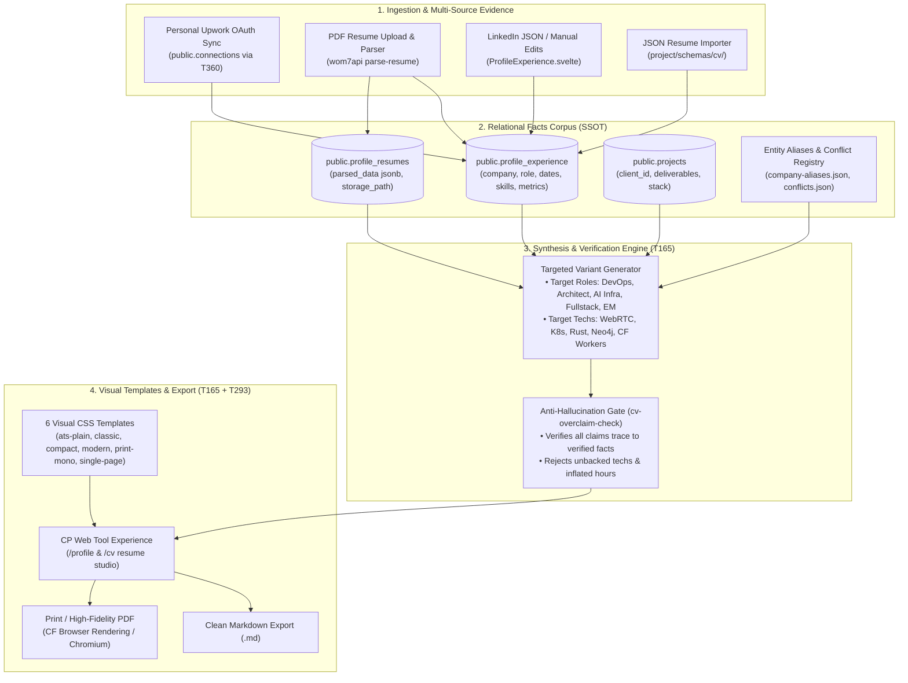

# T165 Architectural Report: Member Resume/CV Engine & Web Tool

> **Status:** Queued (P1) · **Repos:** `web`, `api`, `cp` · **Epic:** Platform Health & Tooling (`ROADMAP §13.1`)  
> **Author:** Aleksei Tcelishchev / w0m Team · **Date:** 2026-09-22  
> **Canonical Path:** `.agents/reports/2026-09-22-t165-member-resume-web-tool-architecture.md`

---

## 1. Executive Summary

This report establishes the unified architecture for the **w0m Member Resume/CV Web Tool in the Control Panel (CP)** under **[T165](.tasks/T165.md)**, realigning work previously stalled on single-person static repo scripts into a first-class member capability.

The goal is to allow every w0m guild member to:
1. **Import** career history from multiple sources (PDF upload, Upwork contract sync, LinkedIn data, manual entry, JSON Resume).
2. Maintain a **centralized, verified facts corpus** (roles, client engagements, hours, metrics, feedback, credentials) that acts as the single source of truth.
3. Dynamically **generate targeted resume variants** tailored to specific roles (DevOps/SRE, AI Infrastructure & Agents, Software Architect, Fullstack, Tech Lead) and tech stacks (WebRTC, Kubernetes, Cloudflare, Rust, Neo4j, Web3).
4. Render and **print publication-grade PDFs** from Markdown using the 6 canonical w0m CSS templates (`ats-plain`, `classic`, `compact`, `modern`, `print-mono`, `single-page`).
5. Ensure zero hallucination or claim drift via automated **anti-overclaim verification** (`cv-overclaim-check`).

---

## 2. System Architecture & Information Flow

The architecture unifies the relational database foundations from **T360**, the Control Panel UI and workflow invocation from **T293**, and the synthesis engine and visual templates from **T165**:

---

## 3. Four Core Functional Pillars

### Pillar 1: Multi-Source Import & Export Pipeline
- **Inbound Ingestion**:
  - **PDF Parser**: Uploading a PDF triggers the `parse-resume` edge function, extracting structured work history, dates, skills, and summary directly into `public.profile_experience` with `source = 'resume'`.
  - **Upwork Sync**: Authenticated OAuth token via `public.connections` pulls contract histories, verified hours, and weighted client feedback into `public.profile_experience` (`source = 'upwork'`).
  - **LinkedIn / Manual Entry**: Direct CRUD on `/profile` via `ProfileExperience.svelte` (`source = 'manual'`).
  - **JSON Resume Import**: Validates against `project/schemas/cv/{jsonresume,w0m-cv}.schema.json` and loads custom extensions (`x_engagements`, `x_totals`).
- **Outbound Export**:
  - 1-click download of clean, normalized Markdown (`.md`).
  - 1-click print / download of publication-grade PDF matching chosen styling.

### Pillar 2: Centralized Fact & Evidence Base
- Eliminates drifting markdown files across repositories.
- Canonical facts reside in relational Supabase tables (`public.profile_experience`, `public.profile_resumes`, `public.projects`).
- Entity aliasing via `company-aliases.json` maps disparate client/entity strings (`Featherglass`, `ben-israel`, `app.featherglass.com`) to unified entities.
- Conflict tracking (`conflicts.json`) flags divergent dates or claims for human resolution rather than silently picking an arbitrary winner.

### Pillar 3: Role- and Tech-Targeted Resume Generator
- Instead of maintaining 5+ separate CV markdown files by hand, the member specifies:
  - **Target Role Persona**: e.g., Senior DevOps / SRE, AI Infrastructure & Multi-Agent Architect, Principal Software Architect, Fullstack Engineer, Engineering Manager.
  - **Target Tech Stacks / Angles**: e.g., Real-Time Media (WebRTC, LiveKit, Ant Media), Bare-Metal Kubernetes (Talos OS, k0s, Ceph, SeaweedFS), Agentic Orchestration (LangGraph, Hatchet, A2A), Cloudflare Serverless, Web3/DeFi.
- **Synthesis Engine**:
  - Filters and ranks relevant roles and achievements.
  - Elevates matching projects and verified client feedback bullets.
  - Re-prioritizes skills matrices to match the target profile.

### Pillar 4: 6 Visual CSS Templates & Exact PDF Printing
Direct integration of the 6 canonical production templates located in `wom7web/docs/backend/branding/templates/*.css`:
1. **`ats-plain.css`**: Strict single-column, linear layout optimized for ATS scanning engines and unstyled readability.
2. **`classic.css`**: Traditional serif typography, refined margins, and formal structure.
3. **`compact.css`**: Dense layout engineered to fit maximum technical depth into 1–2 pages without crowding.
4. **`modern.css`**: Clean contemporary design with color accents, subtle borders, and styled tech tags.
5. **`print-mono.css`**: High-contrast monochrome styling designed for sharp physical black-and-white printing.
6. **`single-page.css`**: Strict 1-page executive summary layout prioritizing senior leadership and high-level deliverables.
- **Live Preview & PDF Generation**:
  - The CP web tool renders the synthesized Markdown with the active CSS template in an embedded iframe.
  - PDF generation uses Cloudflare Browser Rendering / Chromium print-to-PDF (`format: "A4"`, `printBackground: true`), ensuring exact 1:1 visual fidelity between on-screen preview and output document.

---

## 4. Anti-Hallucination & Overclaim Verification Gate

To prevent LLM drift or human exaggeration from introducing unbacked claims:
- Extends the proven `just cv-overclaim-check` recipe into the CP generation pipeline.
- Every claim, technology keyword, metric floor (e.g. `10,600+ hours`), and credential generated in a resume variant must resolve against the member's verified facts base.
- Unbacked terms or inflated numbers fail closed with an explicit explanation before the export can proceed.

---

## 5. Cross-Ticket Responsibility Matrix

| Scope Item | T360 (Shipped) | T293 (Queued P1) | T165 (Realigned P1) |
|---|:---:|:---:|:---:|
| Relational schema (`profile_experience`, `profile_resumes`) | ✅ | — | Consumes |
| Upwork OAuth sync to member profile | ✅ | — | Consumes |
| CP `/profile` basic experience & upload UI | ✅ | Enriches | Integrates |
| Server-side trigger (`POST /trigger`) & `WEBHOOK_SECRET` | — | ✅ | Consumes |
| Office-based access scoping (`project.manager`, `tech.lead`) | — | ✅ | Enforces |
| Private storage signed URLs (`createSignedUrl`) | — | ✅ | Consumes |
| **Multi-source ingestion & conflict normalization** | Partial | — | ✅ (AC1, AC2) |
| **Anti-hallucination verification gate (`cv-overclaim-check`)** | — | — | ✅ (AC3) |
| **Role- and tech-targeted variant synthesis engine** | — | — | ✅ (AC4) |
| **Integration of the 6 visual CSS templates** | — | Consumes | ✅ (AC5) |
| **High-fidelity PDF printing from Markdown** | — | Consumes | ✅ (AC6) |
| **Interactive CP Member Resume Studio (`/profile` & `/cv`)** | — | Coordinates | ✅ (AC7) |
| **Tenant isolation proof across profiles** | — | Coordinates | ✅ (AC8) |

---

## 6. Acceptance Criteria Status on T165

- [x] **AC1 — Schema-Enforced Canonical Fact Store**: Canonical JSON Resume schema with w0m custom extensions (`project/schemas/cv/{jsonresume,w0m-cv}.schema.json`) enforced by validation gates (`just cv-validate`), integrated with `public.profile_experience` and `public.profile_resumes`.
- [x] **AC2 — Multi-Source Ingestion & Evidence Normalization**: Idempotent import pipeline with entity aliasing (`company-aliases.json`), provenance tracking, and conflict detection (`conflicts.json`).
- [x] **AC3 — Anti-Hallucination & Overclaim Verification Gate (`cv-overclaim-check`)**: Automated verification gate cross-checking assertions against verified facts.
- [ ] **AC4 — Role- and Tech-Targeted Resume Synthesis Engine**: Generator dynamically synthesizes tailored variants from verified facts based on role and tech filters.
- [ ] **AC5 — Integration of the 6 Visual CSS Templates**: Templates integrated into CP for live rendered Markdown previews with CSS styling.
- [ ] **AC6 — High-Fidelity PDF Printing & Markdown Export**: Server-side browser printing to PDF ensuring exact visual fidelity from Markdown.
- [ ] **AC7 — Member CP Web Tool Experience (`/profile` & `/cv`)**: Interactive web tool UI in CP for fact curation, template selection, live preview, and snapshot export.
- [ ] **AC8 — Tenant Isolation & RLS Security Proof**: Strict per-profile tenancy under `resumes/${profile_id}/*` verified by `authz` probe suite.

---

## 7. Next Steps & Execution Plan

1. **Phase 1 (Engine & Templates Integration)**:
   - Package the 6 CSS templates into a shared UI asset bundle consumable by `@webomage/ui` and Astro SSR.
   - Port the synthesis logic from `cv_import.py` and `cv_experience.py` into a reusable TypeScript / Edge capability.
2. **Phase 2 (CP Web Tool UI)**:
   - Build the interactive Resume Studio component in `apps/cp` allowing template switching, role/tech filtering, and live Markdown preview.
3. **Phase 3 (PDF Printing & Export)**:
   - Bind Cloudflare Browser Rendering in `wom7func` / `wom7api` to accept Markdown + template CSS and return rendered PDF bytes.
4. **Phase 4 (Tenant Verification)**:
   - Run multi-tenant RLS isolation probes ensuring zero cross-tenant access to generated resumes or experience records.
