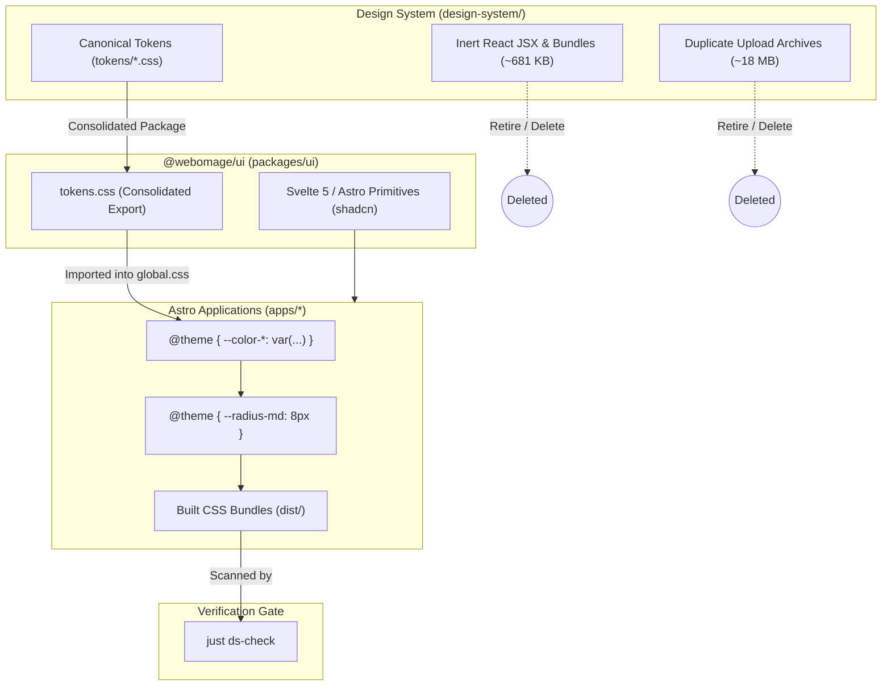
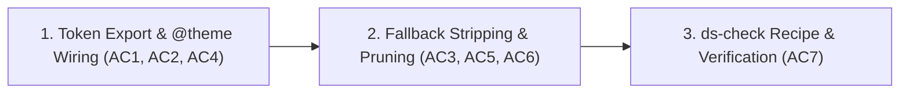

# T420 Start Brief & Specification: Design System & Shipping Code Reconciliation

## 1. Executive Summary

Ticket [T420](../../.tasks/T420.md) reconciles the Webomage Design System (`wom7web/design-system/`) with shipping Astro + Svelte 5 production applications (`apps/web`, `apps/cp`, `apps/join`, `apps/job`) and the `@webomage/ui` runtime component library.

---

## 2. Verified Baseline & Reality Gaps

| Area | Current Reality | Desired Target State | Resolution in T420 |
|---|---|---|---|
| **Shadcn Color Utilities** | `apps/web/src/styles/global.css` declares only 6 colors in `@theme`; utilities like `.text-muted-foreground`, `.bg-primary`, `.border-input` emit 0 rules in `dist/`. | All 12 shadcn semantic color pairs declared in `@theme` and resolving to design system CSS variables. | **AC1**: Complete `@theme` color declaration in `apps/web` and `apps/cp`. |
| **Button Radius Scale** | `design-system/tokens/effects.css` declares 8px (`--radius-md: 0.5rem`), but Tailwind defaults to 6px (`0.375rem`). | All buttons, inputs, and cards render with the specified 8px radius. | **AC2**: Pin `--radius: 0.625rem` and `--radius-md: calc(var(--radius) - 2px)`. |
| **Component Inline Fallbacks** | 32 component locations use hardcoded fallback literals (e.g. `var(--text-muted, #e5e7eb)`). | Clean token variables without hardcoded hex fallbacks. | **AC3**: Declare foundation tokens in `tokens.css` and strip literals. |
| **Token Distribution** | Tokens scattered across `design-system/tokens/*.css` with no unified export. | Single `@webomage/ui/tokens.css` package export imported into `global.css`. | **AC4**: Package and export `tokens.css` via `@webomage/ui`. |
| **Inert React Payload** | `design-system/components/` holds 26 `.jsx` files and legacy bundles (`_ds_bundle.js`). Product stack is 100% Astro + Svelte 5. | Zero `.jsx` files and zero React bundles in `design-system/`. | **AC5**: Retire dead React components, bundles, and templates. |
| **Stale Upload Archives** | `design-system/uploads/` and hash-suffixed files consume ~18 MB of disk space. | Clean design system repo with language-neutral tokens and specs only. | **AC6**: Remove `design-system/uploads/` and unreferenced duplicate files. |
| **Verification Gate** | No automated check verifies that built CSS contains design system utilities. | Automated `just ds-check` scans `dist/` and verifies 100% token rule emission. | **AC7**: Implement `scripts/ds_check.py` and register `just ds-check`. |

---

## 3. Specification Breakdown (`openspec/changes/2026-09-22-design-system-reconciliation/`)

The formal OpenSpec change is committed and passes `just spec-standard` with all 7 requirements conforming to the w0m authoring standard:

1. **Full Shadcn Color Contract in Tailwind v4 Theme**:
   - Variables: `--color-primary`, `--color-primary-foreground`, `--color-secondary`, `--color-secondary-foreground`, `--color-muted`, `--color-muted-foreground`, `--color-accent`, `--color-accent-foreground`, `--color-card`, `--color-card-foreground`, `--color-popover`, `--color-popover-foreground`, `--color-border`, `--color-input`, `--color-ring`, `--color-destructive`, `--color-destructive-foreground`.
2. **Canonical Radius Scale Enforcement**:
   - Pins `--radius: 0.625rem` (10px) and `--radius-md: calc(var(--radius) - 2px)` (8px).
3. **Fallback Token Elimination and Foundation Tokens**:
   - Canonically defines `--text-primary`, `--text-body`, `--text-muted`, `--text-secondary`, `--text-on-brand`, `--font-sans`, `--warning`, and `--warning-rgb`.
4. **Central Token CSS Distribution via `@webomage/ui`**:
   - Aggregates `colors.css`, `typography.css`, `spacing.css`, and `effects.css` into `packages/ui/src/styles/tokens.css`.
5. **Inert React Asset Retirement**:
   - Prunes `design-system/components/**/*.jsx`, `_ds_bundle.js`, `support.js`, `templates/*.dc.html`, and `ui_kits/web/`.
6. **Design System Workspace Streamlining**:
   - Prunes `design-system/uploads/` while strictly preserving token stylesheets, specs, and TypeScript types.
7. **Automated Design System Token Verification Recipe**:
   - Establishes `scripts/ds_check.py` and recipe `just ds-check`.

---

## 4. Implementation Plan (`w0m-sdlc-build`)

1. **Step 1: Tokens & Theme Wiring**:
   - Consolidate `design-system/tokens/*.css` into `packages/ui/src/styles/tokens.css`.
   - Update `packages/ui/package.json` exports map to include `"./tokens.css": "./src/styles/tokens.css"`.
   - Update `apps/web/src/styles/global.css` and `apps/cp/src/styles/global.css` to import `@webomage/ui/tokens.css` and expand `@theme`.
2. **Step 2: Fallback Removal & Inert Code Pruning**:
   - Remove inline hardcoded fallbacks across the 32 component locations.
   - Delete `design-system/components/**/*.jsx`, bundles, and `design-system/uploads/`.
3. **Step 3: Automated Verification**:
   - Create `scripts/ds_check.py` to inspect `dist/` CSS bundles for utility selectors and 8px `--radius-md`.
   - Wire `just ds-check` into root `justfile`.
   - Run `pnpm build` across apps and confirm `just ds-check` passes 100% green.
