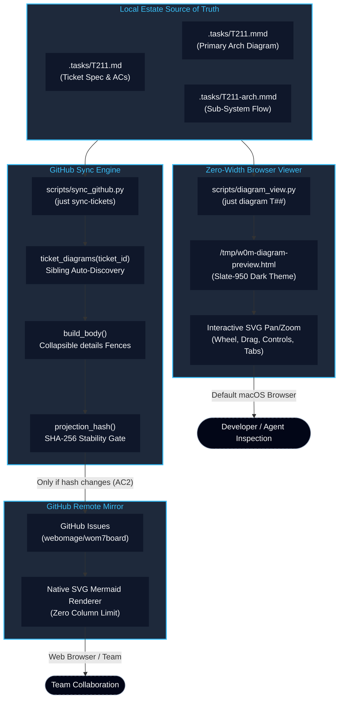

# T211 Architecture Report — Ticket Diagram Co-location, GitHub Sync & Zero-Width Browser Viewer

**Ticket**: [`.tasks/T211.md`](file:///Users/proto/Projects/@self/@wom/.tasks/T211.md) · **Status**: `done` (6/6 ACs verified) · **Reality Audit**: ✅ 4/4 agree  
**Spec**: [`wom7web/openspec/changes/archive/2026-09-24-ticket-diagram-colocation-and-sync`](file:///Users/proto/Projects/@self/@wom/wom7web/openspec/changes/archive/2026-09-24-ticket-diagram-colocation-and-sync/proposal.md)  
**Commits**: Root monorepo `fb4cb17`, `wom7web` `7e69e374` & `e96c592e`

---

## 1. Problem Solved

In terminal and TUI coding agents (Orca, Claude Code CLI, AGY terminal), narrow column limits (<100 columns) truncate Mermaid diagrams into degraded ASCII art or unreadable wraps. Furthermore, generating diagrams only at the end of sessions in post-session reports risked losing them if sessions exhausted quota or disconnected mid-flight, and detached diagrams from the ticket single source of truth.

## 2. Delivered Architecture & Capabilities

### Key Components

1. **Sibling Co-location (`.tasks/T{id}*.mmd`)**:
   - Tickets can carry any number of sibling diagrams named `T{id}.mmd` (primary) or `T{id}-*.mmd` (specific subsystems).
   - Co-located diagram for this ticket created at [`.tasks/T211-arch.mmd`](file:///Users/proto/Projects/@self/@wom/.tasks/T211-arch.mmd).

2. **GitHub Issue Projection (`scripts/sync_github.py`)**:
   - [`ticket_diagrams(ticket_id)`](file:///Users/proto/Projects/@self/@wom/scripts/sync_github.py#L259-L300): Discovers sibling diagrams, sorts primary `T{id}.mmd` first, and strips accidental markdown code fences.
   - [`build_body()`](file:///Users/proto/Projects/@self/@wom/scripts/sync_github.py#L302-L330): Appends diagrams in collapsible `

📊 {Title}
` blocks with native GitHub Mermaid fences.
   - **Byte-Identical Hash Stability (AC2)**: Tickets without `.mmd` files produce byte-identical bodies and hashes (`skipped=421`, zero unwanted GitHub API calls).

3. **Zero-Width Browser Viewer (`scripts/diagram_view.py` & `just diagram`)**:
   - Compiles diagrams into standalone HTML (`/tmp/w0m-diagram-preview.html`) styled in Webomage dark theme (`slate-950` canvas `#020617`, text `#f8fafc`).
   - Full interactive pan/zoom (wheel zoom towards mouse pointer, drag to pan, keyboard shortcuts `+`/`-`/`0`, reset button).
   - Multi-diagram tab navigation when a ticket has multiple diagrams.
   - Fails closed with exit code 1 and explicit diagnostics on missing tickets or empty diagram files.

---

## 3. Verification & Quality Gates

| Gate / Suite | Command | Result |
|---|---|---|
| **Sync Regression Suite** | `just sync-tickets-test` | ✅ 59/59 checks passed |
| **Diagram Viewer Suite** | `just diagram-test` | ✅ 7/7 tests passed |
| **Ticket Schema Check** | `just ticket-schema-check` | ✅ 0 error(s) |
| **DoD Enforcement** | `just dod-check --ticket T211` | ✅ Clean DoD ownership |
| **Ticket Reality Audit** | `just ticket-audit T211` | ✅ 4/4 agree, 6/6 ACs confirmed |
| **State Consistency** | `just state-check` | ✅ Green (193 open tickets, 5 gates) |
