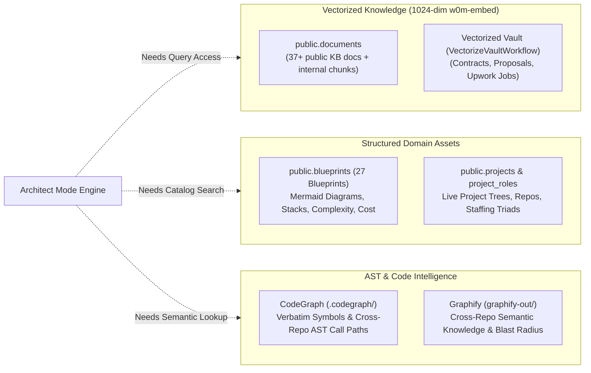

# Architectural Audit: AI Agent Embedding, Vector Store Assets, and Architect Mode Augmentation

**Date:** 2026-09-26  
**Author:** Antigravity  
**Ticket:** [[T462]]  
**Estate Scope:** `wom7web` (`apps/web`, `apps/cp`), `wom7api` (Edge Functions, DB, Vector Store), `wom7func` (Workers, Workflows)  
**Status:** Review & Target Architecture Proposal  

---

## 1. Executive Summary

This audit examines how AI agents are currently constructed, integrated, and embedded across the **public website** (`apps/web`), the **Control Panel** (`apps/cp`), and **backend capabilities** (`wom7api`). It validates the user's insight: **Architect Mode is currently disconnected from the estate's indexed, vectorized, and classified data assets.**

- **Current State:** 
  - The public consultant (`agent-consultant`) uses pgvector RAG (`match_documents`) over 1024-dimensional embeddings, but only accesses a limited set of public text chunks.
  - The technical architect (`agent-architect`) runs zero-shot LLM completions with static system prompts. It performs **zero retrieval**, queries no vector stores, references no blueprints, and has no tool access.
- **The Opportunity:**
  - w0m already maintains rich, classified knowledge assets: `public.documents` (pgvector 1024-dim), 27+ production blueprints with validated Mermaid diagrams, vectorized past client contracts and proposals, and AST/semantic code graphs (`codegraph`, `graphify`).
  - By upgrading Architect Mode to query this indexed data, the agent can generate grounded **Project Manifestos**, cite real production blueprints, embed validated Mermaid architecture diagrams, and evaluate proposals against past contract history.

---

## 2. Current Agent Embedding Topology

Both `apps/web` and `apps/cp` embed AI agents using a unified component architecture driven by client-side modes and server-side Edge Functions:

```mermaid
flowchart TD
    subgraph Frontend["Frontend Surfaces (ChatApp.svelte)"]
        UI_WEB["apps/web: ChatApp.svelte<br/>(Floating Widget + /chat)"]
        UI_CP["apps/cp: ChatApp.svelte<br/>(ChatWidget.astro)"]
    end

    subgraph Modes["Client Mode Switcher"]
        M_CONSULT["mode = 'consultant'<br/>(Default Public / Guest)"]
        M_ARCH["mode = 'architect'<br/>(Client / Member / Manager)"]
        M_ADMIN["mode = 'admin'<br/>(Active Admin Hat Only)"]
    end

    subgraph Backend["Edge Runtime (wom7api/supabase/functions/)"]
        EF_CONSULT["agent-consultant<br/>(chat-core.ts)"]
        EF_ARCH["agent-architect<br/>(index.ts)"]
    end

    subgraph RAG_Data["Retrieval Data Layer"]
        RPC_MATCH["Postgres RPC: match_documents()<br/>(pgvector cosine distance)"]
        DOCS["public.documents<br/>(vector 1024-dim, access_scope)"]
    end

    UI_WEB --> Modes
    UI_CP --> Modes

    M_CONSULT -->|POST { query }, scope: 'ai-agent'| EF_CONSULT
    M_ADMIN -->|POST { query }, scope: 'internal'| EF_CONSULT
    M_ARCH -->|POST { action: 'scaffold-manifesto' }| EF_ARCH

    EF_CONSULT -->|1. Generate w0m-embed| RPC_MATCH
    RPC_MATCH -->|2. Cosine similarity > 0.4| DOCS
    DOCS -->|3. Context injection| EF_CONSULT

    EF_ARCH -.->|🔴 ZERO RETRIEVAL<br/>No RAG, No vector lookup| DOCS
```

### A. Surface Implementations

1. **Public Website (`apps/web/src/components/ChatApp.svelte`):**
   - Mounted globally across the site as a floating widget and on `/chat` as a full-screen application.
   - Client mode switcher offers:
     - `consultant`: General services and portfolio inquiries (public).
     - `architect`: Scoping and manifesto generation (available to guests and authenticated users).
     - `admin`: Offered only if `/api/auth/me` resolves an active `admin` hat.
2. **Control Panel (`apps/cp/src/components/ChatApp.svelte`):**
   - Mounted in `ChatWidget.astro` for logged-in operators, managers, and clients.
   - Identical UI structure, but mints session IDs prefixed with `cp:` to isolate operator memory.

### B. Backend Edge Function Implementations

| Edge Function | Purpose | Retrieval / RAG | Model Routing | Output Format |
|---|---|:---:|---|---|
| **`agent-consultant`** | Public and internal sales/support assistant | **Yes** (`match_documents` via `chat-core.ts`) | `routeChat` (llama-3.1-8b / gemma / Claude) | SSE Stream (`text/event-stream`) |
| **`agent-architect`** | Scoping, Project Manifestos, SEO, SVG/Mermaid | 🔴 **None** (pure zero-shot prompt) | `routeChat` (`ai_personas.agent-architect`) | JSON (`{ output, usage }`) |
| **`chat-internal`** | Internal automation (Slack/Telegram hooks) | Optional (prompt-defined) | `routeChat` | JSON |

---

## 3. Discovered Architectural Seams & Gaps

1. **`agent-architect` is Completely "Blind" to the Knowledge Base:**
   - In `supabase/functions/agent-architect/index.ts`, requests with `action: 'scaffold-manifesto'` simply stringify the user prompt into:
     ```ts
     const messages = [
       { role: "user", content: context ? `Context: ${context}\n\nPrompt: ${prompt}` : prompt },
     ];
     ```
   - It performs **no vector embedding**, calls **no search RPCs**, and never retrieves existing blueprints or past delivery history.
2. **Database Support Exists but is Unused:**
   - In PostgreSQL, the `match_documents` function has already been coded to allow `ai-architect`:
     ```sql
     WHERE (p_agent_role IN ('internal', 'ai-architect', 'ai-admin'))
     ```
   - The database permissions were designed for the architect agent to read internal and architect-scoped documents, but the edge function never executes the RPC.
3. **Admin Mode Divergence:**
   - In `ChatApp.svelte`, switching to `"admin"` mode switches the scope of `agent-consultant` to `"internal"`.
   - However, `agent-consultant`'s system persona is conversational support, not technical system architecture.
   - When an admin selects **Architect Mode**, they expect deep architectural grounding (system blueprints, component diagrams, estate stacks), but get an ungrounded zero-shot text generator.

---

## 4. The Estate's Indexed, Vectorized, and Classified Data Assets

w0m possesses substantial indexed knowledge that is ready to be queried by Architect Mode:



### 1. Vectorized Documents Store (`public.documents`)
- **Dimensions & Model:** 1024-dimensional native vectors generated by canonical `w0m-embed` (`@cf/baai/bge-m3`).
- **Indexing:** PostgreSQL `ivfflat` cosine index (`lists = 100`).
- **Access Scopes:** `public`, `internal`, `archive`, `ai-agent`, `ai-architect`, `ai-admin`.
- **Content:** Service offerings, cloud infrastructure whitepapers, verified CV records, and technical process standards.

### 2. Historical Contracts & Proposals (`VectorizeVaultWorkflow`)
- Cloudflare Workflow in `wom7api/src/workflows/vectorize-vault.ts`.
- Automatically vectorizes historical Upwork contracts, proposals, and client specifications into `public.documents` with `access_scope = 'internal'`.
- Contains real pricing, technical stack choices, timeline estimates, and scope definitions from 98+ engagements.

### 3. Production Blueprints Catalog (`public.blueprints` / `blueprints.json`)
- 27 production-ready system architectures.
- Each blueprint contains:
  - Technical complexity rating (`low`, `medium`, `high`, `enterprise`).
  - Estimated budget and team size.
  - Recommended tech stack tags (`nextjs`, `astro`, `cloudflare`, `supabase`, `k8s`, `telegraf`, etc.).
  - **Validated Mermaid Architecture Diagram** (`diagram_mmd`).
  - Detailed Markdown implementation plan (`content_md`).

### 4. Code & Architecture Graphs (`codegraph` & `graphify`)
- Indexed AST of all 7 estate repositories (`wom7web`, `wom7api`, `wom7func`, `wom7ext`, `wom7sec`, `wom7skills`, `wom7mlx`).
- Graphify semantic knowledge graph exposing god nodes, concept communities, and call paths.

---

## 5. Target Architecture: Supercharging Architect Mode

To make Architect Mode truly capable of serving clients, managers, and admins, it should be upgraded into an **Augmented Technical Architecture Agent**:

```mermaid
sequenceDiagram
    autonumber
    actor Admin as Admin / Architect User
    participant UI as ChatApp.svelte (Architect Mode)
    participant Edge as agent-architect (Edge Function)
    participant Embed as Workers AI (w0m-embed 1024-dim)
    participant PG as PostgreSQL (pgvector + blueprints)
    participant LLM as AI Router (Claude 3.5 Sonnet / Llama 3.3)

    Admin->>UI: "Scope a high-scale RAG system with real-time video"
    UI->>Edge: POST /agent-architect { input, action: 'scaffold-manifesto', scope: 'internal' }
    
    rect rgb(20, 35, 60)
        Note over Edge,PG: Step 1: Retrieval & Classification Lookup
        Edge->>Embed: Embed prompt into 1024-dim vector
        Embed-->>Edge: query_embedding
        Edge->>PG: match_documents(query_embedding, threshold=0.4, p_agent_role='ai-architect')
        PG-->>Edge: Top 5 matching KB & Contract chunks
        Edge->>PG: Search blueprints WHERE tags && query_tags
        PG-->>Edge: Matching Blueprints (e.g. ai-multia-rag-firebase + diagram_mmd)
    end

    rect rgb(25, 45, 30)
        Note over Edge,LLM: Step 2: Grounded Synthesis
        Edge->>LLM: routeChat(messages + Vector Chunks + Blueprint Mermaid + Persona)
        LLM-->>Edge: Streamed/Synthesized Manifesto with real stack, costs, & verified Mermaid diagram
    end

    Edge-->>UI: Complete Project Manifesto (Markdown + Mermaid + Cites)
    UI-->>Admin: Render interactive architecture with zoomable Mermaid diagram
```



### Key Capabilities of the Upgraded Architect Mode:

1. **Dual-Tier Grounding (Vector + Catalog):**
   - **Vector Search:** Queries `match_documents` with `p_agent_role = 'ai-architect'`, retrieving internal whitepapers and past project deliverables.
   - **Catalog Search:** Matches against `public.blueprints` by tags and semantic similarity, extracting existing production-tested Mermaid diagrams.
2. **Mermaid Diagram Insertion from Real Blueprints:**
   - Rather than letting the LLM generate unverified, hallucinated Mermaid syntax from scratch, the architect can incorporate or adapt tested diagrams from the blueprint catalog (validated via `wom7skills/mmd-validate`).
3. **Realistic Estimation Grounded in Historical Contracts:**
   - By referencing vectorized contract data (`VectorizeVaultWorkflow`), the estimated timelines and budgets reflect actual delivered projects rather than generic LLM estimates.
4. **Admin vs Client Visibility Partitioning:**
   - **Client/Lead in Architect Mode:** Receives public/sanitized recommendations, blueprint options, and public portfolio case studies.
   - **Admin in Architect Mode:** Has access to internal contract margins, developer hourly rates, private estate blueprints, and CodeGraph architectural paths.

---

## 6. Implementation Action Plan

To implement this capability cleanly within the w0m SDLC:

| Step | Action | Repository | Gate / Ticket Target |
|---|---|---|---|
| **1. Edge Function RAG Wiring** | Update `supabase/functions/agent-architect/index.ts` to call `routeEmbed('w0m-embed')` and `match_documents` when generating manifestos. | `wom7api` | New SDLC Ticket (`T###`) |
| **2. Blueprint Retrieval RPC** | Add a helper RPC in PostgreSQL (`match_blueprints`) to query blueprints by vector similarity and tag overlap. | `wom7api` | Migration |
| **3. Streaming Support for Architect** | Upgrade `agent-architect` to support Server-Sent Events (`SSE`) streaming, matching `agent-consultant`. | `wom7api` / `wom7web` | Feature |
| **4. Frontend Mode Unification** | Ensure `ChatApp.svelte` in both `apps/web` and `apps/cp` renders streaming architect responses with Mermaid diagrams. | `wom7web` | UI Component |
| **5. Graphify / CodeGraph MCP Bridge (Admin Only)** | Allow Admin Architect Mode to invoke CodeGraph / Graphify summaries for inquiries regarding estate code. | `wom7web` / `wom7api` | Admin Feature |
