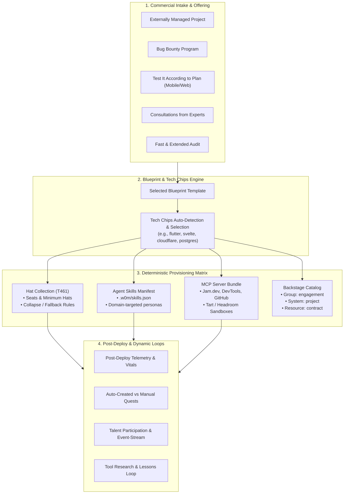
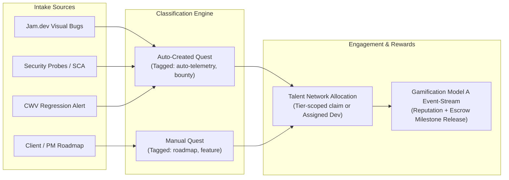

# Blueprint-Driven Project Creation Matrix & Commercial Delivery Architecture

> **Date:** 2026-09-26  
> **Status:** Proposed Architecture & Blueprint Specification  
> **Anchors:** [[AgDR-0026]] (Backstage Entity Standard), [[AgDR-0027]] (Platform, Orgs, Persons), [[AgDR-0028]] (Engagements & Hats), [[T458]] (Org Model), [[T461]] (Hat Collections & Fallback Rules)  
> **Permanent Copies:** `.agents/reports/2026-09-26-project-creation-templates-commercial-matrix-and-observability.md` · `wom7web/docs/reports/2026-09-26-project-creation-templates-commercial-matrix-and-observability.md`

---

## 1. Executive Summary & Core Concept

In w0m's next evolutionary stage, creating a project in the Control Panel (CP) must not be an empty form. Instead, project creation serves as the **bridge between commercial offerings and autonomous execution**.

A project is instantiated from a **Blueprint / Archetype Template** that deterministically configures four synchronized layers:
1. **Tech Chips Set** (`flutter:mobile`, `astro:ssr`, `svelte:5`, `cloudflare:workers`, `supabase:postgres`, etc.).
2. **Engagement & Hat Collection** (under [[T461]] & [[AgDR-0028]], specifying active seats and fallback/collapse rules).
3. **Agent Skills Manifest** (which canonical w0m agent skills are provisioned in `.w0m/skills.json`).
4. **Agent MCP Servers Bundle** (which Model Context Protocol endpoints the agent sandboxes receive).



---

## 2. The 5 Commercial Archetypes & Provisioning Matrix

| Offering / Archetype | Commercial Description | Tech Chips Set | Hat Collection & Fallback (T461) | Agent Skills Bundle | MCP Servers Bundle |
|---|---|---|---|---|---|
| **1. Externally Managed Project** | Client brings their own PM/TL; w0m provides elite execution talent, automated pods, and infrastructure guardrails. | Detected from client repo (e.g., `react`, `node`, `aws`, `docker`). | • `client` (sponsor)<br/>• `external_pm` (client PM)<br/>• `dev` (w0m talent/agent)<br/>• `qa` (optional)<br/>• `devops` (optional)<br/>*Rule:* No w0m PM; devops stays strictly root-guarded. | `modern-web-guidance`<br/>`doubt-driven-development`<br/>`observability-and-instrumentation`<br/>`fact-checker` | • `github`<br/>• `mcp.jam.dev`<br/>• `cloudflare` / client cloud |
| **2. Bug Bounty Program** | Continuous security and bug-hunting engagement open to network or filtered talent tiers (`active`, `senior`). Pay-per-verified-issue. | Target app stack chips (`web`, `mobile`, `api`, `auth:oidc`). | • `sponsor` (client)<br/>• `bounty_triager` (TL/PM triage hat)<br/>• `hunter` (network pool)<br/>*Rule:* Triage reviews proofs; approved bugs auto-convert to paid milestones. | `rbac-auditor`<br/>`security-guardrails`<br/>`playwright-testing`<br/>`troubleshooting` | • `mcp.jam.dev`<br/>• `chrome-devtools`<br/>• `github`<br/>• `headroom` sandbox |
| **3. Test It According to Plan** | Structured test execution across device matrices (Flutter mobile, iOS, Android, cross-browser Web). Verification of user journeys. | `flutter:mobile`<br/>`dart`<br/>`android:apk`<br/>`ios:ipa`<br/>`playwright:vrt` | • `client`<br/>• `qa_lead` (test plan designer)<br/>• `test_runner` (device tester)<br/>*Rule:* QA collapses into TL if unstaffed; runs device test matrix. | `a11y-debugging`<br/>`debug-optimize-lcp`<br/>`playwright-testing`<br/>`fact-checker` | • `flutter-driver` / `adb-mcp`<br/>• `mcp.jam.dev`<br/>• `playwright`<br/>• `chrome-devtools` |
| **4. Consultations from Experts** | Short, high-impact architectural spike, migration plan, or system redesign (1–3 days). | Target architecture chips (`database:pg`, `infra:k8s`, `rag:vector`). | • `client`<br/>• `architect` (`tech.lead` / `delivery.manager`)<br/>*Rule:* Minimal 2-party engagement; single worn hat for advisor. | `feynman`<br/>`steve-jobs`<br/>`think`<br/>`socrates`<br/>`schema-critique`<br/>`torvalds` | • `codegraph`<br/>• `graphify`<br/>• `memory`<br/>• `mcp-mermaid` |
| **5. Fast and Extended Audit** | Deep codebase, security, and RBAC audit. Automated `wom7sec` probe suites + human audit report with certified findings. | Full estate scanners (`sec:sast`, `sec:sca`, `rbac:rls`, `trufflehog`). | • `client` (read-only audit view)<br/>• `lead_auditor` (principal)<br/>• `sec_prober` (automated agent)<br/>*Rule:* Read-only access to source code; no production write grants. | `rbac-auditor`<br/>`security-guardrails`<br/>`torvalds`<br/>`doubt-driven-development`<br/>`fact-checker` | • `codegraph`<br/>• `graphify`<br/>• `github`<br/>• `supabase` |

---

## 3. Control Panel Project Creation Flow (T461 Integration)

The CP project wizard executes a 4-step synthesis:

```
[ Step 1: Archetype & Commercial Contract ]
  ├── Choose Offering: (e.g. "Test It According to Plan")
  └── Link Contract / Upwork Milestone / Payment Intent

[ Step 2: Tech Chips Profiler ]
  ├── Input Git Repository URL or paste stack description
  └── Auto-detect stack: [flutter:mobile] [supabase:postgres] [playwright:e2e]
      (User can toggle or add custom chips)

[ Step 3: Derivation Engine ]
  ├── Hat Collection (T461): [client, qa_lead, test_runner] (Fallback: qa_lead -> pm)
  ├── Skills Template: [playwright-testing, a11y-debugging, fact-checker]
  └── MCP Server Template: [mcp.jam.dev, chrome-devtools, github]

[ Step 4: One-Click Instantiation ]
  ├── Writes Backstage catalog-info.yaml & Supabase engagement record
  ├── Provisions project Sandboxed Tart VM / Headroom container
  └── Mounts Cloudflare Obsidian Vault (_msg/ communication channel)
```

---

## 4. Post-Deploy Observability & Quest Dynamics

To close the loop between engineering execution, deployment, and network compensation, w0m institutes **Release Measuring & Quest Telemetry**:

### 4.1. Automated Post-Deploy Release Measuring
Immediately upon deploy confirmation:
1. **Synthetic User Flow Health**: Playwright E2E smoke tests execute against production endpoints.
2. **Core Web Vitals & Runtime Telemetry**: LCP, INP, and CLS sampled via Tinybird / Cloudflare Analytics.
3. **Security Invariant Verification**: Red probes from `wom7sec` confirm that RLS and anonymous endpoint bounds hold live.

### 4.2. Auto-Created vs. Manually-Created Quests
w0m tracks task creation dynamics to ensure organic, autonomous self-healing:



- **Auto-Created Quests**:
  - Jam.dev visual bug reports automatically ingest network logs, console traces, and screen replays into a formatted bug quest.
  - Dependency/SCA vulnerabilities (Dependabot/OSV) generate remediation quests.
  - CWV or latency regressions spawn optimization quests with baseline targets.
- **Participation & Attribution**:
  - Tracks time-to-first-claim and time-to-resolution across AI agents and human talent.
  - Feeds into **Talent Network Tiering** (`applicant` → `trial` → `trainee` → `active` → `senior`).

---

## 5. Tooling Research Grounded in `LESSONS.md`

All tooling improvements across the 7 estate repos must be rooted in documented failure modes. The estate maintains strict rules derived from empirical postmortems:

1. **Avoid Metric Illusions (Lesson T266 / T331)**:
   - A gate that prints `"Checked 169 files"` must distinguish checked files from *relevant* files.
   - Tools must fail closed when expected input surfaces are missing or moved.
2. **Zero Silent Fallbacks (AgDR-0025)**:
   - Tooling must never fallback through multi-path search ladders or shadow symlinks.
   - If an MCP server, API token, or configuration key is invalid or revoked (e.g. Cloudflare R2 watchdog token), it must error loudly and immediately rather than silently doing nothing.
3. **Decoupled State Anti-Pattern (Lesson T89 / T430)**:
   - Tools must never maintain private, decoupled state stores that drift from git reality.
   - Everything travels with the repo: specs in `openspec/`, tickets in `.tasks/`, decisions in `docs/decisions/`.

---

## 6. Resolving Terminal Spam & `git grep` in Orca / Shells

### 6.1. The Root Cause of Terminal Flooding
Bare `git grep` commands in `wom7web` previously flooded Orca and shell terminal buffers due to two factors:
1. **Unexcluded Massive Generated Files**: `wom7web/docs/STATUS-DASHBOARD.html` is 5.09 MB and embeds every ticket in the project as JSON inside a single `<script>` tag. Any broad regex or keyword search (`AgDR`, `T117`, `supabase`) matches thousands of lines in this single file, outputting megabytes of text.
2. **Terminal Pager Traps**: `git grep` without `--no-pager` attempts to attach a pager, causing background agent tasks to hang or dump unbuffered chunks of output.

### 6.2. Concrete Remediation Rules
To ensure clean terminal output and prevent terminal overflow in Orca and developer shells:

1. **Strictly Enforce `just search`**:
   - Never run raw `git grep` from the workspace root or inside `wom7web`.
   - Use `just search "<pattern>"`, which automatically excludes noise (`STATUS-DASHBOARD.html`, `graphify-out/`, `reports/`, `*.lock`) and enforces a 200-hit cap.
2. **CodeGraph Before Grep**:
   - For symbol definitions and call flows, run `just ask "<symbols>"` or call MCP `codegraph_explore`. This searches AST graphs directly and avoids string-matching spam.
3. **Ignore Configuration for Orca & Ripgrep**:
   - Add `.ignore` / `.gitattributes` to ignore `STATUS-DASHBOARD.html` from search tools.
4. **Artifacts for Large Outputs**:
   - Any architectural report, system audit, or wide Mermaid diagram must be rendered as an Antigravity **Artifact** (`UserFacing: true`), preserving terminal chat for concise human dialogue.
