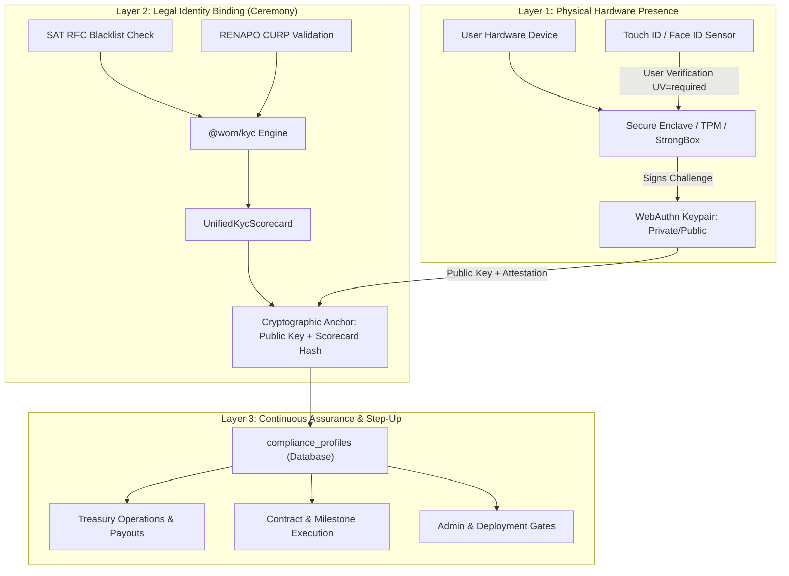

# Architectural Report: Biometrics for Auth as the Bridge into KYC

**Document ID:** `ARCH-KYC-BIO-001`  
**Date:** 2026-09-28  
**Author:** Antigravity (AI Assistant) & Aleksei (Platform Owner)  
**Status:** Architectural Proposal & Design  
**Referenced Tickets & Specs:** [[T100]] (AC9: Profile WebAuthn MFA), [[T349]] (w0m-kyc shared verified levels), [[T471]] (Cross-device presence confirmation gate), [[AgDR-0027]]  

---

## 1. Executive Summary: The Core Insight

> *"Actually if we can do biometrics for auth then it's the bridge into kyc."*

Historically, **Authentication (Auth)** and **Identity Verification (KYC)** operate as disconnected silos:

```
[ Traditional Siloed Model ]
User Onboarding ──> Email/OAuth Auth ──> Static KYC Document Upload ──> DB: kyc_status = 'verified'
                                                                               │
Daily Operations <────────────────────────────────────── Password / Cookie Session ◄── (Vulnerable to ATO, Sybil, Puppet accounts)
```

In the traditional model:
1. **Static Assurance**: A user undergoes KYC once (submitting Mexican CURP/RFC, government ID, or proof of address). A static row is written (`kyc_status = 'verified'`).
2. **Account Takeover & Sybil Vulnerability**: Subsequent sign-ins and sensitive transactions (treasury withdrawals, contract signatures, production deployments) rely only on standard bearer tokens or passwords. If the session cookie is stolen, or if an account is sold/rented, an unvetted third party operates a "KYC-verified" account.
3. **High-Friction Step-Up**: Requiring a user to re-submit identity documents for high-value actions is unusable.

### The Biometric Bridge
By anchoring authentication in **Hardware Biometrics** (WebAuthn / FIDO2 platform authenticators: Apple Touch ID, Face ID, Windows Hello, Android Biometrics) backed by the device **Secure Enclave / TPM**, biometric auth becomes the **live cryptographic bridge into continuous KYC**:

```
[ Biometric-Anchored KYC Bridge ]
┌───────────────────────────┐      Cryptographic Binding Ceremony      ┌───────────────────────────┐
│     Hardware Enclave      │ ───────────────────────────────────────> │      Legal Identity       │
│  Touch ID / Face ID       │   (Public Key Attestation + CURP/RFC)    │  SAT RFC / CURP / Gov ID  │
│  (FIDO2 / WebAuthn AAL3)  │                                          │  (@wom/kyc Verification)  │
└───────────────────────────┘                                          └───────────────────────────┘
              │                                                                      │
              ▼                                                                      ▼
    Continuous Step-Up: 1-Tap Biometric Prompt = Real-Time Proof of Verified Legal Person
```

When an enrolled biometric key is cryptographically bound to a verified KYC record:
- **Zero Raw Biometric Storage (Privacy-by-Design)**: Raw fingerprints and facial scans never leave the device hardware enclave. The platform only stores the public key and device attestation.
- **Continuous Real-Time KYC**: Privileged operations (treasury disbursements, contract commitments, enterprise outstaffing assignments) require a 1-second biometric challenge, instantly proving that the *physically verified individual* is executing the action.
- **Sybil Resistance**: A hardware key pair generated in a device enclave cannot be duplicated across multiple puppet accounts without explicit multi-device attestation.

---

## 2. The 3-Tier Identity & Assurance Architecture



### Layer 1: Hardware-Anchored Biometric Authenticator
- **Standard**: W3C WebAuthn Level 3 / FIDO2 CTAP2.
- **Constraint**: `authenticatorAttachment: "platform"`, `residentKey: "required"`, `userVerification: "required"`.
- **Guarantee**: Guarantees that authentication requires both **something you have** (physical hardware device with Secure Enclave) and **something you are** (biometric match verified on-device).

### Layer 2: The Binding Ceremony (KYC Anchor)
During the KYC verification flow (or immediately after when enrolling Touch ID per [[T100]] AC9):
1. The user completes identity verification via `@wom/kyc` (e.g. CURP validation, RFC standing against SAT 69-B blacklist).
2. The browser generates a WebAuthn biometric keypair specifically for `w0m.xyz` / `webomage.com`.
3. The server signs a unified attestation record:
   $$\text{AttestationToken} = \text{HMAC-SHA256}(\text{UserID} \parallel \text{CredentialID} \parallel \text{CURP/RFC} \parallel \text{VerifiedAt})$$
4. The record is persisted in `gamification.compliance_profiles` with `biometric_anchor_status = 'bound'`.

### Layer 3: Continuous Step-Up Verification
When a user initiates high-assurance actions:
- Instead of asking for SMS codes (vulnerable to SIM swapping) or TOTP (vulnerable to shoulder-surfing/phishing):
- The system issues a 30-second WebAuthn challenge (`navigator.credentials.get({ ... })`).
- The user taps Touch ID or glances at Face ID.
- The Secure Enclave signs the challenge nonce.
- The server verifies the signature against the KYC-anchored public key.
- Result: **NIST AAL3 / IAL2 continuous assurance in under 800ms**.

---

## 3. Data Schema & Ecosystem Integration

### 3.1 `@wom/kyc` Package Extensions (`packages/kyc/src/types.ts`)

```typescript
export interface BiometricAnchor {
  credentialId: string;
  publicKey: string;
  authenticatorType: "apple_secure_enclave" | "android_strongbox" | "windows_hello" | "fido2_external";
  aaguid?: string;
  enrolledAt: string;
  attestationFormat: string;
  counter: number;
}

export type KycAssuranceLevel = 
  | "none"
  | "tier1_basic"              // Identity verified (CURP / basic check)
  | "tier2_full"               // Full Mexican legal check (CURP + RFC clean)
  | "tier3_biometric_anchored" // Full legal check cryptographically bound to hardware biometric enclave
  | "corporate_mx_anchored";   // Corporate entity + authorized biometric keyholder

export interface UnifiedKycScorecard {
  targetType: KycTargetType;
  targetId: string;
  kycStatus: KycStatus;
  kycLevel: KycLevel;
  assuranceLevel: KycAssuranceLevel;
  verifiedAt: string;
  biometricAnchor?: BiometricAnchor;
  evidence: {
    businessScorecards?: VerificationScorecard[];
    curpResult?: CurpValidationResult;
    rfcResult?: PersonalRfcValidationResult;
    biometricBindingHash?: string;
    notes?: string;
  };
}
```

### 3.2 Database Migration (`gamification.compliance_profiles`)

```sql
ALTER TABLE gamification.compliance_profiles
  ADD COLUMN IF NOT EXISTS biometric_credential_id text,
  ADD COLUMN IF NOT EXISTS biometric_public_key text,
  ADD COLUMN IF NOT EXISTS biometric_authenticator_type text,
  ADD COLUMN IF NOT EXISTS biometric_enrolled_at timestamptz,
  ADD COLUMN IF NOT EXISTS biometric_bound_at timestamptz,
  ADD COLUMN IF NOT EXISTS kyc_assurance_level text DEFAULT 'tier1_basic';

-- Enforce assurance level constraint
ALTER TABLE gamification.compliance_profiles
  ADD CONSTRAINT compliance_profiles_assurance_level_check
  CHECK (kyc_assurance_level IN ('none', 'tier1_basic', 'tier2_full', 'tier3_biometric_anchored', 'corporate_mx_anchored'));
```

---

## 4. Security, Privacy & Threat Model

| Threat Vector | Traditional KYC / Password Auth | Biometric-Anchored KYC Bridge |
|---|---|---|
| **Session Hijacking / Cookie Theft** | Attacker replay cookie to perform high-stakes operations. | Blocked: High-stakes operations require live biometric signature from device Secure Enclave. |
| **Credential Phishing** | Attacker tricks user into giving password or TOTP code. | Blocked: WebAuthn is origin-bound by browser crypto; impossible to phish across domains. |
| **Account Resale / Rental (Sybil)** | Verified user sells account credentials to unvetted third party. | Blocked: New operator cannot satisfy biometric prompts on the enrolled physical hardware. |
| **Biometric PII Data Leakage** | Storing facial scans/fingerprints on server creates severe liability (GDPR/INAI). | Zero Risk: Raw biometrics never leave the device; only public keys and signatures are transmitted. |
| **Coerced Action / Duress** | Attacker forces user to give password. | Biometric prompt requires live human presence; challenge nonces expire in 30 seconds. |

### Device Loss & Recovery Protocol
If an enrolled device is lost or destroyed:
1. The user authenticates via recovery backup (e.g. multi-party email/SMS OTP + secondary verified identity).
2. The user's KYC assurance drops to `tier2_full` (downgraded from `tier3_biometric_anchored`). High-value treasury actions are temporarily locked.
3. The user re-enrols their new device's biometric authenticator during a re-verification step (e.g. fast selfie liveness re-match or administrative re-certification).

---

## 5. Strategic Synergies Across the w0m Estate

1. **[[T100]] AC9 (WebAuthn MFA per Profile)**:
   - When the user enrols Touch ID in `Me → Account & Security`, this isn't merely a 2FA toggle—it immediately provisions the `BiometricAnchor` used by `@wom/kyc`.
2. **[[T471]] (Cross-Device Confirmation Gate)**:
   - The same biometric hardware verification pattern deployed in `confirm_step.py` (Orca mobile relay & LocalAuthentication) shares the identical cryptographic philosophy: hardware-bound human verification.
3. **Stage-4 Treasury & Money ([[T290]])**:
   - Payout releases, escrow milestones, and invoice approvals can enforce `kyc_assurance_level = 'tier3_biometric_anchored'`, eliminating automated fraud.
4. **Legioner & Outstaffing ([[AgDR-0027]])**:
   - Outstaffed contractors working on client codebases provide cryptographic proof of identity without intrusive spyware or tracking.

---

## 6. Implementation Roadmap

1. **Phase 1: OpenSpec & Ticket Creation**:
   - File ticket `T475: Biometric Hardware Anchor for @wom/kyc and Compliance Profiles`.
   - Write OpenSpec proposal `openspec/changes/2026-09-28-biometric-kyc-bridge`.
2. **Phase 2: Core Package & DB Schema**:
   - Extend `@wom/kyc` with `BiometricAnchor` types and validation helpers.
   - Migration adding biometric columns to `gamification.compliance_profiles`.
3. **Phase 3: CP Profile Enrolment UI & Step-Up Handler**:
   - Connect `ConnectedIdentities.svelte` / `MfaEnroll.svelte` to trigger the KYC binding ceremony when `kyc_status = 'verified'`.
   - Add biometric step-up check to sensitive API routes (e.g. treasury releases).
