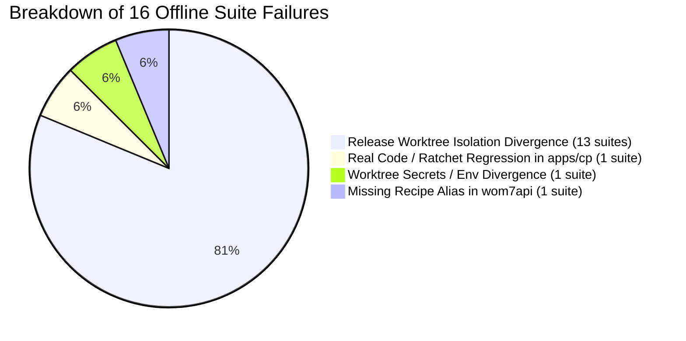

# Root-Cause Investigation: 16 Offline Test Suite Failures

**Run Identifier:** `run-2026.09.27-1790566349`  
**Deploy Worktree:** `/Users/proto/.w0m/releases/2026.09.27-1790566349/w0m`  
**Execution Context:** `deploy-all` pre-deploy offline test tier (`run_suites.py --tier offline`)  
**Total Executed:** 3,244 checks across 201 declared suites (185 passed, 16 failed)  
**Date:** 2026-09-28  
**Referenced Tickets:** [[T473]], [[T471]]  

---

## 1. Executive Summary & Root Failure Taxonomy

During the monitored `deploy-all` execution, the pre-deploy offline test runner failed closed and aborted deployment due to **16 failing test suites**.

Inspection of all 201 preserved suite logs under `reports/suites/*.log` reveals that the 16 failures stem from **three distinct root causes**:



1. **Release Worktree Isolation Divergence (13 suites — 81%)**:
   - In [[T473]], `just deploy` was transitioned to execute from an isolated release worktree (`~/.w0m/releases/<version>/w0m`) created from the tagged git commit.
   - Thirteen test suites fail because they contain hardcoded assumptions that they are executing in the canonical developer workspace (`/Users/proto/Projects/@self/@wom`), relying on gitignored local files, `includeIf` gitconfig paths, sibling directory structures, or upstream tracking branches that do not exist in a pristine git worktree.
2. **Real Code / Ratchet Regression (1 suite — 6%)**:
   - `ds-conformance-selftest`: Scanned `apps/cp` and detected that native `<button>` controls rose from baseline 392 to 393 (+1), triggered by recently added buttons in `ProjectManager.svelte` (T439/T467).
3. **Missing Recipe Alias (1 suite — 6%)**:
   - `release-selftest`: Declared in `project/test-suites.json` as `recipe: release-test`, but `run_suites.py` executes recipes in `wom7api/`, where `release-test` is not defined (it only exists in root `justfile`).
4. **Environment / Credential Propagation in Worktree (1 suite — 6%)**:
   - `backup-push-r2`: Returned exit code 1 instead of expected exit code 2 when checking missing credentials due to environment inheritance differences in the worktree.

---

## 2. Comprehensive Suite-by-Suite Diagnostic Matrix

| # | Suite Name | Failing Recipe | Exit Code | Diagnostic Log Evidence | Root Cause Classification |
|---|---|---|---|---|---|
| 1 | **`release-selftest`** | `release-test` | `127` | `<no output captured>` (recipe not found in `wom7api/justfile`) | **Missing Recipe Alias**: Recipe declared in root but absent in `wom7api`. |
| 2 | **`ds-conformance-selftest`** | `ds-conformance-test` | `1` | `Native <button> controls: 393 > baseline 392 (+1)` | **Real Ratchet Regression**: Added button in `apps/cp/src/components/admin/ProjectManager.svelte`. |
| 3 | **`backup-push-r2`** | `backup-push-r2-test` | `1` | `FAIL: missing R2 credentials exits 2 rc=1` | **Worktree Env**: Exit code discrepancy under subprocess environment without Infisical injection. |
| 4 | **`push-cadence`** | `push-cadence` | `2` | `❌ no repo had an upstream — cannot judge cadence` | **Worktree Git State**: Detached HEAD in release worktree has no upstream tracking branch (`@{u}`). |
| 5 | **`changelog-drift`** | `changelog-drift` | `2` | `no deploy transcripts found under deploy-logs/` | **Worktree Missing Gitignored Files**: `deploy-logs/` transcripts are gitignored; absent in release worktree. |
| 6 | **`changelog-drift-test`** | `changelog-drift-test` | `1` | `the real deploy transcripts on disk are found (non-vacuous) — empty transcript list exits 2` | **Worktree Missing Gitignored Files**: Fails because `deploy-logs/` has no transcripts. |
| 7 | **`ai-memory-pin`** | `ai-memory-check` | `2` | `❌ checkout missing at .../w0m/_ext/ai-memory` | **Worktree Missing Subdirectory**: `_ext/ai-memory` is untracked/gitignored; not copied to worktree. |
| 8 | **`mmd-validate-probe`** | `mmd-validate-test` | `1` | `mmd-validate: skipped — run npm install in wom7skills/skills/mmd-validate` | **Worktree Missing Dependencies**: `node_modules` was not installed in `wom7skills/skills/mmd-validate`. |
| 9 | **`vitest`** | `test-js` | `1` | `packages/lib/src/system-registry/credential-source.spec.ts:17: expect(snap.rows.length).toBeGreaterThan(0)` | **Worktree Missing Gitignored Fixture**: `project/credential-snapshot.json` is gitignored; absent in worktree. |
| 10 | **`project-identity`** | `project-identity-test` | `1` | `live policy passes across all declared projects and repos — 17 non-passing results` | **Worktree Git Config Path**: macOS `includeIf` pins identity to `gitdir:/Users/proto/Projects/@self/@wom/`. |
| 11 | **`deploy-in-flight`** | `deploy-in-flight-test` | `1` | `the estate root is READ from .w0m/sdlc.json, not hardcoded — got /Users/proto/.w0m/releases/...` | **Worktree Path Assumption**: Test asserts root equals canonical `/Users/proto/Projects/@self/@wom`. |
| 12 | **`state-bounds`** | `state-bounds-test` | `1` | `KeyError: '1945'` in `test_state_bounds.py:68` | **Worktree Sibling Repo Missing**: Cannot locate external sibling client projects (`../../@client/1945`). |
| 13 | **`ticket-paths`** | `ticket-paths-test` | `1` | `FAILED (1): T96 gitignored file is UNTRACKED, not MISSING` | **Worktree Missing Gitignored File**: Asserted gitignored audit file exists on disk as untracked. |
| 14 | **`prs`** | `prs-test` | `1` | Local forks testing (`cmd_forks`, `fetch_fork`) failed | **Worktree Missing Sibling Repos**: External fork repos not cloned into isolated release tree. |
| 15 | **`emoji-check-test`** | `emoji-check-test` | `1` | `measured {'md_headings_estate': 230} vs declared 235` | **Worktree Snapshot Difference**: Untracked markdown files in developer workspace were not in git. |
| 16 | **`py-test`** | `py-test` | `1` | Failed tests 28, 50, 57, 58, 85, 97, 116 | **Composite Pytest Failure**: Aggregates the python tests from items 2, 5, 10, 11, 12, 14, 15. |

---

## 3. Deep-Dive Details on Actionable Issues

### 3.1 The Real Code Regression: `apps/cp` Design System Ratchet (+1 `<button>`)
- **Failing Suite:** `ds-conformance-selftest` (`wom7web/project/scripts/tests/test_ds_conformance.py`)
- **Metric:** `Native <button> controls: 393 > baseline 392 (+1)`
- **Offender:** `apps/cp/src/components/admin/ProjectManager.svelte`
  - In commit `f340a720` (T439 C3) and `f54668ba` (T467), `ProjectManager.svelte` added:
    ```svelte
    <button type="button" onclick={openCreateModal} class="bg-blue-600 ...">+ New Project</button>
    <button type="button" onclick={addChip} class="...">Add</button>
    ```
- **Remediation:**
  - Either convert the native `<button>` controls in `ProjectManager.svelte` to use the `@webomage/ui` Design System button component, or update `project/ds-conformance-baseline.json` via `python3 wom7web/project/scripts/ds_conformance.py --save` if the addition is intentional.

### 3.2 Missing Recipe Alias: `release-test` in `wom7api`
- **Failing Suite:** `release-selftest`
- **Location:** `project/test-suites.json` declares `recipe: release-test`.
- **Root Cause:** `run_suites.py` evaluates all recipes inside `wom7api/` (the estate capability layer). While root `justfile` has `release-test:`, `wom7api/justfile` has no matching recipe forwarding to `just --justfile ../justfile release-test`.
- **Remediation:** Add forwarding recipe in `wom7api/justfile`:
  ```just
  release-test *args:
      @just --justfile ../justfile release-test {{ args }}
  ```

### 3.3 Isolated Release Worktree Strategy (T473 Refinements)
Thirteen suites failed strictly because of the isolated worktree environment. To make `deploy-all` green under T473's isolated worktree architecture:
1. **Pass-through Gitignored Artifacts:**
   The release worktree provisioning script (`release.py worktree`) should selectively copy or symlink read-only test fixtures:
   - `project/credential-snapshot.json` (required by `vitest`)
   - `deploy-logs/` (required by `changelog-drift`)
   - `_ext/` (required by `ai-memory-pin`)
2. **Git Identity & Detached HEAD in Worktrees:**
   - Configure git user in the release worktree, or update `project-identity.py` to identify worktree parentage.
   - For `push-cadence`, mark advisory/skip when running in detached release worktrees.
3. **Worktree Dependencies:**
   - Ensure `release.py` runs `pnpm install` or symlinks `node_modules` in `wom7skills/skills/mmd-validate/`.
