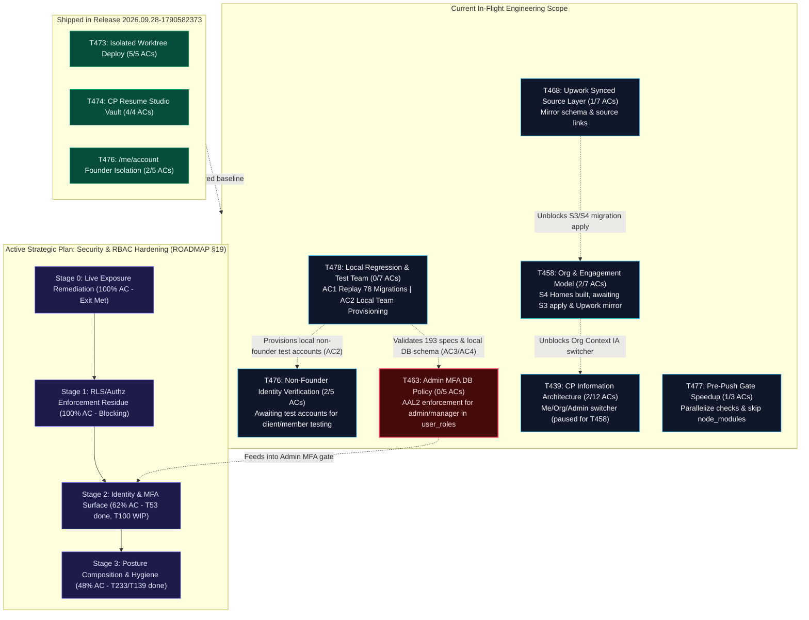

# Strategic Plan & In-Flight Scope Report — 2026-09-28

**Primary Ticket Focus:** [T478](file:///Users/proto/Projects/@self/@wom/.tasks/T478.md) (Local Full Regression with Provisioned Test Team)  
**Active Canonical Plan:** `Security & RBAC Hardening` ([`ROADMAP.md §19`](file:///Users/proto/Projects/@self/@wom/ROADMAP.md))  
**Companion Diagram:** [`.agents/reports/2026-09-28-t478-plan-progress.mmd`](file:///Users/proto/Projects/@self/@wom/.agents/reports/2026-09-28-t478-plan-progress.mmd)  
**Browser View Command:** `just diagram .agents/reports/2026-09-28-t478-plan-progress.mmd`  

---

## 1. Overview & Architecture Diagram

This report records the progress of the active canonical plan declared in `.w0m/sdlc.json -> current_plan` along with the immediate engineering scope currently in flight across the estate following the deployment of release `2026.09.28-1790582373`.

> [!TIP]
> **View Interactive Zero-Width Diagram in Browser:**
> ```bash
> just diagram .agents/reports/2026-09-28-t478-plan-progress.mmd
> ```



---

## 2. Canonical Plan: Security & RBAC Hardening (`ROADMAP.md §19`)

Declared in `.w0m/sdlc.json -> current_plan`, callable via `just tasks current` or `just tasks plan`.

| Stage | Stage Name | Status | Closed Tickets | AC Progress | Stage Exit Criteria |
|---|---|---|---|---|---|
| **stage-0** | Confirmed-live exposure | ✅ MET (2026-08-17) | 3/3 (`T196`, `T201`, `T329`) | `██████████` 100% (16/16) | Verified closed by probe suite. Closed secrets leak and bypass keys. |
| **stage-1** | RLS/authz enforcement residue | 🔒 BLOCKING | 4/4 (`T381`, `T382`, `T327`, `T208`) | `██████████` 100% (21/21) | Each ticket closes on its own ACs; cleans up SSR shared-client residual importers. |
| **stage-2** | Identity & MFA surface | ⏳ IN PROGRESS | 1/2 (`T53` done, `T100` WIP) | `██████░░░░` 62% (10/16) | T53 TOTP/PAT management delivered. T100 sign-in 2FA challenge in progress. |
| **stage-3** | Posture composition & remaining hygiene | ⏳ IN PROGRESS | 2/5 (`T233` done, `T139` done) | `████░░░░░░` 48% (14/29) | T233 composed audit centerpiece. T213, T52, T244 queued. |

> [!WARNING]
> Ticket progress is **evidence of work**, not stage completion. Each stage's `exit` is the criterion that actually closes it.

---

## 3. Current In-Flight Engineering Scope

| Priority | Ticket | Area | Status | AC Progress | Focus / Current Work |
|---|---|---|---|---|---|
| **P1** | [T478](file:///Users/proto/Projects/@self/@wom/.tasks/T478.md) | `sdlc` | `in-progress` | `░░░░░░░░░░` 0/7 (0%) | **Local full regression**: AC1 replaying 78 migrations on local Docker stack; AC2 local test team provisioning. |
| **P1** | [T476](file:///Users/proto/Projects/@self/@wom/.tasks/T476.md) | `security` | `in-progress` | `████░░░░░░` 2/5 (40%) | **/me/account hardening**: Founder profile leak shipped live. AC3 non-founder live verification blocked by T478 test accounts. |
| **P0** | [T463](file:///Users/proto/Projects/@self/@wom/.tasks/T463.md) | `security` | `in-progress` | `░░░░░░░░░░` 0/5 (0%) | **Admin MFA policy gate**: Enforce AAL2 inside DB RLS policies for admin roles rather than relying solely on page guard. |
| **P1** | [T458](file:///Users/proto/Projects/@self/@wom/.tasks/T458.md) | `security` | `in-progress` | `███░░░░░░░` 2/7 (29%) | **Org & engagement model**: S4 Homes built on scratch DB. Blocked by T468 Upwork mirror schema and S3 batches 3/4 apply. |
| **P1** | [T468](file:///Users/proto/Projects/@self/@wom/.tasks/T468.md) | `data` | `in-progress` | `█░░░░░░░░░` 1/7 (14%) | **Upwork synced source layer**: Mirror schema, source links, work-history mapping. |
| **P1** | [T439](file:///Users/proto/Projects/@self/@wom/.tasks/T439.md) | `product` | `in-progress` | `██░░░░░░░░` 2/12 (17%) | **CP Information Architecture**: Me / Org / Admin context switcher shell. Paused pending T458 S1–S6 migrations. |
| **P2** | [T477](file:///Users/proto/Projects/@self/@wom/.tasks/T477.md) | `tools` | `in-progress` | `███░░░░░░░` 1/3 (33%) | **Pre-push speedup**: Prevent slow scans walking `node_modules`, run independent gates in parallel. |

---

## 4. Key Cross-Ticket Dependencies & Critical Path

1. **[T478](file:///Users/proto/Projects/@self/@wom/.tasks/T478.md) is the foundational unblocker**:
   - Replaying the 78 migrations locally establishes an accurate offline replica of production.
   - `just test-team-local` creates test personas (`@test.webomage.com`) on loopback with client, member, and admin hats.
   - This unblocks completing **T476 AC3** without touching live founder accounts, and allows offline verification of **T463** (Admin MFA policies) across the 193 Gauge specs.

2. **[T468](file:///Users/proto/Projects/@self/@wom/.tasks/T468.md) unblocks [T458](file:///Users/proto/Projects/@self/@wom/.tasks/T458.md)**:
   - S3/S4 org migrations depend on separating Upwork mirror data from primary tables.
   - Once S1–S6 land, **T439** (Context Switcher) resumes implementation.

3. **[T463](file:///Users/proto/Projects/@self/@wom/.tasks/T463.md) completes Stage 2 of the Canonical Plan**:
   - Closing T463 and T100 delivers end-to-end 2FA/MFA enforcement across both the frontend router and Postgres RLS.

---

## 5. Available w0m Tools & Just Helpers

| Need | Command | Description |
|---|---|---|
| **View Diagram in Browser** | `just diagram <file.mmd \| T##>` | Zero-width interactive dark-mode viewer in default browser |
| **Active Strategic Plan** | `just tasks current` (or `just tasks plan`) | Shows progress against `.w0m/sdlc.json -> current_plan` |
| **In-Flight Tickets** | `just tasks wip` | Lists all 17 active tickets with completion percentages and blockers |
| **Ticket Dependency Tree** | `just tasks tree --ticket <T##>` | Shows upstream blockers and downstream dependents for a ticket |
| **Hot Priority Queue** | `just tasks hot` | Ranks what can be started based on recorded ticket readiness |
| **SDLC Completion Rank** | `just tasks sdlc` | Ranks tickets closest to done |
| **Queue Overview** | `just tasks overview` | Groups queue by area, tag, and roadmap section |
| **Mermaid Validation** | `node wom7skills/skills/mmd-validate/validate.mjs <file.mmd>` | Fast headless Mermaid syntax validation |
