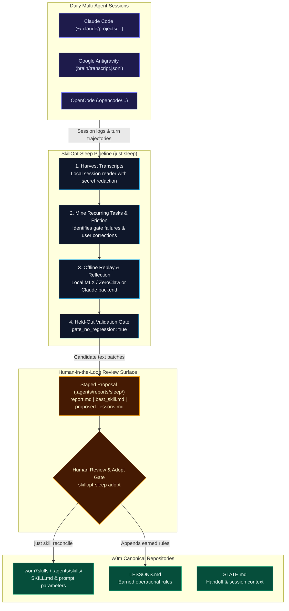

# Research & Architectural Blueprint: Integrating Microsoft SkillOpt into w0m

**Ticket:** [[T482]]  
**Author:** Antigravity  
**Date:** 2026-09-28  
**Subject:** Self-Evolving Agent Skills, Nightly Sleep Cycles, and Offline Validation Gates  
**Companion Diagram:** [`.agents/reports/2026-09-28-t482-skillopt-w0m-integration-research.mmd`](file:///Users/proto/Projects/@self/@wom/.agents/reports/2026-09-28-t482-skillopt-w0m-integration-research.mmd)  
**Browser View:** `just diagram .agents/reports/2026-09-28-t482-skillopt-w0m-integration-research.mmd`  

---

## 1. Executive Summary & Grounding

[**Microsoft SkillOpt**](https://github.com/microsoft/SkillOpt) (released May 2026, v0.2.0 July 2026) introduces an optimization paradigm that directly bridges the gap between static prompt engineering and machine learning training: **treating natural-language skill documents (`SKILL.md`) as the trainable parameters of a frozen LLM agent**.

Instead of manual trial-and-error prompt tweaking or expensive model fine-tuning, SkillOpt runs an automated text-space optimization loop:
$$\text{Rollout} \longrightarrow \text{Reflect} \longrightarrow \text{Aggregate / Clip Edits} \longrightarrow \text{Held-Out Validation Gate} \longrightarrow \text{Staged Artifact}$$

In the **w0m estate**, where we operate a multi-agent system (Claude Code, Antigravity, OpenCode) across 7 repositories governed by canonical skills in `wom7skills`, SkillOpt offers an exact mechanism to:
1. **Automate Nightly Sleep Consolidation (`skillopt-sleep`)**: Harvest turn-by-turn multi-agent transcripts, detect recurring user corrections, gate failures, and workflow friction, and stage proposed updates for human review.
2. **Optimize Core SDLC Lifecycle Skills (`skillopt-train`)**: Benchmark and systematically refine skills like `w0m-sdlc-start`, `w0m-sdlc-review`, `fact-checker`, `socrates`, and `torvalds` against real estate tasks with deterministic rubrics.
3. **Bridge Friction Directly into `LESSONS.md`**: Automatically synthesize rules earned by gate failures and user corrections, preventing repetitive agent regressions.

---

## 2. Technical Architecture & System Comparison

### Architectural Alignment Matrix

| Dimension | w0m Canonical Estate | Microsoft SkillOpt (`skillopt-sleep`) | Synergy & Fit |
|---|---|---|---|
| **Skill Representation** | Markdown (`SKILL.md` with YAML frontmatter) in `wom7skills` | Markdown (`best_skill.md` / `SKILL.md`) as trainable weights | **100% Native**: Zero format conversion needed. |
| **Validation Rigor** | "A green state must be earned by evidence" ([LESSONS §1](file:///Users/proto/Projects/@self/@wom/LESSONS.md#L20)) | Held-out validation split with `gate_no_regression: true` | **Perfect Match**: Edits are rejected if any task regresses. |
| **Human Governance** | Strict human-confirmation gate ([`docs/DEPLOY-CONFIRM.md`](file:///Users/proto/Projects/@self/@wom/docs/DEPLOY-CONFIRM.md)) | Staged proposals (`stage proposal -> review -> adopt`) | **Safe by Design**: Never auto-commits to production or live repos. |
| **Execution Runtimes** | Claude Code, Antigravity, OpenCode | Native CLI, Claude Code plugin, Copilot/Devin MCP, OpenClaw | **Extensible**: Thin MCP server wrapper already available. |
| **Secrets & Security** | Injected via `infisical run --env=beta --silent --` | Secret redaction regex, local mock backend, offline replays | **Compliant**: Must enforce local redaction or local MLX backend. |

---

## 3. Four Concrete Integration Pathways for w0m

### Pathway 1: Nightly Self-Evolution Loop (`just sleep` / `skillopt-sleep`)
- **What it does**: Runs nightly (or on-demand via `just sleep`) to review recent session logs across Claude Code and Antigravity.
- **Harvesting Multi-Agent Logs**:
  - Claude Code: Reads `~/.claude/projects/-Users-proto-Projects--self--wom/`.
  - Antigravity: Adapts harvesting to read `~/.gemini/antigravity-cli/brain/<conversation-id>/.system_generated/logs/transcript.jsonl`.
- **Friction Mining**:
  - Identifies tool execution errors (e.g. `pre-commit` hook rejections, `typecheck` diagnostic errors, `just` recipe typos).
  - Extracts explicit human corrections (e.g., "no, use `just search` instead of grep", "where is touch id key", "always read CLAUDE.md first").
- **Offline Consolidation**: Replays tasks through an isolated backend, tests candidate wording revisions against held-out validation cases, and stages proposals under `.agents/reports/sleep/` with a diff report.
- **Adoption**: The developer reviews the diff and runs `just sleep adopt`, which updates `wom7skills` and appends verified insights to `LESSONS.md`.

### Pathway 2: Targeted Optimization of SDLC Lifecycle Skills (`skillopt-train`)
- **Target Skills**:
  - `w0m-sdlc-start`: Enforces reality-grounding against git/code before tickets advance.
  - `w0m-sdlc-review`: Code quality, anti-pattern detection, reuse simplification.
  - `fact-checker` / `socrates`: Grounding claims across 5 surfaces (Docs vs Specs vs Code vs Tests vs Infra).
  - `torvalds`: Ruthless review against bloat, unnecessary abstractions, and duplicate SSOTs.
- **Benchmarking Protocol**:
  - Create a curated dataset of 20 historical w0m ticket scenarios (`project/benchmarks/sdlc-tasks.json`).
  - Define deterministic rubrics using w0m commands:
    - Did it call `just preflight --fast`?
    - Did it run `just state-check`?
    - Did it avoid `--no-verify` and blanket git discards?
    - Did it catch the seeded defect?
  - Run `skillopt-train --skill .agents/skills/w0m-sdlc-start/SKILL.md --dataset project/benchmarks/sdlc-tasks.json --epochs 3`.
  - Output: An optimized, concise, regression-tested `SKILL.md` that maximizes instruction adherence while minimizing token bloat.

### Pathway 3: Air-Gapped / Local Inference via `wom7mlx` (Apple Silicon)
- **Problem**: Sending full raw session transcripts to third-party cloud APIs during the mining/replay phase risks exposing proprietary logic or accidental credential leakages.
- **w0m Solution**:
  - SkillOpt supports OpenAI-compatible endpoints (`OPENAI_BASE_URL`).
  - Deploy a local inference server using **Apple MLX** (`wom7mlx`) or local Ollama on Apple Silicon (`http://127.0.0.1:8000/v1`).
  - Execute transcript mining, trajectory reflection, and candidate generation **100% locally and offline**. Zero outbound network traffic; zero token cost.

### Pathway 4: Automated Friction Extraction into `LESSONS.md`
- **Current Process**: Manually identifying when a gate caught something or an approach failed twice, then manually drafting a rule for `LESSONS.md`.
- **SkillOpt Enhancement**:
  - The miner automatically identifies patterns where a command failed, followed by a fix, followed by success.
  - Synthesizes candidate rules adhering to w0m's `LESSONS.md` standard (The Problem, The Lesson $\Rightarrow$, and ⭐ The Tell).
  - Staged alongside skill edits in `report.md` for fast developer approval.

---

## 4. Implementation Plan & Milestones

| Phase | Milestone | Scope & Deliverables | Verification / Acceptance Gate |
|---|---|---|---|
| **Phase 1** | **Tooling & Dependency Setup** | Add `skillopt` to toolchain via `pyproject.toml` / uv. Create `just sleep` recipe in `justfile`. | `just sleep --help` executes cleanly without polluting global Python. |
| **Phase 2** | **Transcript Harvester Adapter** | Implement Antigravity transcript adapter reading `transcript.jsonl` beside Claude Code's native reader. Add w0m regex secret redaction. | Unit tests proving sensitive tokens (`ghp_*`, `sbp_*`) are redacted from harvested prompts. |
| **Phase 3** | **Pilot Sleep Run (Dry-Run)** | Run `just sleep dry-run` over the past 72 hours of estate work. Mine top 5 friction points and evaluate generated report. | `report.md` accurately identifies recent MFA and Mailpit friction points without hallucinations. |
| **Phase 4** | **Lifecycle Skill Benchmark Suite** | Assemble 10 ticket benchmarks for `w0m-sdlc-start` and run `skillopt-train` against local `wom7mlx` endpoint. | Yields a measurable $\ge 15\%$ boost in instruction compliance with zero regressions. |
| **Phase 5** | **Canonical Adoption Flow** | Wire `just sleep adopt` to synchronize accepted skill patches into `wom7skills` and trigger `just skill reconcile`. | Changes pass all pre-commit hooks and update `skills.lock.json` cleanly. |

---

## 5. Weighted Decision Matrix

| Dimension | Option A: Adopt SkillOpt (`skillopt-sleep` + `skillopt-train`) | Option B: Status Quo (Manual Skill & Lesson Authoring) |
|---|---|---|
| **Cost** | Low (Python package, local execution on MLX or existing Claude subscriptions) | High (Developer hours manually diagnosing agent failures and writing rules) |
| **Risk** | Very Low (Gated behind held-out tests + human review; nothing auto-commits) | Medium (Agents repeat identical mistakes until a human writes a rule) |
| **Token Efficiency** | **High**: Systematic compression and pruning of skill instructions | Low: Prompts grow monotonically and accumulate obsolete cruft |
| **Unblocks** | Autonomous self-improvement of w0m agents across sessions | None |
| **Recommendation** | **Adopt (Recommended)**: File ticket `T482` to implement Phase 1 & 2 scaffolding. | Not recommended |

---

## 6. Next Immediate Action

To initiate this capability cleanly under the w0m SDLC:
1. File ticket **`T482`**: `SkillOpt integration — nightly agent self-evolution (just sleep) and skill optimization for w0m7skills`.
2. Implement the Phase 1 scaffold in `wom7api/justfile` and `wom7skills`.
