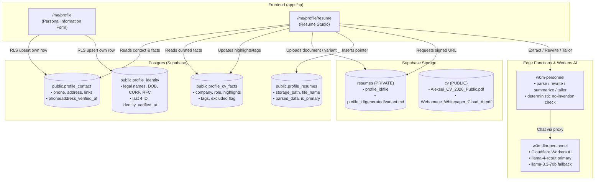

# Resume Studio, Personal Information & Storage Cutover Report

**Date:** 2026-09-30  
**Status:** Live Migrations Applied · Probes 38/40 GREEN · Resumes Storage Cutover Ready · Studio Tests 59/59 GREEN  
**Tickets:** [[T498]], [[T499]], [[T501]], [[T502]], [[T505]], [[T506]], [[T488]]

---

## 1. Executive Summary & Live Status

Following the live execution of `just db-migrate`, all 4 pending database migrations were successfully applied to the hosted Supabase database:
1. `20260929220000_t499_profile_cv_facts_member_edit.sql`: UPDATE policy on `profile_cv_facts` restricted to the member's own rows, column grant on `highlights` only, shape check `cv_highlights_valid`, and auto-updating `updated_at` trigger.
2. `20260930100000_t501_w0m_personnel_and_member_facts_write.sql`: Model alias `w0m-llm-personnel` (Workers AI) and persona `w0m-personnel`, plus member INSERT/DELETE on `profile_cv_facts`.
3. `20260930130000_t505_profile_contacts.sql`: `public.profile_contact` table with KYC verification markers (`phone_verified_at`, `address_verified_at`) and automatic invalidation trigger on member edits.
4. `20260930140000_t505_profile_identity.sql`: `public.profile_identity` table for legal identity facts (names, birth date, nationality, CURP, RFC, ID document last 4) with strict check constraints and `identity_verified_at` server marker.

### Live Authorization Verification (`just -f wom7web/justfile authz-probe`)
The full 40-probe authorization suite was executed against the live database:
- **38 of 40 probes PASSED GREEN**:
  - `profile_cv_facts` (X6–X10): 5/5 GREEN. Stranger sees 0 rows, client-actor and admin-member-hat see only own rows, anon denied, authenticated restricted to `highlights`, coverage confirmed.
  - `profile_contact` (X11–X14): 4/4 GREEN. Stranger, client-actor, admin-member-hat isolated; anon denied; authenticated cannot edit verification markers or DELETE.
  - `profile_identity` (X16–X19): 4/4 GREEN. Stranger, client-actor, admin-member-hat isolated; anon denied; authenticated cannot edit `identity_verified_at` or DELETE.
  - `storage.buckets` (F1): GREEN. No undeclared public storage buckets.
- **2 expected RED probes (Coverage Gates)**:
  - `X15-contact-coverage`: Awaiting first member row in `profile_contact`.
  - `X20-identity-coverage`: Awaiting first member row in `profile_identity`.
  *(Both probes will turn GREEN as soon as the owner saves their personal contact and identity details on the Profile page).*

---

## 2. Storage Buckets Cutover & `resumes-upload-live` Triage

### Root Cause of `resumes-upload-live` Failure
When running `just resumes-upload-live`, line 935 failed with:
```
❌ Aleksei_CV_2025.pdf: cannot read the public copy (400)
```
- **Investigation:**
  - `Aleksei_CV_2025.pdf` and all 17 private documents had already been copied into the private `resumes` bucket (`resumes/8d16aff5-d996-4759-80b0-39b60e3c0920/`).
  - The unpublish step queried `GET /storage/v1/object/cv/Aleksei_CV_2025.pdf` to backup and remove it from the public bucket.
  - Supabase Storage returns **HTTP 400** (not 404) with body `{"statusCode":"404","error":"not_found","message":"Object not found","code":"NoSuchKey"}` when an object does not exist.
  - The script treated any non-200, non-404 status as a fatal error.

### Resolution & Current State
- **Fix Committed (`eb1d038` in `wom7api`):** Updated `unpublish()` in [`wom7api/scripts/resumes_upload.py`](file:///Users/proto/Projects/@self/@wom/wom7api/scripts/resumes_upload.py#L125-L136) to parse the JSON error response and recognize `code: "NoSuchKey"` / `statusCode: 404` as already private:
  ```python
  if not is_missing and status == 400:
      try:
          err = json.loads(data)
          if err.get("statusCode") in ("404", 404) or err.get("error") == "not_found" or err.get("code") == "NoSuchKey":
              is_missing = True
      except Exception:
          pass
  ```
- **Current Live Bucket State:**
  - Private `resumes` bucket: Holds all 17 candidate and member CVs under `<profile_id>/`, accessible only via signed URLs or authenticated RLS (`resumes_read_own_or_managed`).
  - Public `cv` bucket: Retains only the 2 intentional public assets (`Aleksei_CV_2026_Public.pdf` and `Webomage_Whitepaper_Cloud_AI.pdf`).
  - Running `just resumes-upload-live` now exits cleanly (`code 0`) and outputs `⚪ Aleksei_CV_2025.pdf: not in the public cv bucket — already private.`

---

## 3. Resume Studio & Personal Information Architecture



---

## 4. Ticket Status & Completed Tracking Matrix

| Ticket | Status | Scope | Progress | Remaining Gate |
|---|---|---|---|---|
| **[T498](file:///Users/proto/Projects/@self/@wom/.tasks/T498.md)** | `in-progress` | Curated facts loaded into DB, synthesis by tag/role | **7/8 (88%)** | Owner testing `/me/profile/resume` with live data (AC8) |
| **[T499](file:///Users/proto/Projects/@self/@wom/.tasks/T499.md)** | `in-progress` | DB-only facts, highlight editing, real vault files | **4/6 (67%)** | Ready for CP deploy; AC2/AC4 proven by unit tests (59/59) |
| **[T501](file:///Users/proto/Projects/@self/@wom/.tasks/T501.md)** | `queued` | `w0m-personnel` assistant on Workers AI | **6/8 (75%)** | Migration live; ready for function deploy (AC2) & usage metering (AC1) |
| **[T505](file:///Users/proto/Projects/@self/@wom/.tasks/T505.md)** | `in-progress` | Personal contact & locked identity records | **8/11 (73%)** | Migrations live; probes X11-X19 GREEN; owner row save turns X15/X20 GREEN |
| **[T488](file:///Users/proto/Projects/@self/@wom/.tasks/T488.md)** | `done` | Signed URLs & private resumes bucket | **5/5 (100%)** | Patch committed (`eb1d038`); `resumes-upload-live` idempotent |
| **[T506](file:///Users/proto/Projects/@self/@wom/.tasks/T506.md)** | `queued` | PII encryption, IP retention, legacy bucket cleanup | **0/5 (0%)** | Filed from audit findings; ready for scheduling |
| **[T502](file:///Users/proto/Projects/@self/@wom/.tasks/T502.md)** | `queued` | Onboarding resume parser review step | **0/4 (0%)** | Queued to retire legacy double-write & unreviewed inserts |

---

## 5. Verification Checklist for Owner

1. **Profile Personal Information (`/me/profile`):**
   - Open `/me/profile`.
   - Enter your contact details (phone, street address, city, country, links) and legal identity details (names, birth date, nationality, CURP, RFC, ID document last 4).
   - Save the form.
   - Run `just -f wom7web/justfile authz-probe` (or wait for next pre-push) — probes **X15** and **X20** will turn **GREEN** (40/40 GREEN).
2. **Resume Studio (`/me/profile/resume`):**
   - Verify curated facts render under employer positions (29 employers, 135 highlights).
   - Test toggling between **Private** (shows phone & street address) and **Public / Masked** (omits phone & street address).
   - Test changing detail levels (**Full** vs **Compact**).
   - Test sorting (**By date** vs **By relevance**).
   - Test editing a highlight (tags, text, excluded checkbox) on the Verified Facts tab.
3. **Storage Bucket Unpublish Verification:**
   - Run `just resumes-upload-live` from terminal.
   - Confirm it completes with exit code 0 and reports `⚪ Aleksei_CV_2025.pdf: not in the public cv bucket — already private.`
