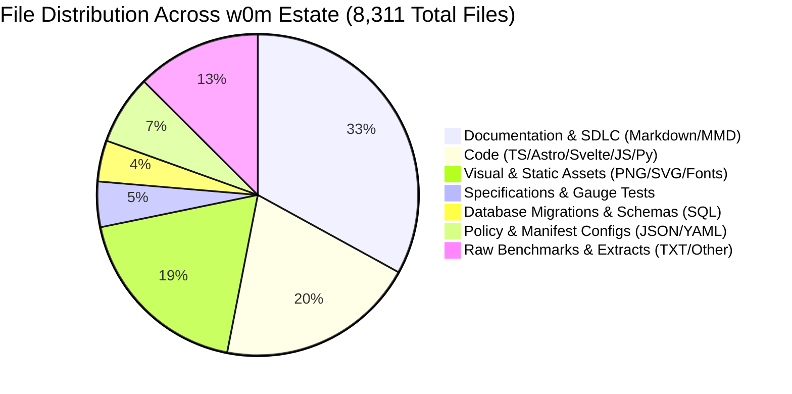
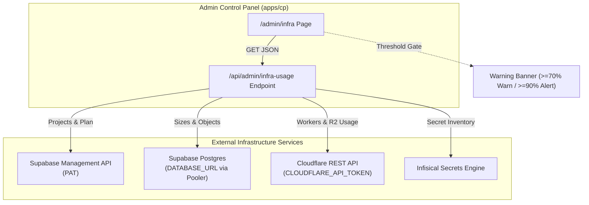

# w0m Estate Full Entity, Storage & Infrastructure Inventory

**Date:** 2026-10-01  
**Status:** Live Measured Fact (Audit & Classification)  
**Governance:** Triangulated SSOT Protocol (`fact-checker`, `schema-critique`, AgDR-0003, AgDR-0025)  
**Scope:** 7 Estate Repositories, Supabase Postgres Database, Supabase Storage, Cloudflare Edge & R2, Infisical, Tinybird  

---

## 1. Executive Summary & Tariff Reality Grounding

The estate operates under the confirmed owner decision to **stay on the Supabase Free tier and not hit the limits** ([AgDR-0003](file:///Users/proto/Projects/@self/@wom/docs/decisions/AgDR-0003-stay-on-supabase-free.md), T229). Because Free tier quotas fail **abruptly rather than gradually**, headroom is treated as a hard operating budget rather than spare capacity.

### Live Measured Infrastructure Posture (2026-10-01 03:57 UTC)

```
┌────────────────────────────────────────────────────────────────────────────────────────┐
│ INFRASTRUCTURE QUOTA & CONSUMPTION MATRIX                                              │
├────────────────────┬───────────┬──────────────┬──────────────┬────────────┬────────────┤
│ Resource           │ Tier      │ Live Used    │ Quota Cap    │ % Used     │ Status     │
├────────────────────┼───────────┼──────────────┼──────────────┼────────────┼────────────┤
│ Supabase Database  │ Free      │ 82.31 MB     │ 524.28 MB    │ 16.5%      │ 🟢 Healthy │
│ Supabase Storage   │ Free      │ 49.13 MB     │ 1,073.74 MB  │ 4.8%       │ 🟢 Healthy │
│ Org Projects       │ Free      │ 2 projects   │ 2 per org    │ 100.0%     │ ⚠️ AT CAP  │
│ Auth Users         │ Free      │ 7 users      │ 50,000 MAU   │ 0.01%      │ 🟢 Healthy │
│ Cloudflare Crons   │ Free      │ 5 triggers   │ 5 per acct   │ 100.0%     │ ⚠️ AT CAP  │
│ Cloudflare R2      │ Free      │ 0.00 MB      │ 10,240 MB    │ 0.0%       │ 🟢 Idle    │
│ Infisical Secrets  │ Self/SaaS │ 105 secrets  │ Unlimited    │ —          │ 🟢 Current │
│ Bandwidth / Egress │ Free      │ UNMEASURED*  │ 5,000 MB/mo  │ Unknown    │ ⚠️ Caveat  │
└────────────────────┴───────────┴──────────────┴──────────────┴────────────┴────────────┘
```

> [!WARNING]
> **Active Quota Warnings:**
> 1. **Project Cap Reached:** The `webomage` Supabase organisation is at **2/2 projects** (`webomage` production and `solar_flares`). A 3rd project must be created under the second empty org (`w0m space`, 0/2 projects) per AgDR-0003, or a paid tier is required.
> 2. **Cloudflare Crons Allocated:** `wom7func` uses all 5 cron trigger slots (`*/15`, `*/30`, `0 8`, `0 */6`, `0 14 SUN`). Adding crons requires removing existing ones or upgrading to Workers Paid.
> 3. **Egress Transparency Caveat:** Supabase Management API exposes no usage endpoint (`/usage` and `/daily-stats` both return 404). Egress cannot be polled programmatically and must be checked periodically in the Supabase Cloud dashboard.
> 4. **Inactivity Auto-pause Sentinel:** Supabase Free projects pause after 7 consecutive days of zero database queries. Active health probes and scheduled jobs (`pg_cron` daily at 07:00) currently prevent pausing, but must remain active.

---

## 2. Complete File System Classification & Estate Taxonomy

Across the 7 member repositories and the `@wom` workspace root, there are **8,311 tracked files** totaling **298.8 MB**.

### Repositories Footprint

| Repository | Purpose | Tracked Files | Disk Footprint | Primary Stacks |
|---|---|---|---|---|
| [`wom7web`](file:///Users/proto/Projects/@self/@wom/wom7web) | Monorepo: Astro web apps (`web`, `cp`, `join`, `job`), shared packages (`@webomage/lib`, `@webomage/ui`), design system, SDLC tracking | 6,742 | 256.2 MB | Astro, Svelte, TypeScript, Tailwind |
| [`wom7api`](file:///Users/proto/Projects/@self/@wom/wom7api) | Backend capability layer: Supabase migrations, edge functions, workflow worker, security probes | 793 | 5.07 MB | PostgreSQL, Deno, TypeScript, Python |
| [`wom7func`](file:///Users/proto/Projects/@self/@wom/wom7func) | Edge worker & cron dispatch: Cloudflare Workflows, scheduled background automation | 57 | 1.09 MB | Cloudflare Workers, TypeScript |
| [`wom7ext`](file:///Users/proto/Projects/@self/@wom/wom7ext) | Webomage browser extensions (Manifest V3, Upwork & ATS bridges) | 524 | 35.48 MB | Manifest V3, TypeScript, Vite |
| [`wom7sec`](file:///Users/proto/Projects/@self/@wom/wom7sec) | Standalone security probes, posture gates, and policy enforcers | 17 | 0.03 MB | Python, Bash |
| [`wom7skills`](file:///Users/proto/Projects/@self/@wom/wom7skills) | Canonical w0m Agent Skills source and synchronization tooling | 178 | 0.96 MB | Markdown, TypeScript |
| [`wom7mlx`](file:///Users/proto/Projects/@self/@wom/wom7mlx) | Apple MLX local inference subsystem | Submodule | Tracked in tree | Python, MLX, C++ |
| [`@wom`](file:///Users/proto/Projects/@self/@wom) | Workspace root: orchestrator justfile, `.tasks/`, central registers | Root | Central control | Just, Python, Markdown |
| **Total Estate** | **Unified Distributed Platform** | **8,311** | **298.8 MB** | — |

---

### Global File Classification Taxonomy

Every file in the repository tree maps to one of six structural tiers:



```
┌─────────────────────────────────────────────────────────────────────────────────────────┐
│ FILE CLASSIFICATION HIERARCHY                                                           │
├──────────────────────┬───────────┬──────────────┬───────────────────────────────────────┤
│ Classification Class │ Count     │ Extensions   │ Governance Standard & Role            │
├──────────────────────┼───────────┼──────────────┼───────────────────────────────────────┤
│ 1. SDLC & Knowledge  │ 2,742     │ .md, .mmd    │ Single source of truth for intent:    │
│                      │           │              │ TASKS.md, .tasks/T##.md, openspec/,   │
│                      │           │              │ docs/decisions/ (AgDRs), TECH-DEBT.md │
├──────────────────────┼───────────┼──────────────┼───────────────────────────────────────┤
│ 2. Executable Logic  │ 1,668     │ .ts, .astro, │ Application code and utilities:       │
│                      │           │ .svelte, .py,│ Cloudflare Workers, Astro routes,     │
│                      │           │ .js          │ Svelte islands, Python CLI gates      │
├──────────────────────┼───────────┼──────────────┼───────────────────────────────────────┤
│ 3. UI & Brand Assets │ 1,555     │ .png, .svg,  │ Static presentation: design system    │
│                      │           │ .woff2       │ tokens, UI icons, component assets    │
├──────────────────────┼───────────┼──────────────┼───────────────────────────────────────┤
│ 4. Verification/Test │ 380       │ .spec        │ Gauge executable specifications,      │
│                      │           │              │ user stories, behavior contracts      │
├──────────────────────┼───────────┼──────────────┼───────────────────────────────────────┤
│ 5. Schema & Data DDL │ 344       │ .sql         │ Supabase PostgreSQL migrations, RLS   │
│                      │           │              │ policies, view definitions, functions │
├──────────────────────┼───────────┼──────────────┼───────────────────────────────────────┤
│ 6. Policies & Bounds │ 581       │ .json, .yaml │ Machine-readable bounds: sdlc.json,   │
│                      │           │              │ stacks-policy.json, services-policy   │
├──────────────────────┼───────────┼──────────────┼───────────────────────────────────────┤
│ 7. Raw Text/Fixtures │ 1,041     │ .txt, .html  │ Test fixtures, corpus extractions     │
└──────────────────────┴───────────┴──────────────┴───────────────────────────────────────┘
```

---

## 3. Storage Bucket Inventory & Classification

Supabase Storage holds **198 live objects** totaling **49.13 MB** across **13 declared buckets**.

```
┌────────────────────────────────────────────────────────────────────────────────────────┐
│ SUPABASE OBJECT STORAGE AUDIT (Live Introspection 2026-10-01)                           │
├──────────────────────┬─────────┬─────────┬───────────┬─────────────┬───────────────────┤
│ Bucket ID            │ Access  │ Objects │ Size (MB) │ Mime Types  │ Lifecycle / Usage │
├──────────────────────┼─────────┼─────────┼───────────┼─────────────┼───────────────────┤
│ news                 │ Public  │ 187     │ 46.83 MB  │ PNG, WEBP,  │ Blog / newsletter │
│                      │         │         │           │ JPEG, TXT   │ editorial imagery │
├──────────────────────┼─────────┼─────────┼───────────┼─────────────┼───────────────────┤
│ blueprints           │ Private │ 7       │ 0.96 MB   │ PNG         │ System blueprints │
│                      │         │         │           │             │ & CAD diagrams    │
├──────────────────────┼─────────┼─────────┼───────────┼─────────────┼───────────────────┤
│ post-images          │ Public  │ 1       │ 0.92 MB   │ JPEG        │ Web post covers   │
├──────────────────────┼─────────┼─────────┼───────────┼─────────────┼───────────────────┤
│ cv                   │ Public  │ 2       │ 0.28 MB   │ PDF         │ Exported public   │
│                      │         │         │           │             │ resume documents  │
├──────────────────────┼─────────┼─────────┼───────────┼─────────────┼───────────────────┤
│ applications         │ Private │ 1       │ 0.14 MB   │ PDF         │ Candidate job     │
│                      │         │         │           │             │ applications      │
├──────────────────────┼─────────┼─────────┼───────────┼─────────────┼───────────────────┤
│ assets               │ Public  │ 0       │ 0.00 MB   │ —           │ Brand assets      │
├──────────────────────┼─────────┼─────────┼───────────┼─────────────┼───────────────────┤
│ public-images        │ Public  │ 0       │ 0.00 MB   │ —           │ Web public images │
├──────────────────────┼─────────┼─────────┼───────────┼─────────────┼───────────────────┤
│ snapshots            │ Public  │ 0       │ 0.00 MB   │ —           │ UI snapshot logs  │
├──────────────────────┼─────────┼─────────┼───────────┼─────────────┼───────────────────┤
│ resumes              │ Private │ 0       │ 0.00 MB   │ —           │ Member CV uploads │
├──────────────────────┼─────────┼─────────┼───────────┼─────────────┼───────────────────┤
│ decks                │ Private │ 0       │ 0.00 MB   │ —           │ Pitch & biz decks │
├──────────────────────┼─────────┼─────────┼───────────┼─────────────┼───────────────────┤
│ upwork               │ Private │ 0       │ 0.00 MB   │ —           │ Upwork sync files │
├──────────────────────┼─────────┼─────────┼───────────┼─────────────┼───────────────────┤
│ interview_recordings │ Private │ 0       │ 0.00 MB   │ —           │ Video recordings  │
├──────────────────────┼─────────┼─────────┼───────────┼─────────────┼───────────────────┤
│ domains              │ Private │ 0       │ 0.00 MB   │ —           │ Domain scan dumps │
├──────────────────────┴─────────┴─────────┼───────────┼─────────────┴───────────────────┤
│ TOTAL (Supabase Free Limit: 1,024 MB)    │ 49.13 MB  │ 4.8% Used · 974.87 MB Headroom  │
└──────────────────────────────────────────┴───────────┴─────────────────────────────────┘
```

### Key Storage Findings & Recommendations

1. **Storage Concentration (95.3% in `news`):** 46.83 MB of the 49.13 MB total lives in the `news` bucket.
2. **Egress Risk:** Serving images directly from Supabase Storage consumes Supabase Free egress (5 GB/mo cap).
3. **Strategic Cloudflare R2 Offload Recommendation:**
   - Migrate public news imagery to Cloudflare R2 bucket (`wom-public-assets`, already declared in `apps/web/wrangler.jsonc`).
   - R2 offers **10 GB free storage** and **$0 egress fees**, completely eliminating Supabase bandwidth pressure.

---

## 4. Database Schema & Tables Inventory

Postgres database size: **82.31 MB** out of **500 MB** Free tier limit (16.5% consumed).  
Schema allocation: `public` (58.66 MB), `auth` (4.13 MB), `storage` (1.21 MB). Total tables: **159**.

### Top Tables by Disk Footprint

| Table Name | Schema | Total Disk Size | Data Size | Index Size | Approx Rows | Domain / Functional Classification |
|---|---|---|---|---|---|---|
| `aggregated_jobs` | `public` | **20.7 MB** | 6.4 MB | 7.4 MB | 7,375 | Job Aggregation & Scraper Cache |
| `proposals` | `public` | **11.2 MB** | 1.7 MB | 2.7 MB | 1,782 | Upwork & Client Commercial Proposals |
| `documents` | `public` | **7.8 MB** | 0.5 MB | 6.4 MB | 102 | Generated Contracts & Legal Documents |
| `chats` | `public` | **6.0 MB** | 3.2 MB | 0.2 MB | 858 | AI Agent Chat Sessions & Transcripts |
| `admin_activity_logs` | `public` | **2.4 MB** | 1.9 MB | 0.4 MB | 6,956 | Audit Trail & Operator Action History |
| `refresh_tokens` | `auth` | **1.5 MB** | 0.4 MB | 1.0 MB | 18 | Supabase Auth Session Refresh (Index Bloat) |
| `analytics_events` | `public` | **1.5 MB** | 1.0 MB | 0.4 MB | 3,897 | CP and Web Navigation Telemetry |
| `posts` | `public` | **1.1 MB** | 0.7 MB | 0.1 MB | 171 | Published Content & Blog Articles |
| `objects` | `storage` | **1.0 MB** | 0.4 MB | 0.6 MB | 555 | Storage Object Metadata & RLS Map |
| `sessions` | `auth` | **0.9 MB** | 0.2 MB | 0.6 MB | 17 | Supabase Auth Active Sessions |
| `blueprints` | `public` | **0.55 MB** | 0.18 MB | 0.05 MB | 27 | Architecture Blueprints Catalog |
| `heatmap_events` | `public` | **0.54 MB** | 0.37 MB | 0.14 MB | 1,065 | UI Interaction Heatmap Logs |
| `ai_usage` | `public` | **0.52 MB** | 0.31 MB | 0.18 MB | 1,253 | LLM Token & Inference Cost Accounting |
| `platform_messages` | `public` | **0.46 MB** | 0.20 MB | 0.10 MB | 170 | In-platform Notifications & Chat |
| `contracts` | `public` | **0.38 MB** | 0.22 MB | 0.13 MB | 98 | Client & Contributor Engagements |

### Database Optimization Findings (`schema-critique`)

1. **`aggregated_jobs` represents 25% of DB storage:** At 20.7 MB, stale scraped jobs from previous months remain in the primary Postgres instance. A retention policy (e.g. prune jobs older than 60 days) would recover ~15 MB instantly.
2. **`documents` index bloat:** Table data is only 504 KB, but index size is 6,352 KB (12x data size). A `REINDEX TABLE documents` pass will reclaim space.
3. **`admin_activity_logs` & `analytics_events`:** Combined ~4 MB of append-only logs. These belong in Tinybird ClickHouse rather than Supabase transactional Postgres.

---

## 5. Architectural Blueprint: Admin CP Infrastructure Tariff & Usage Warnings (T520)

To fulfill the user request (*"have tariff and usage warnings/stats for our infra in admin cp"*), the following SDLC design is proposed.

### Architectural Model



### Dashboard Specification: `/admin/infra`

1. **Top Metric Cards:**
   - **Supabase DB:** `82.3 MB / 524 MB` (Progress bar at 16.5% — Green).
   - **Supabase Storage:** `49.1 MB / 1,024 MB` (Progress bar at 4.8% — Green).
   - **Org Projects:** `2 / 2` (Badge: **⚠️ At Free Cap**).
   - **Keep-Alive Sentinel:** `Active (pg_cron daily 07:00)` — Days until auto-pause: `>7d safe`.
   - **Cloudflare Workers:** Daily requests vs 100k free tier limit.
   - **Cloudflare R2:** Storage vs 10 GB free tier limit.
2. **Visual Warning Callouts:**
   - Banner displays whenever any resource enters `warn_at_percent: 70` (Amber) or `fail_at_percent: 90` (Red).
   - Explicit remediation suggestions (e.g. "Run `just db-backup-prune`", "Offload `news` bucket to R2").
3. **Transparent "Not Measured" Section:**
   - Clearly declares egress as **Unmeasured** with direct link to Supabase Cloud Dashboard, adhering to AgDR-0025 (no false green checks).

---

## 6. Action Items & SDLC Delivery Plan

1. **File SDLC Ticket `T520`:**
   - Title: `Admin CP infrastructure tariff and usage warnings dashboard`
   - Scope: Backend data endpoint (`/api/admin/infra-usage.ts`), Astro view (`apps/cp/src/pages/admin/infra.astro`), tests.
2. **OpenSpec Change Proposal:**
   - Author `openspec/changes/2026-10-01-admin-cp-infra-usage-and-tariff-monitor/`
3. **Storage Hygiene Pass:**
   - Delete obsolete/empty bucket declarations or keep as documented placeholders.
   - Plan migration of `news` (46.8 MB) to Cloudflare R2.
