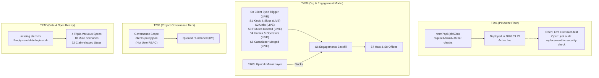

# RBAC & Identity Tickets Revalidation Audit
**Date:** 2026-10-01  
**Auditor:** Antigravity  
**Surfaces Inspected:** Code (`wom7api`, `wom7web`, `wom7sec`), Database Migrations, Specs (`openspec`), Tasks (`.tasks/`, `TASKS.md`), Probes (`authz_probe_suite.py`, `spec_reality_check.py`, `org_client_parity.py`)

---

## Executive Summary & Scorecard

| Ticket | Stated Progress | Measured Reality | Priority & Queue | Key Finding / Truth Gap |
|---|---|---|---|---|
| **[T396](file:///Users/proto/Projects/@self/@wom/.tasks/T396.md)** | 3 of 5 (60%) | **3 of 5** (AC2 code deployed, AC5 non-existent command) | **P0** (now) | Admin active-hat verification is **already deployed** in `requireAdminAuth` (`cfd53f8`), but AC2 is intentionally unticked pending live end-to-end admin-as-member test. `just security-check` does not exist (subsumed by `just audit`). |
| **[T458](file:///Users/proto/Projects/@self/@wom/.tasks/T458.md)** | 2 of 7 (29%) | **Vastly further** (S0–S5 live in DB; S6 blocked on T468) | **P1** (now) | **Stopgap S0 is NOT open** — migration applied and verified live on 2026-09-26 (`org-client-parity` OK). S1–S5 are also live. Living docs (AC3), relation-hat switcher (AC6), and split tickets for S8/S9 (AC7) remain open. |
| **[T299](file:///Users/proto/Projects/@self/@wom/.tasks/T299.md)** | 0 of 8 (0%) | **0 of 8** (Unstarted) | **P1** (next) | **Misclassified**: T299 is **SDLC project governance** in `clients-policy.json` (role: w0m/managed/on-prem + per-project switches), **NOT** user RBAC permissions. |
| **[T461](file:///Users/proto/Projects/@self/@wom/.tasks/T461.md)** | 0 of 7 (0%) | **0 of 7** (Unstarted) | **P1** (now) | Genuinely unstarted. Spec & draft design exist (`openspec/changes/2026-09-26-hat-management/`). Blocked by T458 S6/S8. Awaits owner answers to QH1–QH7. |
| **[T366](file:///Users/proto/Projects/@self/@wom/.tasks/T366.md)** | 0 of 6 (0%) | **0 of 6** (Unstarted) | **P1** (next) | Genuinely unstarted. `project/profiles-policy.json` and `just profile-*` helpers do not exist. Ambient host credentials still leak across profiles. |
| **[T237](file:///Users/proto/Projects/@self/@wom/.tasks/T237.md)** | 2 of 8 (25%) | **2 of 8** (Active Defect Confirmed) | **P1** (now) | Measured live: 4 authorization tests are **still triple-vacuous** (`candidate user is logged in` remains an empty stub; `/cp/ai/*` routes 404; assertion passes on 404). 10 mute scenarios and 22 dummy checks verified. |

---

## Detailed Revalidation by Ticket

---

### 1. T396 — Client Delivery Readiness: End-to-end Client Functions Security & Authz Audit

* **File:** [`file:///.tasks/T396.md`](file:///Users/proto/Projects/@self/@wom/.tasks/T396.md)
* **Status:** `queued` | **Queue:** `now` | **Priority:** **P0** (promoted 2026-09-29 by owner directive).
* **Completed Criteria:**
  * **[x] AC1 (Audit client endpoints):** Completed. 7 client-facing edge surfaces audited.
  * **[x] AC3 (RLS authenticated policies):** Completed. Verified fail-closed behavior for anon access on all client tables.
  * **[x] AC4 (Automated security probes in `wom7sec` / `authz_probe_suite.py`):** Completed. 5 dedicated client tenant-isolation probes (`X1`–`X5`) implemented, passing live (25/25 total probes green). Unit tests in [`test_authz_probe_suite.py`](file:///Users/proto/Projects/@self/@wom/wom7web/project/scripts/tests/test_authz_probe_suite.py) pass 100%.
* **Open Criteria Audit:**
  * **[ ] AC2 (Active-hat validation across onboarding & invites):**
    * *Code Reality:* The core enforcement was **already implemented and deployed** in commit [`cfd53f8`](file:///Users/proto/Projects/@self/@wom/wom7api/supabase/functions/_shared/requireAuth.ts#L144-L156) (release `2026.09.29-1790727494`). [`requireAdminAuth`](file:///Users/proto/Projects/@self/@wom/wom7api/supabase/functions/_shared/requireAuth.ts#L144) now calls database RPC `wom_acting_is('admin')` through the caller's session and runs `adminHatVerdict`. This protects all 9 admin edge functions, including [`admin-invite-candidate`](file:///Users/proto/Projects/@self/@wom/wom7api/supabase/functions/admin-invite-candidate/index.ts#L69). [`client-api`](file:///Users/proto/Projects/@self/@wom/wom7api/supabase/functions/client-api/index.ts#L98) similarly gates its admin bypass on wearing the admin hat.
    * *Why it remains open:* It was deliberately left unticked awaiting an explicit live execution using an admin token wearing the `member` hat to observe the 403 `HAT_REQUIRED` response. In addition, `client-register` provisions standard client access without hat assignments (membership-scoped only).
  * **[ ] AC5 (`just security-check` with 0 high/critical):**
    * *Reality:* `just security-check` **does not exist** anywhere in the estate (0 hits across all 6 repositories).
    * *Subsumed by:* `just audit` (`scripts/w0m_audit.py`). `just audit` exits 0 on authz and ratchets, but skips 2 environment checks and does not output a "0 high/critical findings" score. AC5 remains unticked until the ticket's acceptance command is updated to reflect `just audit`.

---

### 2. T458 — Org and Engagement Model

* **File:** [`file:///.tasks/T458.md`](file:///Users/proto/Projects/@self/@wom/.tasks/T458.md)
* **Status:** `in-progress` | **Queue:** `now` | **Priority:** **P1**
* **The "2 of 7" Tracking Lag vs Real DB State:**
  * Tracker shows only AC1 and AC2 as done (`x_ac_done: 2`).
  * **Fact Check on "Client-create stopgap is open": FALSE.** Stopgap S0 is **fully applied and verified live**. Migration [`20260926120000_t458_s0_client_org_sync.sql`](file:///Users/proto/Projects/@self/@wom/wom7api/supabase/migrations/20260926120000_t458_s0_client_org_sync.sql) installs an `AFTER INSERT` trigger on `clients` synchronizing `orgs`. Verified via `just org-client-parity` (0 unlinked clients) and `just org-client-parity --probe` (4/4 behavioral probes pass). OpenSpec task 1.1 is marked `[x]`. AC4 was simply neglected in `.tasks/T458.md`.
  * **S1–S5 are also LIVE in production:**
    * **S1 (Org kinds & slugs):** Migration `20260926140000` applied live. CP switched to sides.
    * **S2 (Units):** Migration `20260926200000` applied live (`org-units-verify` 5/5).
    * **S3 (Fixtures purge):** Batches 1, 1b, 2, 3, 4 applied live.
    * **S4 (Homes & operator gate):** Migration `20260927010000` applied live (`org-homes-verify` 8/8).
    * **S5 (Casualuser merge):** Verified live. Merged 92 logs into `aleksei@`, linked secondary Google identity.
* **Genuinely Open Items:**
  * **AC3 (Living docs):** Updating terminology map, RBAC references, user stories, and CP IA plans is open.
  * **AC5 (Migrations S6–S7):** S6 (engagements table & historical contract backfill) was re-planned on 2026-09-27 when the owner directed that Upwork contracts should remain in an external mirror layer rather than polluting internal tables. This unbundled **[[T468]]** (P0), which currently blocks S6.
  * **AC6 (Relation-hat switcher & staff pages):** Staff pages at `/o/webomage/...` and the engagement-hat switcher require S6/S7.
  * **AC7 (Split tickets):** While [[T459]], [[T460]], [[T461]], and [[T468]] were filed, the specific split tickets for **S8 (`clients` table retirement)** and **S9 (Axis-1 classes retirement with T453)** have not yet been filed.

---

### 3. T299 — Replace Role Enum with Base Role Plus Per-Service Switches

* **File:** [`file:///.tasks/T299.md`](file:///Users/proto/Projects/@self/@wom/.tasks/T299.md)
* **Status:** `queued` | **Queue:** `next` | **Priority:** **P1** | **Progress:** **0 of 8 (0%)**
* **Reality & Scope Clarification:**
  * **Not a User RBAC Ticket:** User request grouped this under "RBAC and identity" as *"replace the role enum with a base role plus per-service permissions"*. T299 does **not** touch user roles or permissions.
  * **Actual Scope:** SDLC project governance in [`project/clients-policy.json`](file:///Users/proto/Projects/@self/@wom/wom7web/project/clients-policy.json). It replaces the rigid, 33-surface `half-managed` tier ladder (T265 AC2) with project roles (`w0m`, `managed`, `on-prem`) and per-project service overrides (`github, tickets, deploys, secrets`) with mandatory justifications (`reason`).
  * **Codebase Verification:** Lines 250–387 of `clients-policy.json` still use `tiers['half-managed']`. Unstarted.

---

### 4. T461 — Hat Management in the CP

* **File:** [`file:///.tasks/T461.md`](file:///Users/proto/Projects/@self/@wom/.tasks/T461.md)
* **Status:** `queued` | **Queue:** `now` | **Priority:** **P1** | **Progress:** **0 of 7 (0%)**
* **Reality:**
  * Unstarted across all 7 ACs.
  * Spec, design, and UI brief drafted at [`openspec/changes/2026-09-26-hat-management/`](file:///Users/proto/Projects/@self/@wom/wom7web/openspec/changes/2026-09-26-hat-management/).
  * Blocked by **T458 S6 (engagements) and S8 (office catalogue)**.
  * Execution awaits owner answers to questions QH1–QH7 and the external UI reference from Claude Design.

---

### 5. T366 — Per-Developer Connection and Credential Isolation

* **File:** [`file:///.tasks/T366.md`](file:///Users/proto/Projects/@self/@wom/.tasks/T366.md)
* **Status:** `queued` | **Queue:** `next` | **Priority:** **P1** | **Progress:** **0 of 6 (0%)**
* **Reality:**
  * Unstarted across all 6 ACs.
  * Spec exists at [`openspec/specs/per-profile-connection-routing/spec.md`](file:///Users/proto/Projects/@self/@wom/wom7web/openspec/specs/per-profile-connection-routing/spec.md).
  * `project/profiles-policy.json` does not exist.
  * No `profile-infisical` or `profile-jam` recipes exist in `Justfile`.
  * Ambient host credentials (`~/.config/jam/credentials.json`, global Infisical vault) continue to bleed into client workspaces.

---

### 6. T237 — Revalidate Gauge Spec Corpus Against Reality

* **File:** [`file:///.tasks/T237.md`](file:///Users/proto/Projects/@self/@wom/.tasks/T237.md)
* **Status:** `queued` | **Queue:** `now` | **Priority:** **P1** | **Progress:** **2 of 8 (25%)**
* **Fresh Measurement via `python3 scripts/spec_reality_check.py`:**
  * **Corpus State:** 194 specs · 598 scenarios · 514 implemented steps.
  * **The 4 Authorization Tests are Still Triple-Vacuous:**
    * Tested in [`admin_ai_simulator.spec`](file:///Users/proto/Projects/@self/@wom/wom7web/specs/web/admin_ai_simulator.spec#L18-L21), `admin_cp_personas.spec`, `admin_system_domains.spec`, `admin_system_tasks.spec`.
    * Reason 1: Step `@Step("candidate user is logged in")` in [`tests/steps/missing.steps.ts:68`](file:///Users/proto/Projects/@self/@wom/wom7web/tests/steps/missing.steps.ts#L68-L71) is **still an empty stub** (`// Stub — candidate login not yet implemented`). Nobody logs in.
    * Reason 2: Target pages (`/cp/ai/simulator`, `/cp/ai/personas`) **do not exist** in `apps/cp/src/pages/` (404).
    * Reason 3: Step `@Step("user is redirected away from the CP")` checks `!url.includes("/cp")`, which trivially passes on a 404!
  * **Corpus Hygiene Deficits Persist:**
    * 6 stub actions/identities detected.
    * 10 scenarios where not one step verifies anything (e.g. `006-dsl-models.spec`, `goldens.spec`).
    * 22 claim-shaped steps whose bodies verify nothing (e.g. `// Visual check`, `// Basic check passed`).
  * **Blocker (AC7):** The test harness cannot be pointed safely at production (`--env=dev` in Infisical resolves to production Supabase). Running the full suite creates and deletes live database records until re-anchored to the local sandbox stack.
