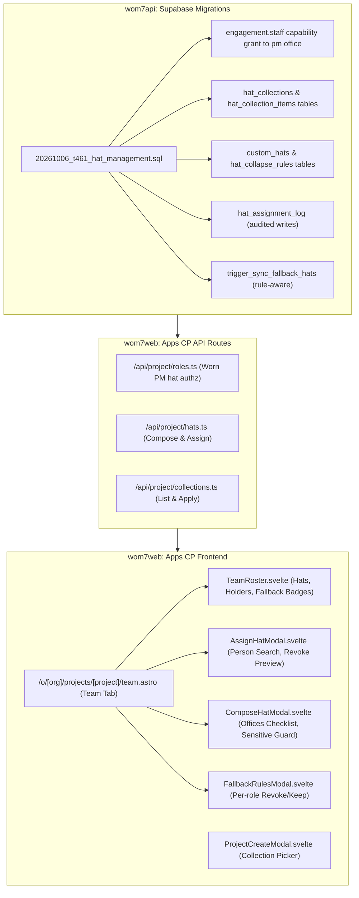

# T461 Start Brief: Hat Management in the CP

**Ticket**: [T461](file:///Users/proto/Projects/@self/@wom/.tasks/T461.md) — *Hat management in the CP: PM and root assign hats, custom hats and mixes, hat collections with fallback rules*  
**Date**: 2026-10-06  
**Lifecycle Gate**: `w0m-sdlc-start`  
**Working Branch**: `agent/agy` (`~/.w0m/work/agy/w0m`)  

---

## 1. Executive Summary & Problem Context

In the current estate, only system administrators (`is_admin()` or `is_manager()`) can configure project roles or assign hats:
- Calling `/api/project/roles` and `/api/project/hats` returns `403 Forbidden` for all non-admin members, even if they are assigned as the Project Manager (`pm`) on that project.
- The automated fallback trigger (`trigger_sync_fallback_hats`) hardcodes two static pairs (`devops` → `tech-lead` and `qa-engineer` → `pm`), leaving no flexibility for project staffing dynamics (e.g. when a PM takes the `dev` hat and retracts the `tl`'s `dev` fallback).
- There is no mechanism to compose custom project-scoped hats from catalog offices, nor are there reusable hat collections during project creation.

**T461** fulfills [[AgDR-0028]] Decision 12 to decentralize hat management:
1. Grant the active `pm` hat holder (while worn) and the root admin authority to staff engagement/project contractor hats (`tl`, `dev`, `devops`, `qa`, `design`, and themselves) via the new capability `engagement.staff`.
2. Allow composing custom hats from catalog offices (with sensitive offices reserved for root).
3. Introduce hat collections with configurable fallback rules (`revoke_fallback` vs `keep_fallback`).
4. Provide the CP Team tab (`/o/<org>/projects/<project>/team`) and collection creation picker.

---

## 2. Reality Grounding & 5-Surface Verification

| Surface | Target / Requirement | Measured Reality | Status |
|---|---|---|---|
| **Tracking** | `.tasks/T461.md`, `TASKS.md`, `ROADMAP.md` §39 | `status: queued`, `0/7 ACs`. `just ticket-audit T461` reports 4/4 tracking surfaces agree with zero contradictions. | ✅ Verified |
| **Spec** | `openspec/changes/2026-09-26-hat-management/` | `proposal.md`, `design.md`, `tasks.md`, `specs/hat-management/spec.md` exist and validate cleanly (`openspec validate 2026-09-26-hat-management --strict`). | ✅ Valid |
| **Living Decisions** | [AgDR-0027](file:///Users/proto/Projects/@self/@wom/docs/decisions/AgDR-0027-orgs-persons-operator-gate.md) & [AgDR-0028](file:///Users/proto/Projects/@self/@wom/docs/decisions/AgDR-0028-engagements-minimum-hats-one-worn-hat.md) | AgDR-0028 Decision 12 explicitly dictates delegated PM assignment, custom hats, collections, and fallback rules. | ✅ Aligned |
| **Database Schema** | `role_templates`, `hats`, `worn_hats`, `trigger_sync_fallback_hats` | `role_templates` exists with 6 system roles; fallback trigger hardcodes 2 pairs. Tables `hat_collections`, `custom_hats`, `hat_assignment_log` do not yet exist. | 🟡 Unstarted |
| **API Endpoints** | `/api/project/roles.ts`, `/api/project/hats.ts` | Endpoints currently check `isElevated` (`admin`/`manager`), completely gating out ordinary members wearing `pm`. | 🟡 Needs Refactor |
| **UI Reference** | `design-system/_ref/hat-management/` | `BRIEF.md` is drafted; static mockups from Claude Design have not yet landed. | ⚪ Pending |

---

## 3. Acceptance Criteria Audit

- [ ] **AC1 — Owner answers QH1–QH7 (`design.md` §Open questions, each with a weighted recommendation)**: ⚪ Not Started. (Presented below for decision).
- [ ] **AC2 — UI reference back from Claude Design per `design-system/_ref/hat-management/BRIEF.md`, reviewed**: ⚪ Not Started.
- [ ] **AC3 — Migrations written (`engagement.staff` capability, collections, custom hats, audit log, collapse-pair table, rule-aware fallback trigger) and applied by owner**: ⚪ Not Started.
- [ ] **AC4 — Assignment and compose endpoints authorised by the worn hat, audited; red probes from `design.md` §Verification pass**: ⚪ Not Started.
- [ ] **AC5 — Collection picker at project creation; add-only on an existing engagement**: ⚪ Not Started.
- [ ] **AC6 — Team tab (roster, assign, compose, rules) verified in a browser as a PM and as a `dev`**: ⚪ Not Started.
- [ ] **AC7 — Deltas to `project-hats-templates` and `project-roles`; change archived**: ⚪ Not Started.

---

## 4. Open Questions QH1–QH7 & Weighted Recommendations

| # | Question | Recommended Answer | Rationale & Weight |
|---|---|---|---|
| **QH1** | May a PM assign `pm` to someone else (a second PM)? | **No: only the root and the org owner add PMs.** | **Low Cost**: Prevents lateral privilege escalation. A PM cannot mint a peer PM. |
| **QH2** | Who assigns client-side hats? | **The `client` hat holder of that engagement; PM may invite, client confirms.** | **Moderate Cost, High Soundness**: Preserves client organization sovereignty over their own team roster. |
| **QH3** | Does the contractor org owner get PM-level assignment across all its engagements? | **Yes, for its own contractor engagements; composes non-sensitive offices.** | **Low Cost, High Utility**: Prevents orphaned engagements when a PM departs. Same permission ceiling as PM. |
| **QH4** | May the `tl` (Tech Lead) holder assign `dev` and `devops` in their engagement? | **Yes, the technical roles under `tl` only.** | **Low Risk**: Streamlines developer onboarding and takes operational burden off the PM. |
| **QH5** | Sensitive offices in custom hats | **Root only (`deploy.execute`, `infra.manage`, `secret.use.prod`).** | **Zero Compromise**: Custom hats created by PMs cannot grant production infrastructure or secret access without root action. |
| **QH6** | Where do org collections live? | **Per org (`hat_collections.owner_scope = org_id`), managed by `<org>.owner`, visible to that org's projects.** | **Clean Isolation**: Enables companies to create and reuse tailored team blueprints. |
| **QH7** | Build Order & Scope Bridge | **Implement on project scope with foreign key compatibility for engagements (`project_id` primary, nullable `engagement_id`).** | **High Value / Unblock**: T458 S6 (engagements) is currently paused behind T468 (Upwork sync). A bridge schema unblocks shipping hat management immediately in the CP for active projects, auto-migrating cleanly to engagements when S6 lands. |

---

## 5. Blast Radius & Implementation Plan

---

## 6. Security & Invariant Guardrails

1. **One Worn Hat Authority**:
   - In accordance with AgDR-0028 Decision 7, authorization is evaluated strictly against the caller's *currently worn hat* in that engagement/project, never a dormant role list. A PM who is wearing a `dev` hat cannot perform staff assignments.
2. **Strict Sensitive Office Ceiling**:
   - `deploy.execute`, `infra.manage`, and `secret.use.prod` are rejected if submitted by any non-root composer.
3. **Inviolable Separation for DevOps**:
   - `keep_fallback` is strictly rejected for `devops` in schema and API (AgDR-0028 Decision 8: approve and execute remain separate).
4. **Audit Immutability**:
   - Every hat creation, assignment, retraction, and rule change logs an immutable entry to `hat_assignment_log` recording `(actor_profile_id, worn_hat_id, target_profile_id, action, before, after)`.
