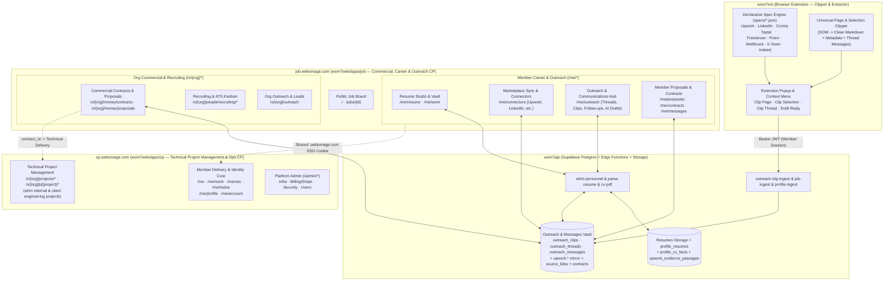

# Jobs Portal Member & Commercial CP, Multi-Platform Outreach Hub & Extension Clipper Architecture (`AgDR-0033`)

> [!IMPORTANT]
> **Decided Architecture (`AgDR-0033`, Owner Confirmed `D1`–`D5` on 2026-10-19)**:
> - **`job.webomage.com` (`wom7web/apps/job`)** is the single canonical portal for **Public Jobs, Member Career & Resume Studio, Freelancer/Marketplace Sync (Upwork, LinkedIn, etc.), Multi-Platform Outreach & Communications, Proposals, Messages, Recruiting, and Contract Management** across both member (`/me/*`) and organization (`/o/[org]/*`) scopes.
> - **`cp.webomage.com` (`wom7web/apps/cp`)** focuses strictly on **Technical Project Management & Engineering Delivery** (`w0m` internal projects and client engineering projects under `/o/[org]/projects/*` and `/o/[org]/p/[project]/*`), member delivery/identity core (`/me`, `/me/work`, `/me/oss`, `/me/todos`, `/me/profile`, `/me/account`), org billing/invoices (`/o/[org]/money/invoices`), and `/admin/*` platform ops.
> - **`wom7ext` (Browser Extension)** acts as the universal authenticated **Page & Selection Clipper** across Upwork, LinkedIn, Contra, Toptal, Freelancer.com, Fiverr Pro, Wellfound, X-Team, Indeed, and any web page into the private Outreach & Messages Vault.

---

## 1. System Topology & Portal Boundary (`apps/job` vs `apps/cp` vs `wom7ext`)

---

## 2. Canonical Route Cutover Map (`apps/cp` $\rightarrow$ `apps/job`)

| Surface / Capability | Previous Location (`apps/cp`) | Canonical Location (`apps/job`) | Cutover in `apps/cp` (`AgDR-0025` / `AgDR-0033`) |
|---|---|---|---|
| **Resume & CV Studio** | `/me/profile/resume` (`ResumeStudio.svelte`) | `/me/resume` | 301 redirect $\rightarrow$ `https://job.webomage.com/me/resume` |
| **CV Work History & Source Links** | `/me/profile/work` (`WorkHistory.svelte`) | `/me/work` | 301 redirect $\rightarrow$ `https://job.webomage.com/me/work` |
| **Member Upwork Contracts / Proposals / Messages** | `/me/upwork/{contracts,proposals,messages}` | `/me/contracts`, `/me/proposals`, `/me/messages` | 301 redirect $\rightarrow$ `https://job.webomage.com/me/{contracts,proposals,messages}` (preserving `?room=` & `?q=`) |
| **Org Commercial Contracts & Proposals** | `/o/[org]/money/{contracts,proposals}` | `/o/[org]/money/{contracts,proposals}` | 301 redirect $\rightarrow$ `https://job.webomage.com/o/[org]/money/{contracts,proposals}` |
| **Org Recruiting & ATS Kanban** | `/o/[org]/people/recruiting/*` | `/o/[org]/people/recruiting/*` | 301 redirect $\rightarrow$ `https://job.webomage.com/o/[org]/people/recruiting/*` |
| **Multi-Platform Outreach & Clips Vault** | *(New capability)* | `/me/outreach`, `/o/[org]/outreach` | Native in `apps/job`; fed by `wom7ext` clipper |
| **Technical Project Management (`w0m` & Client Projects)** | `/o/[org]/projects/*`, `/o/[org]/p/[project]/*` | *(Stays in `apps/cp`)* | Canonical home in `apps/cp` |
| **Member Delivery & Identity Core** | `/me`, `/me/work`, `/me/oss`, `/me/todos`, `/me/profile`, `/me/account` | *(Stays in `apps/cp`)* | Canonical home in `apps/cp` (shared `.webomage.com` SSO cookie) |

---

## 3. Tracked Phased Tickets (`ROADMAP.md` §34 Workstream `B5`)

1. **[`T560`](file:///home/aleksei/.w0m/work/agy-jobs-cp/w0m/.tasks/T560.md) (`P0`, `in-progress`) — Phase 1: `apps/job` CP Shell & Commercial/Career Boundary Cutover**:
   - Populate `apps/job/src/lib/route-policy.ts`, share `ResumeStudio`, `WorkHistory`, `ContractManager`, `ProposalManager`, `ATSKanban`, `upwork-view.ts`, and `unified-registry.ts`, mount `/me/{resume,work,contracts,proposals,messages,connectors}` and `/o/[org]/{money/contracts,money/proposals,people/recruiting/*}` in `apps/job`, fold [`T513`](file:///home/aleksei/.w0m/work/agy-jobs-cp/w0m/.tasks/T513.md) fixes, and cut over `apps/cp` routes to 301 redirects.
2. **[`T561`](file:///home/aleksei/.w0m/work/agy-jobs-cp/w0m/.tasks/T561.md) (`P1`, `queued`) — Phase 2: Multi-Platform Outreach & Clipping Vault Schema & `outreach-clip-ingest` Edge Function**:
   - Owner-scoped `public.outreach_clips`, `public.outreach_threads`, and `public.outreach_messages` tables (`profile_id = public.current_profile_id()`), `public.source_links` & `public.upwork_evidence_passages` integration, `outreach-clip-ingest` Edge Function, and `authz_probe_suite.py` probes.
3. **[`T562`](file:///home/aleksei/.w0m/work/agy-jobs-cp/w0m/.tasks/T562.md) (`P1`, `queued`) — Phase 3: `wom7ext` Universal Page & Selection Clipper + Multi-Platform Freelancer Specs**:
   - DOM-to-Markdown clipper (`content/clipper.ts`), popup/context-menu actions, and declarative `specs/*.json` extractors for Upwork, LinkedIn, Contra, Toptal, Freelancer.com, Fiverr Pro, Wellfound, X-Team, and Indeed.
4. **[`T563`](file:///home/aleksei/.w0m/work/agy-jobs-cp/w0m/.tasks/T563.md) (`P1`, `queued`) — Phase 4: `apps/job` Multi-Platform Outreach & Communications Hub UI**:
   - `/me/outreach` and `/o/[org]/outreach` (`OutreachHub.svelte`) with platform/stage filters, clip-to-thread/proposal/contract promotion, cross-channel thread timeline, and `w0m-personnel` evidence-grounded outreach/reply drafting.

---

## 4. Resolved Decisions (`D1`–`D5` — Recorded in [`AgDR-0033`](file:///home/aleksei/.w0m/work/agy-jobs-cp/w0m/docs/decisions/AgDR-0033-jobs-portal-commercial-career-boundary-and-extension-clipper.md))

| # | Decision | Resolution (2026-10-19) |
|---|---|---|
| **D1** | **`apps/cp` route disposition** | **Clean cutover (`AgDR-0025`)**: Move pages & APIs to `apps/job` (`job.webomage.com`) and replace moved `apps/cp` routes with 301 redirects. |
| **D2** | **Contract & Proposal boundary (`D2b`)** | **Move both member-level (`/me/*`) AND org-level commercial (`/o/[org]/money/{contracts,proposals}`, `/o/[org]/people/recruiting/*`) to `apps/job`**, while keeping technical project management (`/o/[org]/projects/*`, `/o/[org]/p/[project]/*` for `w0m` internal & client tech projects) in `apps/cp`. |
| **D3** | **Identity & Account core** | **Keep `/me/account` (MFA/passkeys/OAuth) and `/me/profile` (public card switches) in `apps/cp`**, sharing `.webomage.com` `HttpOnly` SSO cookies with `job.webomage.com`. |
| **D4** | **Outreach & Clipping schema** | **Keep `upwork.*` untouched (`T468`/`T533`)** and add owner-scoped `public.outreach_clips`, `public.outreach_threads`, and `public.outreach_messages` linked via `public.source_links`. |
| **D5** | **Governance record** | **Recorded as [`AgDR-0033`](file:///home/aleksei/.w0m/work/agy-jobs-cp/w0m/docs/decisions/AgDR-0033-jobs-portal-commercial-career-boundary-and-extension-clipper.md)** and tracked under `T560`–`T563`. |
