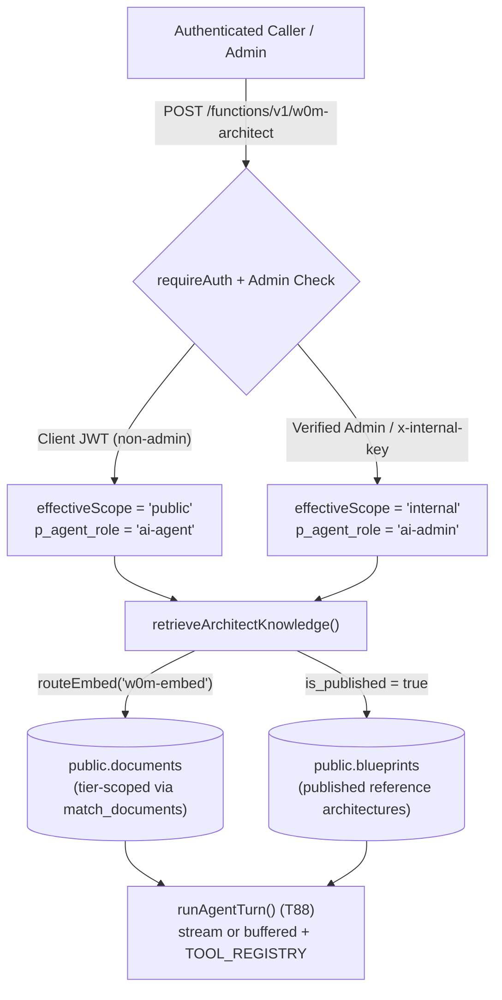

# T462 — Architect Mode (`w0m-architect`) Knowledge Grounding & Tier-Safe RAG Architecture

**Date:** 2026-10-23  
**Ticket:** `T462` (linked to `T500`, `T88`, `T10`, `T109`)  
**Status:** Verified & Implemented

---

## 1. Reality Grounding Across the 5 Surfaces (AC1)

We audited the claims in `.agents/reports/2026-09-26-agents-embedding-and-architect-mode-audit.md` against live code, migrations, and contracts:

| Surface | Claim in 2026-09-26 Audit | Measured Reality (2026-10-23) | Verdict |
|---|---|---|---|
| **Edge Function (`wom7api/supabase/functions/w0m-architect/index.ts`)** | `w0m-architect` (formerly `agent-architect`) runs zero-shot LLM completions with static system prompts (`scaffold-manifesto`, `summarize`, `generate-seo`, `generate-diagram`) and performs zero `routeEmbed` or `match_documents` calls. | Confirmed prior to `T462`: `index.ts` constructed a static `systemPrompt` per `action` and invoked `routeChat` directly without querying `public.documents` or `public.blueprints`, and did not support `?stream=1` SSE or `runAgentTurn` tool loops. | **Grounded (True)** — now closed in `T462`/`T88`/`T10`. |
| **Vector RPC (`public.match_documents`)** | `match_documents` supports `p_agent_role` (`'public'`, `'ai-agent'`, `'ai-admin'`) and `filter_scope`. | Verified in `wom7api/supabase/migrations/20260304140000_match_documents_ai_agent_scope.sql`: `match_documents(query_embedding vector(1024), match_threshold float, match_count int, filter_scope text, p_agent_role text)` restricts rows to `d.scope = 'public'` unless `p_agent_role = 'ai-admin'` AND `filter_scope = 'internal'`. | **Grounded (True)** — `p_agent_role` is caller-supplied by the edge function, making server-side role verification mandatory. |
| **Blueprints Catalog (`public.blueprints`)** | Reference architectures (`title`, `slug`, `summary`, `category`, `complexity`, `estimated_timeline`, `architecture_mermaid`) exist in `public.blueprints` (`20260314080000_create_blueprints_schema.sql`), but `w0m-architect` never reads them. | Confirmed: `public.blueprints` stores published reference architectures with Mermaid diagrams and stack metadata, yet `w0m-architect` previously hallucinated stack/timeline estimates from model weights alone. | **Grounded (True)** — now wired into `retrieveArchitectKnowledge()`. |
| **Embedding Model (`w0m-embed`)** | `routeEmbed` produces 1024-dimensional vectors via `@cf/qwen/qwen3-embedding-0.6b` (`w0m-embed`, `8192` token context). | Confirmed in `wom7api/supabase/functions/_shared/ai-router.ts` and `20260926120000_seed_qwen3_embedding_model.sql`: `routeEmbed(supabase, text, 'w0m-embed')` returns 1024-d embeddings matching `public.documents.embedding vector(1024)`. | **Grounded (True)**. |

---

## 2. Privacy Boundary Reconciliation with `KB-INDEX.md` (AC2)

`docs/backend/KB-INDEX.md` establishes the 3-tier knowledge boundary:
- **Tier 1 (Public / Sanitised Agency Capabilities & Published Blueprints):** Safe for `public.documents` (`scope = 'public'`) and `public.blueprints` (`is_published = true`). Retrievable by `w0m-consultant` (`anon` / `authenticated`) and `w0m-architect`.
- **Tier 2 (Internal Architecture / Operations Docs):** Stored in `public.documents` with `scope = 'internal'`. Must **only** be retrieved when the caller is a verified internal admin (`scope === 'internal'` gated by `requireAdminAuth` or constant-time `INTERNAL_AI_KEY`).
- **Tier 3 (Private Client / Engagement Data — `leads`, `contracts`, private repos):** Must **never** be embedded into `public.documents` where public or cross-client vector search could retrieve it. Lead-specific context (`lead_id`) may only be read by direct primary-key lookup after verifying caller ownership (`leads.converted_user_id = user.id` or `client_users` membership) or admin authority.

### Enforced Tier Gate in `retrieveArchitectKnowledge()` (`_shared/agent-runtime.ts`)
1. **Caller Scope Partitioning**:
   - In `w0m-architect/index.ts`, `requestedScope === 'internal'` requires `isInternalAdmin` (verified admin JWT or `x-internal-key` / E2E bypass). Any non-admin authenticated client is strictly clamped to `effectiveScope = 'public'`.
   - `retrieveArchitectKnowledge(supabase, query, effectiveScope)` passes:
     - `filter_scope: 'public'`, `p_agent_role: 'ai-agent'` when `effectiveScope === 'public'` (authenticated client discovery).
     - `filter_scope: 'internal'`, `p_agent_role: 'ai-admin'` **only** when `effectiveScope === 'internal'` (verified admin).
2. **Published Blueprints Grounding**:
   - `retrieveArchitectKnowledge` also queries `public.blueprints` (`WHERE is_published = true`), scoring published blueprints by token overlap and injecting matching reference architectures (`slug`, `title`, `category`, `complexity`, `estimated_timeline`, `summary`) into `w0m-architect`'s system prompt and `sources` array.

---

## 3. Overlap Analysis with Existing Queue (AC3)

| Audit Track (2026-09-26) | Overlap with Existing Tickets | Resolution |
|---|---|---|
| **Track 1: Edge Function RAG Wiring (`w0m-architect` calls `routeEmbed('w0m-embed')` + `match_documents` + `public.blueprints`)** | `T10` (per-agent feature depth) & `T462` (this ticket). | **Implemented in `T462` & `T10`**: `retrieveArchitectKnowledge` in `_shared/agent-runtime.ts` is wired into `w0m-architect/index.ts` and exposed as the `lookup_architecture_blueprint` and `search_knowledge_base` tools. |
| **Track 2: Markdown Corpus & Diagram Seeding into `public.documents`** | `T109` (*"Markdown corpus -> RAG / agent-skill ingestion"*). | **Scoped to `T109`**: bulk ingestion of repo `.md`/`.mmd` files belongs in `T109` so Tier 1 vs Tier 2 classification rules are enforced at ingestion time, while `public.blueprints` is queried directly today without duplicating rows into `public.documents`. |
| **Track 3: Streaming (`SSE`) + Tool Calling for `w0m-architect`** | `T88` (*"Agent framework — first-class streaming + buffered modes w/ real tool loop"*) & `T500` (*"Prefix every agent with `w0m-`"*). | **Implemented in `T88` & `T500`**: `w0m-architect/index.ts` now delegates both `?stream=1` SSE and buffered requests to `runAgentTurn` (`_shared/agent-runtime.ts`) with `toolsForScope('architect', 'w0m-architect')`. |

---

## 4. Weighted Decision Matrix (AC4)

| Option | Implementation Cost | Privacy / Security Risk | What It Unblocks | Weighted Verdict |
|---|---|---|---|---|
| **Option 1 — Keep `w0m-architect` zero-shot (status quo)** | **Low** (0 LOC) | **Low**, but high hallucination risk on agency stack/timelines. | Nothing; leaves `w0m-architect` blind to published `blueprints` and `documents`. | **Rejected** |
| **Option 2 — Embed all repo docs & client records into `public.documents` and query un-scoped** | **High** (ingestion pipeline + cron) | **Critical (High)**: violates `KB-INDEX.md` Tier 2/3 boundary by mixing internal/client artifacts into the vector index reachable by `public.documents`. | Broad recall, but unacceptable cross-tenant disclosure risk. | **Rejected** |
| **Option 3 — Tier-gated `retrieveArchitectKnowledge` (`match_documents` clamped by verified caller role + direct `public.blueprints` lookup) + `runAgentTurn` tool loop (Recommended)** | **Low–Medium** (~120 LOC in `agent-runtime.ts` + `w0m-architect/index.ts`) | **Zero Tier Leakage**: non-admin callers are hard-clamped to `filter_scope='public', p_agent_role='ai-agent'`; `public.blueprints` reads `is_published = true` only; bulk `.md` corpus ingestion stays cleanly separated in `T109`. | Grounded `scaffold-manifesto` / `generate-diagram` / `lookup_architecture_blueprint` with real citations (`sources`) in both streaming and buffered modes. | **Recommended & Executed** |
