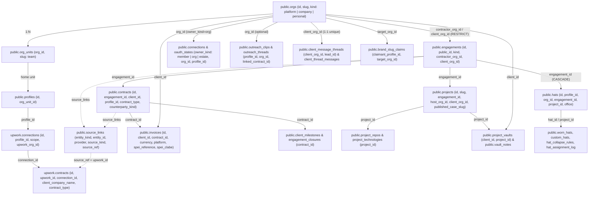

# T459 Research Report — Personal-to-Company Org Merge, Engagement Transfer, and Portfolio Attribution

- **Ticket:** [[T459]] (Split from [[T458]] Q32)
- **Date:** 2026-10-25
- **Area:** Product / Security & RBAC Hardening (`web`, `api`)
- **Related Decisions:** [[AgDR-0025]], [[AgDR-0026]], [[AgDR-0027]], [[AgDR-0028]], [[AgDR-0029]], [[AgDR-0033]], [[AgDR-0034]], [[AgDR-0048]]
- **Verdict:** **Decline destructive in-place `org_id` merge; adopt Non-Destructive Attribution & Cutoff Novation (`AgDR-0048`).**

---

## 1. Executive Summary

Under [[AgDR-0027]] §4 and [[AgDR-0028]] §1, every registered person receives a default home organisation (`orgs.kind = 'personal'` when they do not belong to a company), and every commercial or training relationship between two organisations is represented by a directed two-party `public.engagements` row (`<contractor>.<engagement>.<client>`). When a solo practitioner incorporates from scratch, their personal org can convert to `kind = 'company'` in place (`AgDR-0027` §4). However, when a person who already has historical or active engagements on their personal org **joins or claims an existing company org** (`public.brand_slug_claims`, [[T495]]), [[AgDR-0027]] §4 mandates that their personal org is **kept** so completed engagements retain their true historical parties.

[[T459]] investigates the optional follow-up question from [[T458]] Q32: *Could a person who belongs to a company merge their personal org into that company, transferring all its engagements and everything connected to them (Upwork contracts, direct contracts, invoices, projects, repositories, secrets, vaults, portfolio items, hats, and outreach records)?*

After a full schema, legal, commercial, and RLS audit across all `wom7api` migrations through `20261025210000`, we conclude:

1. **Destructive in-place `org_id` merging must never be built.** Rewriting `contractor_org_id` or `client_org_id` on historical engagements or mutating `client_id` / `org_id` on completed contracts and issued invoices falsifies legal counterparties, breaks Upwork source-mirror fidelity (`AgDR-0029`), invalidates tax and payment settlement audit trails (Stripe, Banxico SPEI / CLABE `T351`, Mercado Pago, 1099/CFDI), and triggers uniqueness collisions on `public.client_message_threads` (`idx_client_message_threads_client_org`) and `public.projects` (`projects_host_name_lower_uq`).
2. **The commercial goal (showcasing a founder's or member's prior track record under their company org and transitioning active work) is solved cleanly without mutating history** through a two-part **Attribution & Novation Model**:
   - **Historical work → Dual Portfolio Attribution (Copy / Cross-Link):** Completed engagements, contracts, and invoices remain permanently on the personal org. Public case studies (`T288`) and portfolio entries cross-link to the company org with explicit provenance (`"Delivered by <Person> (Founder / Principal at <Company>)"`).
   - **Active or prospective work → Cutoff Novation / Pipeline Reassignment (Transfer):** Unbilled leads and `outreach_threads` (`AgDR-0033`) can be reassigned directly to the company org. In-flight commercial engagements transition via a standard **contract novation** at an explicit cutoff date: the personal-org engagement is closed (`status = 'completed'`) preserving all prior invoices, and a successor engagement is opened on the company org (`supersedes_engagement_id`) to which active `projects`, `project_repos`, and `project_vaults` are re-pointed for future billing.

---

## 2. AC1 — Exhaustive Inventory of Org & Engagement Dependencies

The diagram below maps every live database table and catalog surface that references `public.orgs(id)` directly or transitively through `public.engagements(id)`, `public.projects(id)`, and `public.contracts(id)`.

### 2.1 Detailed Surface-by-Surface Commercial, Legal, and Technical Audit

| # | Schema Surface & Migration | Foreign Key / Scoping Columns | Commercial & Legal Meaning | Technical & RLS Constraints |
|---|---|---|---|---|
| **1** | **`public.orgs`** (`20260926140000`, `20261007120000`) | `id` (PK), `slug` (`orgs_slug_shape`), `kind` (`platform \| company \| personal`), `company_name`, `verification_status`, `kyc_level`, `stripe_customer_id`, `stripe_subscription_id` | Represents a distinct legal or solo contracting party. A `personal` org is the solo contracting wrapper of one individual; a `company` org is a corporate entity verified via KYB (`T346`). | RLS policy (`20260927010000`) hides `kind = 'personal'` orgs from everyone except `wom_my_home_org()` and root admin. Referenced with `ON DELETE RESTRICT` by `public.engagements`. |
| **2** | **`public.org_units` & `public.profiles.org_unit_id`** (`20260926200000`, `20260927010000`) | `org_units.org_id -> orgs(id)`, `profiles.org_unit_id -> org_units(id)` | Defines the person's default home (`<org>.team`) and default hat (`AgDR-0027` §4). When a person claims/joins a company, `profiles.org_unit_id` moves to `<company>.team` while the personal org retains its own `team` unit. | `wom_operator_home_gate()` enforces `@webomage.com` primary email for `webomage.team` and forbids `w0m` as a home org. |
| **3** | **`public.engagements`** (`20261007120000`, `20261019120000`) | `contractor_org_id -> orgs(id) ON DELETE RESTRICT`, `client_org_id -> orgs(id) ON DELETE RESTRICT`, `public_id` (unique), `kind` (`delivery \| training`), `status` | The canonical two-party relationship (`<contractor>.<engagement>.<client>`). Records **who served whom** during the life of the engagement. | `ON DELETE RESTRICT` blocks deleting any org that is contractor or client on any engagement. All project/contract/hat tenancy resolves through `engagements`. |
| **4** | **`upwork.connections`, `upwork.contracts`, `upwork.proposals`, `upwork.rooms`, `upwork.messages` & `public.source_links`** (`20260927220000`, `20261018220000`, `20261020032000`) | `upwork.connections.profile_id -> profiles(id)`, `scope` (`freelancer \| agency \| client`), `upwork_org_id`; `source_links(entity_kind, entity_id, provider, source_kind, source_ref)` | **External Marketplace Truth (`AgDR-0029`):** Upwork contracts synced under `scope = 'freelancer'` name the **individual person** (and their personal taxpayer W-8BEN/W-9/DAC7 profile on Upwork), not a later company. Only contracts executed on Upwork under `scope = 'agency'` name an agency org. | `upwork.*` tables are written exclusively by the sync worker and scoped to `connections.profile_id = current_profile_id()`. Rewriting an engagement backed by a freelancer-scope Upwork contract to a company org creates a contradiction between `engagements.contractor_org_id` and `upwork.connections.scope = 'freelancer'`. |
| **5** | **`public.contracts`** (`20261007120000`, `20261020032000`) | `engagement_id -> engagements(id)`, `host_org_id`, `client_id -> orgs(id)`, `profile_id -> profiles(id)`, `contract_type`, `counterparty_kind`, `synced_data`, `authored_terms` | Direct or off-marketplace legal agreements (`client_delivery`, `member_engagement`, `vendor_service`, `advisory`, `internal`). Signed contracts bind the specific legal entity named at execution time. | `contracts_counterparty_key_check` (`T101`) and `contracts_preserve_authored_terms_trg` protect contract integrity. Executed contracts cannot change legal parties without a bilateral novation agreement. |
| **6** | **`public.invoices`, `public.client_milestones`, `public.engagement_closures` & Stripe / SPEI** (`20260918120000`, `20261007120000`, `20261021201000`) | `invoices.client_id -> orgs(id)`, `invoices.contract_id -> contracts(id)`, `currency` (`USD \| MXN`), `platform` (`direct \| stripe \| mercado_pago \| spei_direct \| upwork`), `spei_reference`, `spei_clabe` | **Fiscal & Tax Ledger:** Issued invoices, Stripe charges (`stripe_customer_id`), Mercado Pago preferences, and Banxico SPEI 7-digit references / 18-digit CLABEs (`T351`) are immutable accounting documents tied to tax filings (SAT CFDI in Mexico, IRS 1099 / corporate tax in US). | Mutating `client_id` or the contracting org on issued/paid invoices is illegal under tax audit rules and breaks reconciliation against Stripe Customer IDs and SPEI bank statements. |
| **7** | **`public.projects`, `public.project_repos`, `public.project_technologies`, `adventures`, `raids`, `quests`** (`20260826060000`, `20261019120000`, `20261020032000`, `20261021004500`, `20261021140000`) | `projects.engagement_id -> engagements(id)`, `projects.host_org_id -> orgs(id)`, `projects.client_org_id -> orgs(id)`, `project_repos.project_id -> projects(id)` | Technical delivery workspace, Git repositories, technology stack blueprint (`T534`), and gamified delivery backlog (`T333`). | `projects_host_name_lower_uq` (`T204`) enforces case-insensitive uniqueness on `(host_org_id, lower(btrim(name)))`. Blindly merging two orgs that share a project name (e.g., `sandbox` or `website`) fails with a unique constraint violation. |
| **8** | **`public.project_vaults` & `public.vault_notes`** (`20261019130000`, `20261021180000`) | `project_vaults.client_id -> orgs(id) ON DELETE CASCADE`, `project_vaults.project_id -> projects(id)`, `slug` (unique) | Karpathy LLM Wiki knowledge hub (`T284`) holding client-facing requirements, architecture MOCs, and deliverable reports. | RLS policies `"Client users select own project_vaults"` and `"Client users select own vault_notes"` authorize via active hats on `project_vaults.client_id` or `engagements.client_org_id`. |
| **9** | **`public.connections`, `public.oauth_states` & `public.client_service_settings`** (`20261020160000`, `20261020230000`) | `owner_kind IN ('member', 'org', 'estate')`, `profile_id -> profiles(id)`, `org_id -> orgs(id) ON DELETE CASCADE`, `provider`, `provider_urn` | Encrypted OAuth credentials, API tokens, and service settings (`AgDR-0034`, `T442`). Member-owned connections (`owner_kind = 'member'`) already live on `profile_id` and are unaffected by org changes; org-owned connections (`owner_kind = 'org'`) belong to the specific org. | `connections_owner_shape` CHECK constraint enforces strict separation between `member` (`profile_id IS NOT NULL, org_id IS NULL`) and `org` (`org_id IS NOT NULL, profile_id IS NULL`). Unique index `connections_org_provider_urn_uq` on `(org_id, provider, provider_urn)` rejects duplicate `(provider, provider_urn)` pairs if two orgs are merged. |
| **10** | **Portfolio & Case Studies: `public.projects.published_case_slug`, `public.profile_experience`, `public.profile_cv_facts`, `public.profile_resumes`** (`20260928160000`, `20261008100000`, `20261020020000`) | `projects.published_case_slug`, `projects.case_study_draft` (`T288`); `profile_experience.profile_id` + `source_links` (`entity_kind = 'work_history'`) | Public proof of work. Member resumes and work history belong to the person (`profile_id`). Project case studies (`T288`) belong to the delivery project (`projects.engagement_id`). | A founder who delivered projects under their personal org before incorporating wants their new company org (`/co/<company>`) to showcase those verified case studies without falsifying the historical contract party. |
| **11** | **`public.hats`, `public.worn_hats`, `public.custom_hats`, `public.hat_collapse_rules`, `public.hat_assignment_log` & `public.resource_grants`** (`20261006120000`, `20261007010000`, `20261019120000`) | `hats.org_id -> orgs(id)`, `hats.engagement_id -> engagements(id) ON DELETE CASCADE`, `hats.project_id -> projects(id)`, `hat_assignment_log.worn_hat_id -> hats(id)` | RBAC capability assignment (`AgDR-0028`). `wom_hats_fill()` (`T458 S7`) automatically derives `hats.org_id = coalesce(e.contractor_org_id, p.host_org_id)` for project hats. | `hat_assignment_log` (`T461`) is an append-only security audit log recording which `actor_profile_id` wearing `worn_hat_id` granted permissions at a point in time. |
| **12** | **`public.outreach_clips`, `public.outreach_threads`, `public.outreach_messages`, `public.leads`, `public.client_message_threads`** (`20261020010000`, `20261020020000`) | `outreach_*.profile_id` (required), `outreach_*.org_id -> orgs(id) ON DELETE SET NULL`; `client_message_threads.client_org_id -> orgs(id) ON DELETE CASCADE` | Multi-platform outreach vault (`AgDR-0033`, `T561`) and unified omni-channel client threads (`T285`). | `idx_client_message_threads_client_org` enforces **at most one** `client_message_threads` row per `client_org_id`. Merging two client orgs that both have message threads causes an immediate unique index failure unless threads remain per-org. |

---

## 3. AC2 — Per-Item Disposition Table (Keep, Copy/Cross-Link, or Transfer)

Based on the legal, fiscal, and technical constraints established in AC1, every entity falls into one of three deterministic dispositions:

| Category | Database Table / Surface | Disposition | Exact Rule & Mechanism |
|---|---|---|---|
| **Identity & Org Root** | `public.orgs` (`kind = 'personal'`) | **KEEP ON PERSONAL ORG (Never Delete if Engaged)** | If the personal org has 0 engagements and the owner is incorporating their solo practice with a brand-new company name, `orgs.kind` converts in place (`'personal' -> 'company'`, `AgDR-0027` §4). If the personal org has $\ge 1$ engagement and the person joins/claims an existing company org, the personal org row is **permanently kept** (`ON DELETE RESTRICT`). |
| **Identity & Org Root** | `public.profiles.org_unit_id` (Default Home) | **TRANSFER POINTER** | The person's default home (`profiles.org_unit_id`) updates to the company org's `team` unit (`<company>.team`), while the person retains a hat on their personal org so historical engagements remain accessible in the CP context switcher (`wom_my_contexts()`). |
| **Marketplace Mirror** | `upwork.connections`, `upwork.contracts`, `upwork.proposals`, `upwork.rooms`, `upwork.messages` | **NEVER MOVE (Immutable Source Layer)** | Owned by `profile_id` (`AgDR-0029`, `T468`). Synced verbatim from Upwork GraphQL API. A freelancer-scope Upwork contract legally names the individual freelancer; it can never be rewritten to claim a different company executed it on Upwork. |
| **Source Provenance** | `public.source_links` | **NEVER MOVE (Immutable Link)** | Links historical engagements, contracts, and `profile_experience` to `upwork.*` source records. Remains anchored to the entity that actually executed the work. |
| **Financial & Fiscal** | `public.invoices` (issued, paid, SPEI-reconciled, voided), `orgs.stripe_customer_id` | **NEVER MOVE (Fiscal/Tax Immutability)** | Issued invoices, Stripe payment intents, Mercado Pago settlements, and Banxico SPEI / CLABE reconciliations (`T351`) carry immutable legal counterparties and tax IDs (RFC / EIN / W-8BEN). They must never be re-parented to another legal entity. |
| **Commercial History** | Completed `public.engagements` (`status IN ('completed', 'archived')`) & closed `public.contracts` / `client_milestones` / `engagement_closures` | **KEEP ON PERSONAL ORG (Never Move)** | Historical engagements preserve their exact `<contractor>.<engagement>.<client>` address and counterparties (`AgDR-0027` §4, `AgDR-0028` §1). |
| **Commercial In-Flight** | Active `public.engagements` (`status = 'active'`) & active `public.contracts` | **NOVATION ONLY (Close + Create Successor)** | Never overwrite `contractor_org_id` or `client_org_id` in place on a billed engagement. Instead, execute a **Cutoff Novation**: close the personal-org engagement/contract as of the novation date (leaving prior invoices intact on the personal org) and create a new `public.engagements` row on the company org (`supersedes_engagement_id`) for future milestones and invoices. |
| **Commercial Pipeline** | Draft `public.contracts` (`status = 'DRAFT'`, 0 invoices), `public.leads`, active `public.outreach_threads` | **TRANSFERABLE (Explicit Reassignment)** | Pre-contract commercial pipeline items have no settled tax or fiscal history. Their `org_id` / `client_id` can be reassigned to the company org by the profile owner so the deal closes under the company. |
| **Outreach Evidence** | `public.outreach_clips` & `public.upwork_evidence_passages` (`T561`, `T533`) | **COPY / SHARE (`org_id` Attribution)** | `profile_id` remains the immutable owner (`current_profile_id()`), while `outreach_clips.org_id` can be set to the company org so company team members with outreach capabilities and `w0m-personnel` RAG can reference the clip corpus. |
| **Delivery Workspaces** | `public.projects`, `public.project_repos`, `public.project_technologies`, `adventures`, `raids`, `quests` | **KEEP (Completed) / TRANSFER VIA NOVATION (Active)** | Completed projects stay on their historical engagement. Active projects transitioning to the company org re-point `projects.engagement_id` and `projects.host_org_id` to the newly novated company engagement (after checking `projects_host_name_lower_uq` for slug/name collisions). |
| **Knowledge Hubs** | `public.project_vaults` & `public.vault_notes` (`T284`) | **KEEP (Completed) / TRANSFER WITH PROJECT (Active)** | Follows `projects.engagement_id`. When an active project novates to a company engagement, its vault remains attached to `project_id`. |
| **Credentials & Secrets** | `public.connections` & `public.oauth_states` (`T442`) | **KEEP (`member`) / RE-AUTHORIZE OR EXPLICIT REASSIGN (`org`)** | Connections with `owner_kind = 'member'` already live on `profile_id` and need no move. Connections with `owner_kind = 'org'` are never bulk-merged (to prevent silent credential leakage across org members and `(org_id, provider, provider_urn)` index collisions); the company org connects its own corporate OAuth token or the owner explicitly reassigns a specific uncollided connection. |
| **RBAC & Audit** | `public.hats`, `public.worn_hats`, `public.hat_assignment_log` (`T461`) | **NEVER MOVE AUDIT LOG / PROVISION NEW HATS ON NOVATION** | Historical hats and `hat_assignment_log` entries stay untouched on the personal engagement for audit traceability. When an active project novates to the company org, `wom_hats_fill()` provisions fresh engagement hats on the company engagement. |
| **Portfolio & Case Studies** | `public.projects` (`published_case_slug`, `case_study_draft`, `T288`) & Company Directory (`/co/<slug>`) | **COPY / CROSS-LINK (Dual Portfolio Attribution)** | Keep the project on its true historical engagement, and record a verified attribution link (`attributed_org_id` / `engagement_attributions`) so the company org's public profile and portfolio can display the case study with transparent provenance (`"Delivered by <Person> (Founder at <Company>)"`). |
| **Client Messaging** | `public.client_message_threads` & `public.client_thread_messages` (`T285`) | **KEEP PER ORG (Cross-Link in UI)** | Because `idx_client_message_threads_client_org` enforces one thread per `client_org_id`, historical threads stay on their org and are linked in the UI timeline rather than destructively merged. |

---

## 4. AC3 — Weighted Decision Matrix & Recommendation

### 4.1 Options Considered

- **Option 1 — Destructive In-Place Org Merge:**
  Run a transactional `UPDATE` across `engagements`, `contracts`, `invoices`, `projects`, `hats`, `project_vaults`, `connections`, `outreach_*`, and `client_message_threads` replacing `personal_org_id` with `company_org_id`, then delete the personal org row.
- **Option 2 — Non-Destructive Attribution & Cutoff Novation Model (Recommended):**
  Keep the personal org and all completed engagements, Upwork source links, contracts, invoices, and audit logs 100% immutable (`AgDR-0027` §4, `AgDR-0029`). Solve the commercial agency need via **Dual Portfolio Attribution** (allowing a company org to showcase verified engagements delivered by its founders'/members' personal orgs with provenance badges) and **Cutoff Novation** (closing an in-flight personal engagement at a cutoff date and opening a linked successor engagement on the company org for active projects and future billing).
- **Option 3 — Status Quo (Strict Isolation, No Attribution or Novation Path):**
  Keep the personal org separate with zero portfolio cross-linking on the company page and require manual recreation of active projects/repos when transitioning an ongoing engagement to a company.

### 4.2 Weighted Evaluation Matrix

| Criterion | Weight | Option 1: Destructive In-Place `org_id` Merge | Option 2: Non-Destructive Attribution & Cutoff Novation | Option 3: Status Quo (Manual Recreation Only) |
|---|---|---|---|---|
| **1. Legal, Tax & Marketplace Immutability** (`AgDR-0029` Upwork mirror truth, SAT CFDI / IRS 1099 / Stripe / SPEI `T351` audit trails) | **30%** | **1 / 5 (0.30)** — Falsifies historical counterparties on closed contracts and paid invoices; contradicts `upwork.connections.scope = 'freelancer'`. | **5 / 5 (1.50)** — Zero historical invoices, contracts, or Upwork links are ever altered; novation cleanly separates pre-cutoff solo billing from post-cutoff corporate billing. | **5 / 5 (1.50)** — Preserves historical records untouched. |
| **2. Commercial & Agency Portfolio Value** (Ability for a newly formed/claimed company to showcase founder track record & case studies `T288`) | **25%** | **4 / 5 (1.00)** — Shows past projects under the company, but misrepresents them as executed by the corporate entity rather than the founder. | **5 / 5 (1.25)** — Company portfolio displays founder-delivered case studies with verified provenance (`"Delivered by <Founder> via personal org"`), maximizing trust and conversion. | **1 / 5 (0.25)** — New company page appears empty with zero case studies despite founder's 90+ completed engagements. |
| **3. Schema, RLS & Constraint Safety** (`AgDR-0027`, `AgDR-0028`, `projects_host_name_lower_uq`, `idx_client_message_threads_client_org`, `connections_org_provider_urn_uq`) | **20%** | **1 / 5 (0.20)** — High blast radius: collides on unique indexes for project names, client threads, and OAuth connections; invalidates `hat_assignment_log` history. | **5 / 5 (1.00)** — Zero unique-constraint collisions; `ON DELETE RESTRICT` on `engagements` remains intact; `hat_assignment_log` stays append-only. | **4 / 5 (0.80)** — Safe at the DB level, but manual project recreation duplicates rows. |
| **4. Active Engagement Continuity** (Transitioning an in-flight project, repo, and vault from solo to company) | **15%** | **3 / 5 (0.45)** — Moves the project in place, but mixes pre-incorporation and post-incorporation milestones/invoices under one org. | **5 / 5 (0.75)** — Cutoff novation moves active `projects`, `project_repos`, and `project_vaults` to the successor engagement while keeping past invoices on the closed engagement. | **1 / 5 (0.15)** — Forces manual recreation of projects, repos, hats, and vaults. |
| **5. Implementation Simplicity & Maintenance Cost** | **10%** | **1 / 5 (0.10)** — Requires fragile multi-table merge cascades, conflict resolution UIs, and irreversible data mutations. | **3.5 / 5 (0.35)** — Requires only lightweight attribution linking for portfolio display and a clean novation RPC when needed. | **5 / 5 (0.50)** — Zero new code. |
| **TOTAL WEIGHTED SCORE** | **100%** | **2.05 / 5.00 (Rejected)** | **4.85 / 5.00 (Recommended)** | **3.20 / 5.00 (Rejected)** |

### 4.3 Final Recommendation & Ticket Disposition

1. **Decline Destructive Merge Permanently (`AgDR-0048`):**
   We recommend **not building** a destructive personal-to-company org merge. When a person's personal org has zero engagements and they incorporate their own business, [[AgDR-0027]] §4 already allows converting that personal org to `kind = 'company'` in place. When the personal org has historical engagements and the person joins or claims a separate company org, the personal org **must remain an immutable historical party** (`ON DELETE RESTRICT` on `public.engagements`).
2. **Adopt Non-Destructive Attribution & Cutoff Novation as the Canonical Policy (`AgDR-0048`):**
   - **Portfolio Attribution:** A company org showcases historical case studies (`T288`) and engagements delivered by its verified founders/owners (`<company>.owner` slot) via explicit attribution rather than rewriting `engagements.contractor_org_id`.
   - **Cutoff Novation:** Any in-flight engagement that legally transitions from a personal org to a company org is handled by closing the personal engagement at the cutoff date and creating a successor engagement on the company org (`supersedes_engagement_id`), re-pointing active `projects`, `project_repos`, and `project_vaults` forward without touching historical invoices or `upwork.*` records.
3. **Build Ticket Decision:**
   - **No build ticket for destructive org merge is created** (option closed with reason per T459 DoD).
   - Because `webomage` is currently the sole active delivery contractor org on the platform (`AgDR-0028` §1, with all 95 historical Upwork contracts already linked via `public.source_links` under `T468`/`T529`), no live personal org currently requires a commercial novation or cross-org portfolio attribution migration today. The Attribution & Novation specification is locked in [[AgDR-0048]] so that when external multi-member agencies onboard via the public directory (`AgDR-0027` §9), they follow this exact non-destructive architecture.
