# T460 Research Report — Group Training Across Multiple Personal Orgs: Two-Party Engagements vs Multi-Client vs Cohort Container

- **Ticket:** [[T460]] (Split from [[T458]] Q30)
- **Date:** 2026-10-25
- **Area:** Product / Security & RBAC Hardening (`web`, `api`)
- **Related Decisions:** [[AgDR-0025]], [[AgDR-0026]], [[AgDR-0027]], [[AgDR-0028]], [[AgDR-0049]]
- **Verdict:** **Reject multi-client engagements (Model B); keep two-party `engagements` (Model A) as the legal/RLS primitive; adopt the Cohort Container over Two-Party Engagements (Model C, `AgDR-0049`) when the first multi-trainee batch is scheduled.**

---

## 1. Executive Summary

Under [[AgDR-0027]] §8 and [[AgDR-0028]] §3, a person's talent tier (`applicant → trial → trainee → active → senior`) is an L1 profile attribute that **grants zero permissions**, and all training access flows through L3 **engagements** of `kind = 'training'` with two minimum hats (`trainer` on the contractor side, `trainee` on the client side, seeded by `public.hat_collections` slug `'training'` in `20261006120000_t461_hat_management.sql`). Because an engagement joins exactly two organisations (`contractor_org_id` and `client_org_id`), teaching $N$ trainees from $N$ personal orgs requires $N$ two-party engagements in the base model.

[[T460]] evaluates the owner's research question from [[T458]] Q30: *How should the platform model group training where one trainer teaches several trainees from several personal orgs — one engagement per trainee (Model A), one multi-client engagement joining several client orgs (Model B), or a cohort grouping several two-party engagements (Model C)?*

Our analysis across `wom7api` RLS policies (`20261007120000_t529_retire_clients_and_client_users.sql`, `20261019120000_t458_s7_engagement_hats_rebase.sql`, `20261020020000_t285_t288_client_threads_and_case_studies.sql`, `20261021180000_t284_t344_client_vaults_and_telegram_enforcement.sql`) and the Backstage catalog schema (`wom7web/project/scripts/catalog_models.py`, `@backstage/catalog-model`) establishes:

1. **Model B (Multi-Client Engagement M:N) is a severe security and architectural anti-pattern and is permanently rejected.** Every engagement-scoped RLS policy in `wom7api` grants read access to contracts, milestones, invoices, projects, repositories, vaults, and threads based on holding an active hat on `engagement_id`. Putting $N$ trainees from $N$ unrelated personal orgs into one `engagement_id` leaks every trainee's private grades, assessment feedback, tuition invoices, scholarship terms, and individual code submissions to every other trainee in the class, while breaking the `<contractor>.<engagement>.<client>` address notation (`AgDR-0028` §2) and Backstage's singular client annotation (`AgDR-0028` §Backstage alignment).
2. **Model C (Cohort Container Grouping $N$ Two-Party Engagements) is the clear winner (4.80 / 5.00).** Each trainee keeps their own two-party `public.engagements` row (`contractor_org_id = trainer_org`, `client_org_id = trainee_personal_org`, `kind = 'training'`) for contracts, billing, private 1:1 mentoring threads, private grading, and individual project submissions, while a lightweight `cohort_id` (`public.training_cohorts`) links the $N$ engagements to a shared curriculum vault, shared cohort announcement feed, and unified instructor roster.

---

## 2. AC1 — Deep Comparison of the Three Architectural Models

```mermaid
flowchart TD
    subgraph ModelA["Model A: N Independent Two-Party Engagements (Today)"]
        TA["Trainer Org (webomage)"]
        EA1["Engagement 1 (kind=training)"]
        EA2["Engagement 2 (kind=training)"]
        P1A["Trainee 1 Personal Org"]
        P2A["Trainee 2 Personal Org"]
        TA -->|"contractor"| EA1 -->|"client"| P1A
        TA -->|"contractor"| EA2 -->|"client"| P2A
    end

    subgraph ModelB["Model B: 1 Multi-Client Engagement (M:N Join - REJECTED)"]
        TB["Trainer Org (webomage)"]
        EB["Single Engagement (kind=training)"]
        P1B["Trainee 1 Personal Org"]
        P2B["Trainee 2 Personal Org"]
        TB -->|"contractor"| EB
        EB -->|"client 1 (shared RLS!)"| P1B
        EB -->|"client 2 (shared RLS!)"| P2B
    end

    subgraph ModelC["Model C: Cohort Container over N Two-Party Engagements (RECOMMENDED)"]
        TC["Trainer Org (webomage)"]
        COH["Training Cohort (shared syllabus vault & cohort feed)"]
        EC1["Engagement 1 (kind=training, cohort_id)"]
        EC2["Engagement 2 (kind=training, cohort_id)"]
        P1C["Trainee 1 Personal Org (isolated grades, contract, repo)"]
        P2C["Trainee 2 Personal Org (isolated grades, contract, repo)"]
        TC -->|"owns"| COH
        COH -->|"groups"| EC1 -->|"client"| P1C
        COH -->|"groups"| EC2 -->|"client"| P2C
    end
```



### 2.1 Model A — One Two-Party Engagement per Trainee (Current Base Model)

- **Structure:** Each trainee has a dedicated `public.engagements` row (`contractor_org_id = trainer_org`, `client_org_id = trainee_personal_org`, `kind = 'training'`) addressed `<trainer>.<engagement>.<trainee-org>`.
- **Strengths:**
  - Zero schema changes; 100% compliant with [[AgDR-0028]] decisions 1–6 and all existing RLS policies.
  - Complete privacy and legal isolation: Trainee 1 cannot see Trainee 2's contract, tuition invoice, 1:1 trainer thread, or project submission repository.
  - Independent lifecycle: if Trainee 2 pauses or drops out (`status = 'paused' | 'archived'`), Trainee 1's engagement (`status = 'active'`) is unaffected.
  - Works identically whether a trainee contracts via their personal org (`kind = 'personal'`) or is sponsored by their employer (`kind = 'company'`, where 3 employees of Acme Corp can share one `webomage.<id>.acme` engagement because they belong to the same client org).
- **Limitations for Group Training Across Personal Orgs:**
  - If an instructor teaches 12 solo trainees simultaneously, the instructor has 12 ungrouped training engagements in `/o/<trainer-org>/projects` and must attach or duplicate the shared curriculum vault (`public.project_vaults`) and syllabus announcements across 12 separate engagements.
  - Trainees have no shared peer channel or cohort study room unless they are granted explicit access to a shared resource.

### 2.2 Model B — One Engagement with Several Client-Side Orgs (`engagement_client_orgs` M:N)

- **Structure:** Replace or supplement `engagements.client_org_id` with a join table `public.engagement_client_orgs(engagement_id, client_org_id)` so a single `public.engagements` row connects one `contractor_org_id` to $N$ personal orgs, and all $N$ trainees hold `trainee` hats on that single `engagement_id`.
- **Why Model B Fails (Blast Radius Analysis):**
  1. **Cross-Tenant Data & Privacy Leakage under Live RLS (`T529`, `T284`, `T285`):**
     - `contracts_client_select_own` (`20261007120000_t529_retire_clients_and_client_users.sql` L160–191) allows any user holding an active hat on `contracts.engagement_id` to `SELECT` the contract. All trainees in the group would read each other's tuition contracts, income-share agreements, or scholarship terms.
     - `projects_client_select_own` (L242–272) and `project_repos_client_select_own` (L275–310) grant read access to all projects and repositories under `engagement_id`. Trainees could copy each other's graded exam submissions and private capstone repositories.
     - `wom_hats_fill()` (`20261019120000_t458_s7_engagement_hats_rebase.sql` L21–52) and `wom_context_capabilities()` (L128–188) assume an engagement has one `contractor_org_id` and one `client_org_id`.
  2. **Broken Address Invariant (`AgDR-0028` §2):**
     - Every engagement and hat in w0m is addressed `<contractor>.<engagement>.<client>[.<role>]`. When an engagement has 12 client orgs, `<client>` is undefined.
  3. **Impossible Per-Trainee Lifecycle & Dropout State:**
     - `public.engagements.status` (`draft | active | paused | completed | archived`) is a single column on the engagement row. If 1 of 12 trainees drops out or pauses for medical leave, the engagement cannot be both `active` and `paused`.

### 2.3 Model C — Cohort Container Grouping $N$ Two-Party Engagements (Recommended Target Architecture)

- **Structure:** Keep `public.engagements` strictly two-party (`contractor_org_id`, `client_org_id`, `kind = 'training'`). Introduce a lightweight cohort grouping entity (`public.training_cohorts`) owned by `contractor_org_id` and link each trainee's two-party training engagement via `engagements.cohort_id REFERENCES public.training_cohorts(id) ON DELETE SET NULL`:
  - **Shared Cohort Layer (`training_cohorts`):** Holds the cohort `slug`, `title`, `start_date`, `end_date`, shared curriculum `blueprint_id` (`T534`), shared read-only syllabus vault (`cohort_vault_id REFERENCES public.project_vaults(id)`), and optional peer Q&A room.
  - **Individual Two-Party Layer (`engagements` where `cohort_id = <cohort>`):** Each trainee's personal org is `client_org_id` on their own two-party engagement. Their tuition contract (`public.contracts`), invoices (`public.invoices`), individual grading/capstone project (`public.projects`), private submission repo (`public.project_repos`), 1:1 instructor feedback thread (`public.client_message_threads`), and enrollment status (`engagements.status`) remain 100% isolated on their individual engagement.

### 2.4 Comprehensive Access-Control Matrix Across Models A, B, and C

The table below details what **Trainee $i$** (from Personal Org $i$), **Peer Trainee $j$** (from Personal Org $j$, $j \ne i$), and the **Trainer** (`contractor_org_id`) can access under each model:

| Surface / Artifact | Model A: $N$ Standalone Two-Party Engagements | Model B: 1 Multi-Client Engagement (M:N) | Model C: Cohort Grouping $N$ Two-Party Engagements |
|---|---|---|---|
| **1. Shared Curriculum, Lecture Notes & Syllabus Vault (`project_vaults`)** | Trainer must link or clone the vault per engagement; Trainee $i$ reads via their engagement hat. | Trainee $i$ and Trainee $j$ read the shared engagement vault. | **Shared by Cohort:** All active trainees with `engagements.cohort_id = C` get read access to the cohort's shared curriculum vault (`cohort_vault_id`); Trainer edits once. |
| **2. Trainee $i$'s Graded Lab / Capstone Repo (`projects`, `project_repos`)** | **Isolated:** Only Trainer and Trainee $i$ can read/write Trainee $i$'s repo. | **LEAKED:** Trainee $j$ holds a hat on the same `engagement_id` and can read Trainee $i$'s exam/lab repo via `project_repos_client_select_own`. | **Isolated:** Attached to Trainee $i$'s two-party `engagement_id`; Trainee $j$ has zero access unless a peer-review grant is explicitly added. |
| **3. Grades, Assessment Rubrics & Private Trainer Evaluations** | **Isolated:** Stored on Trainee $i$'s engagement/project; invisible to Trainee $j$. | **LEAKED:** Visible to all trainees sharing the engagement unless every child table re-implements per-profile RLS overrides. | **Isolated:** Stored on Trainee $i$'s two-party engagement/project; strictly invisible to Trainee $j$. |
| **4. Tuition Contracts, Scholarships & Invoices (`contracts`, `invoices`)** | **Isolated:** Keyed to Trainee $i$'s `engagement_id` and `client_org_id`. | **LEAKED / AMBIGUOUS:** `contracts_client_select_own` exposes all contracts on `engagement_id` to every hat holder in the engagement. | **Isolated:** Keyed to Trainee $i$'s `engagement_id` and `client_org_id`; Trainee $j$ sees zero rows. |
| **5. 1:1 Mentoring & Accommodations Thread (`client_message_threads`)** | **Isolated:** Keyed to Trainee $i$'s `client_org_id` (`T285`). | **BROKEN:** No single `client_org_id` for the engagement; private mentoring messages mix with group messages. | **Isolated:** 1:1 thread stays keyed to Trainee $i$'s `client_org_id`, while cohort-wide announcements use a separate cohort discussion channel. |
| **6. Peer Cohort Q&A / Study Group Channel** | **None:** Trainees are completely unaware of classmates. | Shared room, but cannot separate private 1:1 mentoring from group chat. | **Opt-In Shared Channel:** Cohort members can participate in a cohort-scoped Q&A feed without exposing their personal org's private data. |
| **7. Individual Dropout / Pause / Completion (`engagements.status`)** | **Independent:** Trainee $i$ can pause or complete without affecting Trainee $j$. | **BROKEN:** Single `engagements.status` column cannot represent mixed states across $N$ trainees. | **Independent:** Each trainee's `engagements.status` transitions independently (`active → completed` or `paused`), while the cohort tracks overall batch dates. |
| **8. Instructor Roster & Batch Grading UX** | **Fragmented:** Instructor must switch across $N$ separate engagement contexts in CP. | **Unified, but unsafe:** One screen, at the cost of breaking tenant isolation. | **Unified & Safe:** Instructor views `/o/<trainer>/cohorts/<slug>` aggregating all $N$ linked engagements in one table while drilling into each two-party engagement for private grading. |

---

## 3. AC2 — Backstage Catalog Entity Shape Analysis (`AgDR-0026`, `AgDR-0028`)

Under [[AgDR-0026]] and [[AgDR-0028]] §Backstage alignment, every catalog entity is validated against the pinned `@backstage/catalog-model` JSON Schema by `wom7web/project/scripts/catalog_models.py`.

### 3.1 Backstage Schema Constraints (`catalog_models.py`)

In `wom7web/project/scripts/catalog_models.py` (L290–317):
- `GroupSpec` has `type: str`, `children: tuple[str, ...]`, `parent: str | None` (a **single** optional string reference, never a list), and `members: tuple[str, ...]`.
- Under [[AgDR-0028]] L136–145:
  - An **engagement** is `kind: Group`, `spec.type: engagement`, `metadata.name: <public_id>`, `spec.parent: group:default/<contractor-org>`, with annotations `w0m.dev/client: group:default/<client-org>` and `w0m.dev/engagement-kind: training`.
  - A **hat** is `kind: Group`, `spec.type: hat`, `spec.parent: group:default/<engagement-id>`, `spec.members: ["user:default/<handle>"]`, with annotation `w0m.dev/office`.
  - A **project** is `kind: System`, `spec.type: project`, `spec.owner: group:default/<engagement-id>`.

### 3.2 How Each Model Maps to Backstage Entities

| Backstage Aspect | Model A (Today: $N$ Two-Party Engagements) | Model B (Multi-Client Engagement M:N — Rejected) | Model C (Cohort Grouping $N$ Two-Party Engagements — Recommended) |
|---|---|---|---|
| **Engagement `Group` (`spec.type: engagement`)** | $N$ valid `Group` entities, each with `spec.parent: group:default/webomage` and singular `w0m.dev/client: group:default/<trainee-org>`. | **INVALID / AMBIGUOUS:** `w0m.dev/client` can no longer hold a single canonical entity ref (`normalize_entity_ref()` in `catalog_models.py` L370 rejects comma-separated lists), and `metadata.title: "<contractor> → <client>"` has no single client. | $N$ valid `Group` entities (`spec.type: engagement`), each keeping singular `w0m.dev/client: group:default/<trainee-org>`. |
| **Cohort Representation** | None (the $N$ engagements appear as flat peers under `group:default/webomage`). | Conflated with the engagement `Group` itself. | One `Group` entity with `spec.type: cohort`, `spec.parent: group:default/webomage`, and `spec.children: ["group:default/<eg-1>", "group:default/<eg-2>", ...]`. |
| **Parent-Child Hierarchy (`Group.spec.parent` & `spec.children`)** | `webomage` → `<eg-i>` → `<eg-i>.trainer` / `<eg-i>.trainee`. | `webomage` → `<shared-eg>` → `<shared-eg>.trainee` (all $N$ external trainees mixed in one hat `Group`). | `webomage` → `<cohort-slug>` (`spec.type: cohort`) → `<eg-i>` (`spec.type: engagement`) → `<eg-i>.trainer` / `<eg-i>.trainee`. |
| **Project Ownership (`System.spec.owner`)** | Each trainee's capstone `System` is owned by `group:default/<eg-i>`. | Every project in the engagement is owned by `group:default/<shared-eg>`, making all trainees co-owners in catalog graph traversals. | Shared curriculum `System` is owned by `group:default/<cohort-slug>`; each trainee's private lab `System` is owned by `group:default/<eg-i>`. |
| **Passes `@backstage/catalog-model` + `catalog_models.py` without schema changes?** | **Yes** (100% compliant). | **No** (breaks single-client entity ref normalization and mixes unrelated principals). | **Yes** (`GroupSpec.parent` and `GroupSpec.children` natively support arbitrary `Group` trees: `org -> cohort -> engagement -> hat`). |

### 3.3 Concrete Backstage YAML Comparison (Model C)

```yaml
# 1. Cohort Group (parented by the trainer org, children are the N two-party training engagements)
apiVersion: backstage.io/v1alpha1
kind: Group
metadata:
  name: cohort-rust-edge-2026q4
  namespace: default
  title: "Rust & Cloudflare Edge Cohort — 2026 Q4"
  annotations:
    w0m.dev/engagement-kind: training
spec:
  type: cohort
  parent: group:default/webomage
  children:
    - group:default/7k3m9x2qfahd
    - group:default/9p4n8w1rtxyz
---
# 2. Trainee 1's Two-Party Training Engagement (preserves singular w0m.dev/client and isolated hats)
apiVersion: backstage.io/v1alpha1
kind: Group
metadata:
  name: 7k3m9x2qfahd
  namespace: default
  title: "webomage → alice-personal"
  annotations:
    w0m.dev/client: group:default/alice-personal
    w0m.dev/engagement-kind: training
    w0m.dev/cohort: group:default/cohort-rust-edge-2026q4
spec:
  type: engagement
  parent: group:default/cohort-rust-edge-2026q4
  children:
    - group:default/7k3m9x2qfahd.trainer
    - group:default/7k3m9x2qfahd.trainee
```

Because Backstage's `Group` kind is specifically designed for trees (`parent` / `children`), placing `spec.type: cohort` between the trainer org (`group:default/webomage`) and the $N$ two-party engagement groups (`spec.type: engagement`) requires **zero custom kinds** and preserves the invariant that every engagement has one contractor, one client (`w0m.dev/client`), and isolated hats.

---

## 4. AC3 — Weighted Decision Matrix & Recommendation

### 4.1 Weighted Evaluation Matrix

| Criterion | Weight | Model A: One Two-Party Engagement per Trainee (Today) | Model B: Multi-Client Engagement (`engagement_client_orgs` M:N) | Model C: Training Cohort Grouping $N$ Two-Party Engagements |
|---|---|---|---|---|
| **1. Two-Party Contract, Billing & RLS Invariance** (`AgDR-0028` §1–2, `contracts_client_select_own`, `invoices`, `projects_client_select_own`) | **30%** | **5 / 5 (1.50)** — Preserves all two-party invariants, address notation `<contractor>.<engagement>.<client>`, and RLS policies untouched. | **1 / 5 (0.30)** — Breaks two-party invariant, invalidates `<contractor>.<engagement>.<client>` address, and requires rewriting 7+ RLS policies and context RPCs. | **5 / 5 (1.50)** — Preserves 100% of two-party engagement invariants, billing isolation, and RLS policies; cohort is purely an outer grouping container. |
| **2. Trainee Privacy, Assessment & Dropout Isolation** (Grades, private repos, tuition terms, independent `status`) | **25%** | **5 / 5 (1.25)** — Complete isolation of grades, repos, contracts, and status per trainee. | **1 / 5 (0.25)** — Shared `engagement_id` leaks private repos/contracts across trainees and couples `engagements.status` across dropouts and active learners. | **5 / 5 (1.25)** — Complete isolation of grades, private repos, contracts, and dropout status on each trainee's engagement, plus opt-in shared curriculum access. |
| **3. Instructor UX & Shared Curriculum Efficiency** (Teaching $N$ trainees at once without $N\times$ manual duplication) | **20%** | **2 / 5 (0.40)** — Instructor must manage $N$ separate engagements and link curriculum vaults $N$ times. | **4 / 5 (0.80)** — Single engagement view, but conflates shared syllabus with private student work. | **5 / 5 (1.00)** — Single cohort dashboard, one shared syllabus vault, and one cohort feed, with clean drill-down to each trainee's engagement. |
| **4. Backstage Catalog Fidelity** (`AgDR-0026`, `@backstage/catalog-model` `Group` tree & singular `w0m.dev/client`) | **15%** | **4 / 5 (0.60)** — Valid entities, but lacks a catalog node representing the class/batch. | **1 / 5 (0.15)** — Violates singular `w0m.dev/client` entity-ref rule and mixes external principals in one hat `Group`. | **5 / 5 (0.75)** — Native Backstage `Group` hierarchy (`org → cohort → engagement → hat`) with singular `w0m.dev/client` per engagement. |
| **5. Schema & Maintenance Cost** (`AgDR-0025` anti-bloat, migration footprint) | **10%** | **5 / 5 (0.50)** — Zero new tables or migrations today. | **1 / 5 (0.10)** — Invasive M:N rewrite of core `engagements` FKs, triggers, and RLS. | **3 / 5 (0.30)** — Additive `training_cohorts` table + nullable `engagements.cohort_id` FK when needed. |
| **TOTAL WEIGHTED SCORE** | **100%** | **4.25 / 5.00 (Keep as Base Primitive)** | **1.60 / 5.00 (Permanently Rejected)** | **4.80 / 5.00 (Approved Target Architecture)** |

### 4.2 Recommendation & Build Trigger (`AgDR-0049`)

1. **Permanently Reject Model B (Multi-Client Engagement M:N):**
   An engagement in `@wom` will **always** join exactly two organisations (`contractor_org_id` and `client_org_id`, [[AgDR-0028]] §1). Multi-client engagements are closed and rejected (`AgDR-0049`).
   *(Note: If a single corporate client — e.g. `acme` — buys group training for 5 of its own employees, all 5 employees belong to the same client org `acme` and can already hold `trainee` hats on one `webomage.<id>.acme` training engagement under `AgDR-0028` §4 ("several holders per role"). The multi-org question only arises when trainees come from separate personal orgs.)*
2. **Lock Model C (Cohort Container over $N$ Two-Party Engagements) as the Approved Architecture (`AgDR-0049`):**
   When a trainer teaches several trainees from several personal orgs, each trainee gets their own two-party `public.engagements` row (`kind = 'training'`), and those engagements are grouped by `engagements.cohort_id REFERENCES public.training_cohorts(id)`.
3. **When to Build (Just-in-Time Trigger, Zero Speculative Schema Today):**
   - Currently, the live database has **0 rows** in `public.engagements` with `kind = 'training'` (all live engagements are `kind = 'delivery'`).
   - Per [[AgDR-0025]] (zero dead schema ahead of live callers), we **do not add an unused `training_cohorts` table today** and **do not file an unscheduled backlog build ticket**. Instead, [[AgDR-0049]] locks the exact schema, RLS predicate, and Backstage `Group` (`spec.type: cohort`) specification so that when the first multi-personal-org training cohort is scheduled by `w0m.talent.trainer`, it is built directly to this design without re-opening the two-party engagement model.
