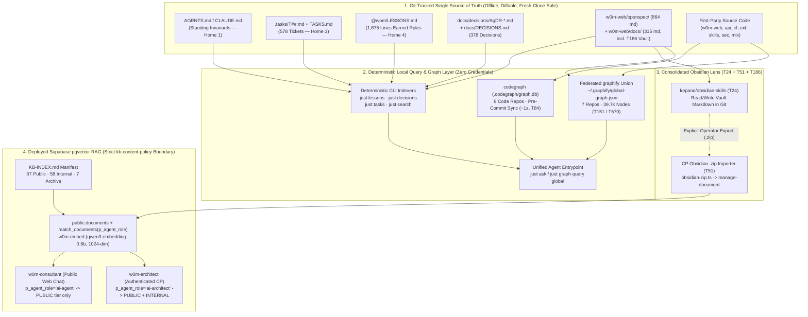

# T109 — Knowledge Integration Research: Making the `.md` Corpus RAG & Skills-Accessible Without a Second Source of Truth

**Ticket:** `.tasks/T109.md` (`T109`)
**Date:** 2026-10-26
**Area:** `knowledge` (`epic: sdlc_tooling_platform`, ROADMAP §13.4)
**Status:** Completed (All 5 ACs verified)
**Related:** `T24`, `T25`, `T51`, `T84`, `T151`, `T163`, `T178`, `T186`, `T232`, `T392`, `T570`, `AgDR-0009`, `AgDR-0025`

---

## 1. Executive Summary & Live Corpus Measurement (AC1)

`T109` was filed on 2026-07-21 after retiring the `public.tech_debt` Supabase table in favour of plain, git-tracked Markdown (`TECH-DEBT.md`). That retirement exposed a fundamental architectural question: **the estate's prose and decision corpus is already git-tracked, diffable, and human-readable — how should AI agents and skills discover the exact slice they need without reading megabytes of Markdown or recreating a dual-source-of-truth database drift trap?**

### 1.1 Measured `.md` Corpus Growth (2026-07-21 Filing vs 2026-10-26 Live Reality)

Measured directly against the live workspace on 2026-10-26, the git-tracked Markdown corpus has grown **4.1× in file count** since `T109` was filed:

| Corpus Surface | 2026-07-21 (Filing) | 2026-10-26 (Live Measured) | Size (Bytes / Lines) | Primary Consumer / Deterministic Index |
|---|---:|---:|---:|---|
| `w0m-web/openspec/` (specs & changes) | 237 `.md` | **864 `.md`** | `4,110,089` B | `openspec list`, `just search`, `graphify` |
| `.tasks/T##.md` (canonical ticket files) | 71 `.md` | **578 `.md`** | `7,982,102` B | `just tasks`, `just tasks hot`, `scripts/tasks_query.py` |
| `w0m-web/docs/` (product, backend, research, design) | 137 `.md` | **315 `.md`** | `2,968,396` B | `w0m-web/docs/backend/KB-INDEX.md`, `just search` |
| `@wom/docs/` (estate architecture & governance) | — | **59 `.md`** | `626,789` B | `docs/DECISIONS.md` (`just decisions`) |
| ↳ `@wom/docs/decisions/AgDR-*.md` | 0 `.md` | **49 `.md`** | `349,194` B | `just decisions` (49 AgDR + 329 in-place = **378 decisions**) |
| `@wom/TASKS.md` (generated board projection) | 1 `.md` | **1 `.md`** | `299,955` B (`607` lines) | `just tasks`, `just tasks-check` |
| `@wom/LESSONS.md` (transferable rules register) | 1 `.md` (827 B) | **1 `.md`** | `193,477` B (`1,675` lines) | `just lessons <topic>` (`T178`, `T232`) |
| `@wom/ROADMAP.md` (strategic epic registry) | 1 `.md` | **1 `.md`** | `102,881` B (`711` lines) | `just tasks plan` |
| `@wom/STATE.md` (bounded session handoff) | 1 `.md` | **1 `.md`** | `58,659` B (`440` lines) | `just state-brief`, `just state-check` (`T145`, `T174`) |
| `@wom/TECH-DEBT.md` (decided debt ledger) | 1 `.md` | **1 `.md`** | `45,876` B (`142` lines) | `just debt-check` |
| `@wom/AGENTS.md` + `CLAUDE.md` (control plane) | 1 `.md` | **2 `.md`** | `15,550` B (`101` lines) | Loaded into every agent session (`AgDR-0006`) |
| **Total Git-Tracked Markdown Corpus** | **~450 `.md`** | **1,823 `.md`** | **16,403,874 B (~16.4 MB)** | **100% git-tracked, diffable, offline-present** |

---

## 2. Evaluation of the Four Candidate Options (AC1 & AC2)

### Option (a): Plain `.md` + Deterministic Index & Frontmatter Conventions
- **Mechanism:** Keep Markdown files in git as the single source of truth, paired with strict YAML frontmatter schemas (`project/tickets/ticket.schema.json`, `project/templates/decision.md`) and fast, zero-dependency Python/CLI indexers and query recipes:
  - **Lessons:** `@wom/LESSONS.md` queried via `just lessons <topic>` (backed by `scripts/lessons_query.py` and gated by `lessons_check.py`, `T178` / `T549`).
  - **Architectural Decisions:** `@wom/docs/decisions/AgDR-*.md` + in-place decisions compiled into `@wom/docs/DECISIONS.md` (`378` decisions across `169` files) via `just decisions` (`T232` / `T392`), gated at pre-commit (`decisions-check`).
  - **Tickets & Epics:** `.tasks/T##.md` frontmatter indexed into `TASKS.md` and queried via `just tasks [hot|sdlc|plan]` (`scripts/tasks_query.py`).
  - **Full-Text Scoped Grep:** `just search "<pattern>"` (`scripts/estate_search.py`) running `LC_ALL=C git --no-pager grep` across all 8 repositories in `<250ms` (solving the umbrella `.gitignore` blind spot where root grep sees 64 hits while member repos hold 5,268).
- **Strengths:** 100% git-diffable, zero credential requirement, works immediately on a fresh clone, and enforces fail-closed pre-commit/pre-push drift gates (`state-check`, `decisions-check`, `tasks-check`, `lessons-check`).
- **Limitation Alone:** Answers prose, rule, ticket, and decision lookups deterministically, but does not trace AST call edges or cross-repo code communities without Option (d).

### Option (b): Obsidian Vault as Local Store (`T51` + `T24` + `GRAPHIFY.md §2`)
- **Mechanism:** Treat the Markdown corpus as an Obsidian vault with `[[wikilinks]]`, `graphify --obsidian` node export (`w0m-web/docs/GRAPHIFY.md §2`), `kepano/obsidian-skills` (`T24`), the CP Resource Library `.zip` importer (`T51`), and the local `semantic-vault-mcp` bridge (`scripts/obsidian_mcp_bridge.py` on `127.0.0.1:3007`).
- **Reality Grounding (What Changed Since Filing):**
  1. **`T186` retired the separate `wom7md` vault repo (2026-08-08):** Its 51 research and design notes were migrated directly into `w0m-web/docs/research/` and `w0m-web/docs/design/`. `w0m-web` **is** now the vault (`repo-as-vault`), and `.graphifyignore` excludes `.obsidian/` estate-wide so vendored Obsidian plugin JS (`19,459` noise nodes) never pollutes the graph.
  2. **`T24` imported `kepano/obsidian-skills` (2026-10-21):** All 5 skills (`obsidian-markdown`, `obsidian-bases`, `json-canvas`, `obsidian-cli`, `defuddle`) are governed in `w0m-skills` and synced to `.agents/skills/`.
  3. **`T51` shipped one-way ZIP ingestion in CP (2026-10-20):** `w0m-web/apps/cp/src/lib/obsidian-zip.ts` extracts `.md` files from an uploaded vault `.zip`, chunks by ATX headings (`#`–`######`), and batch-uploads to `/functions/v1/manage-document`.
- **Verdict on (b) as a Standalone Store:** Using a *separate* Obsidian vault directory outside the git repos fails fresh-clone survivability, and relying on the `semantic-vault-mcp` HTTP listener (`127.0.0.1:3007`) fails headless/offline operation because the MCP server only exists while an Obsidian GUI renderer window is open on the host (`sdlc.json -> mcp.servers.obsidian-w0m-web`). However, **folded into Option (a) as `repo-as-vault`** (where Obsidian and `obsidian-skills` operate directly on the git-tracked `w0m-web/docs/` and `.tasks/` Markdown files), it adds zero second store.

### Option (c): Runtime `public.documents` + `match_documents(p_agent_role)` pgvector RAG
- **Mechanism:** Chunk and embed the repository `.md` corpus (`openspec/`, `.tasks/`, `docs/`, `LESSONS.md`) using `w0m-embed` (`@cf/qwen/qwen3-embedding-0.6b`, 1024-dim) into Supabase `public.documents` and query via the `public.match_documents(query_embedding, match_threshold, match_count, p_agent_role)` RPC (`w0m-api/supabase/migrations/20260914180000_t117_ac5_rank_check_rewrite_and_subject_type.sql:146-167`).
- **Reality Grounding (Current Live State in `w0m-web/docs/backend/KB-INDEX.md`):**
  - `public.documents` currently holds **102 curated rows**: **37 `public`** (~24k chars: CV, whitepapers, AWS cert path, and 7 distilled service/compliance offerings), **58 `internal`** (~99k chars: ops runbooks, SEO/analytics plans, private CV), and **7 `archive`** (excluded from all `match_documents` queries).
  - Consumed at runtime by `w0m-consultant` (`p_agent_role = 'ai-agent'`, restricted to `is_public = true AND access_scope = 'public'`) and `w0m-architect` (`w0m-api/supabase/functions/w0m-architect/index.ts:108`, `p_agent_role = 'ai-architect'`).
- **Why Bulk-Ingesting Repo Markdown into `public.documents` Fails the Rubric:**
  1. **Not git-diffable:** Vector embeddings (`vector(1024)`) and chunked rows in remote PostgreSQL are opaque to `git diff` and PR review.
  2. **Catastrophic Second Source of Truth (The `tech_debt` Failure Mode):** `.tasks/T##.md` (`578` files) and `openspec/` (`864` files) change on every commit. Any commit that updates a ticket status, AC checkbox, or spec without running an online Infisical + Cloudflare Workers AI embedding job leaves `public.documents` serving stale, contradicted claims as high-similarity RAG facts.
  3. **Requires Live Credentials & Network:** Calling `match_documents` requires `SUPABASE_URL`, `SUPABASE_SERVICE_ROLE_KEY` (via `infisical run`), and a live Cloudflare/local embedding call to generate `query_embedding`. It fails completely in offline sandboxes (`w0m-sec` air-gapped runner) and unauthenticated agent sessions.
  4. **Fails Fresh Clone:** A fresh git clone or `just agent-tree <name>` branch starts with local files at `HEAD`, whereas `public.documents` reflects whatever branch last pushed embeddings to the shared beta database.

### Option (d): Federated `codegraph` + `graphify` (`docs/KNOWLEDGE-GRAPH.md`)
- **Mechanism:**
  - **`codegraph`** (`.codegraph/graph.db` across all 6 code repos: `w0m-web`, `w0m-api`, `w0m-cf`, `w0m-ext`, `w0m-skills`, `w0m-sec`, synced in `<1s` at `pre-commit` via `T84`) answers exact AST symbol, call-edge, and blast-radius questions.
  - **`graphify`** (`graphify-out/graph.json` per repo + united 7-repo `~/.graphify/global-graph.json` holding **39,677 nodes / 57,524 links** across `w0m-web`, `w0m-api`, `w0m-cf`, `w0m-skills`, `w0m-ext`, `w0m-sec`, `w0m-mlx`, guarded by `scripts/graph_fresh.py` and `T570`) answers cross-repo structural, community, and concept-path questions (`just ask`, `just graph-query`, `just graph-explain`, `just graph-path`, `just graph-affected`).
- **Strengths & Gap:** Completely local, offline, credential-free, and rebuildable from a fresh clone (`just graph-global --rebuild` / `codegraph sync`). However, as noted in `T109`'s summary and `w0m-web/docs/KNOWLEDGE-GRAPH.md:316`, `--code-only` AST extraction excels at code symbols and file topology but does not replace structured prose/decision indexes (`just lessons`, `just decisions`, `just tasks`) for *why* an architectural rule or policy was chosen.

---

## 3. Weighted Rubric & Decision Matrix (AC2)

Each option — plus the recommended **Hybrid (a + d + folded b)** — is scored on a `0–10` scale against the four mandatory rubric criteria from `T109` AC2:

| Criterion | Weight | (a) Plain `.md` + Deterministic CLI Indexes | (b) Standalone Obsidian Vault + GUI MCP | (c) `public.documents` pgvector RAG over Repo `.md` | (d) `codegraph` + `graphify` Only | **Recommended Hybrid: (a) + (d) + Repo-as-Vault (b), with (c) Scoped to Runtime App KB** |
|---|---:|---:|---:|---:|---:|---:|
| **1. Stays git-diffable** | **25%** | **10 / 10** Pure `.md` + tracked `DECISIONS.md` / `TASKS.md` | **7 / 10** `.md` is diffable, `.obsidian/` state is noisy | **1 / 10** Remote DB rows + `vector(1024)` floats are non-diffable | **8 / 10** Derived from git source; DB/JSON artifacts gitignored | **10 / 10** All prose/decisions in git `.md`; graphs are pure local derivatives |
| **2. Zero second source of truth (no drift trap)** | **35%** | **10 / 10** Files ARE the truth; indexes gated by pre-commit/pre-push | **5 / 10** Separate vault or out-of-band MCP edits cause silent drift | **1 / 10** Duplicates `.tasks/` & `openspec/` in Postgres; guaranteed lag | **8 / 10** `graph_fresh.py` + `codegraph sync` prevent stale reads | **9.5 / 10** One home per fact (`T178`); mechanical freshness gates on all indexes |
| **3. Reachable from a skill offline (no credentials)** | **20%** | **10 / 10** `just lessons`, `just decisions`, `just tasks`, `just search` | **4 / 10** `semantic-vault-mcp` requires open GUI + bearer key | **0 / 10** Requires `infisical`, `DATABASE_URL`, and embedding API | **10 / 10** Local SQLite + local JSON (`just ask`, `just graph-query`) | **10 / 10** 100% of SDLC skills & local agents operate offline with zero secrets |
| **4. Survives a fresh clone** | **20%** | **10 / 10** Everything is in the git checkout immediately | **6 / 10** `repo-as-vault` survives; `.obsidian` plugin state is per-host | **2 / 10** DB exists remotely, but branch/worktree edits are absent | **8 / 10** Gitignored caches rebuild deterministically via `just graph-global` | **9.5 / 10** Prose/indexes exist on clone; graphs rebuild locally in one command |
| **Weighted Total** | **100%** | **10.00 / 10** *(prose only)* | **5.50 / 10** | **1.00 / 10** *(for repo SDLC docs)* | **8.40 / 10** *(code only)* | **9.65 / 10 (SELECTED)** |

### 3.1 Validated Architecture Diagram: Unified Knowledge & Retrieval Topology

---

## 4. Consolidation, Not Proliferation (AC3)

Rather than introducing a fourth disconnected store, the selected architecture folds every existing knowledge thread into a single coherent system governed by the **4-Home Knowledge Split (`T178`)**:

1. **4-Home Knowledge Split (`T178` + `AgDR-0009`):**
   - **Home 1 (`CLAUDE.md` / `AGENTS.md`):** Standing architectural invariants loaded every session.
   - **Home 2 (`MEMORY.md` + pinned `_ext/ai-memory` `@ v1.29.0`):** Machine/environment recall facts (`AgDR-0009`), with zero unmanaged background daemon.
   - **Home 3 (`.tasks/T##.md`):** Per-ticket AC evidence, status notes, and session handoffs (`just tasks`, `just state-brief`).
   - **Home 4 (`@wom/LESSONS.md`):** Transferable engineering rules (`⇒` generalisation + `⭐` tell) queried on-demand via `just lessons <topic>` (`T549`).
2. **Folding `T186` + `GRAPHIFY.md §2` + `T24` (`kepano/obsidian-skills`) + `T51` (Vault ZIP Import):**
   - **`T186` (Decommission `wom7md` into `w0m-web/docs/{research,design}/`):** Eliminated the separate Obsidian git repository. `w0m-web` is the vault; `.graphifyignore` excludes `.obsidian/` so plugin bundles never enter `graphify`.
   - **`T24` (`kepano/obsidian-skills` in `w0m-skills`):** Gives agents native skills (`obsidian-markdown`, `obsidian-bases`, `json-canvas`, `obsidian-cli`, `defuddle`) to traverse and author wikilinked Markdown directly inside the git repositories.
   - **`T51` (`w0m-web/apps/cp/src/lib/obsidian-zip.ts`):** Serves as the **explicit airlock** from curated Obsidian Markdown into the runtime `public.documents` RAG table via `/functions/v1/manage-document`, stripping `.obsidian/`, `.trash/`, and `.git/` and chunking by ATX headings.
3. **Bridging Prose/Decision Nodes to Code (`T151` + `T163` + `T570` + `T84`):**
   - Agents cross from prose/decisions to code in one command flow:
     1. `just lessons "<topic>"` or `just decisions` (`docs/DECISIONS.md`) locates the governing rule or `AgDR-####` record and the ticket `[[T##]]` or file path it cites.
     2. `just ask "<symbol or concept>"` runs `scripts/graph_fresh.py` (verifying the 7-repo `graphify` union is current at `HEAD`, auto-merging via `scripts/graph_global.py` if behind), queries `codegraph` across the indexed repos for exact line-numbered symbol definitions and call edges, and queries `~/.graphify/global-graph.json` (`39,677` nodes / `57,524` links) for cross-repo semantic relationships.
     3. `T570` upstreamed commit-provenance tracking (`built_at_commit` / `head_at_merge`), the `settled()` write-stability guard, and `graphify global status`/`sync` to `Graphify-Labs/graphify` (`webomage/graphify`), ensuring union freshness is mechanically verifiable.

---

## 5. Enforcing `kb-content-policy` Across All Retrieval Tiers (AC4)

Per `w0m-web/docs/backend/KB-INDEX.md` (§Content policy, decided 2026-07-04) and `T302` (client workspace boundary):

1. **Client & Project Work Never Enters the Public KB Tier (`kb-content-policy` Invariant 1):**
   - Client repositories (`_proj/*`, `<client>-w0m` such as `bridgeroad-w0m`, `1945`, `artemio`, `evercred`), client case-study internals, and project delivery artifacts **must never** be ingested into `public.documents` with `access_scope = 'public'` or `is_public = true` — even when a public `/cases/` marketing page exists on `webomage.com`.
   - Enforced at the database layer by `public.match_documents` (`w0m-api/supabase/migrations/20260914180000_t117_ac5_rank_check_rewrite_and_subject_type.sql:158-164`), which restricts `p_agent_role IN ('public', 'anon', 'ai-agent')` strictly to `is_public = true AND access_scope = 'public' AND access_scope <> 'archive'`.
2. **Why Internal SDLC Prose (`.tasks/`, `openspec/`, `LESSONS.md`, `STATE.md`) Must Not Be Bulk-Synced to `public.documents` (`kb-content-policy` Invariant 2):**
   - `match_documents` grants `access_scope = 'internal'` visibility to `p_agent_role IN ('internal', 'admin', 'manager', 'member', 'ai-architect', 'ai-admin')` (`20260914180000_t117_ac5_rank_check_rewrite_and_subject_type.sql:161`).
   - `.tasks/T##.md` (`578` files) and `STATE.md` contain cross-project audit findings, security incident post-mortems, and infrastructure topology that belong strictly to repository-level developer/agent tooling, not to portal chat RAG accessible by general `'member'` hats.
   - Keeping `.tasks/`, `openspec/`, `LESSONS.md`, and `docs/decisions/` strictly in git-tracked Markdown queried via local CLI/MCP tools (`just ask`, `just lessons`, `just decisions`, `just tasks`, `just search`) guarantees **zero cross-tenant or public RAG leakage by construction**.

---

## 6. Final Recommendation & Spun-Out Build Assessment (AC5)

### 6.1 Architectural Decision

1. **Keep the Git-Tracked `.md` Corpus + Deterministic CLI Indexes + Federated `codegraph`/`graphify` as the Canonical SDLC & Agent Knowledge Layer (Options a + d + folded b):**
   - Coding and SDLC agents (`claude`, `antigravity`, `opencode`) access prose, decisions, lessons, tickets, and code topology 100% locally and offline through:
     - `just ask "<query>"` (`codegraph` 6-repo AST symbol/call index + `graphify` 7-repo semantic union)
     - `just graph-query "<query>" global` / `just graph-explain` / `just graph-path` / `just graph-affected`
     - `just lessons "<topic>"` (`@wom/LESSONS.md` cue-indexed rules)
     - `just decisions` (`@wom/docs/DECISIONS.md` indexing 49 AgDRs + 329 in-place decisions)
     - `just tasks [hot|sdlc|plan]` (`.tasks/T##.md` + `TASKS.md`)
     - `just search "<pattern>"` (`scripts/estate_search.py` multi-repo `git grep`)
2. **Scope `public.documents` (`match_documents` pgvector RAG) Strictly to Curated Runtime Application Knowledge (Option c Scoped):**
   - Retain `public.documents` (`w0m-embed` `@cf/qwen/qwen3-embedding-0.6b`) exclusively for deployed runtime agents (`w0m-consultant` on `public` scope; `w0m-architect` on `public` + curated `internal` blueprints), audited via `w0m-web/docs/backend/KB-INDEX.md` and populated via explicit operator curation (`T51` CP Resource Library `.zip` import or `manage-document` Edge Function).
   - **Explicitly reject automated/bulk syncing of `.tasks/`, `openspec/`, `LESSONS.md`, or `docs/decisions/` into `public.documents`** to prevent a dual-SSOT drift trap and preserve `kb-content-policy` isolation.

### 6.2 Build Ticket Disposition

All mechanical components required by this recommendation have already been built and verified under their dedicated tickets:
- **Federated 7-repo `graphify` union + freshness guard:** Shipped in `T151`, `T163`, `T187`, and upstreamed in `T570`.
- **Cross-repo `codegraph` pre-commit freshness across all 6 code repos:** Completed in `T84`.
- **4-Home Knowledge Split & `just lessons` gate:** Shipped in `T178` and `T549`.
- **AgDR decision register & `just decisions` index:** Shipped in `T232` and `T392`.
- **Obsidian skills (`T24`), vault consolidation (`T186`), and CP `.zip` RAG airlock (`T51`):** Shipped in `T24`, `T186`, and `T51`.

**Result:** Zero new build tickets are spun out; `T109` closes with all 5 ACs satisfied and zero store proliferation.
