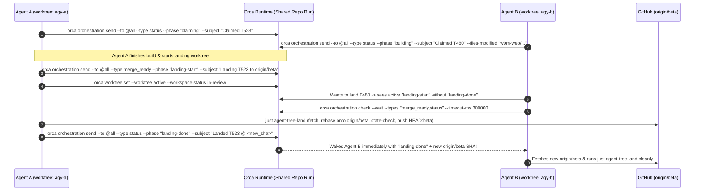

# Orca Agent Collaboration Board — Task Announces, Info Sharing & Auto-Wait Worktree Landing

**Date:** 2026-10-28  
**Tickets:** [[T531]], [[T423]], [[T425]]  
**Target Codebase:** `w0m-pr/orca` (`upstream/main` @ `88662806c0`) + `@wom` `scripts/agent_tree.py`

---

## 1. What Orca Already Has vs. What Is Missing

### 1.1 Existing Primitives in `stablyai/orca` (`upstream/main`)
1. **Headless CLI / RPC Orchestration Engine** (`src/cli/specs/orchestration.ts`, `src/cli/handlers/orchestration/message-send-handler.ts`):
   - **Runs & Tasks DAG**: `orca orchestration run-create`, `task-create --spec ... --deps '[...]'`, `task-list --ready`, `task-update --status <pending|ready|dispatched|completed|failed|blocked>`.
   - **Typed Pub/Sub & Group Addressing**:
     - `orca orchestration send --to <@all|@idle|@worktree:id|run:id|dispatch:id> --type <status|dispatch|worker_done|merge_ready|escalation|handoff|decision_gate|question|heartbeat> --subject "..." --body "..." --phase "..." --files-modified "a.ts,b.ts"`.
   - **Blocking Event Wait with Keepalives**:
     - `orca orchestration check --wait --types "merge_ready,status,worker_done,decision_gate" --timeout-ms 600000` blocks the calling agent process without polling, emitting 15s `_keepalive` JSON heartbeats to `stderr` and waking immediately when a matching message lands in the Run inbox.
   - **Decision Gates & Blocking Ask/Reply**:
     - `orca orchestration gate-create --task <id> --question "..."` / `gate-resolve --id <gate_id> --resolution "..."` and `orca orchestration ask --question "..." --timeout-ms 600000`.
2. **Existing UI Surfaces & Open Upstream PRs**:
   - **Workspace Kanban Board** (`WorkspaceKanbanDrawer.tsx`): Groups worktrees into status lanes (`todo`, `in-progress`, `in-review`, `done`).
   - **Upstream PR `#28513`** (*"feat(workspace-board): move a card with its agent's turn boundary"*): Auto-moves a workspace card between `In progress` and `In review` when an agent turn starts or finishes.
   - **Upstream PR `#30363`** (*"feat(tasks): local per-project task board with no integration required"*): Adds a local per-project Kanban board (`src/shared/local-tasks.ts`, `src/renderer/src/components/task-page/local/Board.tsx`).
   - **Upstream PR `#13888`** (*"Add multi-agent Rooms"*): Shared chat rooms where multiple agents converse.

### 1.2 The 4 Missing Pieces for True Multi-Agent Worktree Collaboration
| Missing Capability | Why Current Orca Falls Short | What We Need |
|---|---|---|
| **1. Visual Agent Collaboration Board (UI ↔ Orchestration Bridge)** | `orca orchestration` tasks, `status` announces, `--files-modified`, and `merge_ready` signals stay invisible inside the CLI/SQLite store; `WorkspaceKanbanDrawer` only shows static worktree cards. | A unified **Agent Collaboration Board** (or live overlay on `WorkspaceKanbanDrawer`) showing each active agent/worktree, its claimed task (`T##`), current `phase` (`researching`, `building`, `testing`, `landing`), in-flight touched files, and a live announcement ticker. |
| **2. Worktree Landing Mutex / Serialization Queue (`landing-lock`)** | When Agent A runs `just agent-tree-land` (fetch → rebase onto `origin/beta` → test → push `HEAD:beta`), if Agent B lands concurrently, one push fails with a non-fast-forward race or stale `STATE.md` / ticket-ID collision. | A first-class **repo landing lease** (`orca orchestration lock-acquire --scope repo:<repo>:beta --wait --holder <worktree>`) that puts Agent A in a **`Landing`** state on the board and automatically parks Agent B in **`Waiting to Land (FIFO #2)`** until Agent A's land completes or releases. |
| **3. Task Claim Announces & Dependency Auto-Wait** | `check --wait` wakes every listener with the same Run batch, and `task-create --deps` only marks tasks `ready` inside a single coordinator's Run. | Peer-to-peer **Task Claim & Dependency Wait**: any agent in any worktree of the same repo can announce `claim T523`, broadcast shared findings (`--type info`), or wait on `--wait-for task:T523` / `--wait-for land:repo:w0m` without needing a parent coordinator pane. |
| **4. Live File-Touch Conflict Radar** | Agents pass `--files-modified` only on final `worker_done` or manual `send`, with no cross-worktree overlap detection. | Automatic overlap detection comparing `git status` / `--files-modified` across active worktrees of the same repo and displaying an amber **Overlap Warning** badge on the board + in `orca orchestration check`. |

---

## 2. How to Do It Today (Zero-Code Workflow Using Existing Orca CLI + `just agent-tree-land`)

---

## 3. Proposed First-Class Orca Feature (`feat/agent-collaboration-board-and-landing-lock`)

1. **Repo-Scoped Coordination Bus & FIFO Landing Lease (`src/main/orchestration/repo-coordination-bus.ts`)**:
   - `orca orchestration land-lock acquire --repo <repo> [--branch beta] --wait --timeout-ms 600000 [--json]`
   - `orca orchestration land-lock release --repo <repo> [--head-sha <sha>] [--outcome landed|aborted]`
2. **Task Announces & Shared Knowledge Bulletin (`orca orchestration announce`)**:
   - `orca orchestration announce --task T523 --phase <claiming|spec|building|testing|landing|done> [--summary "..."] [--files "a.ts,b.ts"] [--share-fact "..."]`
3. **UI Surface in Orca (`WorkspaceKanbanDrawer` + `WorkspaceKanbanCard`)**:
   - Live **Claimed Ticket (`T##`) + Phase Pill (`Building`, `🚀 Landing`, `⏳ Queued to Land #2`)** + **File Overlap Warning Badge** + collapsible **Shared Announcements & Landing Queue** header bar.
4. **Local Estate Hook in `scripts/agent_tree.py` (`just agent-tree-land`)**:
   - Acquire an automatic FIFO landing lock (`~/.w0m/work/.landing-lock` + optional `orca orchestration` broadcast when inside Orca) so concurrent `just agent-tree-land` runs across multiple agents automatically wait their turn, re-fetch `origin/beta`, regenerate `STATE.md`/`TASKS.md` cleanly, and land without colliding.
