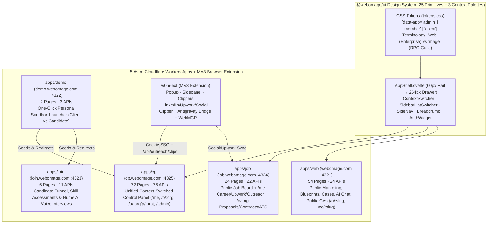
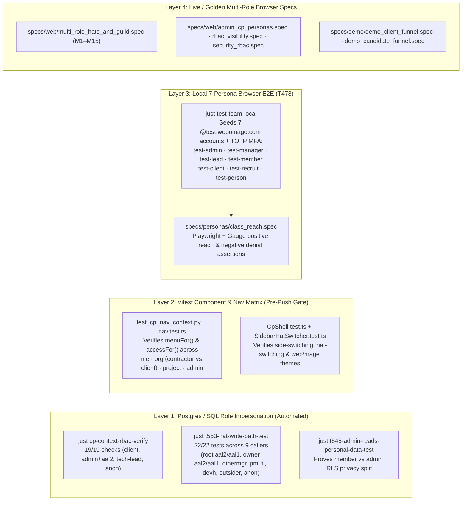

# w0m UI/UX Architecture Catalog, API↔UI Parity Audit & Multi-Role E2E Coverage Report (T579)

> [!IMPORTANT]
> **Executive Summary (Measured Ground Truth & T579 Resolution — 2026-10-28)**
> - **UI Surface Area**: **6 first-party client surfaces** (`apps/web`, `apps/cp`, `apps/job`, `apps/join`, `apps/demo`, and `w0m-ext`) powered by **158 Astro UI pages**, **135 Astro `/api/*` endpoints**, **262 Svelte/Astro components**, and **25 canonical `@webomage/ui` Design System primitives**.
> - **API / DB Capabilities Wired in T579**:
>   1. **Un-reserved `/admin/claims`** in [`nav.ts`](file:///home/aleksei/Projects/!self/w0m/w0m-web/apps/cp/src/lib/context/nav.ts) (`admin` context now has **20/20** active views, **0** reserved).
>   2. **Wired all 4 actionable CP `/api/*` endpoints + `fn:ats-api` + `HatchetActivity.svelte`**:
>      - `POST /api/admin/invoices/reconcile-spei` wired in [`InvoiceManager.svelte`](file:///home/aleksei/Projects/!self/w0m/w0m-web/apps/cp/src/components/admin/InvoiceManager.svelte)
>      - `POST /api/project/release-approval` wired in [`DualManagerGovernanceCard.svelte`](file:///home/aleksei/Projects/!self/w0m/w0m-web/apps/cp/src/components/projects/DualManagerGovernanceCard.svelte)
>      - `POST /api/sync/vault` & `POST /api/admin/broadcast-extension` wired via [`VaultSyncPanel.svelte`](file:///home/aleksei/Projects/!self/w0m/w0m-web/apps/cp/src/components/admin/VaultSyncPanel.svelte) on [`pages/admin/vaults.astro`](file:///home/aleksei/Projects/!self/w0m/w0m-web/apps/cp/src/pages/admin/vaults.astro)
>      - `fn:ats-api` wired in [`ATSKanban.svelte`](file:///home/aleksei/Projects/!self/w0m/w0m-web/apps/cp/src/components/admin/ATSKanban.svelte)
>      - [`HatchetActivity.svelte`](file:///home/aleksei/Projects/!self/w0m/w0m-web/apps/cp/src/components/admin/HatchetActivity.svelte) mounted on [`pages/admin/tasks.astro`](file:///home/aleksei/Projects/!self/w0m/w0m-web/apps/cp/src/pages/admin/tasks.astro)
>   3. **Remaining Backlog Parity Items**: **6 reserved routes** (`me:Public profile`, `org:Quests`, `org:Interviews`, `org:Members & roles`, `org:Company page`, `org:Brand claims`), **4 content/AI Edge Functions** (`generate-blueprint-image`, `generate-post-image`, `linkedin-share`, `reembed-documents`), and **11 database tables** with owner-scoped RLS `SELECT` policies not yet surfaced in `/me`.
> - **Multi-Role E2E & RBAC Runs (`just roles-verify` & `just e2e-roles-local`)**:
>   - Implemented the 5 missing Gauge `@Step` methods in [`personas.steps.ts`](file:///home/aleksei/Projects/!self/w0m/w0m-web/tests/steps/personas.steps.ts) so `gauge validate specs/personas/class_reach.spec specs/web/multi_role_hats_and_guild.spec specs/web/admin_cp_personas.spec` passes with **0 errors**.
>   - Wired **`just roles-verify`** (`14/14` `cp-nav-check-test`, `43/43` `t553-hat-write-path-test` across 10 role/hat/AAL callers, `7/7` `CpShell.test.ts`, and `gauge validate`) and **`just e2e-roles-local`** (1-command local 7-persona browser E2E runner).

---

## 1. Estate UI Topology & UX Design Philosophy

### 1.1 Core UX Design Principles (`@webomage/ui` & `AppShell`)

| UX Pillar | Implementation | Purpose & User Experience |
|---|---|---|
| **Single Frame (`AppShell`)** | [`AppShell.svelte`](file:///home/aleksei/Projects/!self/w0m/w0m-web/packages/ui/src/lib/components/layout/AppShell.svelte), [`CpShell.svelte`](file:///home/aleksei/Projects/!self/w0m/w0m-web/apps/cp/src/components/shell/CpShell.svelte) | Every signed-in page across `cp` and `job` renders inside one responsive frame: a `264px` glass sidebar on desktop (`>= 1024px`) that collapses to a **Chrome-style `60px` icons-only rail** on mobile/tablet (`< 1024px`) or on manual toggle (`w0m-sidebar-collapsed`). On phones (`< 768px`), expanding the rail opens a fixed overlay drawer with backdrop scrim (`T578`). |
| **4-Context Switching (`ContextSwitcher`)** | [`ContextSwitcher.svelte`](file:///home/aleksei/Projects/!self/w0m/w0m-web/packages/ui/src/lib/components/layout/ContextSwitcher.svelte), [`shell-model.ts`](file:///home/aleksei/Projects/!self/w0m/w0m-web/apps/cp/src/lib/context/shell-model.ts) | Top-left switcher moves the user between **4 URL-scoped contexts**: **Me** (`/me/*`), **Organization** (`/o/[org]/*`), **Project** (`/o/[org]/p/[project]/*`), and **Admin Console** (`/admin/*`). |
| **Dual-Side & Engagement Hat Switching (`SidebarHatSwitcher`)** | [`SidebarHatSwitcher.svelte`](file:///home/aleksei/Projects/!self/w0m/w0m-web/apps/cp/src/components/admin/SidebarHatSwitcher.svelte), [`HatSwitcher.svelte`](file:///home/aleksei/Projects/!self/w0m/w0m-web/apps/cp/src/components/admin/HatSwitcher.svelte) | Below the context switcher, users on a dual-side org can flip between **w0m PM (Contractor)** and **Client** view modes (`wom_active_side`), toggle **Enterprise (`web`) vs. RPG Guild (`mage`)** terminology (`Milestones` ↔ `Adventures`, `Team` ↔ `Guild & Cohorts`, `Bounty board` ↔ `Quest Bounties`), and wear a specific **Project Delivery Hat** (`PM`, `Tech Lead`, `Dev`, `DevOps`, `QA`) scoped to the current engagement. |
| **Context-Aware Visual Theme (`[data-app]`)** | [`tokens.css`](file:///home/aleksei/Projects/!self/w0m/w0m-web/packages/ui/src/lib/styles/tokens.css) | The shell root sets `data-app="member"` (on `/me`), `data-app="client"` (on client orgs), or `data-app="admin"` (on contractor orgs and `/admin`), shifting accent colors, glass tints, and borders automatically without component-level hex overrides. |
| **25 Canonical Primitives** | [`_ds_manifest.json`](file:///home/aleksei/Projects/!self/w0m/w0m-web/design-system/_ds_manifest.json) | **Layout (7)**: `AppShell`, `Breadcrumb`, `ContextSwitcher`, `EmptyState`, `PageHeader`, `SideNav`, `Tabs` · **Core (7)**: `Badge`, `Button`, `Card`, `Checkbox`, `Input`, `Label`, `Separator` · **Brand (6)**: `BlueprintCard`, `ComplexityBadge`, `GlassCard`, `SegmentBadge`, `StatusDot`, `TechIcon` · **Data (1)**: `Table` · **Domain (2)**: `BugReportWidget`, `QuickViewModal` · **Overlay (2)**: `Dialog`, `Select`. |

---

## 2. All UI Parts: App-by-App & Context-by-Context Catalog

### 2.1 App 1 — `apps/cp` (`cp.webomage.com` :4325) & `apps/job` (`job.webomage.com` :4324) Unified Context Navigation

`apps/cp` and `apps/job` share the single navigation authority in [`nav.ts`](file:///home/aleksei/Projects/!self/w0m/w0m-web/apps/cp/src/lib/context/nav.ts) (`79` nav items across 4 contexts, plus `7` deep links):

#### Context A: **Me (`/me/*`) — Personal Member, Career, Delivery & Outreach Workspace (16 items)**
| Section | UI Surface / Route | Host App | Required Capability | Key Components | UX Purpose & Design |
|---|---|---|---|---|---|
| **Home** | `/me` | `cp` | `self` | [`me/index.astro`](file:///home/aleksei/Projects/!self/w0m/w0m-web/apps/cp/src/pages/me/index.astro) | Personal member landing dashboard with quick links to profile, work, and account. |
| **Home** | `/me/todos` | `cp` | `platform.unit` | [`TodoManager.svelte`](file:///home/aleksei/Projects/!self/w0m/w0m-web/apps/cp/src/components/admin/TodoManager.svelte) | Personal & staff task checklist backed by `fn:admin-todos-api`. |
| **Profile & CV** | `/me/profile` | `cp` | `self` | [`CharacterSheet.svelte`](file:///home/aleksei/Projects/!self/w0m/w0m-web/apps/cp/src/components/guild/CharacterSheet.svelte), [`PersonalInformation.svelte`](file:///home/aleksei/Projects/!self/w0m/w0m-web/apps/cp/src/components/member/PersonalInformation.svelte), [`PublicSettings.svelte`](file:///home/aleksei/Projects/!self/w0m/w0m-web/apps/cp/src/components/member/PublicSettings.svelte), [`AvatarManager.svelte`](file:///home/aleksei/Projects/!self/w0m/w0m-web/apps/cp/src/components/member/AvatarManager.svelte), [`ContactImportModal.svelte`](file:///home/aleksei/Projects/!self/w0m/w0m-web/apps/cp/src/components/member/ContactImportModal.svelte) | RPG/Enterprise profile sheet (XP, level, wallet, badges), personal contact/identity vault, vCard import, avatar cropper, and public `/u/<slug>` visibility controls. |
| **Profile & CV** | `/me/oss` | `cp` | `self` | [`ParticipatingProjects.svelte`](file:///home/aleksei/Projects/!self/w0m/w0m-web/apps/cp/src/components/member/ParticipatingProjects.svelte) | Open-source contributions, GitHub PR portfolio, and participating projects. |
| **Profile & CV** | `/me/profile/public` | `cp` | `self` | *Reserved (`reserved: true`)* | Planned in-app preview of public `/u/<slug>` profile (currently configured inside `/me/profile`). |
| **Skills & tests** | `/me/skills` | `cp` | `self` | [`CertificationsWorkspace.svelte`](file:///home/aleksei/Projects/!self/w0m/w0m-web/apps/cp/src/components/guild/CertificationsWorkspace.svelte) | Guild skill certifications, timed coding/architecture challenges, and progression tracks (`fn:guild-api`). |
| **Opportunities** | `/me/opportunities` | `cp` | `hat.talent` | [`QuestBoard.svelte`](file:///home/aleksei/Projects/!self/w0m/w0m-web/apps/cp/src/components/guild/QuestBoard.svelte), [`AgentQuestTracksBoard.svelte`](file:///home/aleksei/Projects/!self/w0m/w0m-web/apps/cp/src/components/guild/AgentQuestTracksBoard.svelte) | Internal bounty board & quest tracks where delivery talent claims bounties and attaches AI agents. |
| **My work** | `/me/work` | `cp` | `hat.delivery` | [`MyProjectHats.svelte`](file:///home/aleksei/Projects/!self/w0m/w0m-web/apps/cp/src/components/admin/MyProjectHats.svelte), [`HatSwitcher.svelte`](file:///home/aleksei/Projects/!self/w0m/w0m-web/apps/cp/src/components/admin/HatSwitcher.svelte), [`ProjectManager.svelte`](file:///home/aleksei/Projects/!self/w0m/w0m-web/apps/cp/src/components/admin/ProjectManager.svelte), [`ProjectRolesModal.svelte`](file:///home/aleksei/Projects/!self/w0m/w0m-web/apps/cp/src/components/admin/ProjectRolesModal.svelte) | Delivery workspace showing assigned projects, active worn hats, role switching, blueprint tech-chip provisioning, and mobile-responsive project cards (`T578`). |
| **Account & security** | `/me/account` | `cp` | `self` | [`ConnectedIdentities.svelte`](file:///home/aleksei/Projects/!self/w0m/w0m-web/apps/cp/src/components/member/ConnectedIdentities.svelte), [`MfaEnrollment.svelte`](file:///home/aleksei/Projects/!self/w0m/w0m-web/apps/cp/src/components/member/MfaEnrollment.svelte), [`PersonalAccessTokens.svelte`](file:///home/aleksei/Projects/!self/w0m/w0m-web/apps/cp/src/components/member/PersonalAccessTokens.svelte) | OAuth identity linking (Google/GitHub/LinkedIn), TOTP MFA (`aal2`) factor enrollment, personal access tokens, and password update. |
| **Career & CV** | `/me/resume` | `job` | `self` | [`ResumeStudio.svelte`](file:///home/aleksei/Projects/!self/w0m/w0m-web/apps/cp/src/components/member/resume/ResumeStudio.svelte) | Multi-tab AI Resume Studio: CV variants, Upwork evidence search, skill matrices, document vault, and PDF export (`fn:cv-pdf`, `fn:w0m-personnel`). |
| **Career & CV** | `/me/work` | `job` | `self` | [`WorkHistory.svelte`](file:///home/aleksei/Projects/!self/w0m/w0m-web/apps/cp/src/components/member/WorkHistory.svelte) | Links verified Upwork/agency contracts to CV experience entries (`wom_link_work_history`). |
| **Upwork** | `/me/contracts`, `/me/proposals`, `/me/messages` | `job` | `self` | [`contracts.astro`](file:///home/aleksei/Projects/!self/w0m/w0m-web/apps/job/src/pages/me/contracts.astro), [`proposals.astro`](file:///home/aleksei/Projects/!self/w0m/w0m-web/apps/job/src/pages/me/proposals.astro), [`messages.astro`](file:///home/aleksei/Projects/!self/w0m/w0m-web/apps/job/src/pages/me/messages.astro) | Personal Upwork contract ledger, submitted proposals, and Upwork message rooms (`wom_my_upwork_*`). |
| **Commercial & Sync** | `/me/connectors`, `/me/outreach` | `job` | `self` | [`OutreachHub.svelte`](file:///home/aleksei/Projects/!self/w0m/w0m-web/apps/job/src/components/OutreachHub.svelte), [`SocialHiringSearch.svelte`](file:///home/aleksei/Projects/!self/w0m/w0m-web/apps/job/src/components/SocialHiringSearch.svelte) | Multi-platform connector sync (Upwork MCP, Meta Threads, Telegram) + live Telegram/Threads channel & community discovery (`T575`/`T576`) + web clipper vault & AI outreach drafting. |

#### Context B: **Organization (`/o/[org]/*`) — Agency Staff Console & Client Portal (36 items + 7 deep links)**
> **Side-Branching UX (`CONTRACTOR` vs `CLIENT`)**: Five routes (`Overview`, `Milestones`, `Knowledge hub`, `Services & budget`, `Invoices`) are shared (`sides: BOTH`) and branch by side; `Billing & plans` is pure client-only (`only: "client"`); all other 30 routes are contractor-staff only.

| Section | Routes | Side | Key Components & Purpose |
|---|---|---|---|
| **Overview** | `/o/[org]` | `BOTH` | [`ClientDashboard.svelte`](file:///home/aleksei/Projects/!self/w0m/w0m-web/apps/cp/src/components/client/ClientDashboard.svelte): Project health summary, active retainers, recent milestones, and quick actions. |
| **Projects** | `/o/[org]/projects` (`index`, `milestones`, `vault`, `services`, `messages`, `security-audit`) | `projects`: Contractor Others: `BOTH` | [`ProjectManager.svelte`](file:///home/aleksei/Projects/!self/w0m/w0m-web/apps/cp/src/components/admin/ProjectManager.svelte), [`MilestoneManager.svelte`](file:///home/aleksei/Projects/!self/w0m/w0m-web/apps/cp/src/components/admin/MilestoneManager.svelte) / [`MilestoneList.svelte`](file:///home/aleksei/Projects/!self/w0m/w0m-web/apps/cp/src/components/client/MilestoneList.svelte), [`KnowledgeHub.svelte`](file:///home/aleksei/Projects/!self/w0m/w0m-web/apps/cp/src/components/client/KnowledgeHub.svelte) + [`VaultSearch.svelte`](file:///home/aleksei/Projects/!self/w0m/w0m-web/apps/cp/src/components/admin/VaultSearch.svelte), [`ClientServicesManager.svelte`](file:///home/aleksei/Projects/!self/w0m/w0m-web/apps/cp/src/components/client/ClientServicesManager.svelte) (per-client external services & budget caps, `T272`). |
| **Money & Commercial** | `/o/[org]/money/invoices`, `billing`, `treasury`, `proposals`, `contracts`, `/o/[org]/outreach` | `invoices`: `BOTH` `billing`: `CLIENT` Others: `CONTRACTOR` | [`InvoiceManager.svelte`](file:///home/aleksei/Projects/!self/w0m/w0m-web/apps/cp/src/components/admin/InvoiceManager.svelte) / [`InvoiceList.svelte`](file:///home/aleksei/Projects/!self/w0m/w0m-web/apps/cp/src/components/client/InvoiceList.svelte) (Stripe + MercadoPago checkout), [`SubscriptionManager.svelte`](file:///home/aleksei/Projects/!self/w0m/w0m-web/apps/cp/src/components/client/SubscriptionManager.svelte), [`TreasuryManager.svelte`](file:///home/aleksei/Projects/!self/w0m/w0m-web/apps/cp/src/components/admin/TreasuryManager.svelte) (billing circles, KYC verification, payouts), [`ProposalManager.svelte`](file:///home/aleksei/Projects/!self/w0m/w0m-web/apps/cp/src/components/admin/ProposalManager.svelte), [`ContractManager.svelte`](file:///home/aleksei/Projects/!self/w0m/w0m-web/apps/cp/src/components/admin/ContractManager.svelte). |
| **Sales** | `/o/[org]/sales/leads`, `clients`, `verification`, `blueprints`, `decks` | `CONTRACTOR` | [`LeadManager.svelte`](file:///home/aleksei/Projects/!self/w0m/w0m-web/apps/cp/src/components/admin/LeadManager.svelte) (CRM pipeline & AI proposal generation), [`ClientManager.svelte`](file:///home/aleksei/Projects/!self/w0m/w0m-web/apps/cp/src/components/admin/ClientManager.svelte), [`CorporateVerification.svelte`](file:///home/aleksei/Projects/!self/w0m/w0m-web/apps/cp/src/components/admin/CorporateVerification.svelte) (KYB verification), [`BlueprintManager.svelte`](file:///home/aleksei/Projects/!self/w0m/w0m-web/apps/cp/src/components/admin/BlueprintManager.svelte), [`DeckGenerator.svelte`](file:///home/aleksei/Projects/!self/w0m/w0m-web/apps/cp/src/components/admin/DeckGenerator.svelte). |
| **People & Recruiting** | `/o/[org]/people/team`, `directory`, `technologies`, `quests`*(res)*, `recruiting/*` (`index`, `candidates`, `templates`, `pipeline`, `ats`, `interviews`*(res)*, `cv`) | `CONTRACTOR` | [`TeamManager.svelte`](file:///home/aleksei/Projects/!self/w0m/w0m-web/apps/cp/src/components/admin/TeamManager.svelte), [`PeopleManager.svelte`](file:///home/aleksei/Projects/!self/w0m/w0m-web/apps/cp/src/components/admin/PeopleManager.svelte) + [`RoleManager.svelte`](file:///home/aleksei/Projects/!self/w0m/w0m-web/apps/cp/src/components/admin/RoleManager.svelte), [`TechnologyManager.svelte`](file:///home/aleksei/Projects/!self/w0m/w0m-web/apps/cp/src/components/admin/TechnologyManager.svelte), [`CandidateManager.svelte`](file:///home/aleksei/Projects/!self/w0m/w0m-web/apps/cp/src/components/interviews/CandidateManager.svelte), [`TemplateManager.svelte`](file:///home/aleksei/Projects/!self/w0m/w0m-web/apps/cp/src/components/interviews/TemplateManager.svelte), [`ATSKanban.svelte`](file:///home/aleksei/Projects/!self/w0m/w0m-web/apps/cp/src/components/ats/ATSKanban.svelte). |
| **Content & Marketing** | `/o/[org]/content/pages`, `posts`, `resources`, `slides`, `analytics` (+ `new`, `edit/:slug`, `cases`) | `CONTRACTOR` | [`PageManager.svelte`](file:///home/aleksei/Projects/!self/w0m/w0m-web/apps/cp/src/components/admin/PageManager.svelte), [`PostManager.svelte`](file:///home/aleksei/Projects/!self/w0m/w0m-web/apps/cp/src/components/admin/PostManager.svelte), [`ResourceLibrary.svelte`](file:///home/aleksei/Projects/!self/w0m/w0m-web/apps/cp/src/components/admin/ResourceLibrary.svelte), [`SlideManager.svelte`](file:///home/aleksei/Projects/!self/w0m/w0m-web/apps/cp/src/components/admin/SlideManager.svelte), [`LinkedInAnalytics.svelte`](file:///home/aleksei/Projects/!self/w0m/w0m-web/apps/cp/src/components/admin/LinkedInAnalytics.svelte). |
| **Settings** | `/o/[org]/settings/integrations`, `members`*(res)*, `page`*(res)*, `claims`*(res)* | `CONTRACTOR` | [`OrgIntegrationsManager.svelte`](file:///home/aleksei/Projects/!self/w0m/w0m-web/apps/cp/src/components/admin/OrgIntegrationsManager.svelte) (org-scoped OAuth/API connectors). |

#### Context C: **Project (`/o/[org]/p/[project]/*`) — Scoped Engagement Workspace (7 items)**
| Route | Capability | Key Components & UX Purpose |
|---|---|---|
| `/o/[org]/p/[project]` | `project.view` | [`DualManagerGovernanceCard.svelte`](file:///home/aleksei/Projects/!self/w0m/w0m-web/apps/cp/src/components/admin/DualManagerGovernanceCard.svelte), [`HatSwitcher.svelte`](file:///home/aleksei/Projects/!self/w0m/w0m-web/apps/cp/src/components/admin/HatSwitcher.svelte), [`MyProjectHats.svelte`](file:///home/aleksei/Projects/!self/w0m/w0m-web/apps/cp/src/components/admin/MyProjectHats.svelte) — Engagement overview, dual-manager governance (Client PM + w0m PM), and active role switcher. |
| `/o/[org]/p/[project]/team` | `engagement.staff` | [`ProjectTeam.svelte`](file:///home/aleksei/Projects/!self/w0m/w0m-web/apps/cp/src/components/admin/ProjectTeam.svelte) — Staff hats onto project roles, apply Hat Collections, configure collapse/fallback rules (`T461`/`T553`). |
| `/o/[org]/p/[project]/contacts` | `project.view` | [`ProjectContacts.svelte`](file:///home/aleksei/Projects/!self/w0m/w0m-web/apps/cp/src/components/admin/ProjectContacts.svelte) — Scoped directory of client and contractor stakeholders (`wom_project_contacts`). |
| `/o/[org]/p/[project]/milestones` | `project.view` | [`MilestoneManager.svelte`](file:///home/aleksei/Projects/!self/w0m/w0m-web/apps/cp/src/components/admin/MilestoneManager.svelte) — Engagement-scoped deliverables & approval workflow. |
| `/o/[org]/p/[project]/bugs` | `project.view` | [`BugTriageBoard.svelte`](file:///home/aleksei/Projects/!self/w0m/w0m-web/apps/cp/src/components/admin/BugTriageBoard.svelte) — Interactive bug reports captured via `BugReportWidget` with Telegram escalation. |
| `/o/[org]/p/[project]/vault` | `project.view` | [`VaultSearch.svelte`](file:///home/aleksei/Projects/!self/w0m/w0m-web/apps/cp/src/components/admin/VaultSearch.svelte) — Semantic RAG search over engagement documents (`fn:w0m-consultant`). |
| `/o/[org]/p/[project]/services` | `project.view` | [`ClientServicesManager.svelte`](file:///home/aleksei/Projects/!self/w0m/w0m-web/apps/cp/src/components/client/ClientServicesManager.svelte) — Engagement-level cloud/AI service toggles and budget limits. |

#### Context D: **Admin (`/admin/*`) — Platform Root Operations Console (20 items, requires `platform.admin` + `aal2` MFA)**
| Section | Routes & Components | Purpose & UX Design |
|---|---|---|
| **Access (4)** | `/admin` ([`HealthDashboard.svelte`](file:///home/aleksei/Projects/!self/w0m/w0m-web/apps/cp/src/components/admin/HealthDashboard.svelte), [`ConnectivityStatus.svelte`](file:///home/aleksei/Projects/!self/w0m/w0m-web/apps/cp/src/components/admin/ConnectivityStatus.svelte), [`GeoMetricsDashboardCard.svelte`](file:///home/aleksei/Projects/!self/w0m/w0m-web/apps/cp/src/components/admin/GeoMetricsDashboardCard.svelte)), `/admin/users` ([`RoleManager.svelte`](file:///home/aleksei/Projects/!self/w0m/w0m-web/apps/cp/src/components/admin/RoleManager.svelte)), `/admin/demo` ([`DemoProvision.svelte`](file:///home/aleksei/Projects/!self/w0m/w0m-web/apps/cp/src/components/admin/DemoProvision.svelte)), `/admin/claims` ([`BrandClaimsManager.svelte`](file:///home/aleksei/Projects/!self/w0m/w0m-web/apps/cp/src/components/admin/BrandClaimsManager.svelte)) | Platform health & provider quotas, global RBAC & user impersonation (`/api/admin/impersonate`), demo environment seeding, and brand slug dispute resolution. |
| **Operations (7)** | `/admin/logs` ([`ActivityLog.svelte`](file:///home/aleksei/Projects/!self/w0m/w0m-web/apps/cp/src/components/admin/ActivityLog.svelte), [`ChatAuditor.svelte`](file:///home/aleksei/Projects/!self/w0m/w0m-web/apps/cp/src/components/admin/ChatAuditor.svelte), [`TelegramLogViewer.svelte`](file:///home/aleksei/Projects/!self/w0m/w0m-web/apps/cp/src/components/admin/TelegramLogViewer.svelte)), `/admin/tasks`, `/admin/services`, `/admin/infra` ([`AdminInfraDashboard.svelte`](file:///home/aleksei/Projects/!self/w0m/w0m-web/apps/cp/src/components/admin/AdminInfraDashboard.svelte)), `/admin/credentials`, `/admin/secrets` ([`SecretManager.svelte`](file:///home/aleksei/Projects/!self/w0m/w0m-web/apps/cp/src/components/admin/SecretManager.svelte)), `/admin/settings` ([`CoreSettingsManager.svelte`](file:///home/aleksei/Projects/!self/w0m/w0m-web/apps/cp/src/components/admin/CoreSettingsManager.svelte)) | Audit trails, AI chat transcripts, live Supabase/Cloudflare tariff & quota telemetry (`T520`), `admin_secrets` system vault, and site settings. |
| **Integrations (3)** | `/admin/connections` ([`ConnectionsManager.svelte`](file:///home/aleksei/Projects/!self/w0m/w0m-web/apps/cp/src/components/admin/ConnectionsManager.svelte)), `/admin/sync-health` ([`SyncHealthBoard.svelte`](file:///home/aleksei/Projects/!self/w0m/w0m-web/apps/cp/src/components/admin/SyncHealthBoard.svelte)), `/admin/ai-agents` ([`AIAgentWorkspace.svelte`](file:///home/aleksei/Projects/!self/w0m/w0m-web/apps/cp/src/components/admin/AIAgentWorkspace.svelte), [`AIContentAssistant.svelte`](file:///home/aleksei/Projects/!self/w0m/w0m-web/apps/cp/src/components/admin/AIContentAssistant.svelte), [`AiCostAccountingCard.svelte`](file:///home/aleksei/Projects/!self/w0m/w0m-web/apps/cp/src/components/admin/AiCostAccountingCard.svelte)) | Estate-level OAuth connectors, Upwork poller freshness monitor, AI persona/model editor, interactive agent simulator, and AI token cost accounting. |
| **Tools (6)** | `/admin/domains` ([`DomainManager.svelte`](file:///home/aleksei/Projects/!self/w0m/w0m-web/apps/cp/src/components/admin/DomainManager.svelte), [`DomainScanner.svelte`](file:///home/aleksei/Projects/!self/w0m/w0m-web/apps/cp/src/components/admin/DomainScanner.svelte)), `/admin/diagram-validator` ([`DiagramValidator.svelte`](file:///home/aleksei/Projects/!self/w0m/w0m-web/apps/cp/src/components/admin/DiagramValidator.svelte)), `/admin/scrapers` ([`ScraperDashboard.svelte`](file:///home/aleksei/Projects/!self/w0m/w0m-web/apps/cp/src/components/admin/ScraperDashboard.svelte)), `/admin/forks` ([`ForksManager.svelte`](file:///home/aleksei/Projects/!self/w0m/w0m-web/apps/cp/src/components/admin/ForksManager.svelte)), `/admin/vaults`, `/admin/debug` | Domain security/WHOIS scanner, headless Mermaid validator, market intelligence job scrapers, `webomage/*` OSS fork/PR tracker, vault status, and runtime diagnostics. |

---

### 2.2 Other Client Surfaces (`apps/web`, `apps/job` Public, `apps/join`, `apps/demo`, `w0m-ext`)

| Surface | Pages & Components | UX Purpose & Design |
|---|---|---|
| **`apps/web` (`webomage.com` :4321)** | **54 pages** (EN + i18n `[lang]/*`): Home (`index.astro`), Blueprints catalog & comparator (`blueprints/index.astro`, `blueprints/[...slug].astro`, `blueprints/compare.astro`), Case Studies (`cases/[...slug].astro`), Domain Landings (`ai-infra`, `blockchain`, `devops-stack`, `security`, `solutions`, `services`, `process`), AI Consultant Chat (`chat.astro`), Interactive Cost Estimator (`CostEstimator.svelte`), Public Profiles (`/u/[slug].astro`, `/co/[slug].astro`), Public CVs (`cv.astro`, `cv-full.astro`, `cv-upwork.astro`), Live Status (`status.astro`), LLM index (`llms-full.txt.ts`). | Fixed Warp Three.js background (`T452`), glassmorphic cards, interactive architecture blueprint explorer with side-by-side comparison, public verified member/company profiles (`AppShell`), and streaming AI architect/consultant chat. |
| **`apps/job` Public (`job.webomage.com` :4324)** | [`index.astro`](file:///home/aleksei/Projects/!self/w0m/w0m-web/apps/job/src/pages/index.astro), [`jobs/[id].astro`](file:///home/aleksei/Projects/!self/w0m/w0m-web/apps/job/src/pages/jobs/[id].astro), [`JobBoard.svelte`](file:///home/aleksei/Projects/!self/w0m/w0m-web/apps/job/src/components/JobBoard.svelte) | Aggregated remote tech job board (Adzuna, Jooble, RemoteOK, Remotive, WeWorkRemotely, HN, X-Team, Telegram, Threads) with vector similarity matching and one-click application routing. |
| **`apps/join` (`join.webomage.com` :4323)** | [`index.astro`](file:///home/aleksei/Projects/!self/w0m/w0m-web/apps/join/src/pages/index.astro), [`dashboard.astro`](file:///home/aleksei/Projects/!self/w0m/w0m-web/apps/join/src/pages/dashboard.astro), [`assessments/index.astro`](file:///home/aleksei/Projects/!self/w0m/w0m-web/apps/join/src/pages/assessments/index.astro), [`assessments/[id].astro`](file:///home/aleksei/Projects/!self/w0m/w0m-web/apps/join/src/pages/assessments/[id].astro), [`interview/[id].astro`](file:///home/aleksei/Projects/!self/w0m/w0m-web/apps/join/src/pages/interview/[id].astro) | Candidate recruitment portal: resume upload & AI parsing (`fn:parse-resume`), candidate status dashboard, timed technical assessments (`fn:grade-challenge`), and Hume AI EVI voice interviews (`fn:hume-token`, `fn:analyze-interview`). |
| **`apps/demo` (`demo.webomage.com` :4322)** | [`index.astro`](file:///home/aleksei/Projects/!self/w0m/w0m-web/apps/demo/src/pages/index.astro), [`api/demo/enter.ts`](file:///home/aleksei/Projects/!self/w0m/w0m-web/apps/demo/src/pages/api/demo/enter.ts) | Split-card persona launcher allowing prospects to enter a pre-seeded **Client Portal** (`Carol`) or **Candidate Funnel** (`Ravi`) in one click. |
| **`w0m-ext` (Browser Extension)** | [`popup.html`](file:///home/aleksei/Projects/!self/w0m/w0m-ext/extension/src/popup/popup.html), [`sidepanel.html`](file:///home/aleksei/Projects/!self/w0m/w0m-ext/extension/src/sidepanel/sidepanel.html), [`background/index.ts`](file:///home/aleksei/Projects/!self/w0m/w0m-ext/extension/src/background/index.ts), `content/*` | Auto-syncs `.webomage.com` Supabase session cookies (`T574`), clips LinkedIn profiles/jobs & Upwork/Threads/Telegram leads into `/api/outreach/clips`, and connects to the Antigravity Bridge via HTTPS/Realtime. |

---

## 3. API / Backend / DB Capabilities Not Yet Exposed in UI (Parity Gaps)

### 3.1 Reserved Navigation Routes (`reserved: true` in [`nav.ts`](file:///home/aleksei/Projects/!self/w0m/w0m-web/apps/cp/src/lib/context/nav.ts))

These 7 items appear as disabled/reserved pills in `SideNav.svelte`:

| Context | Nav Label | Declared Path | Capability | Backend / Code Reality | Actionable Recommendation |
|---|---|---|---|---|---|
| `admin` | **Claims & disputes** | `/admin/claims` | `platform.admin` | **Page & API already exist!** [`pages/admin/claims.astro`](file:///home/aleksei/Projects/!self/w0m/w0m-web/apps/cp/src/pages/admin/claims.astro), [`BrandClaimsManager.svelte`](file:///home/aleksei/Projects/!self/w0m/w0m-web/apps/cp/src/components/admin/BrandClaimsManager.svelte), and [`/api/admin/claims.ts`](file:///home/aleksei/Projects/!self/w0m/w0m-web/apps/cp/src/pages/api/admin/claims.ts) are fully built. | Remove `reserved: true` on `claims` in [`nav.ts:193`](file:///home/aleksei/Projects/!self/w0m/w0m-web/apps/cp/src/lib/context/nav.ts#L190-L194) so admins can click it from the sidebar. |
| `me` | **Public profile** | `/me/profile/public` | `self` | Public profile is rendered at `webomage.com/u/[slug]` and settings live inside `/me/profile` (`PublicSettings.svelte`). | Either wire `/me/profile/public` as an embedded preview/redirect to `/u/<slug>` or remove the reserved nav stub. |
| `org` | **Quests** | `/o/[org]/people/quests` | `quest.master` | RPCs `wom_get_project_quest_tracks()` & `wom_attach_agent_to_quest_track()` and unmounted [`RaidBoard.svelte`](file:///home/aleksei/Projects/!self/w0m/w0m-web/apps/cp/src/components/admin/RaidBoard.svelte) exist. | Mount `RaidBoard.svelte` + `AgentQuestTracksBoard.svelte` at `/o/[org]/people/quests` and un-reserve. |
| `org` | **Interviews** | `/o/[org]/people/recruiting/interviews` | `interview.conduct` | `fn:analyze-interview`, `fn:hume-token`, and `interview_sessions` table exist in `w0m-api`. | Build `/o/[org]/people/recruiting/interviews.astro` in `apps/job` to list and review recorded AI interview sessions & transcripts. |
| `org` | **Members & roles** | `/o/[org]/settings/members` | `grant.manage` | `org_units`, `hats`, and `/api/admin/grants` exist; currently managed via `/o/[org]/people/directory`. | Wire `/o/[org]/settings/members` to org-scoped member/grant management or consolidate into Directory. |
| `org` | **Company page** | `/o/[org]/settings/page` | `grant.manage` | Public company page renders at `webomage.com/co/[slug]` (`orgs` table). | Add an org profile editor page for `/co/[slug]` metadata (logo, bio, links, visibility). |
| `org` | **Brand claims** | `/o/[org]/settings/claims` | `grant.manage` | `brand_slug_claims` table and `/api/admin/claims` exist. | Add an org-side form to submit/view a brand slug claim (`brand_slug_claims`). |

### 3.2 Astro `/api/*` Endpoints With No UI Caller (5 Actionable Gaps)

Out of **135** Astro `/api/*` endpoints across the 5 apps, **107** are called directly by UI components and **23** are OAuth callbacks, webhooks, or `/api/health` probes. The remaining **5** are **real backend capabilities that have no UI button or view wired to them**:

| Endpoint | File | What the API Does Today | Missing UI Surface |
|---|---|---|---|
| `POST /api/admin/invoices/reconcile-spei` | [`reconcile-spei.ts`](file:///home/aleksei/Projects/!self/w0m/w0m-web/apps/cp/src/pages/api/admin/invoices/reconcile-spei.ts) | Matches Mexican SPEI CLABE bank transfer references against open `invoices` and marks them paid. | No "Reconcile SPEI Transfer" button or modal in [`InvoiceManager.svelte`](file:///home/aleksei/Projects/!self/w0m/w0m-web/apps/cp/src/components/admin/InvoiceManager.svelte) or [`TreasuryManager.svelte`](file:///home/aleksei/Projects/!self/w0m/w0m-web/apps/cp/src/components/admin/TreasuryManager.svelte). |
| `POST /api/project/release-approval` | [`release-approval.ts`](file:///home/aleksei/Projects/!self/w0m/w0m-web/apps/cp/src/pages/api/project/release-approval.ts) | Records dual-manager (Client PM + w0m PM) sign-off for a project release gate. | [`DualManagerGovernanceCard.svelte`](file:///home/aleksei/Projects/!self/w0m/w0m-web/apps/cp/src/components/admin/DualManagerGovernanceCard.svelte) displays governance state on `/o/[org]/p/[project]` but has no "Approve Release" action wired to `/api/project/release-approval`. |
| `POST /api/admin/broadcast-extension` | [`broadcast-extension.ts`](file:///home/aleksei/Projects/!self/w0m/w0m-web/apps/cp/src/pages/api/admin/broadcast-extension.ts) | Pushes commands (`extension_commands`) over Supabase Realtime to connected `w0m-ext` browser extensions. | No UI panel in `/admin/connections` or `/admin/ai-agents` to dispatch or inspect extension commands. |
| `POST /api/sync/vault` | [`sync/vault.ts`](file:///home/aleksei/Projects/!self/w0m/w0m-web/apps/cp/src/pages/api/sync/vault.ts) | Syncs Markdown knowledge vault documents into `documents` + triggers vector embedding. | [`pages/admin/vaults.astro`](file:///home/aleksei/Projects/!self/w0m/w0m-web/apps/cp/src/pages/admin/vaults.astro) is a static shell with no "Sync Vault Now" button wired to `/api/sync/vault`. |
| `POST /api/mcp` | [`mcp.ts`](file:///home/aleksei/Projects/!self/w0m/w0m-web/apps/cp/src/pages/api/mcp.ts) | Authenticated JSON-RPC 2.0 Model Context Protocol (MCP) server endpoint for CP tools. | Consumed by external MCP clients; no interactive MCP tool inspector on `/admin/ai-agents` or `/admin/debug`. |

### 3.3 Supabase Edge Functions (`w0m-api`) & Cloudflare Workflows (`w0m-api` / `w0m-cf`) Not in UI

Out of **64** Supabase Edge Functions in [`w0m-api/supabase/functions/`](file:///home/aleksei/Projects/!self/w0m/w0m-api/supabase/functions):
- **39** are invoked directly from UI components.
- **5** are invoked via Astro `/api/*` proxies (`mercadopago-webhook`, `notify-telegram`, `seed-demo`, `stripe-portal`, `submit-service-request`).
- **10** are background cron/webhook/OAuth handlers by design (`daily-news-scheduler`, `news-post-generator`, `weekly-digest`, `gamification-ingest`, `gamification-processor`, `stripe-webhook`, `telegram-webhook`, `auth-telegram`, `upwork-callback`, `sourcing`).
- **10 have backend capabilities that are NOT wired to any UI action**:

| Backend Function / Workflow | Location | What Exists in Backend | What Is Missing in UI |
|---|---|---|---|
| `fn:ats-api` + Huntflow/Merge ATS Connectors | [`w0m-api/supabase/functions/ats-api`](file:///home/aleksei/Projects/!self/w0m/w0m-api/supabase/functions/ats-api/index.ts), [`w0m-cf/src/services/ats/`](file:///home/aleksei/Projects/!self/w0m/w0m-cf/src/services/ats/factory.ts) | Full external ATS adapter (Huntflow + Merge.dev) for syncing candidates, vacancies, and stage transitions. | [`ATSKanban.svelte`](file:///home/aleksei/Projects/!self/w0m/w0m-web/apps/cp/src/components/ats/ATSKanban.svelte) only reads local `job_applications` and has no "Sync External ATS (Huntflow/Merge)" button calling `fn:ats-api`. |
| `fn:generate-blueprint-image` & `fn:generate-post-image` | [`generate-blueprint-image`](file:///home/aleksei/Projects/!self/w0m/w0m-api/supabase/functions/generate-blueprint-image/index.ts), [`generate-post-image`](file:///home/aleksei/Projects/!self/w0m/w0m-api/supabase/functions/generate-post-image/index.ts) | AI cover/OG image generation for blueprints and news posts. | [`BlueprintManager.svelte`](file:///home/aleksei/Projects/!self/w0m/w0m-web/apps/cp/src/components/admin/BlueprintManager.svelte) and [`PostManager.svelte`](file:///home/aleksei/Projects/!self/w0m/w0m-web/apps/cp/src/components/admin/PostManager.svelte) have no "Generate AI Cover Image" button (unlike `ProjectManager.svelte`, which wires `fn:generate-ui-mockup`). |
| `fn:linkedin-share` & `fn:linkedin-ingest` | [`linkedin-share`](file:///home/aleksei/Projects/!self/w0m/w0m-api/supabase/functions/linkedin-share/index.ts), [`linkedin-ingest`](file:///home/aleksei/Projects/!self/w0m/w0m-api/supabase/functions/linkedin-ingest/index.ts) | Shares posts to LinkedIn and ingests LinkedIn post analytics. | [`PostManager.svelte`](file:///home/aleksei/Projects/!self/w0m/w0m-web/apps/cp/src/components/admin/PostManager.svelte) has no "Share to LinkedIn" button; [`LinkedInAnalytics.svelte`](file:///home/aleksei/Projects/!self/w0m/w0m-web/apps/cp/src/components/admin/LinkedInAnalytics.svelte) triggers `/api/admin/integrations/trigger` rather than `fn:linkedin-ingest`. |
| `fn:reembed-documents` | [`reembed-documents`](file:///home/aleksei/Projects/!self/w0m/w0m-api/supabase/functions/reembed-documents/index.ts) | Re-computes BGE-M3 (`@cf/baai/bge-m3`) vector embeddings across `documents`. | No "Re-index Embeddings" button in [`ResourceLibrary.svelte`](file:///home/aleksei/Projects/!self/w0m/w0m-web/apps/cp/src/components/admin/ResourceLibrary.svelte) or [`pages/admin/vaults.astro`](file:///home/aleksei/Projects/!self/w0m/w0m-web/apps/cp/src/pages/admin/vaults.astro). |
| `fn:platform-orchestrator` & `fn:trigger-hatchet-workflow` + **19 CF Workflows** | [`w0m-api/src/index.ts:9-27`](file:///home/aleksei/Projects/!self/w0m/w0m-api/src/index.ts#L9-L27), [`HatchetActivity.svelte`](file:///home/aleksei/Projects/!self/w0m/w0m-web/apps/cp/src/components/admin/HatchetActivity.svelte) | 19 Cloudflare Workflows (`CvGenerator`, `DeckGenerator`, `JobScanner`, `DomainScanner`, `Vectorize*`, `CertEvaluator`, etc.) + `workflow_runs` / DLQ tables in `w0m-cf`. | [`pages/admin/tasks.astro`](file:///home/aleksei/Projects/!self/w0m/w0m-web/apps/cp/src/pages/admin/tasks.astro) is static and [`HatchetActivity.svelte`](file:///home/aleksei/Projects/!self/w0m/w0m-web/apps/cp/src/components/admin/HatchetActivity.svelte) is unmounted (`GET /tasks` in `w0m-api` returns `[]`). |
| `CvGeneratorWorkflow` / `fn:resume-pdf` vs `/o/[org]/people/recruiting/cv` | [`CVGenerator.svelte`](file:///home/aleksei/Projects/!self/w0m/w0m-web/apps/cp/src/components/admin/CVGenerator.svelte), [`cv-generator.ts`](file:///home/aleksei/Projects/!self/w0m/w0m-api/src/workflows/cv-generator.ts) | Real PDF & CV workflows exist in `w0m-api` (`CvGeneratorWorkflow`, `PdfGeneratorWorkflow`, `fn:cv-pdf`). | `/o/[org]/people/recruiting/cv` (`CVGenerator.svelte`) still points to a non-existent legacy table/host (`T525`) instead of `fn:cv-pdf` / `CvGeneratorWorkflow`. |

### 3.4 Database Tables With Owner-Scoped RLS `SELECT` Policies Not Shown in UI (11 Tables)

Measured by [`cp_feature_index.py`](file:///home/aleksei/Projects/!self/w0m/w0m-web/project/scripts/cp_feature_index.py):
1. **Member-Visibility Gaps (2 tables)**:
   - `public.account_profiles` — Read by staff in `org:Treasury`, but has no `/me` view for the member.
   - `public.social_integrations` — Read by admins in `admin:Connections`, but has no `/me/connectors` or `/me/account` view for the member's own connected social accounts.
2. **Owner-Readable Tables With Zero Nav Readers (9 tables)**:
   - `blueprint_acl`, `project_acl` (fine-grained ACL grants), `platform_rooms`, `platform_messages` (internal platform chat rooms), `revision_requests` (client milestone/deliverable revision requests), `scraped_jobs` (raw scraped job feed), `client_users`, `oauth_states`, `admin_todos` (accessed via `fn:admin-todos-api` rather than direct table select).

---

## 4. Multi-Role E2E & RBAC Test Runs: What Exists & Current Status

Yes — the estate has **4 distinct layers** of multi-role / RBAC testing. Here is what exists, which roles each layer exercises, and what has been run:

### 4.1 Summary of Multi-Role Test Suites & Latest Verdicts

| Suite / Recipe | Runner & File | Roles / Personas Exercised | Latest Run Status |
|---|---|---|---|
| **`just t553-hat-write-path-test`** | Throwaway PostgreSQL cluster ([`test_t553_hat_write_path.py`](file:///home/aleksei/Projects/!self/w0m/w0m-web/project/scripts/tests/test_t553_hat_write_path.py)) | **10 callers**: `root` (`admin` + `aal2`), `root1` (`admin` `aal1` without MFA), `owner` (`manager` + `aal2`), `owner1` (`manager` `aal1`), `othermgr` (other-org `manager`), `pm` (Project Manager hat), `tl` (Tech Lead hat), `devh` (Developer hat), `out` (Outsider), `anon`. | **PASS (`22/22` tests green)** — proves QH1 (only root/host-owner assigns PM), QH4 (Tech Lead assigns dev/devops only), QH5 (sensitive offices root-only), and direct-write denials. |
| **`just cp-context-rbac-verify`** | Live read-only SQL transaction ([`verify_t439_context_rbac.py`](file:///home/aleksei/Projects/!self/w0m/w0m-web/project/scripts/verify_t439_context_rbac.py)) | **4 live roles**: `client` (`client.member`), `admin` (`aal2`), `w0m.tech.lead` (Tech Lead hat), and `anon`. | **PASS (`19/19` checks green)** — proves `wom_my_contexts()` and `wom_context_capabilities()` isolation per role. |
| **`just t545-admin-reads-personal-data-test`** | Throwaway PostgreSQL ([`test_t545_admin_reads_personal_data.py`](file:///home/aleksei/Projects/!self/w0m/w0m-web/project/scripts/tests/test_t545_admin_reads_personal_data.py)) | `member` (owner) vs `admin` (`aal2`) vs `recruit` (onboarding) across `profile_contact`, `profile_identity`, `profile_resumes`, `profile_experience`. | **PASS (green in pre-push)** — proves admin onboarding switch and personal-data privacy boundaries. |
| **`just cp-nav-check-test`** | Python + Vitest ([`test_cp_nav_context.py`](file:///home/aleksei/Projects/!self/w0m/w0m-web/project/scripts/tests/test_cp_nav_context.py), [`CpShell.test.ts`](file:///home/aleksei/Projects/!self/w0m/w0m-web/apps/cp/src/components/shell/__tests__/CpShell.test.ts)) | `me` (network member vs delivery member), `org` (`contractor` vs `client` side), `project` hats, `admin`, plus impersonation banner. | **PASS (green in pre-push)**. |
| **`specs/personas/class_reach.spec`** | Gauge + Playwright ([`class_reach.spec`](file:///home/aleksei/Projects/!self/w0m/w0m-web/specs/personas/class_reach.spec), [`personas.steps.ts`](file:///home/aleksei/Projects/!self/w0m/w0m-web/tests/steps/personas.steps.ts)) | **Local (`just test-team-local`)**: 7 personas (`test-admin`, `test-manager`, `test-lead`, `test-member`, `test-client`, `test-recruit`, `test-person`). **Live**: 4 personas (`Ada` admin, `Carol` client, `Ravi` recruit, `Nox` anon). | **Local**: Wired via [`test_team_local.py`](file:///home/aleksei/Projects/!self/w0m/w0m-api/scripts/test_team_local.py) (requires local Supabase `127.0.0.1:54321` + local CP/Join/Web dev servers). **Live**: `Ada` and `Nox` work; `Carol` & `Ravi` require `seed-demo` re-run for `@demo.webomage.com` accounts (`class_reach.spec:18`). |
| **`specs/web/multi_role_hats_and_guild.spec`** | Gauge + Playwright ([`multi_role_hats_and_guild.spec`](file:///home/aleksei/Projects/!self/w0m/w0m-web/specs/web/multi_role_hats_and_guild.spec)) | **4 personas (M1–M15)**: `admin`, `pm` (wearing `pm`/`tl`/`dev`/`trainee`/`trainer` hats), `client`, and `legioner` (Guild progression). | Step implementations wired in [`personas.steps.ts`](file:///home/aleksei/Projects/!self/w0m/w0m-web/tests/steps/personas.steps.ts) (`T579`); `gauge validate` passes **0 errors**; runs via `just e2e-roles-local`. |

### 4.2 Completed in T579 & Remaining Follow-Ups

| # | Item | Status | Notes |
|---|---|---|---|
| **1** | **Un-reserve `/admin/claims` and wire the headless CP APIs (`reconcile-spei`, `release-approval`, `broadcast-extension`, `sync/vault`, `ats-api`, `HatchetActivity`)** | **DONE (`T579`)** | `/admin/claims` un-reserved in `nav.ts`; `InvoiceManager`, `DualManagerGovernanceCard`, `VaultSyncPanel`, `ATSKanban`, and `pages/admin/tasks.astro` wired and indexed in `docs/CP-FEATURE-INDEX.md`. |
| **2** | **Wire `just roles-verify` and `just e2e-roles-local` + missing Gauge step definitions** | **DONE (`T579`)** | `just roles-verify` runs `cp-nav-check-test` (14/14), `t553-hat-write-path-test` (43/43), `CpShell.test.ts` (7/7), and `gauge validate` (3 specs, 0 errors); `just e2e-roles-local` provisions the 7 `T478` personas, starts `edge-local`, and runs the multi-role browser specs against the local stack when Docker is running. |
| **3** | **Reseed live `@demo.webomage.com` accounts (`Carol` & `Ravi`)** | **Owner action (when ready)** | Trigger `fn:seed-demo` (via `/admin/demo` or `just seed-demo`) so live `Carol` (`client`) and `Ravi` (`recruit`) accounts use `@demo.webomage.com` and turn live `class_reach.spec` green. |
