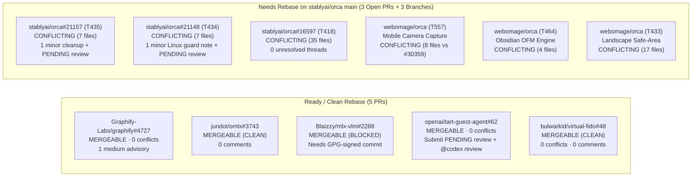

# Upstream PRs & Prepared Feature Branches — Deep Review, Rebase & Cross-Reference Audit

**Audit Date:** 2026-10-28  
**Scope:** 8 open upstream pull requests (`Graphify-Labs/graphify`, `jundot/omlx`, `Blaizzy/mlx-vlm`, `stablyai/orca` ×3, `openai/tart-guest-agent`, `bulwarkid/virtual-fido`) + 3 prepared `webomage/orca` feature branches (`T557`, `T464`, `T433`) + `T593` (Orca mobile dark/light mode override tracking).

> [!IMPORTANT]
> **Critical Discovery — 3 Unsubmitted `PENDING` Draft Reviews on GitHub:**
> `@casualuser` has **3 unsubmitted `PENDING` draft reviews** sitting on GitHub (`stablyai/orca#21157`, `stablyai/orca#21148`, `openai/tart-guest-agent#62`) containing 10 inline replies explaining commit fixes. Because GitHub hides `PENDING` review comments from everyone except their author until the review is submitted, maintainers and review bots cannot see those replies yet.

---

## 1. Executive Matrix — All 8 Open PRs & 3 Prepared Branches

| # | PR / Branch | Ticket | State / Mergeable | Ahead / Behind Base | Unresolved Threads | Rebase Conflicts | Immediate Next Action |
|---|---|---|---|---|---|---|---|
| 1 | [`Graphify-Labs/graphify#4727`](https://github.com/Graphify-Labs/graphify/pull/4727) | `T538` | `OPEN` · `MERGEABLE` | `+1` / `-86` (`upstream/v8`) | 3 bot coupling notices + 1 medium advisory | **0** (`CLEAN`) | Sample `head_at_merge` **before** merge at `graphify/global_graph.py:289` and rebase onto `upstream/v8`. |
| 2 | [`jundot/omlx#3743`](https://github.com/jundot/omlx/pull/3743) | `T492` | `OPEN` · `MERGEABLE (CLEAN)` | `+1` / `-765` (`main`) | **0** | **0** (`CLEAN`) | Ready to merge upstream; no reviewer requests. |
| 3 | [`Blaizzy/mlx-vlm#2288`](https://github.com/Blaizzy/mlx-vlm/pull/2288) | `T431` | `OPEN` · `MERGEABLE (BLOCKED)` | `+1` / `-286` (`main`) | **0** (1 bot gate comment) | **0** (`CLEAN`) | Amend commit `4e28e354b2` with GPG signature (`git commit --amend -S --no-edit`) & force-push to clear `mlx-vlm-unverified-commits`. |
| 4 | [`stablyai/orca#21157`](https://github.com/stablyai/orca/pull/21157) | `T435` | `OPEN` · `CONFLICTING (DIRTY)` | `+6` / `-6293` (`upstream/main`) | **1** (`@pullfrog`) + **1 `PENDING` review** | **7 files** | Drop vestigial `pendingWorktreeDeepLink` field, rebase onto `upstream/main`, and submit `PENDING` review `PRR_kwDORpCz1s8AAAABOQeUEg`. |
| 5 | [`stablyai/orca#21148`](https://github.com/stablyai/orca/pull/21148) | `T434` | `OPEN` · `CONFLICTING (DIRTY)` | `+6` / `-6293` (`upstream/main`) | **1** (`@coderabbitai`) + **1 `PENDING` review** | **7 files** | Move Linux dev registration before generic guard in `orca-protocol-client-registration.ts:14`, rebase onto `upstream/main`, and submit `PENDING` review `PRR_kwDORpCz1s8AAAABOQgiZg`. |
| 6 | [`stablyai/orca#16597`](https://github.com/stablyai/orca/pull/16597) | `T418` | `OPEN` · `CONFLICTING (DIRTY)` | `+12` / `-5849` (`upstream/main`) | **0** (14/14 resolved) | **35 files** | Rebase onto `upstream/main` (aligning with refactored `src/main/ai-vault/` and `src/shared/tui-agent*` modules). |
| 7 | [`openai/tart-guest-agent#62`](https://github.com/openai/tart-guest-agent/pull/62) | `T293` | `OPEN` · `MERGEABLE (BLOCKED)` | `+113` / `-0` (`upstream/main`) | **0** (135/135 resolved) + **1 `PENDING` review** | **0** (`CLEAN`) | Submit `PENDING` review `PRR_kwDOOVaphs8AAAABOP8CGA` (7 replies) and post `@codex review` to re-run the transient Codex check on `b935262`. |
| 8 | [`bulwarkid/virtual-fido#48`](https://github.com/bulwarkid/virtual-fido/pull/48) | `T548` | `OPEN` · `MERGEABLE (CLEAN)` | `+59` / `-0` (`upstream/master`) | **0** | **0** (`CLEAN`) | Up to date with `upstream/master` and ready for maintainer review. |
| B1 | `webomage/orca` `feat/mobile-camera-capture-chat` | `T557` | Prepared branch (no PR yet) | `+1` / `-6690` (`upstream/main`) | — | **8 files** | Port `launchCameraAsync` into the new `mobile/src/session/native-chat/composer/` + `mobile/src/platform/native-media-device.ts` layout from merged `#30359`. |
| B2 | `webomage/orca` `feat/obsidian-ofm-engine` | `T464` | Prepared branch (no PR yet) | `+1` / `-5581` (`upstream/main`) | — | **4 files** | Rebase 4 markdown preview/IPC files onto `upstream/main`. |
| B3 | `webomage/orca` `fix/mobile-landscape-safe-area-insets` | `T433` | Prepared branch (no PR yet) | `+7` / `-5909` (`upstream/main`) | — | **17 files** | Rebase 15 modified mobile screens + drop 2 deleted parity test files onto `upstream/main`. |
