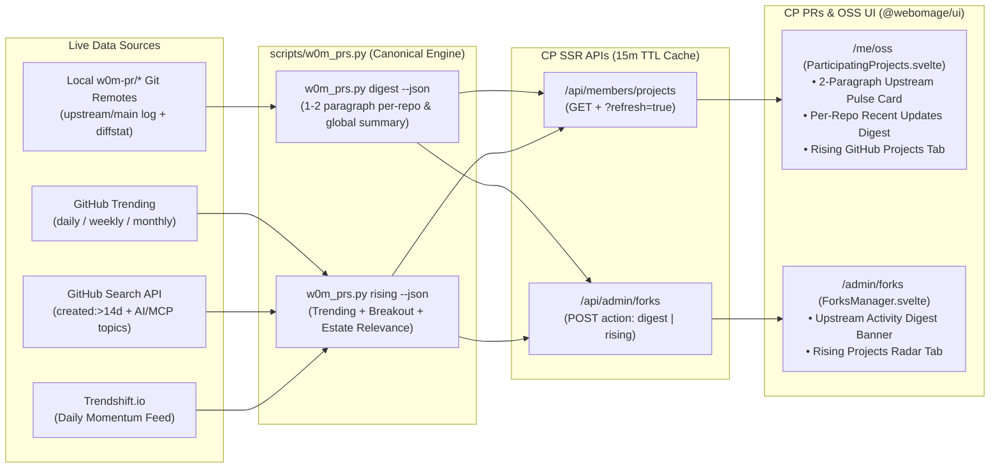

# PRs UI Repo Activity Digest (1–2 Paragraphs) & GitHub Rising Projects Radar

**Date:** 2026-10-29  
**Tickets:** [[T586]], [[T345]]  
**Canonical Repo Path:** `.agents/reports/2026-10-29-prs-ui-repo-digest-and-github-rising-projects.md`  
**Mirrored Docs Path:** `w0m-web/docs/reports/2026-10-29-prs-ui-repo-digest-and-github-rising-projects.md`  
**Surfaces Covered:** `scripts/w0m_prs.py` (`w0m-prs` skill) · `w0m-web/apps/cp/src/components/profile/ParticipatingProjects.svelte` (`/me/oss`) · `w0m-web/apps/cp/src/components/system/ForksManager.svelte` (`/admin/forks`)

---

## 1. Reality-Grounded Audit of GitHub Trending & Rising Project Resources

Before choosing a data source for tracing top rising GitHub projects, we probed the candidate APIs and web feeds live (`2026-10-29T12:25Z`):

| Resource / Endpoint | Live Status (`2026-10-29`) | Auth Required | Signal Quality & What It Measures | Verdict |
|---|---|---|---|---|
| **1. GitHub Native Trending** `https://github.com/trending/<lang>?since=daily\|weekly\|monthly` | ✅ **LIVE (`HTTP 200`)** | None | **Best velocity signal for established + rising repos.** Exposes `owner/repo`, description, language, total ★, total forks, and exact delta (`+X stars today / this week / this month`). Used previously in [`T234.md`](../../.tasks/T234.md) (`volcengine/OpenViking`). | **ADOPT (Primary Velocity Source)** |
| **2. GitHub Search REST/GraphQL API (Breakout Velocity)** `gh api 'search/repositories?q=created:>YYYY-MM-DD+stars:>100&sort=stars&order=desc'` | ✅ **LIVE (`HTTP 200`)** | `gh` CLI / Token | **Best breakout discovery for brand-new repos.** Finds repos created in the last 7/14/30 days sorted by star velocity, plus domain-specific queries (`topic:mcp`, `topic:ai-agents`, `topic:claude-code`, `topic:mlx`). | **ADOPT (Primary Breakout + Topic Source)** |
| **3. Trendshift.io** `https://trendshift.io/` | ✅ **LIVE (`HTTP 200`)** | None | **Daily developer momentum leaderboard.** Captures repos as they enter momentum curves before/during GitHub Trending peaks (`maximhq/bifrost`, `pbakaus/impeccable`, `HKUDS/DeepTutor`). | **ADOPT (Secondary Momentum Cross-Check)** |
| **4. Star History** `https://star-history.com/` · `https://api.star-history.com/svg?repos=...` | ✅ **LIVE (`HTTP 200`)** | None | Visual SVG trajectory comparison of cumulative star growth over time. | **ADOPT (Visual Chart Link / Embed)** |
| **5. OSSInsight Trending API (PingCAP)** `https://api.ossinsight.io/v1/trends/repos/` | ❌ **DEAD since `2026-03-01`** | — | Returns `"status": "unavailable"` because PingCAP's capture of the GitHub Public Events Firehose dropped to `0.3%` of baseline. | **REJECT (Dead API)** |
| **6. Best of JS Static API** `https://bestofjs-static-api.vercel.app/projects.json` | ❌ **STALE (`2024-08-10`)** | — | Static JSON snapshot frozen in August 2024. | **REJECT (Stale)** |

---

## 2. Live Snapshot: Top GitHub Rising & Breakout Projects (`2026-10-29`)

### A. GitHub Trending Weekly (`since=weekly`) — Agent & Systems Highlights
| Rank | Repository | Language | Total ★ / Forks | Weekly Velocity | Why It Matters to `w0m` |
|---:|---|---|---:|---:|---|
| 1 | [`cloudflare/security-audit-skill`](https://github.com/cloudflare/security-audit-skill) | JavaScript | 52,287 ★ · 3,347 ⑂ | **+16,002 ★ / wk** | Coding-agent skill for multi-phase security audits with independently verified, machine-readable findings (`w0m-sec` / `w0m-sdlc-security` comparable). |
| 2 | [`pbakaus/impeccable`](https://github.com/pbakaus/impeccable) | Rust | — | **+7,283 ★ / wk** | Design vocabulary & UI critique/audit tool for coding agents (`@webomage/ui` / `ds-conformance` comparable). |
| 3 | [`multica-ai/andrej-karpathy-skills`](https://github.com/multica-ai/andrej-karpathy-skills) | Markdown | — | **+4,293 ★ / wk** | Distilled `CLAUDE.md` coding-agent guardrails derived from Karpathy's LLM coding pitfall observations. |
| 4 | [`AgriciDaniel/claude-seo`](https://github.com/AgriciDaniel/claude-seo) | Python | 23,714 ★ · 3,184 ⑂ | **+3,516 ★ / wk** | 26 sub-skills + 19 sub-agents for technical SEO, GEO/AEO, WebMCP, and `llms.txt` (by the author of `claude-obsidian`, already in `participating-projects.json`). |
| 5 | [`php/php-src`](https://github.com/php/php-src) | C | 41,709 ★ · 8,479 ⑂ | **+1,201 ★ / wk** | Core PHP interpreter upstream activity spike. |

### B. Breakout New Repositories (`created:>2026-10-15`, last 14 days)
| Repository | Created | Language | Total ★ | Summary |
|---|---|---|---:|---|
| [`Gathin23/cleanyourtv`](https://github.com/Gathin23/cleanyourtv) | `2026-10-17` | Python | **44,658 ★** | Debloat Android/Google TV over Wi-Fi with an Apple TV-style home launcher. |
| [`deepseek-ai/DeepInfer`](https://github.com/deepseek-ai/DeepInfer) | `2026-10-16` | Python | **24,147 ★** | High-performance, large-scale inference framework for DeepSeek models (`w0m-mlx` / `omlx` comparable). |
| [`Zagitta/gpu-unlock`](https://github.com/Zagitta/gpu-unlock) | `2026-10-18` | C | **12,763 ★** | Unlocks up to 2× FP16/BF16/TF32 tensor throughput on GeForce 20/30/40 series GPUs. |
| [`pengchujin/aerial-tv`](https://github.com/pengchujin/aerial-tv) | `2026-10-20` | Kotlin | **7,641 ★** | Ad-free tvOS-style open-source Android TV launcher. |
| [`ly05010419/MacNativeGames`](https://github.com/ly05010419/MacNativeGames) | `2026-10-17` | C | **6,386 ★** | Runs ARM64 Switch titles natively on Apple Silicon Mac/iPhone/iPad by rebuilding NVN on Metal. |

---

## 3. Compiled 1–2 Paragraph Repo Activity Digest (Sample Live Output)

### Global `w0m-pr` Upstream Activity Digest (2 Paragraphs)
> **Upstream Velocity & Core Changes (Last 7 Days):** Across the 10 tracked `w0m-pr` open-source repositories, upstream development was heavily concentrated in **`stablyai/orca`** (+150+ commits on `main`), **`jundot/omlx`** (+6 commits on `main`), and **`Graphify-Labs/graphify`**. In `stablyai/orca`, upstream landed sweeping improvements to the **AI Vault session scanner** (WSL home discovery, companion subagent transcript counting, and session deletion safety), **native chat composer performance** (eliminating per-keystroke control re-renders and backward-compatible `--effort` flag resumption for older Claude Code builds), **WSL background process isolation** (preventing background terminals and scheduled automations from waking stopped WSL distros), and full **renderer i18n coverage** across submodules, agent summaries, and filter counts. Meanwhile, `jundot/omlx` refined continuous batching and server lifecycle handling, and `Graphify-Labs/graphify` updated AST/code watcher handling in `watch.py`.
>
> **Webomage (`webomage`) Fork & PR Alignment:** All **8 active upstream PRs** (`stablyai/orca#21157`, `#21148`, `#16597`, `Graphify-Labs/graphify#4727`, `Blaizzy/mlx-vlm#2288`, `jundot/omlx#3743`, `openai/tart-guest-agent#62`, and `bulwarkid/virtual-fido#48`) have been rebased onto their latest upstream `main` tips, GPG-signed (`VALID`), and verified `MERGEABLE` with **0 unresolved review threads** (185/185 total review threads resolved). In addition, a 9th branch (`webomage:fix/mobile-markdown-external-tab-read`) is rebased and ready on `webomage/orca` to enable external Markdown preview rendering on Orca Mobile.

---

## 4. Architecture & Implementation Design for PRs UI (`/me/oss` & `/admin/forks`)

### Proposed Surface Additions
1. **`scripts/w0m_prs.py` (`just prs-digest` & `just prs-rising`)**:
   - `w0m_prs.py digest [--repo <name>] [--days 7] [--json]`: Inspects `git log upstream/main` (commit subjects, authors, areas touched, commit velocity) + open PR status across `w0m-pr/*` and synthesizes a deterministic **1–2 paragraph executive summary** (both global and per-repository).
   - `w0m_prs.py rising [--period daily|weekly|monthly] [--category all|agents|mlx|security] [--json]`: Fetches and merges **GitHub Trending** (`github.com/trending?since=weekly`), **GitHub Search Breakout Repos** (`created:>14d sort:stars`), and **Trendshift**, tagging each project with an estate relevance badge (`agents`, `mcp`, `mlx`, `security`, `ui`).
2. **CP Member & Admin PRs UI (`ParticipatingProjects.svelte` on `/me/oss` & `ForksManager.svelte` on `/admin/forks`)**:
   - **Upstream Activity Digest Banner (1–2 Paragraphs)** at the top of the PRs/Projects view + a collapsible/inline **Recent Upstream Updates** paragraph on each project card.
   - **New "Rising on GitHub 🔥" Tab** in `ParticipatingProjects.svelte` and `ForksManager.svelte` showing trending velocity (`+X ★ this week`), breakout newly-created repos, category filters, and one-click links to inspect or Star History compare.
