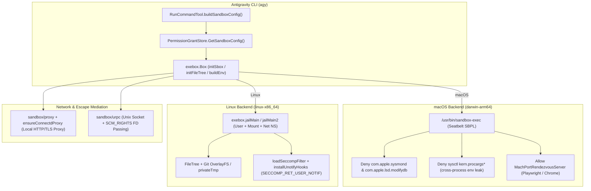

# Research Report: Antigravity (`agy`) Sandboxing Architecture & Multi-Engine OCI/VM Sandboxes (`T480`)

**Date:** 2026-11-01
**Ticket:** [[T480]]
**Scope:** Binary & runtime analysis of `agy` (`darwin-arm64` & `linux-x86_64`) sandboxing (`google3/devtools/ai/sandbox/*`) and integration with `w0m` local/remote OCI sandboxes (`scripts/oci_sandbox.py`).

---

## 1. Executive Summary

Antigravity (`agy`) ships a built-in, zero-VM, OS-native process sandboxing subsystem (`google3/devtools/ai/sandbox/exebox` + `sbox` + `proxy` + `urpc`) controlled via `--sandbox` (`enableTerminalSandbox` in `~/.gemini/antigravity-cli/settings.json`) and enforced automatically for read-only subagents (`research`). Rather than spinning up OCI containers for each tool invocation, `agy` re-executes itself as a sandbox supervisor (`selfexec`) and wraps child commands using:

1. **macOS (`darwin-arm64`):** Apple **Seatbelt** (`/usr/bin/sandbox-exec`) with a dynamically generated `(version 1) (deny default)` SBPL profile (`; macOS Seatbelt sandbox profile`).
2. **Linux (`linux-x86_64`):** Unprivileged **user/mount/PID/network namespaces** (`unshare` / `jailMain` / `jailMain2`), a synthetic VFS mount tree (`buildFileTree` + `preferGitOverlay` overlayfs/tmpfs mounts), and a **BPF Seccomp filter** (`loadSeccompFilter` + `installUnotifyHooks` `SECCOMP_RET_USER_NOTIF` syscall interception).
3. **Cross-Platform Network & Escape Mediation (`connectd` / `proxy` / `urpc`):** Inside the sandbox, direct external sockets are blocked or scrubbed (`dropDeniedSocketEnv`, `dbusSocketPath`, `x11SocketPath`, `deleteRPCProxyEnv`). Outbound HTTP/HTTPS/connect traffic routes through an in-process MITM/CONNECT proxy (`exebox.(*Box).startLocalProxy`, `ensureConnectdProxy`, `rejectProtocolSmuggling`), while sanctioned host commands use a file-descriptor-passing Unix domain RPC channel (`urpc.withFDs` / `escapeServer`).

---

## 2. Architecture Diagram

---

## 3. Deep Dive: How `agy` Sandboxes Commands

### 3.1 Policy Resolution (`GetSandboxConfig`)
- **Entrypoints:**
  - CLI Flag: `agy --sandbox` ("Run in a sandbox with terminal restrictions enabled")
  - Settings key: `"enableTerminalSandbox": true` in `~/.gemini/antigravity-cli/settings.json`
  - Subagent enforcement: The built-in `research` subagent always overrides `SandboxConfig` to read-only filesystem (`sbox.FilePerm`) with `AllowFullNetwork = false`.
- **Filesystem Tree (`exebox.FileTree` & `sbox.FilePerm`):**
  - `EssentialPaths` (`/usr`, `/bin`, `/sbin`, `/lib`, `/System`, `/opt/homebrew`, nix/toolchain dirs) are mounted/permitted **Read-Only**.
  - Active workspace roots (`trustedWorkspaces` / `--add-dir`) are granted **Read-Write** (or backed by `preferGitOverlay` when git overlay mode is active).
  - `DefaultDeniedHomePaths` (`~/.ssh`, `~/.aws`, `~/.gnupg`, `~/.config/gcloud`, keyring paths) and sensitive sockets (`dbusSocketPath`, `x11SocketPath`, `EMACS_SOCKET_NAME`, `WAYLAND_DISPLAY`) are stripped or masked via `dropDeniedSocketEnv` and `isTmpfs`.
  - A private `/tmp` (`privateTmpRoot` / `writableTmpEnv`) is provisioned per sandbox instance.

### 3.2 macOS Enforcement (`sandbox-exec` Seatbelt Profile)
Extracted directly from `/Users/proto/.local/bin/agy`, the macOS Seatbelt profile enforces:
- `(version 1)` and `(deny default)`.
- **Process & Task Isolation:**
  - `(allow process-exec)` and `(allow process-fork)`.
  - `(allow process-info* (target same-sandbox))` and `(allow signal (target same-sandbox))` — processes inside the sandbox cannot signal or inspect processes outside the sandbox.
  - `(deny sysctl-read (sysctl-name-prefix "kern.procargs"))` — prevents reading `argv`/`envp` of host processes via `ps eww` or `pgrep -lf`.
- **Mach Service Hardening:**
  - `(deny mach-lookup (global-name "com.apple.sysmond"))` — blocks querying the host process table via `sysmond`.
  - `(deny mach-lookup (global-name "com.apple.lsd.modifydb"))` — blocks registering `.app` bundles or hijacking URL schemes via LaunchServices.
- **Headless Browser Compatibility (`Chromium` / `Playwright` / `Electron`):**
  - Explicitly allows `(allow mach-register (local-name-prefix "com.google.Chrome.MachPortRendezvousServer.") ...)` and `"org.chromium.crashpad.child_port_handshake."` plus `(allow sysctl-write (sysctl-name "kern.tcsm_enable"))` for Node/V8, so Playwright/Chromium E2E tests can run inside `agy --sandbox` without crashing on `BOOTSTRAP_NOT_PRIVILEGED (1100)`.

### 3.3 Linux Enforcement (`exebox.jailMain` + `seccomp` + `urpc`)
Extracted from `linux-host:~/.local/bin/agy`:
- **Self-Exec Loader (`google3/devtools/ai/sandbox/selfexec`):** Inspects `/proc/self/cmdline` (`parseLoaderLaunch`) to bootstrap `exebox.jailMain` / `jailMain2` inside unprivileged namespaces (`bringLoopbackUp` brings up `lo` inside the network namespace).
- **Mount Namespace & Overlay (`buildFileTree`):** Constructs a restricted rootfs with read-only system paths, masked `DefaultDeniedHomePaths`, and optional Git overlayfs (`preferGitOverlay`).
- **Seccomp + User Notification (`loadSeccompFilter` / `installUnotifyHooks`):** Installs BPF seccomp rules and uses Linux `seccomp_unotify` to intercept privileged syscalls or socket binds (`bindPort`, `forwardListeners`).
- **Escape Channel (`escapeServer` / `urpc`):** Provides a tightly scoped `urpc` Unix socket (`escape.sock`) using `SCM_RIGHTS` file-descriptor passing (`urpc.withFDs`) so approved host-level actions can execute without breaking namespace isolation.

---

## 4. Comparison: `agy` Process Sandbox vs. `w0m` Multi-Engine OCI/VM Sandboxes (`scripts/oci_sandbox.py`)

| Dimension | `agy` Built-in Sandbox (`exebox`/`sbox`) | `colima` (`vz` + `dockerd`) | `apple-container` (`1.6.1`) | `tart` / `devpod` | `remote-ssh` (`linux-host`) |
|---|---|---|---|---|---|
| **Isolation Boundary** | OS process sandbox (Seatbelt / Linux NS + Seccomp) | Linux VM (`Virtualization.framework`) + Docker containers | Per-container microVM (`Kata 3.32 arm64`) | Full macOS / Linux Guest VM | Remote physical host (`192.168.0.95`) + Linux namespaces |
| **Startup Latency** | `< 15 ms` per command | `~1s` per container (VM warm) | `~300 ms` per microVM container | `~5–15 s` per VM | `< 200 ms` over SSH |
| **Docker Engine API (`DOCKER_HOST`)** | No | **Yes** (`unix://~/.colima/default/docker.sock`) | No (`xpc://com.apple.container.apiserver`) | Via VM guest | **Yes** (`ssh://linux-host` + port forward) |
| **Best Use Case in `w0m`** | Every agent tool command & read-only `research` subagent | Local Supabase (`just db-local-up`), multi-container E2E | Fast isolated single-image OCI tasks | Full OS desktop / macOS Tahoe testing (`T296`) | Offloading heavy x86_64/Linux containers from macOS |

---

## 5. Host & Service Identity + Expected Version Probes (`scripts/host_service_probe.py`)

To prevent port-collision false positives (where an old or wrong service listening on a port passes a bare TCP/HTTP status check), every host and service probe in the estate (`just host-probe`, `just oci-status`, `just orca-hosts`, and `just e2e-local`) verifies **both** the replying service identity and its expected version:

| Target | Endpoint | Expected Service Field | Expected Version Check |
|---|---|---|---|
| `app:web` | `http://127.0.0.1:4321/api/health` | `service == "web"` (`status == "ok"`) | Exact `DEPLOY_VERSION` match |
| `app:job` | `http://127.0.0.1:4322/api/health` | `service == "job"` (`status == "ok"`) | Exact `DEPLOY_VERSION` match |
| `app:join` | `http://127.0.0.1:4323/api/health` | `service == "join"` (`status == "ok"`) | Exact `DEPLOY_VERSION` match |
| `app:demo` | `http://127.0.0.1:4324/api/health` | `service == "demo"` (`status == "ok"`) | Exact `DEPLOY_VERSION` match |
| `app:cp` | `http://127.0.0.1:4325/api/health` | `service == "cp"` (`status == "ok"`) | Exact `DEPLOY_VERSION` match |
| `supabase-auth` | `http://127.0.0.1:54321/auth/v1/health` | `name == "GoTrue"` | Prefix `v2.` (`v2.197.0`) |
| `edge-local-proxy` | `http://127.0.0.1:8791/health` | `service == "w0m-edge-local-proxy"` | Exact `DEPLOY_VERSION` / `local` |
| `orca-hosts` (`local` & `linux-host`) | `orca-runtime.json` Unix RPC (`status.get`) | `runtimeId` + `ready == true` | Prefix `1.4.` (`1.4.245`) |
| `oci_sandbox.py` (`colima`, `apple-container`, `docker-native`, `podman`, `tart`, `devpod`, `remote-ssh`) | Daemon CLI & socket info | Engine binary/server identity | Expected version prefix (`v0.10.`, `1.6.`, `29.`, `5.`, `3.`, `v0.16.`) |

