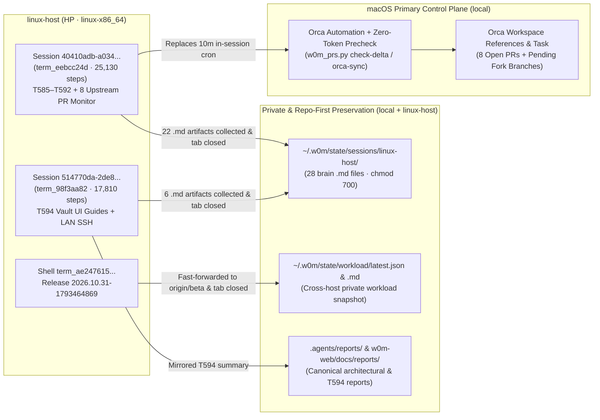

# Linux Box (`HP`) `w0m` Orca Sessions Progress Summary, Artifact Archive & Closeout Report (`T599`)

**Date:** 2026-11-01  
**Author:** Antigravity (`agy:agy-t599`, Track C)  
**Ticket:** [[T599]]  
**Related:** [[T596]], [[T597]], [[T598]], [[T594]], [[T593]], [[T585]], [[T586]], [[T588]], [[T589]], [[T590]], [[T591]], [[T592]]

---

## 1. Executive Summary

All three `w0m` Orca terminals and two long-running Antigravity sessions (`40410adb-a034-4a71-8a83-98907b5e3a7f` and `514770da-2de8-4c42-b74c-763a3bf102dd`) on **`linux-host` (`HP` / `192.168.0.95`, `linux-x86_64`)** have been audited, their 28 brain Markdown artifacts collected into the private local archive (`~/.w0m/state/sessions/linux-host/`), all 8 estate repositories on `linux-host` fast-forwarded to `origin/beta`, and the 3 `w0m` Orca terminal tabs on `linux-host` cleanly closed.

---

## 2. Closed `linux-host` `w0m` Sessions & Terminals Inventory

| Terminal Handle | Tab ID | Conversation ID | Steps | Delivered Scope & Tickets | Closeout Status |
|---|---|---|---|---|---|
| `term_eebcc24d-0e7a-428f-beff-8fa23bca844b` | `4038d563-9589-4712-abe0-0b6911622b9a` | `40410adb-a034-4a71-8a83-98907b5e3a7f` | `25,130` | • Delivered Waves/Batches (`T585`–`T592`, OSS packages & tools audit, GitHub-Issues-as-SSOT voting board, `w0m-prs` digest & rising projects, Orca collaboration board research, upstream PR rebase audit). • Ran 513 iterations of the 10-minute upstream PR monitor across 8 open PRs (`0` unresolved review threads, all `MERGEABLE` and GPG-signed). | **22 artifacts archived** → `~/.w0m/state/sessions/linux-host/40410adb-a034-4a71-8a83-98907b5e3a7f/`. **Tab & PID `24381` closed** (`closeMode: "tab"`). Replaced by native Orca Automation (`just prs-orca-sync`). |
| `term_98f3aa82-7f43-4134-a71f-28cca2dce966` | `6470ff5f-3087-440b-9be0-2784fd77350c` | `514770da-2de8-4c42-b74c-763a3bf102dd` | `17,810` | • Delivered `T508`, `T509` (`AgDR-0050`), `T512`, `T516`–`T519`, `T521`, `T522`, `T226`, `T227`, `T106`, `T109`, `T84`, `T128`, `T132`. • Delivered `T594` (per-project `notes/ui-user-guide.md` + `assets/*.svg` across all 5 Obsidian vaults `w0m`, `1945`, `artemio`, `servicios777`, `personaje0`, uploaded to Cloudflare R2 `r2://wom-engagement-vaults/` and Supabase `public.vault_notes`). • Configured `HP` LAN SSH server (`192.168.0.95:22` & `:2222`, `sshd-lan` PAM stack) and Orca Mobile multi-host discovery. | **6 artifacts archived** → `~/.w0m/state/sessions/linux-host/514770da-2de8-4c42-b74c-763a3bf102dd/`. `T594` summary preserved in [`.agents/reports/2026-10-31-t594-project-ui-user-guides.md`](2026-10-31-t594-project-ui-user-guides.md). **Tab & PID `24557` closed** (`closeMode: "tab"`). |
| `term_ae247615-71df-406c-af2c-94685f5322f2` | `20800427-5a4b-4e25-9383-54d9ac29e8a1` | *(Interactive shell)* | — | • Executed production release `releases/2026.10.31-1793464869.json` on `origin/beta` and `~/.local/bin/enable-ssh-port22`. | **Fast-forwarded** `w0m-web`, `w0m-api`, `w0m-cf`, and `@wom` to `origin/beta`. **Tab closed** (`closeMode: "tab"`). |

---

## 3. Collected Brain Artifacts Ledger (`28` Markdown Files)

All 28 brain Markdown artifacts from `linux-host` are stored privately in `~/.w0m/state/sessions/linux-host/` (`0700` permissions) so sensitive operational artifacts (such as `totp-enrollment-qr.md` and `block-dx-5453094008-application.md`) never enter public Git, while transferable architectural reports are mirrored in `.agents/reports/` and `w0m-web/docs/reports/`:

### 3.1 Session `40410adb-a034-4a71-8a83-98907b5e3a7f` (`22` files)

| Artifact File | Size | Classification | Canonical Repo Mirror / Private Archive Location |
|---|---:|---|---|
| `estate-oss-packages-and-tools-audit.md` | `20,052 B` | Architectural Report | [`.agents/reports/estate-oss-packages-and-tools-audit.md`](estate-oss-packages-and-tools-audit.md) |
| `github-issue-feature-voting-board-research.md` | `8,548 B` | Architectural Report | [`.agents/reports/github-issue-feature-voting-board-research.md`](github-issue-feature-voting-board-research.md) |
| `prs-ui-repo-digest-and-github-rising-projects.md` | `9,204 B` | Architectural Report | [`.agents/reports/2026-10-29-prs-ui-repo-digest-and-github-rising-projects.md`](2026-10-29-prs-ui-repo-digest-and-github-rising-projects.md) |
| `orca-agent-collaboration-board-research.md` | `7,025 B` | Architectural Report | [`.agents/reports/2026-10-28-orca-agent-collaboration-board-research.md`](2026-10-28-orca-agent-collaboration-board-research.md) |
| `upstream-prs-deep-review-and-rebase-audit.md` | `5,418 B` | Architectural Report | [`.agents/reports/2026-10-28-upstream-prs-deep-review-and-rebase-audit.md`](2026-10-28-upstream-prs-deep-review-and-rebase-audit.md) |
| `harness2-w0m-analysis.md` | `10,370 B` | Architectural Report | [`.agents/reports/2026-10-18-harness2-w0m-analysis.md`](2026-10-18-harness2-w0m-analysis.md) |
| `role-alignment-integration.md` | `6,288 B` | Architectural Report | [`.agents/reports/role-alignment-report.md`](role-alignment-report.md) |
| `active-paused-tickets-epic-audit.md` | `18,272 B` | Session Delivery Log | `~/.w0m/state/sessions/linux-host/40410adb-.../` |
| `all-tickets-area-classification.md` | `64,452 B` | Session Delivery Log | `~/.w0m/state/sessions/linux-host/40410adb-.../` |
| `area-5-6-delivery-report.md` | `11,818 B` | Session Delivery Log | `~/.w0m/state/sessions/linux-host/40410adb-.../` |
| `area-7-delivery-report.md` | `10,266 B` | Session Delivery Log | `~/.w0m/state/sessions/linux-host/40410adb-.../` |
| `area-8-delivery-report.md` | `14,377 B` | Session Delivery Log | `~/.w0m/state/sessions/linux-host/40410adb-.../` |
| `batch-a-delivery-report.md` | `10,598 B` | Session Delivery Log | `~/.w0m/state/sessions/linux-host/40410adb-.../` |
| `batch-b-delivery-report.md` | `9,801 B` | Session Delivery Log | `~/.w0m/state/sessions/linux-host/40410adb-.../` |
| `firecrawl-and-tasks-status-report.md` | `17,093 B` | Session Delivery Log | `~/.w0m/state/sessions/linux-host/40410adb-.../` |
| `live-content-ui-and-e2e-audit.md` | `13,603 B` | Session Delivery Log | `~/.w0m/state/sessions/linux-host/40410adb-.../` |
| `ticket-actuality-audit.md` | `12,793 B` | Session Delivery Log | `~/.w0m/state/sessions/linux-host/40410adb-.../` |
| `track-a-b-c-delivery-report.md` | `11,908 B` | Session Delivery Log | `~/.w0m/state/sessions/linux-host/40410adb-.../` |
| `track-d-and-agent-quest-board-report.md` | `6,967 B` | Session Delivery Log | `~/.w0m/state/sessions/linux-host/40410adb-.../` |
| `wave-13-tickets-delivery-report.md` | `12,555 B` | Session Delivery Log | `~/.w0m/state/sessions/linux-host/40410adb-.../` |
| `block-dx-5453094008-application.md` | `11,284 B` | Private Application Data | `~/.w0m/state/sessions/linux-host/40410adb-.../` *(Private only)* |
| `totp-enrollment-qr.md` | `682 B` | Private Security / TOTP | `~/.w0m/state/sessions/linux-host/40410adb-.../` *(Private only)* |

### 3.2 Session `514770da-2de8-4c42-b74c-763a3bf102dd` (`6` files)

| Artifact File | Size | Classification | Canonical Repo Mirror / Private Archive Location |
|---|---:|---|---|
| `project-ui-user-guides.md` | `6,272 B` | Architectural Report (`T594`) | [`.agents/reports/2026-10-31-t594-project-ui-user-guides.md`](2026-10-31-t594-project-ui-user-guides.md) |
| `job-portal-profile-prep-and-r2-vaults.md` | `12,265 B` | Architectural Report | [`.agents/reports/job-portal-profile-prep-and-r2-vaults.md`](job-portal-profile-prep-and-r2-vaults.md) |
| `jobs-portal-outreach-architecture.md` | `9,394 B` | Architectural Report | [`.agents/reports/2026-10-19-jobs-portal-resume-studio-outreach-architecture.md`](2026-10-19-jobs-portal-resume-studio-outreach-architecture.md) |
| `t272-client-services-budget-grounding.md` | `9,224 B` | Architectural Report (`T272`) | [`.agents/reports/t272-client-services-budget-grounding.md`](t272-client-services-budget-grounding.md) |
| `w0m-ui-ux-api-parity-and-e2e-roles-audit.md` | `47,153 B` | Architectural Report (`T579`) | [`.agents/reports/2026-10-28-t579-ui-ux-api-parity-and-e2e-roles-audit.md`](2026-10-28-t579-ui-ux-api-parity-and-e2e-roles-audit.md) |
| `w0m-ui-roles-system-agdr-guide.md` | `54,792 B` | Session QA / AgDR Walkthrough | `~/.w0m/state/sessions/linux-host/514770da-.../` |
