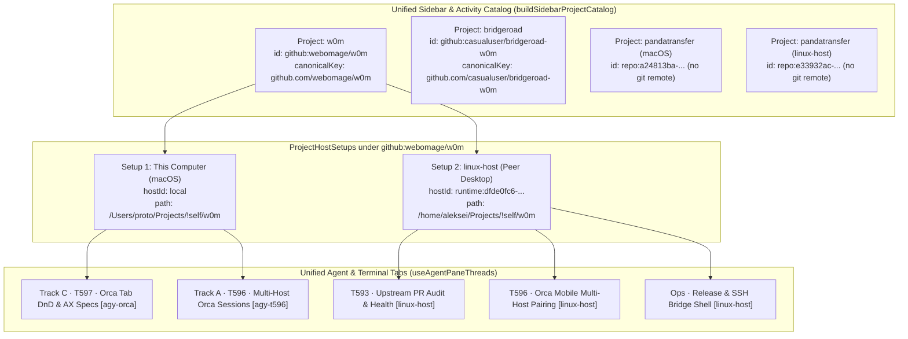
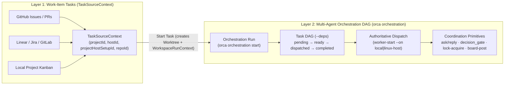
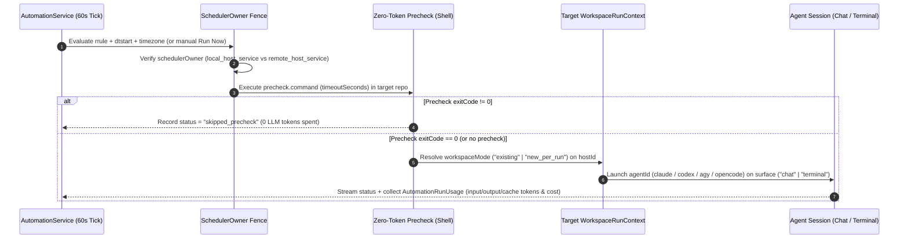
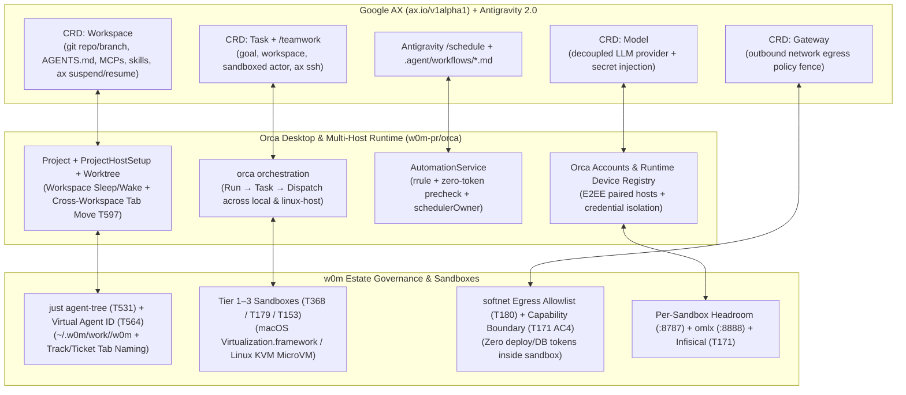

# Orca Multi-Host Projects, Tasks, Automations, Track/Ticket Session Naming & Google AX Workflow Architecture

**Date:** 2026-11-01  
**Author:** Antigravity (`agy:agy-orca`, Track C)  
**Tickets:** [[T597]], [[T596]], [[T564]], [[T171]], [[T180]], [[T368]], [[T531]]  
**Spec:** [`w0m-web/openspec/changes/2026-11-01-orca-session-naming-and-ax-workflows/`](../../w0m-web/openspec/changes/2026-11-01-orca-session-naming-and-ax-workflows/proposal.md)

---

## Executive Summary

This report documents the source-verified architecture of **Orca** (`w0m-pr/orca`, `v1.4.245`) across four operational pillars and maps them directly to **Google AX (`agentexecutor.io` / `ax.io/v1alpha1`)**, **Google Antigravity 2.0 Workflows**, and the **`w0m` Multi-Agent SDLC**:

1. **Multi-Host Same-Project Agent Visibility (Desktop ↔ Desktop Peer Pairing, Like the Mobile App):**
   - Orca's project catalog (`src/shared/project-host-setup-projection.ts` & `src/shared/sidebar-list/sidebar-project-catalog.ts`) merges workspaces from multiple hosts under a **single `Project`** whenever their repositories share a canonical Git remote (`github:<owner>/<repo>` or `git:<canonicalKey>`).
   - We identified and fixed a split-brain daemon issue on `linux-host` (`HP`): `orcadDeployment` had spawned a secondary headless `orcad` (`runtimeId: 61753056-...` on port `6770` with `0` terminals) while the interactive Linux Desktop GUI (`runtimeId: 15bbb9f9-8451-4fff-bb8f-5054a75cb0de`, holding all 5 live terminals) was already listening on `ws://0.0.0.0:6768`.
   - By decommissioning the redundant headless instance (`orca environment stop --environment linux-host --yes`) and pairing macOS Orca directly to `linux-host`'s primary desktop runtime (`scope: "runtime"` in `~/.config/orca/orca-devices.json` → `orca environment add --name linux-host`), macOS Orca now queries and controls all 5 live Linux desktop terminals natively (`orca terminal list --environment linux-host`), and merges `github:webomage/w0m` and `github:casualuser/bridgeroad-w0m` across both hosts.
2. **Orca Tasks (`TaskSourceContext` + `orca orchestration` Federated DAGs):**
   - Orca operates two complementary task layers: (a) **Work-Item Tasks** (`TaskSourceContext` for GitHub Issues, GitLab, Linear, Jira, and local project Kanban boards) that launch worktrees bound to `WorkspaceRunContext`, and (b) **Orchestration Task DAGs** (`Run` → `Task` → `Dispatch`) with cross-host worker federation (`orca orchestration worker-start --on <environment>`), distributed locks (`lock-acquire`), shared board (`board-post`), and blocking `ask`/`reply` + `decision_gate`.
3. **Orca Automations (`AutomationService` + `ExternalAutomationManager`):**
   - Scheduled (`rrule` + `dtstart` + `timezone`) and manual automations evaluated every `60s` with a **Zero-Token Shell Precheck Gate** (`precheck.command` — skips LLM invocation when `exitCode !== 0`), multi-host owner fencing (`schedulerOwner: 'local_host_service' | 'ssh_bridge' | 'remote_host_service'`), and external cron discovery (`openclaw` over local/SSH).
4. **Google AX (`ax.io/v1alpha1`) & Antigravity 2.0 Workflow Alignment:**
   - Google AX's 4 Kubernetes-style CRDs (`Workspace`, `Task`, `Gateway`, `Model`) and `ax suspend`/`ax resume` lifecycle map 1-to-1 onto Orca + `w0m` primitives (`ProjectHostSetup`/`agent-tree`, `orca orchestration` + `T368` sandboxes, `T180` `softnet` CIDR fence, and `T171` Headroom/`omlx` model routing).
5. **Deterministic Agent Session & Tab Naming Against Track or Ticket:**
   - Standardized session and tab naming grammar: **`[<Track> · ]<T##> · <Short Title> [<handle>]`** (e.g. `Track C · T597 · Orca Tab DnD & AX Specs [agy-orca]`), wired into `w0m-web/project/scripts/agent_identity.py` (`claim_ticket` + `rename` CLI), `w0m-web/project/scripts/agent_tree.py` (`new --ticket --track`), and preserved across cross-workspace tab drag-and-drop (`T597`).

---

## 1. Displaying Remote-Host Agents Inside the Same Orca Project (Like the Mobile App)

### 1.1 Two-Tier Data Model: `Project` vs `ProjectHostSetup`

In `w0m-pr/orca/src/shared/project-host-setup-projection.ts` (`L107-L134`) and `src/shared/sidebar-list/sidebar-project-catalog.ts` (`L39-L75`), Orca separates **Project Identity** from **Host Execution Setup**:



1. **Canonical Project ID Derivation (`deriveProjectIdentity`):**
   - If a repository has a GitHub remote (`git@github.com:webomage/w0m.git`), Orca assigns `projectId = "github:webomage/w0m"`.
   - If a repository has a non-GitHub Git remote, Orca assigns `projectId = "git:<canonicalKey>"`.
   - If a repository has **no Git remote** (or is a plain folder), Orca falls back to `projectId = "repo:<repoUuid>"`, where `isHostLocalProjectId(projectId) === true`.
2. **Automatic Cross-Host Merging (`mergeProjectEntries` & `useAgentPaneThreads`):**
   - When a remote host (`runtime:<environmentId>`) is paired, `mergeFetchedHostProjectCatalog` merges any remote project whose `projectId` is **not** host-local (`!isHostLocalProjectId`) into the existing `Project` row and attaches a second `ProjectHostSetup` (`hostId: "runtime:<environmentId>"`).
   - In the Activity view (`src/renderer/src/components/activity/use-agent-pane-threads.ts` `L204-L231`), `useAgentPaneThreads` groups threads by `project.id`, displaying both `local` and `linux-host` agent sessions inside the same `w0m` project group with a host badge (`linux-host`).
3. **Why `pandatransfer` Did Not Auto-Merge (and How to Merge It):**
   - On both macOS (`/Users/proto/Projects/!proj/pandatransfer`) and `linux-host` (`/home/aleksei/Projects/!proj/pandatransfer`), `git remote -v` is currently empty, so Orca generated host-local IDs (`repo:a24813ba-02ae-4e47-866a-813393b79deb` on macOS vs `repo:e33932ac-3fcb-4deb-9b19-468b9708f170` on `linux-host`).
   - Setting a matching `origin` remote URL on both checkouts causes Orca to compute the same `git:<canonicalKey>` / `github:<owner>/<repo>` ID and merge `pandatransfer` across both hosts automatically.

### 1.2 Why `orcadDeployment` Showed `0` Terminals vs Peer-Desktop Pairing (`15bbb9f9-...`)

| Connection Mode | Runtime on `linux-host` | State Directory | WebSocket Port | Live Desktop GUI Tabs Visible? |
|---|---|---|---|---|
| **Managed Headless Server (`orcadDeployment`)** | Secondary headless `orcad` (`61753056-03d4-4f49-b8a0-0affbc9cdbfc`, decommissioned) | `~/.orca/` | `127.0.0.1:6770` (tunnelled) | **No (`0` terminals)** — isolated from the X11/Wayland GUI desktop session |
| **Peer-Desktop Runtime Pairing (`scope: "runtime"`)** | Primary interactive `orca-ide` (`15bbb9f9-8451-4fff-bb8f-5054a75cb0de`) | `~/.config/orca/` | `ws://0.0.0.0:6768` (`192.168.0.95:6768`) | **Yes (all 5 live terminals)** — identical runtime used by the Orca Mobile App |

By decommissioning the redundant headless `orcadDeployment` (`orca environment stop --environment linux-host --yes`) and registering a `scope: "runtime"` peer credential in `linux-host:~/.config/orca/orca-devices.json` (which `DeviceRegistry.adoptExternalEdits()` hot-reloads on the next request without restarting the Linux GUI), macOS Orca (`environment: linux-host`, `id: dfde0fc6-159f-4d96-b535-394c337acc87`) now talks directly to `runtimeId: 15bbb9f9-8451-4fff-bb8f-5054a75cb0de`.

---

## 2. How Tasks Work in Orca (`TaskSourceContext` & `Orchestration` DAGs)

Orca implements two distinct but connected task architectures:



### 2.1 Work-Item Tasks (`src/shared/task-source-context.ts`, `mobile.tasks.v1`)
- **Multi-Host Scoping:** Every external task list (GitHub Issues, GitLab Issues, Linear, Jira) and local Kanban board is scoped by `TaskSourceContext`:
  - `provider`: `'github' | 'gitlab' | 'linear' | 'jira'`
  - `projectId`: e.g. `github:webomage/w0m`
  - `hostId`: `'local'` | `'runtime:<envId>'` | `'ssh:<targetId>'`
  - `projectHostSetupId` & `repoId`
- **Starting a Task:** Clicking **"Start task"** in the Tasks view (or Mobile Tasks tab) selects the target `ProjectHostSetup` (e.g. `w0m` on `local` or `w0m` on `linux-host`), creates a Git worktree on that host, injects the issue context into the agent prompt, and records task provenance on the worktree metadata.

### 2.2 Multi-Agent Orchestration Tasks (`src/main/runtime/rpc/methods/orchestration.ts`)
- **State Machine:** `Run` (coordinator namespace + message inbox) → `Task` (`pending | ready | dispatched | completed | failed | blocked`, with `--deps` dependency edges) → `Dispatch` (single authoritative worker execution attempt).
- **Cross-Host Federation (`src/main/runtime/rpc/methods/orchestration/federation/federation.ts`):**
  - `orca orchestration worker-start --task <id> --on <environment> --worktree new-top-level --repo <selector> --agent <agent>` dispatches a worker onto a paired remote environment (`linux-host`) while keeping the `Run` coordinator inbox and DAG state synchronized.
- **Shared Board & Distributed Locks (Already Wired in `w0m`):**
  - `w0m-web/project/scripts/agent_tree.py` (`L353-L390`) uses `orca orchestration lock-acquire --resource land:w0m` during `just agent-tree-land`.
  - `w0m-web/project/scripts/agent_identity.py` (`L505-L541`) announces ticket claims and completions to Orca's shared board via `orca orchestration board-post`.

---

## 3. How Automations Work in Orca (`AutomationService` & `ExternalAutomationManager`)

Grounded in `w0m-pr/orca/src/main/automations/service.ts`, `src/shared/automations-types.ts`, and `src/main/automations/external-manager.ts`:



1. **Schedule & Missed-Run Recovery:**
   - Uses RFC 5545 `rrule` + `dtstart` + `timezone`.
   - Evaluates due schedules every `60,000ms` (`DEFAULT_TICK_MS`).
   - Supports `missedRunPolicy: 'skip' | 'run_once_within_grace'` (`missedRunGraceMinutes`, e.g. when a laptop wakes from sleep).
2. **Zero-Token Precheck Gate (`AutomationPrecheck`):**
   - Before spawning an LLM agent, Orca can run a lightweight shell command (`precheck: { command, timeoutSeconds }`, e.g. `git fetch origin && test $(git rev-list HEAD..origin/beta --count) -gt 0` or `just in-check`).
   - If the command exits non-zero, the run is logged as `skipped_precheck` with stdout/stderr diagnostics and **zero LLM token spend**.
3. **Multi-Host Target & Split-Brain Owner Fencing (`schedulerOwner`):**
   - Each automation binds to a `WorkspaceRunContext` (`projectId`, `hostId`, `projectHostSetupId`, `repoId`, `path`).
   - `schedulerOwner: 'local_host_service' | 'ssh_bridge' | 'remote_host_service'` + `executionTargetGeneration` guarantees that when macOS Desktop is paired with `linux-host`, an automation owned by `remote_host_service` fires **only once** on `linux-host` even when both desktops are open.
4. **External Automation Discovery (`src/main/automations/external-manager.ts`):**
   - Discovers and controls external agent cron managers (`ExternalAutomationProvider = 'openclaw'`) across both `local` and `ssh` targets (`pause`, `resume`, `run`, `delete`).

---

## 4. How Orca & `w0m` Map to Google AX Workflows (`google/ax` + Antigravity 2.0)

In Google's Agent Experience / Agent Executor ecosystem, **"AX Workflows"** span two complementary layers:
1. **Google AX (`github.com/google/ax`, `agentexecutor.io`, `ax.io/v1alpha1`)** — Kubernetes-style declarative CRDs (`Workspace`, `Task`, `Gateway`, `Model`) for running isolated, stateful, suspendable autonomous agents on cluster/VM substrates.
2. **Google Antigravity 2.0 Workflows (`.agent/workflows/*.md`, `/goal`, `/teamwork`, `/schedule`, `invoke_subagent`)** — IDE/CLI-level markdown procedures, reactive subagent DAGs, and in-session cron/timer schedules.



### Architectural Comparison Matrix

| Dimension | Google AX (`ax.io/v1alpha1`) | Google Antigravity 2.0 | Orca (`w0m-pr/orca`) | `w0m` Estate (`@wom`) |
|---|---|---|---|---|
| **Workspace & Context** | `Workspace` CRD (clones repo/branch, injects `AGENTS.md`, MCPs, skills; `ax suspend` / `ax resume`) | `Workspace: 'inherit' \| 'branch' \| 'share'` in `invoke_subagent` | `Project` + `ProjectHostSetup` + `Worktree` (with workspace sleep/wake) | `just agent-tree <name>` (`~/.w0m/work/<name>/w0m`, `T531`) + `just skills-sync` |
| **Task & Actor Dispatch** | `Task` CRD (`goal`, `workspace`, `image`, `debug: true` / `ax ssh`) | `/goal`, `/teamwork`, `invoke_subagent` + `send_message` | `TaskSourceContext` + `orca orchestration` (`Run` → `Task` → `Dispatch` across hosts) | `.tasks/T##.md` + `agent_identity.py` (`T564`) + `orca_sessions.py` (`T596`) |
| **Scheduling & Routines** | External K8s `CronJob` submitting `Task` CRDs | In-session `schedule` tool (`CronExpression` / `DurationSeconds`) | `AutomationService` (`rrule` + **zero-token shell `precheck`** + `schedulerOwner`) | `T171` batched sandbox runner (adopts Orca `AutomationService` + `precheck` as AC6 surface) |
| **Network & Permission Fence** | `Gateway` CRD (restricts outbound egress per `Task`) | `Internet Access Policy` + `Browser URL Allowlist` | Per-device `RuntimeDeviceGrant` + `rpc-caller-scope` | `T180` `softnet` CIDR allowlist + `T171` AC4 capability-based credential exclusion |
| **Model & Proxy Routing** | `Model` CRD (decouples LLM provider & API keys from `Task`) | `--model` / `Model` enum (`inherit`, `pro`, `flash`) | `orca account` profile pointer + provider adapters | `T171` per-sandbox `headroom` (`:8787`) + `omlx` (`:8888`) + Infisical process injection |

> [!IMPORTANT]
> **Key Synthesis for `T171` (AC5 & AC6):** Rather than inventing a third invisible scheduler in `w0m`, `T171`'s scheduled/batched sandbox execution should use **Orca's `AutomationService` (with its zero-token shell `precheck` gate) + `orca orchestration` task dispatches** as the visible control plane (`orca automations list` / `orca automations runs`), while executing each sandboxed workload inside the Google AX-aligned VM boundary (`T153`/`T368`/`T180`).

---

## 5. Specification: Deterministic Agent Session & Tab Naming Against Track or Ticket

### 5.1 Problem Statement
When running 5–10 concurrent terminals across `local` (macOS) and `linux-host` (Linux Desktop), default terminal titles (`Terminal 1`, `Terminal 2`, `aleksei@HP: ~/Projects/!self/w0m`) make it impossible to tell at a glance which tab owns which Track (`Track A`, `Track C`) or Ticket (`T596`, `T597`, `T593`) — especially when dragging tabs across workspaces (`T597`) or inspecting multi-host sessions (`T596`).

### 5.2 Canonical Naming Grammar

Every Orca terminal tab bound to a `w0m` ticket, track, or isolated agent tree MUST follow the deterministic title format:

```text
[<Track> · ]<T##> · <Short Title> [<handle>]
```

Or, when a terminal is created for an agent tree or project operational scope before a specific `T##` is claimed:

```text
[<Track> · ]<Project/Scope> · <Short Title> [<handle-or-host>]
```

**Live Verified Examples Across Both Hosts (2026-11-01):**

| Host | Terminal Handle | Tab ID | Worktree | Canonical Session / Tab Title |
|---|---|---|---|---|
| `local` (macOS) | `term_af5da960-...` | `c8c2059c-...` | `/Users/proto/Projects/!self/w0m` | `Track C · T597 · Orca Tab DnD & AX Specs [agy-orca]` |
| `local` (macOS) | `term_e05da15c-...` | `16ef0b1a-...` | `/Users/proto/Projects/!self/w0m` | `Track A · T596 · Multi-Host Orca Sessions [agy-t596]` |
| `local` (macOS) | `term_5ddea623-...` | `32ad91c5-...` | `global-floating-terminal` | `PandaTransfer · Remote Setup & SSH [floating]` |
| `local` (macOS) | `term_f4c263dd-...` | `6e914942-...` | `/Users/proto/Projects/!proj/bridgeroad` | `BridgeRoad · Coaching & Auth Audit [local]` |
| `local` (macOS) | `term_d405c9a4-...` | `a6b9ec08-...` | `/Users/proto/Projects/!proj/pandatransfer` | `PandaTransfer · IEX Docs & License [local]` |
| `linux-host` | `term_eebcc24d-...` | `4038d563-...` | `/home/aleksei/Projects/!self/w0m` | `T593 · Upstream PR Audit & Health [linux-host]` |
| `linux-host` | `term_98f3aa82-...` | `6470ff5f-...` | `/home/aleksei/Projects/!self/w0m` | `T596 · Orca Mobile Multi-Host Pairing [linux-host]` |
| `linux-host` | `term_ae247615-...` | `20800427-...` | `/home/aleksei/Projects/!self/w0m` | `Ops · Release & SSH Bridge Shell [linux-host]` |
| `linux-host` | `term_a1ba06d4-...` | `351b6987-...` | `/home/aleksei/Projects/!proj/pandatransfer` | `PandaTransfer · Disk & Infra Audit [linux-host]` |
| `linux-host` | `term_f57e94be-...` | `d04b5b5a-...` | `/home/aleksei/Projects/!proj/pandatransfer` | `PandaTransfer · Host Shell [linux-host]` |

### 5.3 Automatic Enforcement Hook Points

1. **`w0m-web/project/scripts/agent_identity.py` (`claim_ticket` & `rename` subcommand):**
   - Reads `ORCA_TERMINAL_HANDLE` and `ORCA_TAB_ID` injected by Orca into the shell environment.
   - When `claim_ticket(ticket_id, ..., track=...)` runs (invoked by `just ticket-claim T##` or `w0m-sdlc-start`), it formats the canonical title via `format_session_title(...)`, invokes `orca terminal rename --terminal <ORCA_TERMINAL_HANDLE> --title "<formatted>"`, and records `session_title`, `orca_terminal_handle`, and `orca_tab_id` in `~/.w0m/agents/registry.json`.
   - Exposes `python3 w0m-web/project/scripts/agent_identity.py rename [--ticket T##] [--track "Track C"] [--title "..."] [--terminal term_...] [--environment <env>]` for explicit or cross-host renaming.
2. **`w0m-web/project/scripts/agent_tree.py` (`new <name> [--ticket T##] [--track <Track>]`):**
   - Accepts optional `--ticket` and `--track` flags when creating an isolated agent tree (`~/.w0m/work/<name>/w0m`).
   - Automatically claims/binds the ticket (if specified) and renames the enclosing Orca terminal tab to the Track/Ticket-bound title.
3. **`T597` Cross-Workspace Tab Drag-and-Drop (`w0m-pr/orca`):**
   - Step 2 (Confirmation Modal) displays the tab's Track/Ticket `customTitle` alongside the detected `agentIdentity` and target workspace.
   - Step 4 (`moveUnifiedTabToWorktree`) preserves `customTitle` across `tabsByWorktree` and `unifiedTabsByWorktree` so moving a tab between `global-floating-terminal` and a project worktree never resets its Track/Ticket title.
