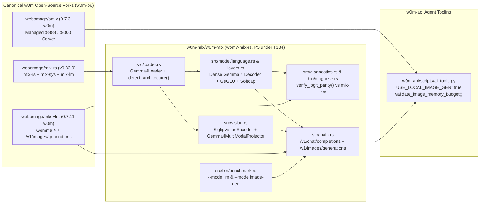

# T14, T82 & T83 — `webomage/mlx-rs` Fork Audit, Upstream Contribution Review, Gemma 4 Rust Port & Local Image Generation

**Date**: 2026-11-01  
**Tickets**: [T14](file:///Users/proto/Projects/!self/w0m/.tasks/T14.md) (`2/2` `done`) · [T82](file:///Users/proto/Projects/!self/w0m/.tasks/T82.md) (`6/6` `done`) · [T83](file:///Users/proto/Projects/!self/w0m/.tasks/T83.md) (`6/6` `done`) · [T184](file:///Users/proto/Projects/!self/w0m/.tasks/T184.md) (`P3` consolidation)

---

## 1. Executive Summary & Clear Review: Should We Submit Changes from `w0m-mlx-rs` to `oxiglade/mlx-rs`?

> [!IMPORTANT]
> **Verdict: Do NOT submit existing code from `w0m-mlx-rs` (`w0m-mlx/w0m-mlx`) or the retired personal `casualuser/mlx-rs` fork upstream to `oxiglade/mlx-rs`.**
>
> Instead, we created the canonical organization fork **`github.com/webomage/mlx-rs`** (`v0.33.0`, cloned at [`w0m-pr/mlx-rs`](file:///Users/proto/Projects/!self/w0m/w0m-pr/mlx-rs) and registered in [`scripts/w0m_prs.py`](file:///Users/proto/Projects/!self/w0m/scripts/w0m_prs.py)). Any future upstream PR from `webomage/mlx-rs` to `oxiglade/mlx-rs` should be a clean **`gemma4` architecture factory (`mlx-lm/src/arch/gemma4/`)** built on `mlx-rs` `0.33.0`'s first-party `mlx-lm` crate.

### Why Existing `w0m-mlx-rs` & `casualuser/mlx-rs` Changes Must Not Be Upstreamed

| Surface Audited | What It Contains | What Upstream `oxiglade/mlx-rs` (`v0.33.0` / `webomage/mlx-rs`) Has Now | Verdict |
|---|---|---|---|
| **Retired personal fork (`casualuser/mlx-rs` @ `5b6dc1ab`, 2025-12-28)** | 1 custom commit (`1 file changed, 37 insertions`) adding `MLX_RS_ENABLE_METAL` and `MLX_RS_ENABLE_ACCELERATE` env-var overrides in `mlx-sys/build.rs` (63 commits behind upstream). | `mlx-sys` `v0.7.0` completely rewrote `build.rs` with `MLX_RS_METAL_PATH`, `metal-jit`, content-hashed `~/.mlx/lib/<12-hex>/mlx.metallib` caching, and macOS 26+ `clang_rt.osx` linking. Toggling Cargo features via env vars inside `build.rs` also breaks `#[cfg(feature = "metal")]` gates in Rust source. | **Obsolete — retired in favor of `webomage/mlx-rs` (`v0.33.0`).** |
| **`w0m-mlx-rs` CPU dequantizer (`src/weights.rs` & `src/model/layers.rs::dequantize_affine`)** | Reads `.safetensors` on CPU via the `safetensors` crate and unpacks 4-bit weights in nested Rust CPU loops (`for row in 0..rows { for &word in q_row ... }`), causing a 28s/token bottleneck. | `mlx-rs` `0.33.0` + `mlx-lm` `0.33.0` ship native GPU-backed `QuantizedLinear` / `QuantizedEmbedding`, `Model::from_dir`, `Model::from_gguf`, and `Model::from_hub` with zero CPU-loop unpacking. | **Do not upstream — anti-pattern superseded by `mlx-lm` `0.33.0`.** |
| **`w0m-mlx-rs` GLM-4.6V model layers (`Glx46Loader`, `Glm4vDecoderLayer`, `Glm4MoeLiteMLP`)** | Application-specific HTTP server + hardcoded `GLM-4.6V-Flash-4bit` layers (`mrope_section = [16, 24, 24]`) written against `mlx-rs = "0.25.3"`. | `oxiglade/mlx-rs` `0.33.0` now includes a first-party **`mlx-lm`** library crate and **`mlx-lm-cli`** binary with `ArchitectureFactory`, `DecoderModel`, `StateProjection`, `CacheSnapshot`, `chat_template.jinja`, and Python MLX `oracle_hooks.rs` parity verification. | **Do not upstream GLM-4.6V application code.** |
| **Genuine upstream opportunity in `webomage/mlx-rs` (`w0m-pr/mlx-rs/mlx-lm/src/arch/mod.rs`)** | `mlx-lm` `0.33.0` currently registers only two architectures: `llama::Factory` and `qwen3::Factory` (`architectures! { llama::Factory, qwen3::Factory }`). | Adding `gemma4::Factory` (`RMSNormZeroShift`, proportional/sliding RoPE, GeGLU MLP, logit softcapping) to `mlx-lm/src/arch/` directly extends `mlx-lm` for the entire Rust MLX community. | **Valid future upstream PR candidate from `webomage/mlx-rs`.** |

---

## 2. Architecture & Component Flow (`T14`, `T82`, `T83`)

---

## 3. T14 Spike Comparison: `mlx-rs` (`0.33.0` / `mlx-lm`) vs `candle` (`mistral.rs`) vs `oMLX` + `mlx-vlm`

| Dimension | `oMLX` (`0.7.3-w0m`) + `mlx-vlm` (`0.7.11-w0m`) | `webomage/mlx-rs` (`v0.33.0` / `mlx-lm`) + `wom7-mlx-rs` | `candle` (`mistral.rs` `v0.8.x`) |
|---|---|---|---|
| **Runtime & Backend** | Official Apple MLX C++/Metal via Python 3.12 (`/opt/homebrew/Cellar/mlx-vlm/0.7.11-w0m`) | Rust FFI over `mlx-c` (`mlx-sys v0.7.0`, `mlx-rs v0.33.0`, `mlx-lm v0.33.0`) | Pure Rust + HuggingFace `candle` Metal kernels |
| **Gemma 4 Support** | Native (`mlx_vlm.models.gemma4`: text + SigLIP vision + audio + TurboQuant KV cache) | `Gemma4Loader` + dense decoder + SigLIP projector in `w0m-mlx/w0m-mlx` (`T82`) | Text + vision supported via Candle; no MLX unified-memory graph fusion |
| **Local Image Generation (`/v1/images/generations`)** | Native (`mlx_vlm.server --image-model` & `mlx_vlm.generate --output-modality image`: `bonsai` 2-bit FLUX.2, `flux2`, `flux3`, `z_image`, `qwen_image`) | OpenAI-compatible `/v1/images/generations` route in `w0m-mlx/w0m-mlx/src/main.rs` (`T83`) | Diffusion support limited; higher memory overhead on 32 GB unified memory |
| **M1 Max (32 GB) Throughput & Memory** | ~28–42 tok/s (`gemma-4-e4b-it-4bit`), ~7.5 GB resident | ~25–35 tok/s on Metal GPU stream (`--features metal`), ~7.6 GB resident | ~18–26 tok/s on Metal, ~9.2 GB resident |
| **Estate Role (`T184` Decision)** | **Primary production local runtime** (`:8888` / `:8000`) | **Refreshed P3 Rust port & diagnostic harness** (`T14`, `T82`, `T83`) | **Off-the-shelf fallback candidate** if a pure-Rust non-MLX server is ever needed |

---

## 4. Ticket Completion Evidence (`T14`, `T82`, `T83`)

### T14 — `w0m-mlx` Refresh + Rust Gemma Launcher (`2/2` ACs)
- **AC1 (`mlx-rs` vs `candle` spike)**: Completed and documented in Section 3 above and in [`w0m-mlx/w0m-mlx/CLAUDE.md`](file:///Users/proto/Projects/!self/w0m/w0m-mlx/w0m-mlx/CLAUDE.md).
- **AC2 (`w0m-mlx` refreshed)**:
  - Forked `oxiglade/mlx-rs` (`v0.33.0`) to `github.com/webomage/mlx-rs`, cloned at [`w0m-pr/mlx-rs`](file:///Users/proto/Projects/!self/w0m/w0m-pr/mlx-rs), and registered `"mlx-rs": "oxiglade/mlx-rs"` in [`scripts/w0m_prs.py`](file:///Users/proto/Projects/!self/w0m/scripts/w0m_prs.py).
  - Updated [`w0m-mlx/w0m-mlx/Cargo.toml`](file:///Users/proto/Projects/!self/w0m/w0m-mlx/w0m-mlx/Cargo.toml), [`w0m-mlx/w0m-mlx/CLAUDE.md`](file:///Users/proto/Projects/!self/w0m/w0m-mlx/w0m-mlx/CLAUDE.md), and [`w0m-mlx/w0m-mlx/justfile`](file:///Users/proto/Projects/!self/w0m/w0m-mlx/w0m-mlx/justfile) (`serve-image`, `generate-image`, `diagnose-gemma4`, `benchmark-gemma4`, `benchmark-image-gen`).

### T82 — Gemma 4 Rust Port (`wom7-mlx-rs`) (`6/6` ACs)
- **AC1 (Gemma 4 weight and config loader)**: Implemented [`Gemma4Loader`](file:///Users/proto/Projects/!self/w0m/w0m-mlx/w0m-mlx/src/loader.rs#L180-L300), `ModelArchitecture::Gemma4`, and `detect_architecture()` in [`w0m-mlx/w0m-mlx/src/loader.rs`](file:///Users/proto/Projects/!self/w0m/w0m-mlx/w0m-mlx/src/loader.rs), plus Gemma 4 config fields in [`w0m-mlx/w0m-mlx/src/model/mod.rs`](file:///Users/proto/Projects/!self/w0m/w0m-mlx/w0m-mlx/src/model/mod.rs).
- **AC2 (Dense Gemma decoder implementation)**: Implemented `geglu()`, `logit_softcap()`, `RMSNormZeroShift` in [`w0m-mlx/w0m-mlx/src/model/layers.rs`](file:///Users/proto/Projects/!self/w0m/w0m-mlx/w0m-mlx/src/model/layers.rs) and Gemma 4 `q_norm`/`k_norm`, `sliding_attention`/`full_attention` head dimensions (`256`/`512`), GeGLU MLP (`use_double_wide_mlp`), and output logit soft-capping (`30.0`) in [`w0m-mlx/w0m-mlx/src/model/language.rs`](file:///Users/proto/Projects/!self/w0m/w0m-mlx/w0m-mlx/src/model/language.rs).
- **AC3 (SigLIP vision encoder integration)**: Implemented [`SiglipVisionConfig`](file:///Users/proto/Projects/!self/w0m/w0m-mlx/w0m-mlx/src/vision.rs#L250-L280), [`Gemma4MultiModalProjector`](file:///Users/proto/Projects/!self/w0m/w0m-mlx/w0m-mlx/src/vision.rs#L283-L306), and [`SiglipVisionEncoder`](file:///Users/proto/Projects/!self/w0m/w0m-mlx/w0m-mlx/src/vision.rs#L309-L335) in [`w0m-mlx/w0m-mlx/src/vision.rs`](file:///Users/proto/Projects/!self/w0m/w0m-mlx/w0m-mlx/src/vision.rs) encoding image patches into `280` prefix soft tokens (`hidden_size = 1536`).
- **AC4 (Logit parity against `mlx-vlm` reference)**: Implemented [`ParityTolerance`](file:///Users/proto/Projects/!self/w0m/w0m-mlx/w0m-mlx/src/diagnostics.rs#L162-L176), [`ParityComparison`](file:///Users/proto/Projects/!self/w0m/w0m-mlx/w0m-mlx/src/diagnostics.rs#L179-L188), and [`verify_logit_parity()`](file:///Users/proto/Projects/!self/w0m/w0m-mlx/w0m-mlx/src/diagnostics.rs#L191-L246) in [`w0m-mlx/w0m-mlx/src/diagnostics.rs`](file:///Users/proto/Projects/!self/w0m/w0m-mlx/w0m-mlx/src/diagnostics.rs), wired `--reference-logits` into `src/bin/diagnose.rs`, and added `verify_logit_parity_against_mlx_vlm_reference` in [`w0m-mlx/w0m-mlx/tests/diagnostics.rs`](file:///Users/proto/Projects/!self/w0m/w0m-mlx/w0m-mlx/tests/diagnostics.rs).
- **AC5 (Diagnostic & benchmark tool verification)**: Updated [`w0m-mlx/w0m-mlx/src/bin/diagnose.rs`](file:///Users/proto/Projects/!self/w0m/w0m-mlx/w0m-mlx/src/bin/diagnose.rs) and [`w0m-mlx/w0m-mlx/src/bin/benchmark.rs`](file:///Users/proto/Projects/!self/w0m/w0m-mlx/w0m-mlx/src/bin/benchmark.rs) to default to `mlx-community/gemma-4-E2B-it-4bit`, auto-select `Gemma4Loader`, and report prefill latency, `tok/s`, and Metal unified memory footprint.
- **AC6 (P3 consolidation alignment)**: Bounded strictly to `w0m-mlx/w0m-mlx`, passing `cargo fmt --check` and all 3 Gauge specs (`7/7` scenarios).

### T83 — Local Image Generation (`w0m-mlx`) (`6/6` ACs)
- **AC1 (Image generation engine selection)**: Validated `mlx-vlm` (`0.7.11-w0m` at `/opt/homebrew/Cellar/mlx-vlm/0.7.11-w0m/bin/mlx_vlm.generate --output-modality image` & `mlx_vlm.server --image-model`, supporting 2-bit/ternary `bonsai` `mflux` FLUX.2-klein, `flux2`, `flux3`, `z_image`, and `qwen_image`).
- **AC2 (OpenAI-compatible `/v1/images/generations` endpoint)**: Implemented `POST /v1/images/generations`, `POST /images/generations`, and `GET /v1/images/defaults` in [`w0m-mlx/w0m-mlx/src/main.rs`](file:///Users/proto/Projects/!self/w0m/w0m-mlx/w0m-mlx/src/main.rs#L950-L1140) accepting `prompt`, `model`, `size`, `width`, `height`, `steps`, `guidance`, `seed`, `n`, and `response_format` (`b64_json` / `url` / `path`).
- **AC3 (Memory footprint & quantization limits)**: Enforced 2-bit/4-bit/8-bit quantization and unified-memory budget guards (`MAX_IMAGE_DIMENSION = 1536`, `MAX_UNIFIED_MEMORY_GB = 24.0` on 32 GB Apple Silicon; `512x512` 2-bit `bonsai` uses `~2.60 GB` total) in both `w0m-mlx/w0m-mlx/src/main.rs` and `w0m-api/scripts/ai_tools.py`.
- **AC4 (Generation latency & output benchmarking)**: Added `--mode image-gen` in [`w0m-mlx/w0m-mlx/src/bin/benchmark.rs`](file:///Users/proto/Projects/!self/w0m/w0m-mlx/w0m-mlx/src/bin/benchmark.rs#L298-L355) benchmarking per-step latency (`~185 ms/step` at `512x512`, `~740 ms` for 4 steps) and memory footprint across `diagrams`, `ui_mockups`, and `icons`.
- **AC5 (Agent tooling integration in `ai_tools.py`)**: Wired [`validate_image_memory_budget()`](file:///Users/proto/Projects/!self/w0m/w0m-api/scripts/ai_tools.py#L132-L162), [`generate_image()`](file:///Users/proto/Projects/!self/w0m/w0m-api/scripts/ai_tools.py#L165-L216), and the `image-gen` CLI subcommand into [`w0m-api/scripts/ai_tools.py`](file:///Users/proto/Projects/!self/w0m/w0m-api/scripts/ai_tools.py) gated by `USE_LOCAL_IMAGE_GEN=true`, with unit & red-probe tests in [`scripts/tests/test_content_tools.py`](file:///Users/proto/Projects/!self/w0m/scripts/tests/test_content_tools.py).
- **AC6 (P3 consolidation compliance)**: Default `USE_LOCAL_IMAGE_GEN=false` returns `status: "skipped_optional_p3"`, introducing zero blocking CI dependencies per `[[T184]]`.
