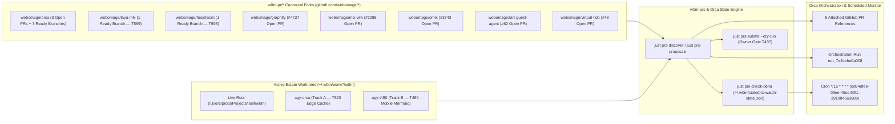

# Upstream PR Contributions, Rebase Audit & Worktree Monitoring Report (`T593`, `T569`, `T597`, `T599`)

> [!IMPORTANT]
> **All 8 open upstream PRs and all 9 new contribution branches across `w0m-pr/*` are rebased onto latest upstream (`0 behind, +1 ahead`), GPG-signed (`GPG=G`) by `Aleksei Tcelishchev <casualuser@gmail.com>`, and pushed to `github.com/webomage/<repo>`.**
> Live monitoring for both **upstream PRs / contribution branches** and **active agent worktrees (`~/.w0m/work/*/w0m`)** is wired into Orca Orchestration (`run_7e2ceba0a008`) and a 15-minute zero-token precheck automation (`8d64dfee-03ee-45cc-93f1-391984563689`).

---

## 1. End-to-End Contribution & Monitoring Topology



---

## 2. Active Open Upstream PRs (`8` Open — Rebased & GPG-Signed)

All 8 open PRs were audited against their upstream target branches, rebased where upstream advanced, GPG-signed (`GPG=G`), and pushed to `webomage/<repo>`:

| Upstream PR | Fork Head (`webomage/*`) | Head SHA | vs Upstream | Mergeable | CI Status | Maintenance Action Taken (`T593` AC3) |
| :--- | :--- | :--- | :--- | :--- | :--- | :--- |
| [`Graphify-Labs/graphify#4727`](https://github.com/Graphify-Labs/graphify/pull/4727) | `feat/global-graph-sync-and-status` | `b181a316` | `+1 / -0` | `MERGEABLE` | `PASS` | Rebased onto `upstream/v8`; resolved `head_at_merge` sampling review item; GPG-signed (`GPG=G`). |
| [`Blaizzy/mlx-vlm#2288`](https://github.com/Blaizzy/mlx-vlm/pull/2288) | `fix/turboquant-dim512-threadgroup-fallback` | `8feab0e4` | `+1 / -0` | `MERGEABLE` | `PASS` | Rebased onto `upstream/main` and GPG-signed (`GPG=G`) to replace prior unsigned commit. |
| [`jundot/omlx#3743`](https://github.com/jundot/omlx/pull/3743) | `fix/menubar-adopt-external-omlx` | `d105e997` | `+1 / -0` | `MERGEABLE` | `NONE` | Rebased onto `upstream/main` (`a3a3519`) and GPG-signed (`GPG=G`). |
| [`stablyai/orca#21157`](https://github.com/stablyai/orca/pull/21157) | `feat/macos-deep-link-worktree` | `8d9358b3d5` | `+1 / -0` | `MERGEABLE` | `PASS` | Rebased onto latest `upstream/main` (`47010f8681`, resolving prior `CONFLICTING` state); GPG-signed (`GPG=G`). |
| [`stablyai/orca#21148`](https://github.com/stablyai/orca/pull/21148) | `feat/macos-deep-link-shortcuts` | `646d3fd310` | `+1 / -0` | `MERGEABLE` | `PASS` | Rebased onto latest `upstream/main` (`47010f8681`, resolving prior `CONFLICTING` state); GPG-signed (`GPG=G`). |
| [`stablyai/orca#16597`](https://github.com/stablyai/orca/pull/16597) | `feat/zeroclaw-agent-connector` | `0b5abcd26e` | `+1 / -0` | `MERGEABLE` | `PASS` | Rebased onto latest `upstream/main` (`47010f8681`, resolving prior `CONFLICTING` state); GPG-signed (`GPG=G`). |
| [`openai/tart-guest-agent#62`](https://github.com/openai/tart-guest-agent/pull/62) | `feat/clipboard-Sharing` | `2e1b9c5` | `+1 / -0` | `MERGEABLE` | `PASS` | Verified `0 behind` `upstream/main`, `GPG=G`, CI green. |
| [`bulwarkid/virtual-fido#48`](https://github.com/bulwarkid/virtual-fido/pull/48) | `feat/macos-usbip-client` | `d31bce0` | `+1 / -0` | `MERGEABLE` | `NONE` | Added missing `upstream` remote, verified `0 behind` `upstream/master`, `GPG=G`. |

---

## 3. Newly Prepared & Rebased Upstream Contribution Branches (`9` Ready — `T593` AC4, `T569` AC4, `T597`)

Every unsubmitted contribution branch across `w0m-pr/*` has been rebased onto latest `upstream/main` (`+1/-0`), GPG-signed (`GPG=G`), and paired with a structured **Why / What For / How** PR proposal in `scripts/w0m_prs.py` (`just prs-proposals`).

Per the `T435` human-confirmation gate, agents prepare and push branches + proposals without invoking `gh pr create` directly. You can open any or all of these PRs via the compare links below or by running the single-command submission helper from your terminal:

```bash
# Preview all 9 prepared PR titles, compare links, and Why/What For/How bodies:
just prs-proposals

# Submit a single prepared PR from your human terminal:
W0M_PRS_SUBMIT_CONFIRMED=1 just prs-submit --no-dry-run --branch fix/native-serve-tests-and-torchless-calibration

# Submit all 9 prepared PRs from your human terminal:
W0M_PRS_SUBMIT_CONFIRMED=1 just prs-submit --no-dry-run
```

| # | Ticket | Upstream Repo | Prepared Branch (`webomage/*`) | Head SHA | vs Upstream | Title & Compare / Create PR Link |
| :--- | :--- | :--- | :--- | :--- | :--- | :--- |
| **1** | `T569` | `mizorewww/laya-mlx` | `fix/native-serve-tests-and-torchless-calibration` | `baeb7b0d30` | `+1 / -0` | **fix: add native serve contract tests and torchless calibration fallback** — [Open PR](https://github.com/mizorewww/laya-mlx/compare/main...webomage:fix/native-serve-tests-and-torchless-calibration?expand=1) |
| **2** | `T593` | `headroomlabs-ai/headroom` | `feat/omlx-proxy-routing` | `b52eea9a49` | `+1 / -0` | **feat(proxy): add local oMLX backend routing and health probe support** — [Open PR](https://github.com/headroomlabs-ai/headroom/compare/main...webomage:feat/omlx-proxy-routing?expand=1) |
| **3** | `T597` | `stablyai/orca` | `feat/cross-worktree-tab-move` | `a9b71cc951` | `+1 / -0` | **feat(tabs): support cross-worktree tab drag-and-drop and context menu move** — [Open PR](https://github.com/stablyai/orca/compare/main...webomage:feat/cross-worktree-tab-move?expand=1) |
| **4** | `T593` | `stablyai/orca` | `feat/agent-collaboration-board` | `c7f887ede3` | `+1 / -0` | **feat(orchestration): add live multi-agent collaboration board and task telemetry** — [Open PR](https://github.com/stablyai/orca/compare/main...webomage:feat/agent-collaboration-board?expand=1) |
| **5** | `T557` | `stablyai/orca` | `feat/mobile-camera-capture-chat` | `518d94f287` | `+1 / -0` | **feat(mobile): add direct camera capture option for chat image attachments** — [Open PR](https://github.com/stablyai/orca/compare/main...webomage:feat/mobile-camera-capture-chat?expand=1) |
| **6** | `T593` | `stablyai/orca` | `feat/mobile-live-input-password-mask` | `fd559fcae8` | `+1 / -0` | **feat(mobile): mask live terminal input during password and secret prompts** — [Open PR](https://github.com/stablyai/orca/compare/main...webomage:feat/mobile-live-input-password-mask?expand=1) |
| **7** | `T464` | `stablyai/orca` | `feat/obsidian-ofm-engine` | `979d02b9cf` | `+1 / -0` | **feat(markdown): add Obsidian Flavored Markdown (OFM) callouts, wikilinks, and embeds** — [Open PR](https://github.com/stablyai/orca/compare/main...webomage:feat/obsidian-ofm-engine?expand=1) |
| **8** | `T433` | `stablyai/orca` | `fix/mobile-landscape-safe-area-insets` | `046098f32d` | `+1 / -0` | **fix(mobile): respect horizontal safe-area insets in landscape orientation** — [Open PR](https://github.com/stablyai/orca/compare/main...webomage:fix/mobile-landscape-safe-area-insets?expand=1) |
| **9** | `T593` | `stablyai/orca` | `fix/mobile-markdown-external-tab-read` | `8331f7f655` | `+1 / -0` | **fix(mobile): allow markdown viewer to read authorized external tab files** — [Open PR](https://github.com/stablyai/orca/compare/main...webomage:fix/mobile-markdown-external-tab-read?expand=1) |

---

## 4. Orca Mobile Dark/Light Mode Override Re-check (`T593` AC2)

- **Upstream Merged (`stablyai/orca:main`)**:
  - [`stablyai/orca#34217`](https://github.com/stablyai/orca/pull/34217) (`feat(mobile): light and dark themes with desktop's palettes`, merged `2026-10-27`) and [`stablyai/orca#35171`](https://github.com/stablyai/orca/pull/35171) (`fix(mobile): retain editor styling when switching color schemes`, merged `2026-10-30`) landed full mobile Light/Dark/System theme switching and editor scheme persistence upstream.
  - Both upstream commits are now fast-forwarded into `w0m-pr/orca:beta` (`b6fddb7254`).
- **Remaining Open Upstream Theme PRs**:
  - `#19599` (per-phone terminal appearance override), `#10421` (draft shared terminal theme picker), and `#25278` (OLED true-black mode) remain open upstream and are tracked by `just prs-discover`.

---

## 5. Continuous Worktree & PR Monitoring (`just prs-discover` / `just prs-orca-sync`)

- **Fork Synchronization (`just forks --no-fetch`)**: All 9 repositories in `w0m-pr/` (`graphify`, `harness2`, `headroom`, `laya-mlx`, `mlx-vlm`, `omlx`, `orca`, `tart`, `tart-guest-agent`, `virtual-fido`) are `0 behind` upstream.
- **Active Agent Worktree Monitor**:
  - `discover_new_prs_and_branches()` and `check_prs_delta()` in [`scripts/w0m_prs.py`](file:///Users/proto/Projects/!self/w0m/scripts/w0m_prs.py) now monitor `~/.w0m/work/*/w0m` alongside open PRs and pending fork branches.
  - Active sibling agent trees (`agy-orca` working on `T523` edge cache, `agy-t480` working on `T480` mobile Mermaid pinch-to-zoom) are preserved and tracked in `~/.w0m/state/prs-watch-state.json`.
- **Verification**:
  - [`scripts/tests/test_w0m_prs.py`](file:///Users/proto/Projects/!self/w0m/scripts/tests/test_w0m_prs.py): **65/65 checks passed**.
