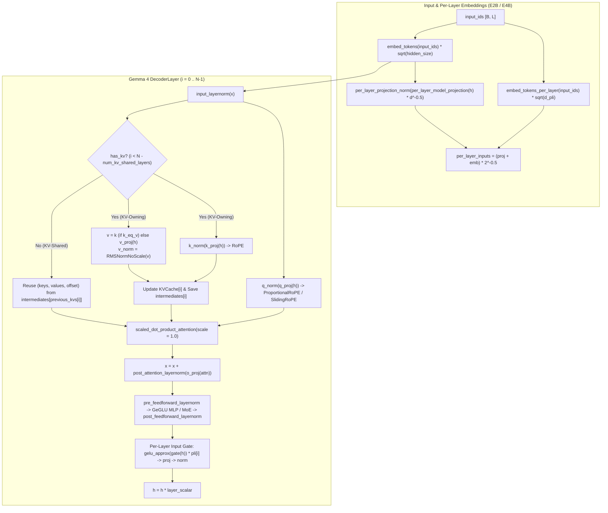

# T601 — Proper MLX Gemma 4 Port, `oMLX` Support Schemas & Upstream PRs (`oxiglade/mlx-rs` + `ml-explore/mlx-lm`)

> [!IMPORTANT]
> **Summary (`T601`):**
> 1. **Proper MLX Gemma 4 Port + `oMLX` Support Schemas in `w0m-mlx/w0m-mlx`**: Upgraded `w0m-mlx` to `mlx-rs 0.33.0` (`mlx-sys 0.7.0`) and ported the canonical MLX Gemma 4 architecture (`ml-explore/mlx-lm/mlx_lm/models/gemma4_text.py` & `gemma4.py` + `Blaizzy/mlx-vlm/mlx_vlm/models/gemma4_text/language.py`) alongside the full `oMLX` (`jundot/omlx`) Gemma 4 support schemas (`src/gemma4_schema.rs`, `10/10` Rust tests passing).
> 2. **Upstream PR Branch for `oxiglade/mlx-rs` (`webomage/mlx-rs` -> `feat/mlx-lm-gemma4-arch`)**: Implemented `mlx-lm/src/arch/gemma4/` (`mod.rs`, `config.rs`, `rope.rs`, `weights.rs`, `tests.rs`) supporting `"gemma4"`, `"gemma4_text"`, and `"gemma4_unified"`, including `per_layer_config` (`oMLX` `#3537`), `ProportionalRoPE`, `RMSNormNoScale` `v_norm`, `scale = 1.0`, `previous_kvs` KV sharing, `attention_k_eq_v`, 4 norms, `hidden_size_per_layer_input` gating, `use_double_wide_mlp`, `geglu`, `final_logit_softcapping`, and `mtp.*` / shared-KV extra weight ignore rules.
> 3. **Upstream PR Branch for `ml-explore/mlx-lm` (`webomage/mlx-lm` -> `perf/gemma4-kv-shared-prefill-and-moe-sanitize`)**: Added `per_layer_config` derivation of `global_head_dim` and `num_global_key_value_heads`, `logits_to_keep` prefill trimming across KV-shared layers (`first_kv_shared_layer_idx`), `.self_attn.v_norm` shared-KV extra weight dropping, `.experts.gate_up_proj.*` / `.experts.down_proj.*` quantized MoE sanitization, and `mtp.*` / `language_model.mtp.*` stripping (`11/11` Gemma 4 unit tests passing).
> 4. **Registered Structured PR Proposals (`scripts/w0m_prs.py`)**: Added **Why / What For / How** PR proposals for both `oxiglade/mlx-rs` and `ml-explore/mlx-lm` ready for owner-confirmed submission via `just prs-submit`.

---

## 1. Canonical MLX Gemma 4 Architecture vs Legacy Approximations



| Architectural Invariant | Canonical MLX Gemma 4 (`mlx-lm` / `mlx-vlm` / `oMLX`) | Implemented In (`T601`) |
|---|---|---|
| **Value Normalization (`v_norm`)** | `RMSNormNoScale`: `mx.fast.rms_norm(v, None, eps)` (no learnable weight) + `Attention.scale = 1.0` | `w0m-mlx/src/model/layers.rs` (`RMSNormNoScale`), `w0m-pr/mlx-rs/mlx-lm/src/arch/gemma4/mod.rs` |
| **Proportional RoPE (`full_attention`)** | `partial_rotary_factor = 0.25`, `rope_theta = 1_000_000.0`, `exponents = (2 * i) / head_dim`, unrotated pairs `freqs = inf` (`inv_freq = 0`) | `w0m-mlx/src/model/language.rs` (`Gemma4ProportionalRoPE`), `w0m-pr/mlx-rs/mlx-lm/src/arch/gemma4/rope.rs` |
| **Cross-Layer KV Sharing (`previous_kvs`)** | Top `num_kv_shared_layers` layers have `has_kv = false`, omit `k_proj`/`v_proj`/`k_norm`/`v_norm`, and reuse `(K, V, offset)` from latest non-shared layer of same `layer_type` | `w0m-mlx/src/model/mod.rs`, `w0m-pr/mlx-rs/mlx-lm/src/arch/gemma4/mod.rs`, `w0m-pr/mlx-lm/mlx_lm/models/gemma4_text.py` |
| **Full-Attention `attention_k_eq_v`** | On `full_attention` layers when `attention_k_eq_v = true`, `values = keys` (prior to `k_norm`/RoPE) and `n_kv_heads = num_global_key_value_heads` | `w0m-mlx/src/model/language.rs`, `w0m-pr/mlx-rs/mlx-lm/src/arch/gemma4/mod.rs` |
| **Per-Layer Input Embeddings & Gating** | `embed_tokens_per_layer`, `per_layer_model_projection`, `per_layer_projection_norm` + per-layer `per_layer_input_gate`, `per_layer_projection`, `post_per_layer_input_norm` | `w0m-mlx/src/model/mod.rs` & `language.rs`, `w0m-pr/mlx-rs/mlx-lm/src/arch/gemma4/mod.rs` |
| **Sparse MoE Router & Experts (26B-A4B)** | `Gemma4Router` (`rms_norm(x, scale * d^-0.5) -> proj -> top_k -> softmax * per_expert_scale`) + `Gemma4Experts` (`SwitchGLU` with `GeGLU`) + dual FFN norms | `w0m-mlx/src/model/language.rs` (`Gemma4Router`, `Gemma4Experts`, `Gemma4MoeBlock`) |

---

## 2. `oMLX` Gemma 4 Support Schemas Ported (`src/gemma4_schema.rs`)

| `oMLX` Surface (`jundot/omlx`) | Schema / Protocol Behavior | `w0m-mlx` Implementation |
|---|---|---|
| `omlx/engine/vlm.py:_gemma4_global_kv_from_per_layer_config` (`#3537`) | Transformers >= 5.15 checkpoints store full-attention `head_dim` and `num_key_value_heads` inside `text_config.per_layer_config` (`{"05": {"head_dim": 512, "num_key_value_heads": 2}}`) instead of `global_head_dim` / `num_global_key_value_heads` | [`derive_gemma4_global_kv_from_per_layer_config`](file:///Users/proto/Projects/!self/w0m/w0m-mlx/w0m-mlx/src/gemma4_schema.rs#L42-L109) + [`TextConfig::resolve_gemma4_defaults`](file:///Users/proto/Projects/!self/w0m/w0m-mlx/w0m-mlx/src/model/mod.rs#L170-L246) |
| `omlx/engine/vlm.py:_drop_gemma4_mlx_shared_kv_extras_on_load` | Drops redundant `layers.{i}.self_attn.{k_proj,v_proj,k_norm,v_norm}.*` tensors on shared-KV layers (`i >= num_hidden_layers - num_kv_shared_layers`) in `format=mlx` E2B/E4B checkpoints | [`is_gemma4_shared_kv_extra_weight`](file:///Users/proto/Projects/!self/w0m/w0m-mlx/w0m-mlx/src/gemma4_schema.rs#L114-L148) |
| `omlx/patches/mlx_lm_mtp/gemma4_text_model.py` | Strips merged speculative decoding MTP heads (`mtp.*`, `model.mtp.*`, `language_model.mtp.*`) and accepts `model_type = "gemma4_unified"` and `mtp_assistant_config` | [`is_gemma4_ignored_non_backbone_weight`](file:///Users/proto/Projects/!self/w0m/w0m-mlx/w0m-mlx/src/gemma4_schema.rs#L153-L192) |
| `omlx/parser/gemma4_output_parser.py` | Parses `<|channel>thought\n...<channel|>` reasoning blocks into `reasoning_content` and `<think>\n...</think>\n`, absorbing `<turn|>`, `<end_of_turn>`, `<|tool_response>`, `<tool_response|>` | [`parse_gemma4_output`](file:///Users/proto/Projects/!self/w0m/w0m-mlx/w0m-mlx/src/gemma4_schema.rs#L222-L333) |
| `omlx/adapter/gemma4.py` | Strips prior thought channels and stray `<|tool_call>` markers from assistant history turns and folds `role="tool"` turns onto preceding assistant `tool_responses` (`[{"name": ..., "response": ...}]`) | [`extract_gemma4_messages`](file:///Users/proto/Projects/!self/w0m/w0m-mlx/w0m-mlx/src/gemma4_schema.rs#L368-L433) |
| `omlx/api/tool_calling.py` | Parses `<|tool_call>call:name{k:<|"|>v<|"|>}<tool_call|>` and parenthesized 26B `<|tool_call>call:name(k="v")<tool_call|>` tool calls into structured JSON arguments | [`parse_gemma4_tool_calls`](file:///Users/proto/Projects/!self/w0m/w0m-mlx/w0m-mlx/src/gemma4_schema.rs#L439-L518) |

---

## 3. Prepared Upstream Pull Requests (Ready for Owner Confirmation)

| Upstream Repository | Fork & Branch (`github.com/webomage/*`) | Commit (GPG-Signed) | Title & Verification |
|---|---|---|---|
| `oxiglade/mlx-rs` | `webomage/mlx-rs` (`feat/mlx-lm-gemma4-arch`) | GPG-signed on `feat/mlx-lm-gemma4-arch` | `feat(mlx-lm): add Gemma 4 architecture with KV sharing, ProportionalRoPE, and per_layer_config` (`165/165` `mlx-lm` unit tests + `clippy -D warnings` passing) |
| `ml-explore/mlx-lm` | `webomage/mlx-lm` (`perf/gemma4-kv-shared-prefill-and-moe-sanitize`) | `01ee0e7` (GPG-signed) | `perf(gemma4): add per_layer_config, KV-shared logits_to_keep prefill trimming, and MTP/MoE sanitization` (`11/11` Gemma 4 unit tests passing) |

To submit the prepared PRs with Touch ID confirmation:
```bash
just prs-proposals
just prs-submit
```
