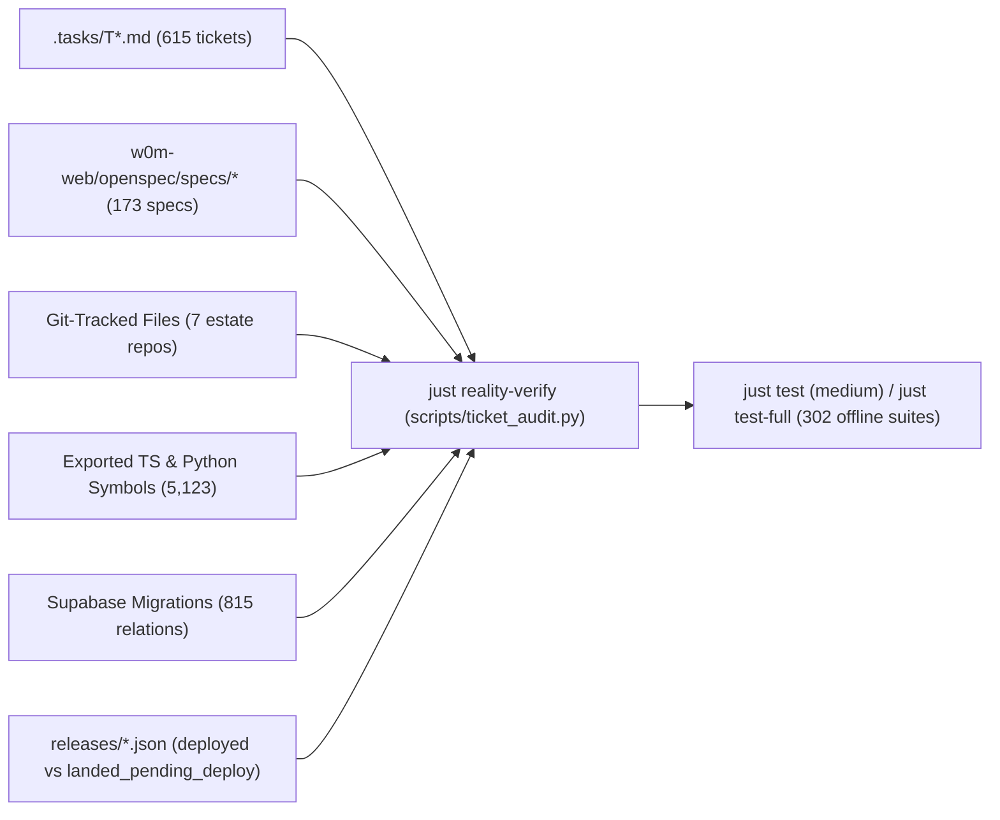

# Completed-Ticket & Canonical-Spec Reality Verification and Offline Suite Restoration (T616)

**Ticket:** `T616` · **Status:** `done` · **Date:** `2026-11-02` · **Epic:** `sdlc_tooling_platform`

> [!IMPORTANT]
> **Outcome Summary:** Eliminated three silent false-green blind spots across SDLC verification (`dod_check.py` scanning `0` files in a retired directory, `spec_drift_gate.py` keeping inline `#` YAML comments on `status: done`, and `just test` defaulting to `14` `critical` suites while `30` offline suites were red), shipped `just reality-verify` (`scripts/ticket_audit.py --completed --specs --strict --offline`) across **`605` completed tickets** and **`173` canonical OpenSpec files** (`815` SQL relations + `5,123` exported TS/Python symbols + `releases/*.json` deploy state), and restored **100% green blocking offline suites** (`0` blocking failures, `0` uncounted `?` suites).

## Architecture: 5-Surface Reality Verification Pipeline

## Key Root Causes & Remediations

### 1. Corpus-Wide Reality Verification (`AC1` & `AC4`)
- **Upgraded `scripts/ticket_audit.py` (`just reality-verify`)**:
  - Audits single tickets, `--completed` (`605` `done` tickets, deep-checking recent completions against paths, exported symbols, SQL relations, commit traces, and `releases/*.json` `deployed (<version>)` vs `landed_pending_deploy`), and `--specs` (`173` canonical `w0m-web/openspec/specs/*/spec.md` files).
  - Fails closed (`exit 2`) if `.tasks/` or `w0m-web/openspec/specs/` resolves empty (`AgDR-0025`).
  - Registered as blocking offline suite `reality-verify` in `w0m-web/project/test-suites.json` and wired into `.w0m/sdlc.json -> session_wrapup.verification_gates` plus canonical skills (`w0m-ticket-audit`, `fact-checker`, `w0m-sdlc-verify`, `w0m-sdlc-archive` in `w0m-skills`).

### 2. Repaired Vacuous & Drifting Governance Gates (`AC2` & `AC3`)
- **`scripts/dod_check.py`**: Repointed from retired `w0m-web/project/tickets` (`0` files) to `.tasks/` (`615` tickets) using batched `git log --raw` + `git cat-file --batch` + working-tree DoD freshness detection (`< 0.5s` runtime vs ~90s per-file subprocesses). Ratcheted `w0m-web/project/dod-baseline.json` downward (`stale: 17 -> 6`, `shared: 120 -> 111`).
- **`scripts/spec_drift_gate.py`**: Fixed `_strip_inline_yaml_comment()` so `status: done # ...` is never misclassified as open.
- **OpenSpec & Ticket Reconciliation**: Archived 9 legacy done-owner changes plus `2026-11-02-t616-completed-ticket-and-spec-reality-verification` via `openspec archive` (`161/161` `openspec validate --all --strict` green; `just spec-drift` `0` findings) and reconciled stale paths/symbols/SQL helpers (`public.is_capable`, `public.wom_can_uri`, `public.offices`, `public.office_capabilities`) across completed tickets, `w0m-web/openspec/specs/`, and `docs/standards/SYSTEM-STANDARDS-MATRIX.md`.

### 3. Restored Full Offline Suite Matrix & Worktree Provisioning (`AC5` & `AC6`)
- **`just test` Level Alignment**: Switched `just test` default `W0M_TEST_LEVEL` from `"critical"` (`14` suites) to `"medium"` (all blocking gates), keeping `just test-prepush` fast on `critical`.
- **Remediated All Failing & Uncounted Offline Suites**:
  - **`vitest` (`406` checks)**: Disambiguated `profiles!hats_profile_id_fkey(...)` in `apps/cp/src/pages/api/bug-report.ts`, removed hardcoded `casualuser` from 6 CP files, aligned `threads` provider fixtures and `kyc-verify` / `services` / Node 25 `AppShell` `localStorage` mocks.
  - **`py-typecheck` (`369` files) & `py-test` (`1,289` tests)**: Cleared all `52` mypy errors (`untyped_defs` `140 -> 129`, `untyped_json_loads` `298 -> 280`), declared `pillow>=12.0.0` in `w0m-web/pyproject.toml`, updated Node 25 `--input-type=module` test flags, and refreshed `w0m-web/docs/CODEMAP.md` + `docs/DECISIONS.md`.
  - **Edge/Ratchet/Policy Gates**: Replaced `10` Worker `process.env` reads in `apps/cp` with `locals.runtime.env`, reduced inline suppressions without raising ceilings, classified `session_wrapup` in `clients-policy.json`, trimmed `AGENTS.md` under `16,000` chars, fixed Python 3.15 unittest runner invocations, fixed `secret_flow_check.py` Worker `--name` selftest keys, and linked `w0m-api`, `w0m-cf`, and `w0m-ext/extension` `node_modules` in `scripts/release.py -> provision_worktree_fixtures()`.
  - **Countable Check Markers (`0` `?` suites)**: Added per-item `[OK]` output to `hooks_llm_check.py` (`4`) and `cloud_compute_check.py` (`4`), and switched `consumer-skill-gate-test` from a silent `0`-test `python3` call to `uv run pytest -q` (`4`).
