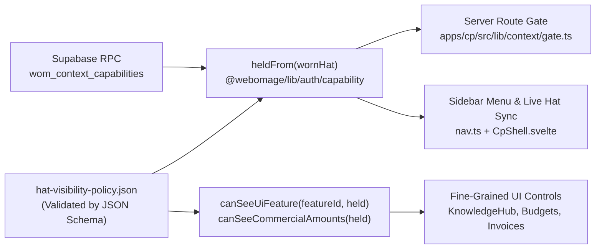
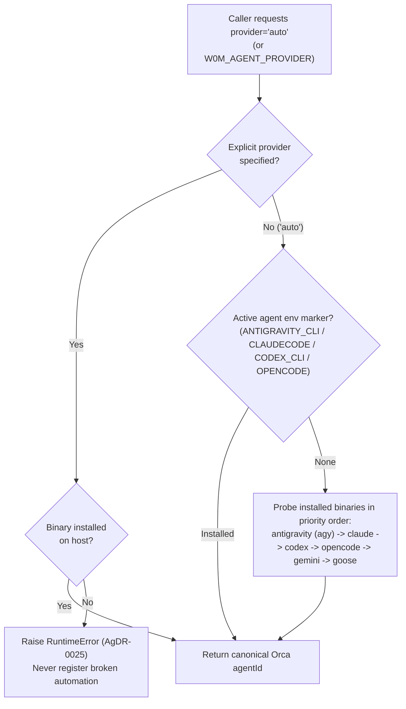

# Hat/Role Permissions, UI Visibility Schema & Multi-Agent Provider SSOT (`T609`)

**Date:** 2026-11-02  
**Ticket:** `T609`  
**Architectural Anchors:** `AgDR-0028` (One Worn Hat & Engagement Roles), `AgDR-0020` (Commercial Amount Isolation), `AgDR-0025` (Single Source of Truth & Fail-Closed), `AgDR-0046` (Agent Naming)

---

## 1. Hat/Role Permissions & Feature UI Visibility Architecture

All Control Plane (`cp.webomage.com`) capability narrowing, active-side derivation, commercial-amount visibility, sidebar navigation sections, and fine-grained widget controls now resolve from **one JSON-Schema-governed Single Source of Truth**:

- **JSON Schema:** `w0m-web/packages/lib/src/auth/hat-visibility-policy.schema.json`
- **Canonical Policy SSOT:** `w0m-web/packages/lib/src/auth/hat-visibility-policy.json`
- **Evaluator API:** `w0m-web/packages/lib/src/auth/hat-visibility.ts` (re-exported via `@webomage/lib/auth/capability` and `@webomage/lib/auth`)
- **Automated Parity Gates:** `hat-visibility.spec.ts` + `hat-visibility-parity.test.ts` (enforces 100% route/capability/side alignment with `apps/cp/src/lib/context/nav.ts`)

### Hat & Role Capability / UI Visibility Matrix

| Hat Key | Category | Default Side | Collapse Target | Commercial USD Visible | Org Nav Sections Visible | Invoices & Billing | Knowledge Hub Actions |
|---|---|---|---|---|---|---|---|
| `admin` | `platform` | Unscoped (`both`) | — | Yes | Overview, Projects, Money, Sales, People, Content, Settings (+ `/admin`) | Receivables, Payables, Treasury | Docs, Obsidian URI, R2 Mobile, R2 Push, Staff RAG Search |
| `finance` | `org_unit` | `contractor` | — | Yes | Overview, Money (`Invoices`, `Treasury`), Sales (`Clients`) | **Receivables, Payables, Treasury** | — |
| `growth` | `org_unit` | `contractor` | — | Yes | Overview, Sales (`Leads`, `Clients`, `Verification`, `Blueprints`, `Decks`), Content | Hidden | — |
| `recruiting` | `org_unit` | `contractor` | — | No | Overview, Sales (`Leads`), People (`Team`, `Directory`, `Technologies`, `Quests`) | Hidden | — |
| `pm` | `engagement_delivery` | `contractor` | — | Yes (Contracts/Budgets) | Overview, Projects, Sales (`Leads`, `Clients`, `Decks`), People | **Hidden** (No `invoice.view`) | Docs, Obsidian URI, R2 Mobile, R2 Push, Staff RAG Search |
| `tl` | `engagement_delivery` | `contractor` | — | **No** (`AgDR-0020`) | Overview, Projects, People (`Team`, `Directory`, `Technologies`) | **Hidden** | Docs, Obsidian URI, R2 Mobile, R2 Push, Staff RAG Search |
| `dev` | `engagement_delivery` | `contractor` | `tl` | **No** | Overview, Projects | **Hidden** | Docs, Obsidian URI, R2 Mobile, Staff RAG Search (No R2 Push) |
| `devops` | `engagement_delivery` | `contractor` | `tl` | **No** | Overview, Projects | **Hidden** | Docs, Obsidian URI, R2 Mobile, R2 Push, Staff RAG Search |
| `qa` | `engagement_delivery` | `contractor` | `pm` | **No** | Overview, Projects | **Hidden** | Docs, Obsidian URI, R2 Mobile, Staff RAG Search |
| `design` | `engagement_delivery` | `contractor` | `pm` | **No** | Overview, Projects, Sales (`Blueprints`) | **Hidden** | Docs, Obsidian URI, R2 Mobile, Staff RAG Search |
| `client` | `engagement_delivery` | `client` | — | Yes (Own Org) | Overview, Projects (`Milestones`, `Knowledge Hub`, `Services`), Money (`Invoices`, `Billing`) | **Client Invoices & Retainer Plans** | Docs, Obsidian URI, R2 Mobile (No R2 Push, No Staff RAG Search) |
| `trainer` | `engagement_training` | `contractor` | — | **No** | Overview, Projects, Sales (`Blueprints`), People | **Hidden** | Docs, Obsidian URI, R2 Mobile, Staff RAG Search |
| `trainee` | `engagement_training` | `client` | — | **No** | Overview, Projects (`Milestones`, `Knowledge Hub`, `Services`) | **Hidden** | Docs, Obsidian URI only |

---

## 2. Multi-Agent CLI & Orca Provider Abstraction (`scripts/agent_provider.py`)

### Root Cause of `claude: command not found`
`scripts/w0m_prs.py` (`sync_prs_to_orca`) and `scripts/t171_sandbox_cohort_runner.py` previously hardcoded `provider="claude"` (and macOS `/Applications/Orca.app/Contents/Resources/bin/orca`), while `scripts/orca_sessions.py` hardcoded `agy`. On Linux workstations where `agy` (`antigravity`) is installed without `claude`, scheduled Orca automations launched `claude --plugin-dir ...` and exited immediately with `claude: command not found`.

### Canonical Resolution Flow (`scripts/agent_provider.py`)

- **Live Host Remediation:** Updated live Orca automation `5cc35a43-05f5-45d1-a366-13dcd4ae6e97` (`w0m Upstream PRs & Fork Branches Monitor`) from `agentId: "claude"` to `agentId: "antigravity"`, and updated `sync_prs_to_orca` so existing automations self-heal via `orca automations edit` whenever `existing_agent_id != resolved_provider`.
