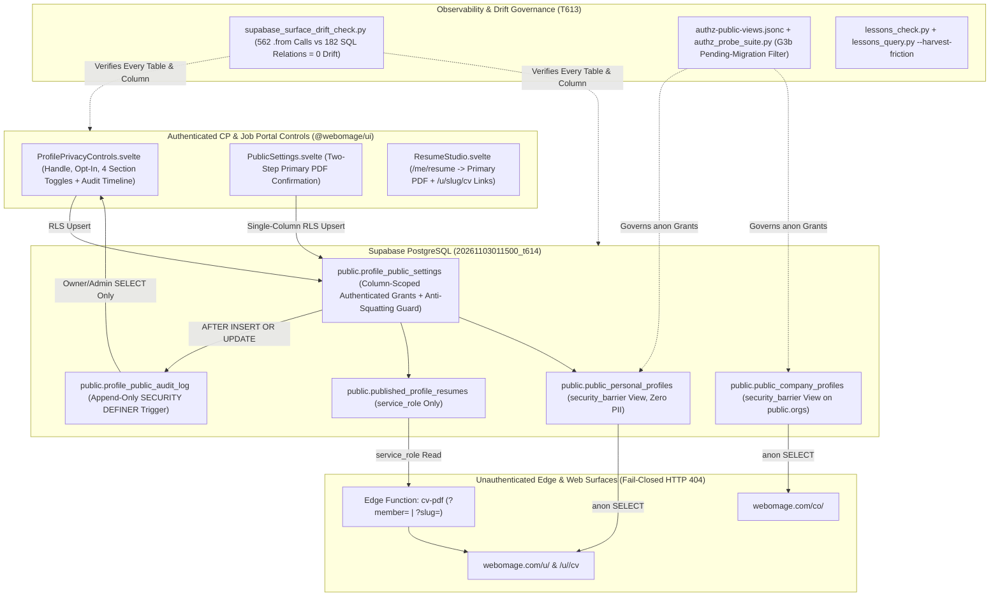

# SDLC Session Wrap-Up, Zero-Unused-Parts Drift Governance & End-to-End Regular-User Public Profiles (`T613` · `T614`)

**Date:** 2026-11-02  
**Tickets:** [[T613]] · [[T614]] (completing earned lessons & archive dispositions for [[T609]] · [[T611]])  
**Scope:** `@wom` root · `w0m-skills` · `w0m-api` · `w0m-web` (`apps/web`, `apps/cp`, `apps/job`, `packages/lib`)

> [!IMPORTANT]
> **Core Invariants Enforced:**
> 1. **Complete Session & Ticket Wrap-Up (`T613`)**: Every ticket and session must finish `w0m-sdlc-archive` (`status: done` + `queue: done`, `LESSONS.md` + `just lessons-harvest` + `lessons_check.py`, repo-first `.agents/reports/` + `w0m-web/docs/reports/`, `TECH-DEBT.md` `debt-check --enforce`, `TASKS.md` + `STATE.md`, `just agent-tree-land`, live `--ff-only`, and `just agent-tree-remove`) *before* handing human-gated `just deploy-all` to the operator.
> 2. **Zero Unused / Unwired Parts & Mechanical Drift Detection (`T613` AC5)**: `w0m-web/project/scripts/supabase_surface_drift_check.py` statically verifies all 562 `.from("<relation>")` calls and audited settings write keys across `w0m-web/{apps,packages}` against `w0m-api/supabase/{baseline,migrations}` in `< 0.2s` with zero exemptions (`system_logs` → `admin_activity_logs`, `organizations` → `public_company_profiles`).
> 3. **Fail-Closed Regular-User Public Profiles & Append-Only Audit Log (`T614`)**: Regular users can claim `/u/<slug>`, publish `/u/<slug>` and `/u/<slug>/cv` (`cv-pdf?slug=<slug>`), toggle per-section visibility (`bio`, `portfolio`, `skills_tests`, `connected_accounts`), and inspect their append-only `profile_public_audit_log` timeline across CP and Job Portal—with real HTTP `404`s replacing synthetic `200 OK` fallbacks (`AgDR-0025`).

---

## 1. End-to-End Architecture & Audit Data Flow

---

## 2. Defects Found & Resolved

| Surface | Prior State (Drift / Unwired / Gap) | Canonical Fix (`T613` / `T614`) |
|---|---|---|
| **SDLC Wrap-Up (`w0m-skills`, `AGENTS.md`, `.w0m/sdlc.json`)** | Sessions stopped after `verify` when `deploy-all` required human Touch ID, skipping `LESSONS.md`, `.agents/reports/` mirroring, and `agent-tree-remove`; `T609` lacked `LESSONS.md` entries. | Codified mandatory **Session & Ticket Wrap-Up** across 5 canonical SDLC skills, `AGENTS.md`, `.agents/rules/sdlc.md`, `.w0m/sdlc.json` (`session_wrapup`), and `lessons_check.py`; backfilled `T609`/`T611` lessons + dispositions. |
| **`apps/cp/src/pages/api/admin/infra-usage.ts`** | Queried `.from("system_logs")` (non-existent relation) for 24h edge activity count, silently returning `0`. | Wired to canonical `.from("admin_activity_logs")` and added `supabase_surface_drift_check.py` (562 `.from(...)` calls checked in `< 0.2s`). |
| **`public.profile_public_settings` (`w0m-api`)** | Lacked `public_slug`, `public_profile_enabled`, `public_visibility`, `headline`, and `authenticated` column grants; UI upserts failed in PostgREST (`X24`). | Added columns, anti-squatting trigger (`reserved_slugs` + `brand_slug_claims` + `team_members` canonical slugs), and explicit column-level `INSERT`/`UPDATE` grants (excluding `updated_at`). |
| **Visibility Change Observability** | Zero audit trail when public profile handles, opt-in flags, or visibility toggles changed. | Created append-only `public.profile_public_audit_log` + `SECURITY DEFINER` trigger `wom_trg_profile_public_settings_audit()` (`REVOKE INSERT/UPDATE/DELETE` from `anon`/`authenticated`) + live timeline in `ProfilePrivacyControls.svelte`. |
| **`/u/<slug>`, `/u/<slug>/cv`, `/co/<slug>` (`apps/web`)** | Queried RLS-protected tables as `anon` (always empty), queried non-existent `.from("organizations")`, and returned synthetic `200 OK` placeholder HTML for unknown slugs. | Created `public_personal_profiles` and `public_company_profiles` `security_barrier` views (`authz-public-views.jsonc`), wired `@webomage/lib/public-profiles.ts`, and enforced real HTTP `404`s. |
| **`cv-pdf` Edge Function & Resume Studio** | Accepted only `team_members.id` (`?member=<uuid>`); regular users on `job.webomage.com/me/resume` had no public PDF URL or privacy controls. | Added `published_profile_resumes` + `cv-pdf?slug=<public_slug>` (preserving identical `404` fingerprint), wired `ResumeStudio.svelte` & `PublicSettings.svelte`, and mounted `ProfilePrivacyControls.svelte` on `/profile` and `job/me/resume`. |

---

## 3. Weighted Architectural Decisions

| Decision Question | Chosen Option | Weight (Cost · Risk · Unblocks) | Rationale |
|---|---|---|---|
| **How to expose opted-in regular-user profiles to `anon` without weakening `profiles` RLS (`T545`)?** | Dedicated `security_barrier` views (`public_personal_profiles`, `public_company_profiles`) registered in `authz-public-views.jsonc` | Low cost · Minimal risk · Unblocks `/u/<slug>` & `/co/<slug>` | Keeps `public.profiles`, `profile_experience`, `connections`, and `orgs` strictly RLS-locked while projecting only opted-in, zero-PII columns. |
| **How to audit every public-profile mutation without trusting client-submitted logs?** | PostgreSQL `AFTER INSERT OR UPDATE` `SECURITY DEFINER` trigger writing append-only `profile_public_audit_log` | Low cost · Zero tamper risk · Unblocks end-to-end drift & compliance trace | Clients have `SELECT`-only access (`REVOKE INSERT, UPDATE, DELETE`); every handle, opt-in, resume, or section change records `actor_user_id`, `changed_fields`, `old_values`, and `new_values`. |
| **How `authz_probe_suite.py` (`G3b`) handles allowlisted views added in a pending migration before `just db-migrate`?** | `"migration_version"` metadata in `authz-public-views.jsonc` checked against `supabase_migrations.schema_migrations` in SQL | Tiny cost · Zero security weakening · Unblocks pre-deploy gate order (`T503`) | Pre-deploy gates pass cleanly before `db-migrate` and automatically enforce live view existence the instant `20261103011500` is applied. |

---

## 4. Verification Matrix

- **Governance & Drift Suites (`pytest` + static gates)**:
  - `pytest`: `test_lessons_check.py`, `test_supabase_surface_drift_check.py`, `test_t494_public_profiles.py`, `test_authz_public_views.py`, `test_t545_admin_reads_personal_data.py` (against real PostgreSQL) — **39/39 passed**.
  - `test_authz_probe_suite.py` — **passed**.
  - `lessons_check.py` — **0 findings**.
  - `supabase_surface_drift_check.py` — **562 `.from(...)` calls across 921 files vs 182 SQL relations → 0 findings**.
  - `ds_conformance.py --enforce` — **0 regressions** (native `<button>` count improved `-47` below baseline).
- **Skills Governance (`w0m-skills`)**:
  - `pnpm run skill-audit` (60/60 skills, 0 findings), `just skills-sync`, `just consumer-skill-gate` (0 findings), `skill-test` (**172/172 passed**).
- **Edge Function & Frontend Unit Suites**:
  - `deno test supabase/functions/cv-pdf/handler.test.ts` — **14/14 passed**.
  - `vitest`: `infra-usage.test.ts`, `PublicSettings.test.ts` (22 tests), `ProfilePrivacyControls.test.ts` (5 tests), `public-profiles.spec.ts` (7 tests), `ResumeStudio.test.ts` — **100% green**.
  - `openspec validate --all --strict --no-interactive` — **passed**.
