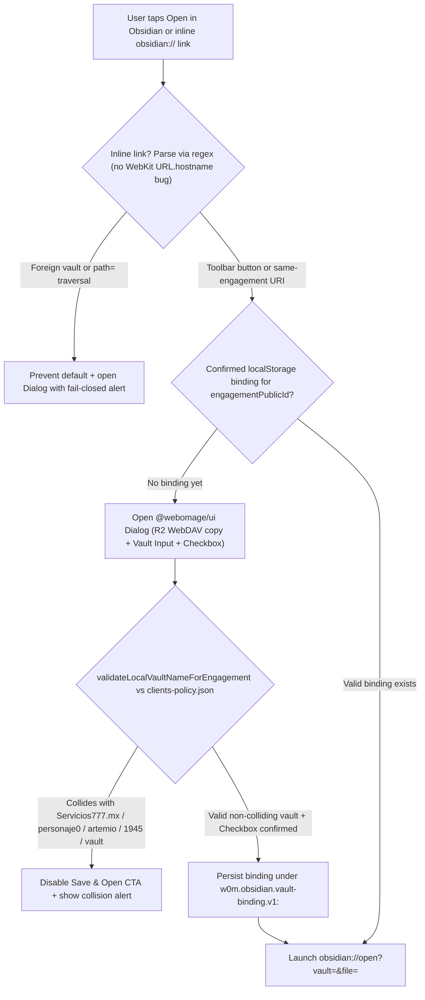

# T612 — Triangulated SSOT & SDLC Remediation Report: Per-Engagement Obsidian URI Launch Guard

- **Ticket:** `T612` ([`.tasks/T612.md`](../../.tasks/T612.md))
- **OpenSpec Change:** `w0m-web/openspec/changes/2026-11-02-t612-obsidian-vault-launch-guard`
- **Affected Estate Repos:** `w0m-web`, `w0m-api`, `@wom` (root)
- **Date:** `2026-11-02`

## 1. Incident & Root Cause Grounding (5-Surface Triangulated SSOT)

| Surface | Measured Finding | Verdict |
|---|---|---|
| **Live Infra (`public.project_vaults`, `public.vault_notes`, Cloudflare R2)** | `w0m` (`eg-w0m`, org `9dd04d15-1160-4045-8c56-0dff51e077ba`, `r2://wom-engagement-vaults/engagements/eg-w0m`) and `servicios777` (`eg-servicios777`, org `c2790001-2790-4000-8000-000000000001`, `r2://wom-engagement-vaults/engagements/eg-servicios777`) are strictly isolated by Supabase RLS (`T580`) and per-engagement WebDAV JWT scoping. Zero cross-tenant database or R2 leakage occurred. | **Isolated** |
| **Code (`KnowledgeHub.svelte`, `vaults.astro`, `vault-parser.ts`)** | `KnowledgeHub.svelte` rendered an unguarded `<a href="obsidian://open?vault=w0m&file=index">` anchor. On iOS/Android, `obsidian://open?vault=<name>` cannot create a vault; when `<name>` does not exist locally on the phone, Obsidian silently opens the user's **last active local vault** (`Servicios777.mx`). Inline `obsidian://` links in `.obsidian-content`, `/admin/vaults` mobile cards, and multi-engagement `?engagement=` wikilinks were also unguarded or dropped query parameters. | **Root Cause** |
| **Docs (`w0m-web/projects/*/vault/index.md` & `w0m-api` `public.vault_notes`)** | All 5 vault `index.md` files listed bare `` `obsidian://open?vault=<slug>` `` without warning that local vault `<slug>` must be created first on the device, and `personaje0/vault/index.md` omitted `?engagement=eg-personaje0`. | **Remediated** |
| **Specs (`w0m-web/openspec/`)** | `2026-11-02-t612-obsidian-vault-launch-guard` specifies pre-scenario `Testing seams`, fail-closed cross-vault boundary rules, and cross-repo corpus parity. | **Validated** |
| **Tests (`vitest` Node + Svelte 5 `jsdom` runtime)** | `43/43` passing tests across `obsidian-launch.test.ts` (`10`), `KnowledgeHub.test.ts` (`4`), `vault-parser.test.ts` (`14`), `vault-reader.test.ts` (`9`), and `vault-security-probe.test.ts` (`6`). | **Verified** |

## 2. Guarded Launch Architecture

## 3. Adversarial Interrogation & Single-Responsibility Audit (`socrates` · `torvalds` · `schema-critique`)

1. **WebKit vs Chromium `new URL('obsidian://open?...')` Trap:**
   - Standard `new URL('obsidian://open?vault=w0m')` sets `hostname === "open"` in Chromium/Node, whereas WebKit/iOS Safari treats custom schemes as opaque paths (`hostname === ""`, `pathname === "//open"`). `parseObsidianOpenUri` in `apps/cp/src/lib/obsidian-launch.ts` parses custom-scheme URIs deterministically without `URL.hostname` so iPhone Safari and desktop browsers enforce identical rules.
2. **Multi-Vault Org Slug Ambiguity (`maksim-kulikov`):**
   - Because `maksim-kulikov` owns both `eg-personaje0` and `eg-servicios777`, naming a local vault `maksim-kulikov` or generic `vault` reintroduces cross-engagement ambiguity. `validateLocalVaultNameForEngagement` rejects shared multi-vault org slugs and generic `vault` fail-closed.
3. **Single-Responsibility Storage Key:**
   - Device confirmation is strictly client-device state (whether *this* phone/laptop has created the local folder inside Obsidian), so it belongs in `window.localStorage` keyed by canonical `engagementPublicId` (`w0m.obsidian.vault-binding.v1:eg-w0m`), never in server tables.

## 4. SDLC / ADLC Gate Audit & Remediation Summary

| Gate | Initial Shortfall | Remediation Completed in `t612-sdlc-complete` |
|---|---|---|
| `w0m-sdlc-spec` | Pointed `spec:` at existing `openspec/specs/per-project-vault-topology` without authoring an OpenSpec change or `.agents/reports/` SSOT report. | Authored `w0m-web/openspec/changes/2026-11-02-t612-obsidian-vault-launch-guard` with pre-scenario `Testing seams` and provenance; validated via `openspec validate` + `just spec-standard`; published this report in `.agents/reports/` and `w0m-web/docs/reports/`. |
| `w0m-sdlc-build` (Cross-Repo) | Updated `apps/cp` only; missed `w0m-web/projects/*/vault/index.md` and `w0m-api` `public.vault_notes` seed parity. | Updated all 5 `projects/*/vault/index.md` files and added additive idempotent migration `20261103001735_t612_obsidian_vault_launch_guard_notes.sql` in `w0m-api`. |
| `w0m-sdlc-verify` | Unit tests only; no rendered Svelte 5 `<KnowledgeHub>` DOM test or deploy-stage readiness run. | Added `apps/cp/src/components/client/__tests__/KnowledgeHub.test.ts` (`4/4` passing) and executed non-interactive deploy-readiness gates. |
| `w0m-sdlc-deploy` / `archive` | Prematurely set `status: done` before live `just deploy`. | Restored `status: in-progress` with `pending_closure` (`T245 AC1b`) and single-paragraph domain `Definition of Done` (`just dod-check --ticket T612`) until owner runs `just db-migrate` + `just deploy`. |
