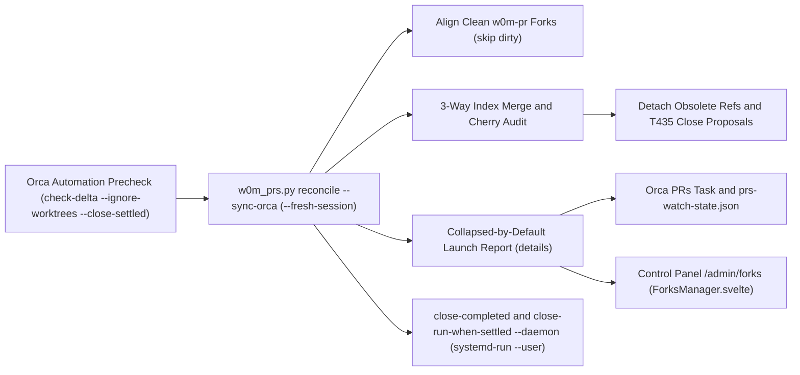

# T615 — PRs & Forks Monitor Extension: Post-Rebase Obsolete PR Management, Cgroup-Safe Completed-Session Auto-Close & Collapsed Launch Reports UI

- **Ticket:** [`.tasks/T615.md`](../../.tasks/T615.md)
- **Spec:** [`w0m-web/openspec/specs/multi-agent-concurrency/spec.md`](../../w0m-web/openspec/specs/multi-agent-concurrency/spec.md)
- **Date:** 2026-11-02

## Architecture Overview

## Delivered Capabilities

1. **Upstream Alignment & Post-Rebase Obsolete PR Management (`AC1`)**:
   - `evaluate_pr_alignment` in `scripts/w0m_prs.py` performs 100% read-only alignment analysis (zero working-tree edits and zero loose objects written to `.git/objects`) using `git rev-list --left-right --count`, `git cherry` (`OBSOLETE_PATCH_EQUIVALENT`), and a temporary `GIT_INDEX_FILE` 3-way `git read-tree --aggressive -i -m` + `git merge-file -p` + `git hash-object --stdin` + `git diff-index --quiet --cached` comparison (`OBSOLETE_EMPTY_AFTER_REBASE`, `CLEAN_REBASEABLE`, `CONFLICTING_NEEDS_REBASE`).
   - `reconcile_prs_and_forks` (`just prs-reconcile`) fast-forwards clean `w0m-pr/*` base branches (`skipped_dirty` on dirty trees), filters obsolete branches from `prs-discover`, detaches obsolete PR URLs from Orca workspace references, records `obsolete_prs` in `~/.w0m/state/prs-watch-state.json`, and exposes human-confirmed `gh pr close` proposals (`just prs-obsolete` / `just prs-obsolete-close`, enforcing `T435`).
2. **Safe Completed Agent Session Cleanup (`AC2`)**:
   - `close_completed_sessions` in `scripts/orca_sessions.py` (`just orca-close-completed`) closes only finalized Orca automation run terminals (with persisted `outputSnapshot`) and settled `done`/`idle` `w0m` agent-tree sessions whose sets are `clean` and `0 ahead` of `origin/beta`—sparing active `working`/`permission` agents, unlanded trees, live root shells, and client workspaces (`T302`).
   - `w0m-web/project/scripts/agent_tree.py` honors `.w0m/sdlc.json -> release.keep_worktrees` (`5`) via `max_sets_for` and skips `/usr/bin/orca` (Linux GNOME screen reader) in `_orca_cli_binary`.
3. **Collapsed-by-Default Launch Reports in Orca & Control Panel UI (`AC3`)**:
   - `format_launch_report` and `get_launch_reports` emit concise headlines with all sections wrapped in collapsed-by-default `
` disclosures (no `open` attribute).
   - `w0m-web/apps/cp/src/pages/api/admin/forks.ts` adds `launch_reports`, `reconcile`, and alignment-enriched `prs` (`prs-enriched`).
   - `w0m-web/apps/cp/src/components/system/ForksManager.svelte` implements the missing `activeTab === "prs"` table (with `OBSOLETE` / `CONFLICTING` / `CLEAN_REBASEABLE` badges and copyable `gh pr close` commands) and the **PRs Updates Task — Launch Reports** panel (`data-testid="prs-launch-reports"`) with collapsed-by-default `
` items using `@webomage/ui` primitives.
4. **Cgroup-Safe Detached `--daemon` Self-Closer, `--fresh-session` Isolation & PR-Only Precheck (`AC4`)**:
   - `spawn_detached_closer` (`w0m_prs.py close-run-when-settled --daemon`) launches a transient `systemd-run --user --collect` unit on Linux (forwarding `ORCA_CLI_COMMAND`, `ORCA_USER_DATA_PATH`, `XDG_CONFIG_HOME`, `HOME`, `PATH`) with `subprocess.Popen(..., start_new_session=True)` fallback so agent tool-runner cgroup/PGID teardown cannot `SIGKILL` the background closer before Orca's `RuntimeTerminalRunObserver` captures `outputSnapshot` (~22s post-turn, `max_wait=60s`), and unwraps `last-status.json` v2 `entries` dicts.
   - `sync_prs_to_orca` uses `resolve_canonical_estate_root` so running `orca-sync` inside `~/.w0m/work*` never embeds ephemeral worktree paths in `precheck`, and passes `--fresh-session` + `--enabled` so scheduled monitor runs never hijack or loop inside existing conversations.
   - `check_prs_delta` / `cmd_check_delta` adds `--ignore-worktrees` (stopping unrelated `~/.w0m/work/*` dirty-repo edits from waking the PR monitor), `--close-settled` (zero-token precheck sweep of finalized tabs), and `pending_deltas` handoff so precheck-detected PR deltas survive into `reconcile`.

## Verification Summary

- `python3 scripts/tests/test_w0m_prs.py` — **84/84 passed**
- `python3 scripts/tests/test_orca_sessions.py` — **9/9 passed**
- `python3 -m pytest w0m-web/project/scripts/tests/test_agent_tree.py` — **82/82 passed**
- `pnpm --dir w0m-web --filter @webomage/cp exec vitest run src/tests/api/admin/forks.test.ts` — **22/22 passed** (`node` + `dom`)
- `just ds-check`, `just mmd-validate`, `just reports-ticket-check`, `just debt-check --enforce`, `just check-guardrails` — **all passed**
