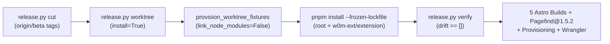

# Release Worktree Drift Fix, Hermetic Lockfile Installs & Full Deploy App Build Verification (`T617`)

- **Date:** `2026-11-03`
- **Ticket:** [`T617`](../../.tasks/T617.md)
- **Specs:** [`persistent-stable-worktree/spec.md`](../../w0m-web/openspec/specs/persistent-stable-worktree/spec.md) · [`toolchain_currency/spec.md`](../../w0m-web/openspec/specs/toolchain_currency/spec.md) · [`archive/2026-11-03-t617-release-worktree-node-modules-and-gitignore`](../../w0m-web/openspec/changes/archive/2026-11-03-t617-release-worktree-node-modules-and-gitignore/proposal.md)

## 1. Root Cause Analysis Across Both `just deploy-all` Runs

| Release / Step | Observed Failure | Root Cause | Resolution (`T617`) |
|---|---|---|---|
| `2026.11.02-1793646360` (`deploy-web` / `astro build`) | `[vite]: Rolldown failed to resolve import "@webomage/fingerprint"` | Release was cut at `w0m-web` `b08eb85f` before `"@webomage/fingerprint": "workspace:*"` landed in `w0m-web/apps/web/package.json`. | Verified resolved on `beta` (`56eb799c`) by building all 5 Astro apps end-to-end inside a fresh `pnpm install --frozen-lockfile` worktree (`5/5` bundles stamped cleanly). |
| `2026.11.03-1793712665` (`release.verify()` before Touch ID) | `w0m-api: ?? node_modules`, `w0m-cf: ?? node_modules`, `w0m-ext: ?? extension/node_modules` | Git trailing-slash rules (`node_modules/`, `**/node_modules/`) match **directories only, never symlinks**, AND `release.worktree()` called `provision_worktree_fixtures()` before `pnpm install --frozen-lockfile`, symlinking live `node_modules` and skipping hermetic lockfile installs. | Added unslashed `node_modules` across all 5 JS `.gitignore` files (`w0m-api`, `w0m-cf`, `w0m-ext`, `w0m-web`, `w0m-sec`), tightened `ignore-policy.json` to `^(\*\*/)?node_modules$`, and parameterized `provision_worktree_fixtures(..., link_node_modules=not install)` with `NESTED_PNPM_DIRS` (`w0m-ext/extension`). |
| Isolated `deploy-web` `build:search` (`justfile` line 676) | `pnpm dlx pagefind --site dist/client` exited `1` (`SIGILL`, `exit 132`) | Unpinned `pnpm dlx pagefind` downloaded floating `pagefind@1.6.0`, whose static Linux `pagefind_extended` binary executes x86-64-v3/AVX2 instructions unsupported on `aleksei@HP` (`AMD A10-5745M`, x86-64-v2). | Pinned `"build:search": "pnpm dlx pagefind@1.5.2 --site dist/client"` in `w0m-web/apps/web/package.json` and `w0m-web/apps/cp/package.json`, enforced by `scripts/tests/test_npx_audit.py`. |

## 2. Empirical Build & Gate Verification Matrix

- **Release & Provisioning Self-Tests (`python3 scripts/release.py --test`)**: `82/82` probes pass (including 3 new `T617` probes covering `.gitignore` symlink cleanliness across all 6 JS repos, `link_node_modules=True` vs `link_node_modules=False`, and hermetic `worktree(install=True)` across `w0m-api`, `w0m-ext`, and `w0m-ext/extension`).
- **Ignore & Layout Governance**:
  - `python3 scripts/ignore_audit.py --enforce`: `21/21` ignore files governed, `4` required rules x repo (`0` missing).
  - `python3 w0m-web/project/scripts/layout_check.py`: `0` unclassified files, `408` `.gitignore` patterns justified.
- **Full Production App Builds in Fresh Worktree**:
  - `just build`: `5/5` Astro SSR Cloudflare bundles built and stamped (`apps/web`, `apps/cp`, `apps/join`, `apps/job`, `apps/demo`).
  - `just _assert-provisioned web|cp|join|job`: `4/4` `[OK]` (no unresolved config throws, public secrets inlined).
  - `pnpm --dir w0m-web/apps/web run build:search`: `Pagefind v1.5.2 (Extended)` indexed `43` pages across `ru`, `en`, `es` (`6,232` words + `pagefind-component-ui.{js,css}`) in `0.31s`.
  - `wrangler deploy --dry-run`: `6/6` Cloudflare Worker bundles validated (`web`, `cp`, `join`, `job`, `demo`, `w0m-cf`).
  - `just _assert-clean-tree`: `✅ Deploy left no tracked snapshot/version files dirty.`
