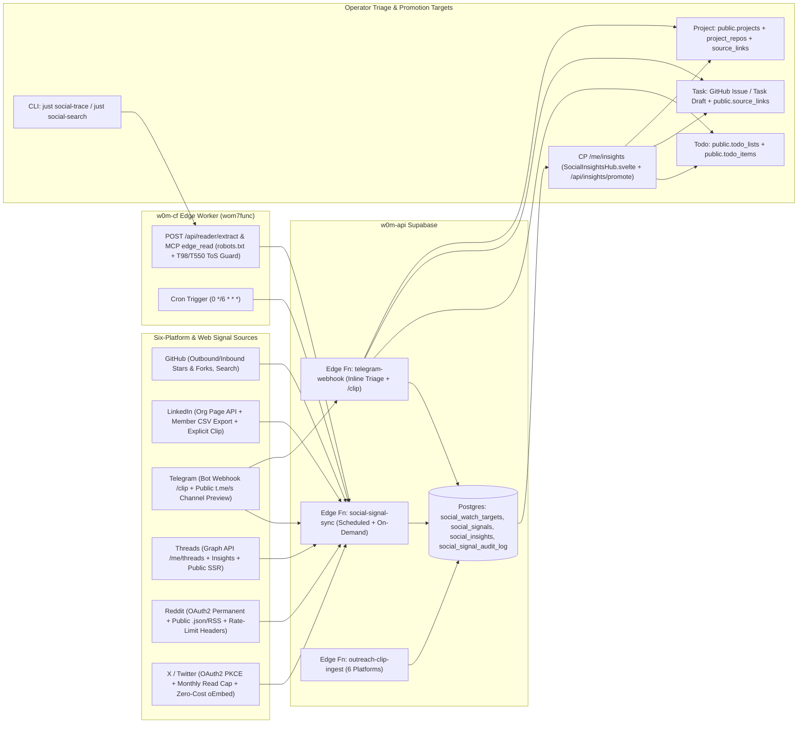

# T624 · T622 · T623 — Multi-Platform Social Connectivity & Insights Pipeline, Toolchain Governance, CP Mobile/UI Refinements & Mobile Shell Architecture

- **Date:** 2026-11-03
- **Tickets:** `T624`, `T622`, `T623`
- **Repos:** `w0m-web`, `w0m-api`, `w0m-cf`, `w0m-ext`, `@wom` (`tooling`)
- **Author:** `agy:t619-social-signal-insights`

---

## 1. Multi-Platform Social Connectivity & Actionable Insights Pipeline (`T624`)

### Architecture Flow

### Key Design & Security Invariants

1. **ToS-Aware First-Party Edge Reader (`w0m-cf/src/lib/edge-reader.ts`)**:
   - Exposes `POST /api/reader/extract` and MCP tools `edge_read`, `social_search`, and `social_trace` authenticated with `WEBHOOK_SECRET` / `API_AUTH_TOKEN`.
   - Enforces `robots.txt` parsing (`User-Agent: WebomageEdgeReader`, `Disallow` / `Allow` longest-prefix match, `Crawl-delay`), `Retry-After` propagation, SSRF private/loopback IP rejection, and hard ToS blocklists (`451 blocked_tos` on LinkedIn authenticated/Sales Navigator scraping per `T98` and Telegram MTProto user-account scraping per `T550`).
   - Reuses the existing `0 */6 * * *` cron trigger in `w0m-cf/src/index.ts` without exceeding Cloudflare's 5-cron trigger ceiling.
2. **Database & Append-Only Audit Provenance (`__KEEP_MIGRATION_20261103213000_T624__`)**:
   - Widens `outreach_clips`, `outreach_threads`, and `source_links` CHECK constraints to `'github'`, `'reddit'`, and `'x'`.
   - Creates `social_watch_targets`, `social_signals` (deduplicated on `(profile_id, platform, signal_kind, external_id)` with `wom_jsonb_has_credential_keys(raw_payload)` guard), `social_insights` (with `promoted_todo_id uuid references public.todo_items(id)`), and append-only `social_signal_audit_log` populated by `SECURITY DEFINER` triggers (`T614`) and protected by explicit `X24` column grants.
   - Preserves `source_links` write-lock (`REVOKE INSERT/UPDATE/DELETE FROM authenticated`) by exposing `SECURITY DEFINER` RPC `public.wom_link_social_insight_source(...)` that verifies `social_insights.profile_id = public.current_profile_id()` before linking promoted todos/tasks/projects.

---

## 2. Host CLI & Stdout-Filtering Toolchain Governance (`T622`)

- **Root Cause**: `rg`, `fd`, `yq`, `bat`, `sqlite3`, and `tree` were previously parked in `out_of_scope` (`T164`) assuming every agent harness bundles internal search/filter binaries, while `scripts/tool_usage_probe.py`'s `SHELL_PREFIX` missed YAML `entry:` and `bash -c` invocations (reporting `0` uses for `ruff` despite `w0m-sec/.pre-commit-config.yaml` running `entry: ruff check`).
- **Remediation**:
  - Extended `SHELL_PREFIX` in `scripts/tool_usage_probe.py` to parse YAML `entry:` and `bash -c` commands without false-positiving YAML keys (`44` tracked probe candidates).
  - Promoted `rg`, `fd`, `yq`, `ruff`, `sqlite3`, `bat`, and `tree` out of `out_of_scope` and governed `curl`, `gpg`, `htmlq`, `mlr`, `sd`, `fzf`, `shellcheck`, `pdftotext`, and `code-review-graph` in `project/policies/tools-policy.json` (`62` governed tools total).
  - Provisioned the Linuxbrew suite on `aleksei@HP` (`git 2.49+`, `jq 1.8.2`, `rg`, `fd`, `yq`, `bat`, `sqlite3`, `tree`, `ruff`, `htmlq`, `mlr`, `sd`, `fzf`, `shellcheck`) achieving `0 required-problem(s)` in `just tools-check` and `22/22` in `just preflight --fast`.

---

## 3. Control Plane UI & Mobile Header Refinements (`T623`)

1. **Top-Left Enterprise / RPG Icon Switcher + `Alt+M` + `4 Taps`**:
   - Added `railStart` snippet slot in `packages/ui/src/lib/components/layout/AppShell.svelte` and `design-system/components/layout/AppShell.d.ts`.
   - Replaced the bulky `Vocabulary Mode` card in `SidebarHatSwitcher.svelte` with a compact `@webomage/ui` `Button` (`variant="ghost"`, `size="icon"`) at the top-left of `CpShell.svelte`, swapping `Building2` (`Enterprise` / `web`) and `Swords` (`RPG` / `mage`).
   - Wired both `Alt+M` and a non-interactive **4-tap gesture** (`<= 900ms`, `<= 48px` drift, ignoring taps inside interactive controls) to trigger the identical terminology mode toggle.
2. **Mobile Header & Footer Logo Corruption Fix**:
   - **Root Cause**: `/assets/logo.svg` (`viewBox="0 0 746 746"`, `stroke-width="12"`) scales down `18.65x` at `40px` (`h-10`) to `0.64px` sub-pixel strokes. Chaining `blur-[0.5px] opacity-90 drop-shadow-[0_0_8px_rgba(255,255,255,0.4)]` inside `<header class="... backdrop-blur-md">` forced mobile GPU compositors to rasterize `` into a `40x40` bitmap tile before smearing sub-pixel strokes into a washed-out white halo.
   - **Fix**: Removed `blur-[0.5px]`, `opacity-90`, and the white `drop-shadow` across `apps/{cp,web}/src/components/{Header,Footer}.astro` and locked `h-10 w-10 md:h-12 md:w-12 shrink-0 object-contain block`.
3. **Personal Information Verification Check-Mark Rounds (`/me/profile`)**:
   - Replaced `Phone: unverified` / `Address: unverified` / `Identity: unverified` text in `PersonalInformation.svelte` with compact `Phone`, `Address`, and `Identity` pills displaying **gray** (unverified/missing), **yellow** (entered/pending verification or modified since KYC), and **green** (KYC verified) check-marks inside filled circular badges.

---

## 4. Cross-Platform Mobile Shell Evaluation for Astro + Svelte 5 + Embedded Obsidian Vault

### Weighted Decision Matrix (`Client` · `Registered Person` · `Member` Apps)

| Criterion (Weight) | Capacitor 7+ (Recommended Primary) | Tauri v2 Mobile (Strong Rust-Heavy Alternative) | NativeScript / Lynx (Svelte Native) | Bare PWA |
|---|---|---|---|---|
| **Astro + Svelte 5 + `@webomage/ui` Reuse (30%)** | **10/10** — Full WKWebView / Android WebView DOM + CSS variables + Tailwind 4 | **9/10** — Full system WebView DOM + CSS variables | **2/10** — No HTML/CSS DOM; breaks Astro, `@webomage/ui`, CodeMirror 6, Mermaid, Svelte Flow | **9/10** — Full browser DOM |
| **Embedded Obsidian Vault Parity (25%)** | **10/10** — **Powers Obsidian's own official iOS & Android apps**; native `@capacitor/filesystem` + `@capacitor-community/sqlite` | **9/10** — Rust core (`tantivy` / `pulldown-cmark` / `rusqlite`) excels at local 10k-note FTS & backlink graphs | **3/10** — Cannot host CodeMirror 6 / Markdown canvas WebView cleanly without nested WebViews | **3/10** — WebKit storage eviction + weak background file sync on iOS |
| **3-App Multi-Target Build (`Client` / `Person` / `Member`) (20%)** | **9/10** — Environment-parameterized `capacitor.config.ts` (`appId`, `appName`, `data-app` theme) from one monorepo | **8/10** — Separate `tauri.conf.json` flavors + Rust mobile Xcode/Gradle targets | **5/10** — Separate native bridges per target | **4/10** — Apple App Store Guideline 4.2 rejects thin PWA wrappers |
| **Mobile Native Ecosystem (Push, Biometrics, Deep Links, Share Sheet) (25%)** | **10/10** — Mature `@capacitor/push-notifications`, Passkeys/Biometrics, iOS/Android Share Extension (mobile `w0m-ext` clipper!) | **7/10** — Official `tauri-plugin-notification` / `biometric` exist, APNs/FCM + Share Sheet younger than Capacitor | **6/10** — Smaller plugin maintenance footprint | **4/10** — Limited iOS share-target & background capabilities |
| **Weighted Score** | **9.80 / 10** | **8.30 / 10** | **3.65 / 10** | **5.35 / 10** |

### Recommended Mobile Packaging Topology

1. **Static Shell + Shared Workspace Packages**:
   - `apps/cp` uses `output: "server"` on `@astrojs/cloudflare` for SSR web delivery. Mobile apps bundle local static assets (`index.html` + JS/CSS) inside the signed `.ipa` / `.apk` and call `https://cp.webomage.com/api/*`, `w0m-api`, and `w0m-cf` over HTTPS with PKCE + Passkey/Biometric token storage (`@capacitor/preferences` / Keychain / Keystore).
   - Build either an **`astro.mobile.config.mjs` (`output: "static"`)** shell rendering Svelte 5 islands (`client:only="svelte"`) or thin **`apps/mobile-{client,person,member}`** Vite + Svelte 5 shells importing 100% of `@webomage/ui`, `@webomage/lib`, and `@webomage/vault` (`unified`/`remark-obsidian` + `CodeMirror 6` + `@capacitor-community/sqlite` FTS5 + R2 delta sync).
2. **Why Capacitor 7+ First (with Optional Rust/WASM Vault Indexer)**:
   - Obsidian Mobile itself runs on **Capacitor**, proving that `WKWebView` + Android WebView + native filesystem/SQLite handles multi-thousand-note Markdown vaults, `[[wikilinks]]`, Canvas, Mermaid, and CodeMirror 6 at 60fps.
   - Native iOS Share Extension + Android Intent Filter in Capacitor also replaces `w0m-ext` on mobile so sharing any LinkedIn, X, Reddit, Threads, Telegram, or GitHub link on a phone feeds directly into `/me/insights` (`T624`).
