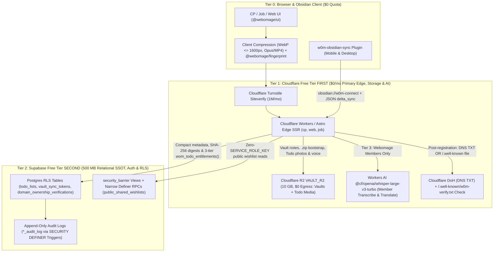

# Free-Tier-First Architecture (`AgDR-0055`), Active-Hat Tool Visibility, Native R2 Obsidian Sync, Tiered Universal Todos/Wishlists & Zero-Page-Code Domain Audit Guard (`T628`–`T630`, `T632`)

- **Date:** 2026-11-03
- **Tickets:** [[T628]] · [[T629]] · [[T630]] · [[T632]]
- **Architectural Decision:** [[AgDR-0055]] (`docs/decisions/AgDR-0055-cloudflare-first-then-supabase-free-tier-architecture.md`)
- **Canonical OpenSpecs:**
  - `w0m-web/openspec/specs/per-project-vault-topology/spec.md` (`T628`, `T632`)
  - `w0m-web/openspec/specs/user-todos-and-shared-wishlists/spec.md` (`T629`)
  - `w0m-web/openspec/specs/website-audit-ownership-and-order-guard/spec.md` (`T630`)

## Executive Summary

This delivery codifies the estate's `$0/mo` **Free-Tier-First Resource Allocation Rule (`AgDR-0055`: Cloudflare Free Tier First → Supabase Free Tier Second)** and ships four interconnected product and security capabilities across `w0m-web`, `w0m-api`, `w0m-ext`, and `@wom` tooling:

1. **`AgDR-0055` — Free-Tier-First Architecture Rule (`T630` AC1)**:
   - Establishes a mandatory 4-tier cascade: **(0) Client/Browser compression & static assets first**, **(1) Cloudflare Free Tier FIRST** (`Workers`, `R2` `10 GB` + `$0` egress, `KV`, `Turnstile` `1M/mo`, `Workers AI` `10k Neurons/day`, `Cloudflare DoH`), **(2) Supabase Free Tier SECOND** (`500 MB` Postgres + GoTrue Auth + RLS strictly for compact relational metadata, SHA-256 digests, and append-only `*_audit_log` rows), and **(3) Triggered Paid Tiers** only on quantitative `AgDR-0043` thresholds with owner approval.
2. **`T632` — Active-Hat Tool Availability UI & Tech/Client Project Vault Telemetry**:
   - Surfaces `HatToolsAvailabilityBar.svelte` inside `CpShell.svelte` driven directly by `hat-visibility-policy.json` (`describeHatToolAvailability`), showing unlocked tools and hidden capabilities per worn hat while redacting `amount_usd` whenever `!canSeeCommercialAmounts(held)`.
   - Renders `ProjectVaultTelemetry.svelte` (SVG completion ring, segmented progress bar, phased visual roadmap, inline client milestone approval/revision controls, and corpus/delivery stats) across `/o/[org]/p/[project]`, `/o/[org]/p/[project]/vault`, and `/o/[org]/projects/vault`, plus synced `mocs/roadmap-and-progress.md`.
3. **`T628` — First-Party `w0m-obsidian-sync` Plugin & Native Cloudflare R2 Delta Sync**:
   - Replaces 1-hour-expiring JWT WebDAV setups with SHA-256-hashed revocable device tokens (`public.vault_sync_tokens` + `public.vault_sync_token_audit_log`), single-round-trip JSON R2 `delta_sync` on `/api/vault/r2/[engagement]`, `GET ?format=bootstrap-zip` archives with `w0m-obsidian-sync` (`isDesktopOnly: false`) pre-installed, and 1-tap `obsidian://w0m-connect` pairing.
4. **`T629` — Universal Shared Todos, Checklists & Wishlists with 3-Tier Cloudflare Media/AI Entitlements**:
   - **Tier 1 (Everyone — all authenticated users)**: Basic text todos, nested checklist sub-steps, repeatable checklists, and full-featured shared wishlists (`/u/<slug>/wishlist`, `/wishlist/<token>`, `@slug` collaborator invites, item Claim/Reserve, append-only `public.todo_visibility_audit_log`) across `cp` (`/me/todos`, `/o/[org]/p/[project]/todos`) and `job` (`/me/todos`), retiring guild-only `admin_todos` / `admin-todos-api`.
   - **Tier 2 (Webomage Members + Clients with Active Subscription — `orgs.subscription_status IN ('active', 'trialing')`)**: Client-compressed WebP picture and cross-browser Opus/MP4 voice-note storage in Cloudflare R2 (`VAULT_R2`, `403 MEDIA_ENTITLEMENT_REQUIRED` for unsubscribed users).
   - **Tier 3 (Webomage Members ONLY — `platform` org hat / `team_members` / `admin`)**: Cloudflare Workers AI (`@cf/openai/whisper-large-v3-turbo`) voice **Transcribe** (`task: "transcribe"`) and **Translate to English** (`task: "translate"`, `403 MEMBER_AI_ENTITLEMENT_REQUIRED` for non-members).
5. **`T630` — Turnstile + Fingerprint Order Guard & Zero-Page-Code Domain Ownership Verification**:
   - Guards `/audit` (`SecurityAuditWidget.svelte`), `ChatApp.svelte`, `ClientDashboard.svelte`, `/api/security-audit`, and `submit-service-request` with **Cloudflare Turnstile + `@webomage/fingerprint`**, creating ONLY the pending order (`status: "pending_ownership_verification"`) with zero outbound target scanning.
   - Defers `runPassiveDomainAudit` until the registered Client Portal user confirms domain control via **ANY ONE OF** two zero-page-code methods: **DNS `TXT` record** (`_w0m-verify.<domain>`) **OR** **uploaded verification file** (`https://<domain>/.well-known/w0m-verify.txt`), logged in `public.domain_ownership_audit_log`. Website HTML/page-code modification (`html_meta`) is never required or offered.

## Architecture & Data-Flow Topology (`AgDR-0055`)



## Surface Matrix by Ticket

| Ticket | Key Code, Schema & Policy Surfaces | Verification Evidence |
|---|---|---|
| **`T632`** | `packages/lib/src/auth/{hat-visibility-policy.json,hat-visibility.ts}`, `HatToolsAvailabilityBar.svelte`, `CpShell.svelte`, `project-telemetry.ts`, `vault-telemetry-md.ts`, `ProjectVaultTelemetry.svelte`, `MilestoneManager.svelte`, `o/[org]/p/[project]/{index,vault,milestones}.astro`, `o/[org]/projects/{vault,milestones}.astro` | `hat-visibility.spec.ts` (`6/6`), `project-telemetry.test.ts` (`15/15`), `nav.test.ts` (`22/22`), `ds_conformance.py --enforce` (`-63` hex, `-61` raw `<button>`) |
| **`T628`** | `20261103190000_t620_vault_sync_tokens.sql`, `20261103214500_t622_vault_sync_token_rpc_authz.sql`, `w0m-ext/obsidian-w0m/**` (`dist/{main.js,manifest.json,styles.css}`), `apps/cp/src/pages/api/vault/tokens.ts`, `vault-bootstrap-zip.ts`, `vault-r2-gateway.ts`, `KnowledgeHub.svelte`, `VaultSyncPanel.svelte` | `just -f w0m-ext/justfile test-obsidian` (`4/4`), `vault-r2-gateway.test.ts` (`13/13`), `KnowledgeHub.test.ts` (`4/4`), `test_authz_admin_client.py` (`8/8`) |
| **`T629`** | `20261103193000_t621_universal_todos_and_shared_wishlists.sql`, `packages/lib/src/todos/**`, `apps/cp/src/lib/todos-server.ts`, `apps/{cp,job}/src/pages/api/todos/{index,media,transcribe}.ts`, `TodoWorkspace.svelte`, `SharedWishlistView.svelte`, `apps/web/src/pages/{u/[slug]/wishlist,wishlist/[token]}.astro`, `apps/web/src/pages/api/wishlists/{claim,media/[id]}.ts` | `todos.test.ts` + `media.test.ts` (`10/10`), `todos-api.test.ts` (`3/3`), `TodoWorkspace.test.ts` (`3/3`), `wishlists-public.test.ts` (`2/2`), `test_authz_public_views.py` (`5/5`) |
| **`T630`** | `docs/decisions/AgDR-0055-cloudflare-first-then-supabase-free-tier-architecture.md`, `20261103200000_t623_domain_ownership_verifications.sql`, `domain-ownership.ts`, `audit.astro`, `SecurityAuditWidget.svelte`, `ChatApp.svelte`, `apps/web/src/pages/api/security-audit.ts`, `apps/cp/src/pages/api/client/security-audit.ts`, `SecurityAuditReportViewer.svelte`, `ClientDashboard.svelte`, `submit-service-request/index.ts` | `domain-ownership.spec.ts` + `passive-audit.spec.ts` + `security-audit-order.test.ts` (`20/20`), `test_t336_security_audit.py` (`5/5`), `just decisions --check` (`385` indexed) |

## Owner-Only Post-Landing Steps (`docs/DEPLOY-CONFIRM.md`)

1. Apply the four new SQL migrations (`20261103190000`, `20261103193000`, `20261103200000`, `20261103214500`) via Touch ID:
   ```bash
   just db-migrate
   ```
2. Ship the updated Cloudflare Workers & Supabase Edge Functions via Touch ID:
   ```bash
   just deploy-all
   ```
