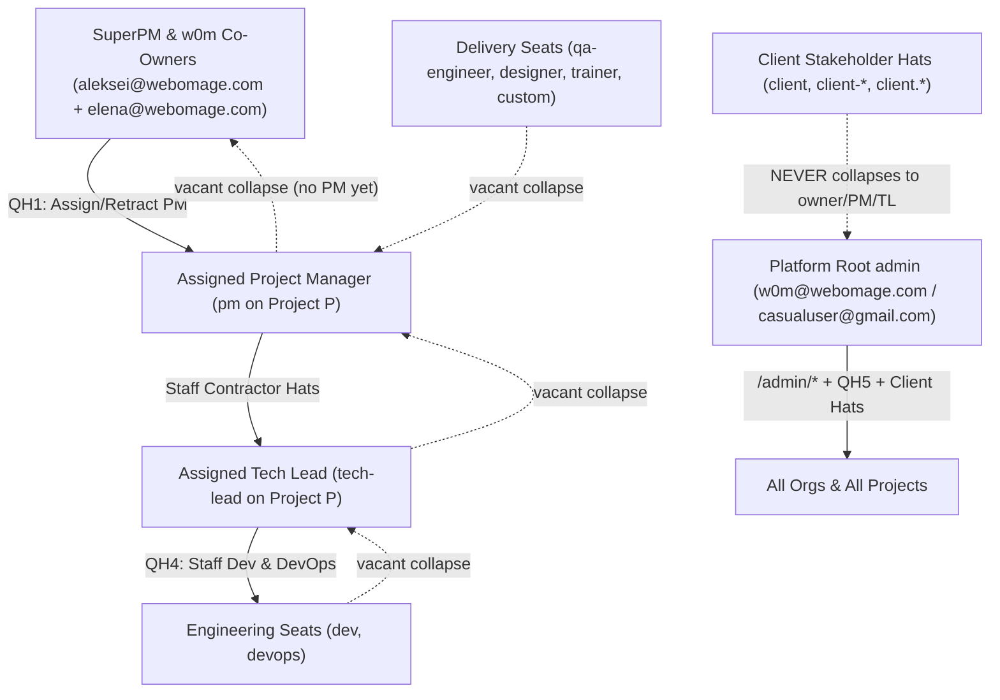

# SuperPM & w0m Co-Owner Role (`w0m.exec.owner`), Transitive Owner Collapse, & Project-Scoped Assigned-PM Permissions (`T631`)

- **Date:** 2026-11-03
- **Ticket:** [[T631]]
- **Canonical OpenSpec:** `w0m-web/openspec/specs/hat-management/spec.md`
- **Related Decisions & Tickets:** [[AgDR-0020]] · [[AgDR-0028]] · [[AgDR-0035]] · [[T314]] · [[T439]] · [[T461]] · [[T463]] · [[T465]] · [[T543]] · [[T553]] · [[T571]] · [[T609]]

## Executive Summary

`T631` introduces a first-class **`SuperPM & w0m Co-Owner`** tier (`public.offices.office = 'w0m.exec.owner'`, `hat-visibility` key `super_pm`, SQL definer `public.is_w0m_owner()`) positioned strictly between the institutional **Platform Root `admin`** (`w0m@webomage.com` / `casualuser@gmail.com`) and regular unit managers/members, assigns it idempotently to both **`aleksei@webomage.com`** and **`elena@webomage.com`**, completes end-to-end **Project Manager (PM)** permissions across SQL RLS, `SECURITY DEFINER` RPCs, `@webomage/lib/auth`, and CP UI, and upgrades the fallback engine (`public.wom_recompute_project_fallbacks`) so **every non-client project hat collapses transitively to `w0m` owners (`aleksei` & `elena`) whenever no real PM is assigned yet**, automatically retracting from owners and collapsing to the real PM (and Tech Lead) once staffed.

## Role, Boundary, & Transitive Collapse Architecture



| Capability / Boundary | Platform Root `admin` (`is_admin()`) | `SuperPM & w0m Co-Owner` (`aleksei` & `elena`, `is_w0m_owner()`) | Assigned PM (`wom_is_assigned_project_pm`) |
|---|---|---|---|
| `public.user_roles` | `['admin', 'member']` | `['manager', 'member']` (NEVER `'admin'`) | `['member']` or `['manager', 'member']` |
| `/admin/*` on `cp.w0m.xyz` | Allowed | Denied (`is_admin() = false`) | Denied |
| `QH5` Sensitive Capabilities (`deploy.execute`, `infra.manage`, `secret.use.prod`) | Allowed (`authority = 'root'`) | Denied (`authority = 'owner'`) | Denied (`authority = 'staff'`) |
| Pure-Client Orgs & Client Portal Side (`sides = ['client']`) | Allowed | Excluded (`sides = ['contractor']` only) | Contractor project context |
| **`client` Project Hats (`client`, `client-*`, `client.*`)** | **Allowed** | **Unavailable & Refused (`403` / SQL `42501`)** | Refused |
| Active Projects Visibility & PM Permissions | All projects | **All active projects** | **Assigned project(s) ONLY** |
| Assign / Reassign Project Managers (`QH1`) | Allowed (all projects) | **Allowed (all projects)** | Denied (`QH1`) |
| **Unstaffed Contractor Hats When No PM Assigned Yet** | Root override | **Collapse (`is_fallback = true`) to `aleksei` & `elena`** | N/A until staffed |
| **Unstaffed Contractor Hats Once PM Is Assigned** | Root override | **Owner fallbacks retract automatically** | **Collapse (`is_fallback = true`) to Assigned PM (or Tech Lead)** |
| Engagement R2 Vaults (`w0m_vst_` + Web/Obsidian) & Shared Todos | All engagements/lists | **All engagements & org/project lists** | **Assigned engagement/project ONLY** |

## Key Surfaces Delivered

1. **Supabase Migration (`w0m-api/supabase/migrations/20261103223000_t631_super_pm_w0m_co_owner_role.sql`)**:
   - Upserts `public.offices('w0m.exec.owner')` + non-`QH5` `office_capabilities`, completes `w0m.tech.program` / `w0m.delivery.manager` capabilities, and backfills missing `office`, `engagement_id`, and `org_id` on project-scoped `public.hats` rows.
   - Ships `public.is_w0m_owner()`, `public.wom_is_assigned_project_pm`, `public.wom_provision_owner_project_hat` (refusing client hats for non-admin owners with `42501`), and `public.wom_toggle_project_office_grant` (auditing per-seat office grants in `hat_assignment_log`).
   - Ships `public.wom_recompute_project_fallbacks(p_project_id uuid)` (`service_role`-only trigger helper) and upgraded `wom_sync_role_fallback()` across `public.hats`, `public.project_roles`, and `public.hat_collapse_rules`, walking `dev`/`devops` -> `tech-lead` -> `pm` -> `w0m.exec.owner` while strictly excluding all `client` hats and never overwriting a real (`not is_fallback`) holder's hat.
   - Upgrades `wom_staff_authority`, `wom_staff_hat`, `wom_my_contexts`, `wom_context_capabilities` (filtering `QH5` caps on fallback hats for `v_owner`), `wom_eligible_project_managers`, `wom_assign_project_manager`, `verify_vault_sync_token` (scoping org-hat fallback to `project_id is null and engagement_id is null`), `wom_can_access_todo_list`, and `wom_provision_blueprint_technologies`.
   - Adds `D2-hat-narrows`-compliant RLS policies across `projects`, `contracts`, `client_milestones`, `project_vaults`, and `vault_notes`.
   - Extends `public.hat_assignment_log` with `org_id` + `hat_assignment_log_scope_check`, idempotently seeds `aleksei@webomage.com` and `elena@webomage.com` as `manager` + `w0m.exec.owner`, deactivates any client hats on their profiles, and recomputes fallbacks across all active projects.
2. **Auth Policy & CP Surfaces (`w0m-web`)**:
   - `project/authz-definers.jsonc`, `packages/lib/src/auth/{hat-visibility-policy.json,hat-visibility.ts}` (`dev`/`devops` -> `tl` -> `pm` -> `super_pm`; `client` -> `null`).
   - `apps/cp/src/pages/api/project/{hats,roles,index}.ts` (exposing `owners` and `is_fallback`, sorting real hats ahead of fallbacks), `apps/cp/src/lib/vault-r2-gateway.ts`.
   - `SidebarHatSwitcher.svelte`, `ProjectTeam.svelte` (separating `realMembers` vs `is_fallback` rows, rendering `Fallback: Aleksei, Elena (w0m owner)` on PM-less projects while keeping `client` `Vacant`), `ProjectManager.svelte`, `docs/CP-FEATURE-INDEX.md`.
   - `openspec/specs/hat-management/spec.md`, `project/scripts/aleksei_member_probe.py`, `project/scripts/tests/test_t631_super_pm_and_project_pm.py`.

## Verification Summary

- `test_t631_super_pm_and_project_pm.py` (real throwaway PostgreSQL): **6/6 PASSED** (`AC1` idempotent seeding + admin separation, `AC2` SuperPM cross-project authority + client-hat refusal, `AC2` Platform Root client hats + `QH5`, `AC3` Assigned PM end-to-end permissions + cross-project isolation, `AC4` `D2-hat-narrows` across projects/contracts/milestones/vaults/notes, `AC5` 4-stage transitive collapse to `w0m` owners -> Assigned PM -> Tech Lead -> owner re-collapse).
- `test_t553_hat_write_path.py` (real PostgreSQL): **42/42 PASSED**.
- `test_t543_project_manager_rpcs.py` (real PostgreSQL): **19/19 PASSED**.
- `supabase_surface_drift_check.py` (`0` findings), `cp_feature_index.py --check` (`83` items), `ds_conformance.py --enforce`, `just spec-drift`: **ALL PASSED**.

## Owner-Only Post-Landing Commands (`docs/DEPLOY-CONFIRM.md`)

Run from the live estate root via Touch ID:

```bash
cd ~/Projects/'!self'/w0m
just db-migrate
just deploy-all
just smoke-live
```
