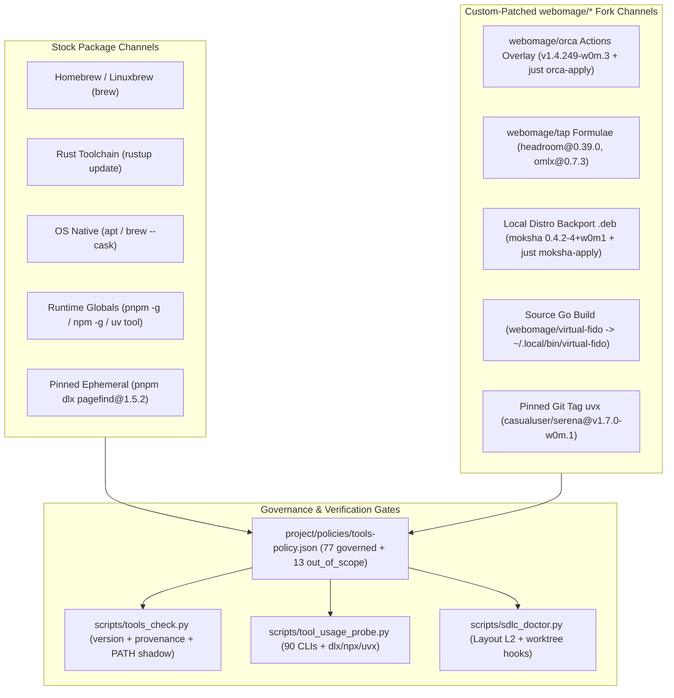

# Workstation, Agent & Custom-Fork Tools Audit (`T620`)

- **Ticket:** `T620` (`.tasks/T620.md`)
- **Date:** `2026-11-04`
- **Scope:** All host CLIs, agent harnesses, MCP launch lines, ephemeral `pnpm dlx` / `npx` / `uvx` runners, desktop/security wrappers, TUI monitors, and custom-patched `webomage/*` forks across Linux (`aleksei@HP`) and macOS (`MacBook Pro`, Apple Silicon).
- **Policy SSOT:** `project/policies/tools-policy.json` (`77` governed tools + `13` `out_of_scope` = `90` audited CLI candidates, plus `abi_policy` and `ephemeral_policy`).

---

## 1. Executive Summary

1. **Probe & Policy Parity (`44 -> 90` CLIs + Ephemeral Runners):** `scripts/tool_usage_probe.py` previously scanned only `44` host CLI names (omitting `30` already-governed tools, all `6` `agent_provider.py` harnesses, `orca`, `moksha`, `virtual-fido`, `google-chrome`, `w0m-obsidian-uri`, `T638` TUI monitors, and `100%` of `package.json` / `.mcp.json` / `pnpm dlx` / `npx` / `uvx` invocations). It now enforces bidirectional `90/90` parity with `tools-policy.json` plus `ephemeral_policy` (`forbid_npx: true` and `must_pin` ABI/ref pins).
2. **Zero Runnable `npx` Restored Across All 7 Repos:** The expanded ephemeral probe caught `5` live `npx` pre-commit hooks in `w0m-api/.pre-commit-config.yaml` (`oxlint`, `oxfmt`) and `w0m-cf/.pre-commit-config.yaml` (`tsc`, `oxlint`, `oxfmt`) that `test_npx_audit.py` missed, plus `2` unnecessary `pnpm dlx supabase` calls in `just/estate.just`. All `5` hooks now use `pnpm exec` and `just/estate.just` invokes governed `supabase` directly.
3. **Provenance Mismatches & `PATH` Shadows Surfaced Mechanically:** `scripts/tools_check.py` now runs `detect_provenance_issues()`, catching `4` tools on `aleksei@HP` declared `source: "brew"` (`just`, `terraform`, `node`, `pnpm`) that actually resolve from `~/.local/bin` or `fnm` shims (making `just` and `terraform` invisible to `brew outdated` / `just tools-upgrade`). Off-`PATH` `@fission-ai/openspec@1.16.0` (`~/.local/share/pnpm/bin/openspec`) was symlinked into `~/.local/bin/openspec`.
4. **Layout L2 & Worktree Repair in `sdlc_doctor.py`:** Fixed `scripts/sdlc_doctor.py` (`just sdlc-doctor`), which had been failing on deleted `w0m-web/justfile` (`AgDR-0050`), vacuous `wom7*` globs (`AgDR-0012`), stale `board_identity` import path, and `.git` file worktrees (`git rev-parse --git-path hooks/pre-commit`).

---

## 2. Workstation Hardware & ABI Baseline (`abi_policy`)

| Dimension | Linux Workstation (`aleksei@HP`) | macOS Workstation (`MacBook Pro`) | Policy Enforcement |
|---|---|---|---|
| **OS / Desktop** | Ubuntu `22.04` LTS / Bodhi `7.0` (`Moksha 0.4.2-4+w0m1`) | macOS `15+` (`arm64`) | Multi-OS `linux_source` + `macos_source` |
| **CPU & ISA Ceiling** | `AMD A10-5745M APU` (`x86-64-v2`: `avx`, `sse4_2`, `aes`, `bmi1`, `fma`; **NO `avx2`/`bmi2`**) | Apple Silicon (`arm64`) | `abi_policy.linux_x86_64.isa_ceiling = "x86-64-v2"` (`avx2_allowed: false`) |
| **C Runtime / Signing** | System `glibc 2.35` + Linuxbrew `glibc 2.39_1` | Mach-O ad-hoc `codesign --force --sign -` | `glibc_min: "2.35"`; `pagefind@1.5.2` pinned (`1.6.0+` crashes with `SIGILL` `132`) |
| **Memory Ceiling** | `5.0 GiB` physical RAM | Unified Apple Silicon memory | Prefer lightweight Rust/Go/C binaries; avoid duplicate Electron daemons |
| **Primary Package Prefix** | `/home/linuxbrew/.linuxbrew` + `apt`/`dpkg` + `~/Apps/*.AppImage` | `/opt/homebrew` + `brew --cask` + `webomage/tap` | `AgDR-0052` Homebrew-first CLI standard |

---

## 3. Update Channels & Custom-Fork Provenance Architecture



### Custom-Fork & Overlay Provenance Matrix (`AC3`)

| Tool / Component | Upstream -> Fork | Active Version / Tag | Update Mechanism | Stock Auto-Update Risk & Guardrail |
|---|---|---|---|---|
| **`orca` / `orca-cli`** | `stablyai/orca` -> `webomage/orca@beta` (`15` PR branches) | `1.4.249-w0m.3` | GitHub Actions `w0m-overlay-release.yml` + Electron auto-updater + `just orca-apply` (`T619`, `T627`) | **Guarded:** `app-update.yml` points to `webomage/orca` releases, never stock `stablyai/orca`; SHA-512 verified before atomic AppImage swap. |
| **`headroom`** | `chopratejas/headroom` -> `webomage/headroom@beta` | `0.39.0` | `brew upgrade webomage/tap/headroom` (`auto: none`, ad-hoc `codesign`) | **Guarded:** Tap formula pins `webomage/headroom`; `auto: none` prevents core tap shadow. |
| **`omlx`** | `jundot/omlx` -> `webomage/omlx@beta` | `0.7.3` | `brew upgrade webomage/tap/omlx` (Apple Silicon MLX `:8888`) | **Guarded:** Carries PR `#3743` + Gemma 4 `dim > 256` kernel guard (`AgDR-0052`). |
| **`moksha`** | `JeffHoogland/moksha` -> `webomage/moksha@beta` (`3` PRs) | `0.4.2-4+w0m1` | Local `.deb` backport via `just moksha-apply` (`T618`) | **Advisory:** Bodhi `apt upgrade` could overwrite if upstream publishes `> 0.4.2-4+w0m1`; `apt-mark hold moksha` or `just moksha-apply` preserves 8-zone snap. |
| **`virtual-fido`** | `bulwarkid/virtual-fido` -> `webomage/virtual-fido` (`PR #48`) | `0.1.0` (`dd3ab634`) | Built via `go build` from `w0m-pr/virtual-fido` into `~/.local/bin/virtual-fido` (`T618`) | **Guarded:** No upstream apt/brew package exists; paired with `virtual-fido-ctl` + `virtual-fido-hotkey`. |
| **`serena`** | `oraios/serena` -> `casualuser/serena` (`PR #2085`) | `v1.7.0-w0m.1` | `uvx --from git+https://github.com/casualuser/serena.git@v1.7.0-w0m.1` (`T170`) | **Guarded:** Marketplace plugin prohibited (`T166`); `ephemeral_policy.must_pin` enforces exact tag. |
| **`graphify`** | `Graphify-Labs/graphify` (`PR #4727` merged upstream) | `0.9.100` (`0.9.92` on `HP`) | `uv tool install "graphifyy[mcp,sql]>=0.9.92"` | **Guarded:** Must always pass `[mcp,sql]` extras together (`uv` replaces extras on upgrade). |

---

## 4. Complete Classification Summary (`90` Audited CLIs)

### A. Required Universal Gate & SDLC Tools (`22` tools — `required: true`)

| Tool | Floor (`min`) | `known_good` | `aleksei@HP` Installed | Linux / macOS Source | Measured Estate Uses |
|---|---|---|---|---|---|
| `curl` | `8.0.0` | `8.23.0` | `8.23.0` (brew) | `brew` / `brew` | `26` uses (`3` files) |
| `deno` | `2.0.0` | `2.9.8` | `2.9.7` (brew, drift) | `brew` / `brew` | `8` uses (`5` files) |
| `fd` | `10.0.0` | `10.5.0` | `10.5.0` (brew) | `brew` / `brew` | `0` script (`agy` shell globber) |
| `gh` | `2.60.0` | `2.103.3` | `2.103.0` (brew, drift) | `brew` / `brew` | `34` uses (`11` files) |
| `git` | `2.39.0` | `2.56.0` | `2.56.0` (brew) | `brew` / `brew` | `229` uses (`105` files) |
| `gitleaks` | `8.20.0` | `8.30.1` | `8.30.1` (brew) | `brew` / `brew` | Pre-commit framework repo hook |
| `gpg` | `2.4.0` | `2.5.24` | `2.5.24` (brew `gnupg`) | `brew` / `brew` | Mandatory `-S` fork signing |
| `infisical` | `0.40.0` | `0.44.11` | `0.44.6` (brew, drift) | `brew` / `brew` | `163` uses (`13` files) |
| `jq` | `1.6` | `1.8.2` | `1.8.2` (brew) | `brew` / `brew` | `1` use (`just/estate.just`) |
| `just` | `1.40.0` | `1.59.0` | `1.58.0` (`~/.local/bin`, provenance drift) | `brew` / `brew` | `135` uses (`29` files) |
| `node` | `22.23.3` | `26.13.0` | `26.13.0` (`fnm` shim, provenance note) | `brew` (or `fnm`) / `brew` | `36` uses (`17` files) |
| `osv-scanner` | `2.0.0` | `2.7.0` | `2.7.0` (brew) | `brew` / `brew` | Pre-commit framework repo hook |
| `pnpm` | `10.32.0` | `12.16.1` | `12.16.1` (`fnm` corepack, provenance note) | `brew` (or `fnm`) / `brew` | `141` uses (`24` files) |
| `pre-commit` | `4.0.0` | `4.7.0` | `4.7.0` (brew) | `brew` / `brew` | `7` uses (`5` files) + git hooks |
| `python3` | `3.12.0` | `3.15.2` | `3.15.0` (brew, drift) | `brew` / `brew` | `753` uses (`27` files) |
| `rg` | `14.0.0` | `15.2.0` | `15.2.0` (brew `ripgrep`) | `brew` / `brew` | `agy` / shell regex filter |
| `ruff` | `0.10.0` | `0.17.3` | `0.17.3` (brew) | `brew` / `brew` | `2` pre-commit hooks (`w0m-sec`, `w0m-mlx`) |
| `semgrep` | `1.100.0` | `1.183.0` | `1.182.0` (brew, drift) | `brew` / `brew` | `7` pre-commit hooks |
| `sqlite3` | `3.40.0` | `3.54.1` | `3.54.1` (brew `sqlite`) | `brew` / `brew` | `.codegraph/graph.db` inspection |
| `supabase` | `2.100.0` | `2.122.0` | `2.121.0` (brew, drift) | `brew` / `brew` | `7` uses (`5` files) |
| `uv` | `0.5.0` | `0.13.6` | `0.13.4` (brew, drift) | `brew` / `brew` | `10` uses (`4` files) |
| `yq` | `4.40.0` | `4.54.1` | `4.54.1` (brew) | `brew` / `brew` | YAML/frontmatter inspection |

*(Note: `22` `required: true` tools total in `tools-policy.json`; every single one meets or exceeds its `min` floor on `aleksei@HP`.)*

### B. Optional Workflow, Agent Harness, Custom-Fork & TUI Tools (`55` tools — `required: false`)

| Category | Tools (`55`) | Linux `aleksei@HP` Status & Notes |
|---|---|---|
| **Agent Harnesses & Orchestrator (`7`)** | `agy`, `claude`, `codex`, `gemini`, `goose`, `opencode`, `orca` | `agy 1.5.0`, `goose 1.56.0`, `orca 1.4.249` (`1.4.249-w0m.3`) active on `HP`; `claude`, `codex`, `gemini`, `opencode` optional per-host harnesses in `scripts/agent_provider.py`. |
| **Custom Forks, Desktop & Browser (`6`)** | `google-chrome`, `headroom`, `moksha`, `omlx`, `virtual-fido`, `w0m-obsidian-uri` | `google-chrome 155.0.8059`, `moksha 0.4.2` (`0.4.2-4+w0m1`), `virtual-fido 0.1.0`, `w0m-obsidian-uri 0.1.0` active on `HP`; `headroom` (`webomage/tap`) & `omlx` (Apple Silicon MLX) optional. |
| **Orca Monitor TUIs (`4`, `T638`)** | `btop`, `ctop`, `duf`, `lazydocker` | All `4` at `known_good` (`btop 1.4.8`, `ctop 0.7.7`, `duf 0.9.1`, `lazydocker 0.25.2`) via Linuxbrew. |
| **Knowledge Graph & Spec CLIs (`5`)** | `code-review-graph`, `codegraph`, `graphify`, `openspec`, `serena` | `code-review-graph 2.3.9`, `openspec 1.16.0` (fixed `PATH` symlink), `serena 1.7.0`, `graphify 0.9.92` (`< 0.9.100`) active on `HP`; `codegraph` optional (`npm`). |
| **Rust & WASM Toolchain (`7`)** | `cargo`, `cargo-clippy`, `rustc`, `rustfmt`, `rustup`, `wasm-pack`, `worker-build` | `cargo 1.99.1`, `cargo-clippy 0.1.99`, `rustc 1.99.1`, `rustfmt 1.10.0`, `rustup 1.29.3` active on `HP`; `wasm-pack` & `worker-build` optional (`wasm_worker_check.py` fallback). |
| **Cloud, Container & Infra (`14`)** | `aws`, `az`, `caddy`, `cloudflared`, `colima`, `docker`, `gcloud`, `mkcert`, `podman`, `psql`, `sshpass`, `tart`, `terraform`, `warp-cli` | `docker 29.9.0`, `psql 18.6`, `terraform 1.16.5` (`~/.local/bin`), `warp-cli 2026.8.2110` (`apt` `cloudflare-warp`) active on `HP`; `colima`/`tart` Apple Silicon VM tools. |
| **Code Quality, E2E & Shell Filters (`12`)** | `ast-grep`, `bat`, `fzf`, `gauge`, `htmlq`, `mlr`, `mypy`, `pdftotext`, `sd`, `shellcheck`, `tree`, `zeroclaw` | `ast-grep 0.51.0`, `bat 0.26.1`, `fzf 0.74.5`, `gauge 1.6.42`, `htmlq 0.4.0`, `mlr 6.22.0`, `mypy 2.4.0`, `pdftotext 26.10.0`, `sd 1.0.0`, `shellcheck 0.11.0`, `tree 2.3.2` active on `HP`. |

### C. Ephemeral Runner Inventory (`pnpm dlx` / `npx` / `uvx`)

| Runner | Package | Pin Status | Locations | Audit Disposition |
|---|---|---|---|---|
| `pnpm dlx` | `pagefind@1.5.2` | **Pinned (`1.5.2`)** | `w0m-web/apps/{web,cp}/package.json` | **Enforced in `ephemeral_policy.must_pin`** (`1.6.0+` triggers `SIGILL` on `x86-64-v2`, `T617`). |
| `uvx` | `serena@v1.7.0-w0m.1` | **Pinned (`v1.7.0-w0m.1`)** | `project/policies/tools-policy.json` | **Enforced in `ephemeral_policy.must_pin`** (`T166` / `T170` Astro LSP fork tag). |
| `pnpm dlx` | `mcp-remote` | Unpinned | `w0m-web/project/scripts/*upwork_mcp*` (`4` files) | Manual operator Upwork OAuth sync helper; pure JS (`no native AVX2 binary`). |
| `pnpm dlx` | `skills` | Unpinned | `w0m-skills/w0m_skill.ts` | Upstream CLI passthrough wrapper (`just skills-*` uses locked local registry). |
| `pnpm dlx` | `oxlint`, `web-ext` | Unpinned | `w0m-ext/justfile` | Optional extension packaging recipes; pre-commit uses workspace `oxlint`. |
| `uvx` | `specify` | Unpinned | `w0m-sec/justfile` | Manual Spec-Kit bootstrap helper (`not in automated gates`). |
| `npx` | *(all)* | **`0` invocations** | `5` hooks migrated to `pnpm exec` (`w0m-api`, `w0m-cf`) | **Enforced `forbid_npx: true` in `tool_usage_probe.py --check` + `test_npx_audit.py`.** |

### D. Out-of-Scope / Retired Workstation Binaries (`13` tools — `0` estate uses)

`ansible`, `cmake`, `direnv`, `go` *(used only outside `@wom` when compiling `w0m-pr/virtual-fido`)*, `helm`, `java`, `kubectl`, `minikube`, `ncdu` *(interactive Orca Monitor TUI only)*, `pip3`, `redis-cli`, `sg` *(`/usr/bin/sg` is `newgrp` on Linux)*, `wget`.

---

## 5. Workstation Cleanup & Alignment Commands (`aleksei@HP`)

1. **Completed automatically during `T620`:**
   - Linked `/home/aleksei/.local/bin/openspec -> /home/aleksei/.local/share/pnpm/bin/openspec` (`openspec 1.16.0` now `ok` on `PATH`).
2. **Optional operator cleanup on `aleksei@HP`** (run when no concurrent agent build is executing `just` to move `just` and `terraform` onto Linuxbrew, upgrade the `6` minor-drift Linuxbrew formulae, and remove `203 MB` of unused `~/.local/bin/{kubectl,minikube}` binaries):

Migrate standalone `just` and `terraform` in `~/.local/bin` onto Linuxbrew so `just tools-upgrade` tracks them:

```bash
brew install just terraform && \
  rm -f ~/.local/bin/just ~/.local/bin/terraform \
    ~/.local/bin/LICENSE.txt && \
  hash -r
```

Apply verified Linuxbrew minor updates and refresh `graphify`:

```bash
cd ~/Projects/'!self'/w0m && \
  just tools-upgrade --apply && \
  uv tool install --upgrade "graphifyy[mcp,sql]>=0.9.100"
```

Hold custom `moksha` `.deb` backport against accidental Bodhi `apt upgrade` overwrites and optionally reclaim `203 MB` from retired Kubernetes binaries:

```bash
sudo apt-mark hold moksha && \
  rm -f ~/.local/bin/kubectl ~/.local/bin/minikube
```
