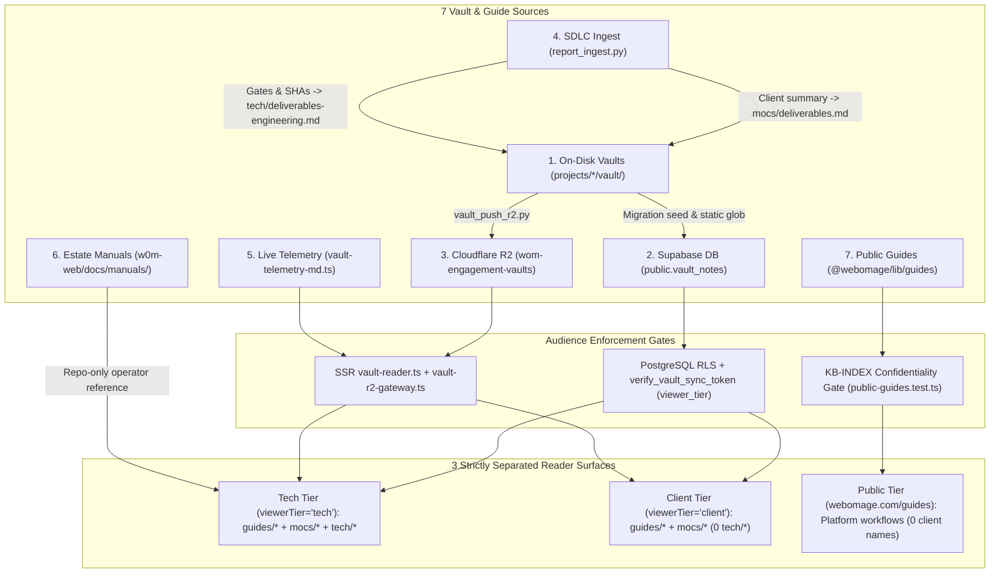

# T634 — Project Docs Vault 7-Source Audit & Three-Tier Separation (`tech` / `client` / `public`)

## 1. Executive Summary

Prior to `T634`, engagement vaults under `w0m-web/projects/*/vault/` and `public.vault_notes` blended operational user guides with internal engineering details (`.svelte`/`.jsx`/`.py`/`.ts` source file paths, Cloudflare KV hex namespace IDs, deprecated third-party `Remotely Save` instructions, and client staff email/name PII) inside unseparated `notes/ui-user-guide.md`, `notes/mobile-sync-user-guide.md`, and `mocs/architecture.md` notes, while `webomage.com` lacked a dedicated public guides & instructions hub.

`T634` audits all **7 sources** feeding project docs vaults and establishes end-to-end **three-tier audience separation (`tech` | `client` | `public`)** enforced across:
1. **Policy SSOT**: `project/policies/clients-policy.json` (`allowed_prefixes` + `guide_prefixes: ["guides/"]` + `tech_prefixes: ["tech/"]`).
2. **PostgreSQL RLS, Trigger Normalization & Append-Only Audit Log**: `w0m-api/supabase/migrations/20261104010000_t634_vault_audience_separation.sql` (`public.vault_notes.audience`, `trg_vault_notes_normalize_audience`, `public.vault_notes_audit_log` + `wom_trg_vault_notes_audit()`, audience-enforcing RLS, `viewer_tier` on `public.verify_vault_sync_token`, and reconciled seed corpus across all 5 vaults).
3. **Control Panel SSR & Cloudflare R2 Sync Gateway**: `vault-reader.ts`, `vault-r2-gateway.ts` (`WebDAV`, `delta_sync`, `pull_batch`, `push_batch`, and `?format=bootstrap-zip`), and `<KnowledgeHub>` (`viewerTier: "tech" | "client"`).
4. **Public Platform Guides Hub (`webomage.com/guides`)**: Prerendered `/guides` and `/guides/[slug]` backed by `@webomage/lib/guides` (`public-guides.ts`), strictly honoring `w0m-web/docs/backend/KB-INDEX.md` (*projects-private*: zero client names, domains, or engagement IDs).

---

## 2. Complete 7-Source Project Docs Vault Inventory

| # | Vault / Docs Source | Canonical Location & Generator | Storage / Runtime Backing | Pre-`T634` Gap | `T634` Audience Tier & Gate |
|---|---|---|---|---|---|
| **1** | **On-disk engagement vault corpora (5 vaults)** | `w0m-web/projects/{w0m,1945,artemio,servicios777,personaje0}/vault/` + `scripts/init_project_vault.py` | Bundled into CP SSR via static `import.meta.glob` (`BUNDLED_VAULT_MARKDOWN` in `vault-reader.ts`) | Mixed `.svelte`/`.jsx` paths, KV hex IDs, PII, and legacy `Remotely Save` instructions inside `notes/` & `mocs/` | Split into `guides/` (`client`/`public`, zero leaks) + `tech/` (`tech` staff-only); legacy `notes/*-user-guide.md` deleted |
| **2** | **Relational vault metadata & note overrides** | `public.project_vaults` + `public.vault_notes` (`w0m-api/supabase/migrations/*.sql`) | Supabase PostgreSQL with RLS + `vault-reader.ts` merge | Single-tier RLS (`Client users select own vault_notes`) returned every row in the vault to client seats; no note audit log | Added `audience` column + normalization trigger + append-only `vault_notes_audit_log` + RLS hiding `audience = 'tech'` from client seats |
| **3** | **Cloudflare R2 vault bucket & sync gateway** | `scripts/vault_push_r2.py` -> `r2://wom-engagement-vaults/engagements/<eg>/` -> `vault-r2-gateway.ts` (`/api/vault/r2/[engagement]`) | Cloudflare R2 (`VAULT_R2`) + `public.verify_vault_sync_token` (`w0m_vst_` tokens) | `vault_push_r2.py` had no `tech/` vs `guides/` policy awareness; `verify_vault_sync_token` returned boolean auth without audience tier | `vault_push_r2.py` syncs `guides/` + `tech/`; gateway & `verify_vault_sync_token` enforce `viewer_tier` (`403` on `tech/*` for `client` tokens, omitted from `PROPFIND`/`delta_sync`/`bootstrap-zip`) |
| **4** | **SDLC report ingestion pipeline** | `w0m-web/project/scripts/report_ingest.py` (`just project-report-ingest`) | Appends release entries to vault Markdown + `_msg/Progress/` + optional `vault_notes` upsert | Appended raw CLI verification gates, commit SHAs, and ticket internals directly to client-visible `mocs/deliverables.md` | Writes client-clean milestone summaries to `mocs/deliverables.md` (`audience: client`) and full engineering gates/commits to `tech/deliverables-engineering.md` (`audience: tech`) |
| **5** | **Live virtual telemetry note** | `w0m-web/apps/cp/src/lib/vault-telemetry-md.ts` -> `mocs/roadmap-and-progress.md` | Synthesized at request time from live milestones, contracts, and active hats (`T632`) | Already role-scoped (`viewerRole`), needed explicit alignment with `viewerTier` (`tech` vs `client`) | Continues serving role-scoped live progress alongside `viewerTier`-filtered vault notes on both client and staff CP routes |
| **6** | **Internal estate engineering manuals** | `w0m-web/docs/VAULT-INDEX.md`, `w0m-web/docs/manuals/`, `.agents/reports/` | Git-tracked internal operator/developer documentation (never in `clients-policy.json`) | Clear internal boundary, but delivery reports were occasionally copied into `projects/*/vault/sources/` | Strict separation preserved; `artemio` delivery report moved from `sources/` to `tech/reports/2026-09-14-artemio-t216-t222-delivery-report.md` (`audience: tech`) |
| **7** | **Public platform docs & LLM index** | `w0m-web/apps/web/src/pages/knowledge.astro` (`public.documents`) + new `/guides` (`@webomage/lib/guides`) | Prerendered Astro static HTML on `webomage.com` (`apps/web`) | Only `/knowledge` (capability cards + `llms.txt`) existed; no step-by-step public operational instructions | Added prerendered `/guides` & `/guides/[slug]` (`4` public guides) linked from `/knowledge`, verified zero client/project confidentiality leaks (`KB-INDEX.md`) |

---

## 3. Three-Tier Audience Architecture



---

## 4. Verification Matrix

| Check / Suite | Surface | Result |
|---|---|---|
| `python3 w0m-web/project/scripts/tests/test_t634_vault_audience_separation.py` | Ephemeral PostgreSQL cluster (`initdb`/`pg_ctl`) testing `T461` + `T553` + `T631` + `T634` RLS, normalization trigger, append-only `vault_notes_audit_log`, and `verify_vault_sync_token` `viewer_tier` | **PASS** (`Ran 4 tests in 7.593s — OK`) |
| `vitest run` (`public-guides`, `vault-reader`, `vault-security-probe`, `vault-parser`, `vault-r2-gateway`, `KnowledgeHub`) | Unit, integration, confidentiality, R2 WebDAV/delta-sync/bootstrap-zip, and Svelte 5 DOM component tests | **PASS** (`6` files, `50/50` tests passed) |
| `python3 scripts/tests/test_init_project_vault.py` & `test_vault_push_r2.py` | Vault scaffolder (`guides/` + `tech/`) and R2 sync manifest filter (`68` files across `5` vaults in `--dry-run`) | **PASS** (`5/5` tests passed) |
| `python3 w0m-web/project/scripts/tests/test_report_ingest.py` | Dual-target SDLC ingestion (`mocs/deliverables.md` client summary vs `tech/deliverables-engineering.md` staff log) | **PASS** (`6/6` tests passed) |
| `pnpm --filter web build` | Prerenders `/guides`, `/guides/website-audit-verification`, `/guides/client-portal-and-milestones`, `/guides/obsidian-vault-sync`, `/guides/shared-todos-and-wishlists`, and `/knowledge` | **PASS** (`Complete!`) |

---

## 5. Human Operator Rollout Commands (`docs/DEPLOY-CONFIRM.md`)

After landing on `beta`, apply the database migration, push reconciled vault files to Cloudflare R2, and deploy from the live workspace:

```bash
cd ~/Projects/'!self'/w0m
git merge --ff-only origin/beta
just db-migrate
just vault-push-r2
just deploy-all
```
