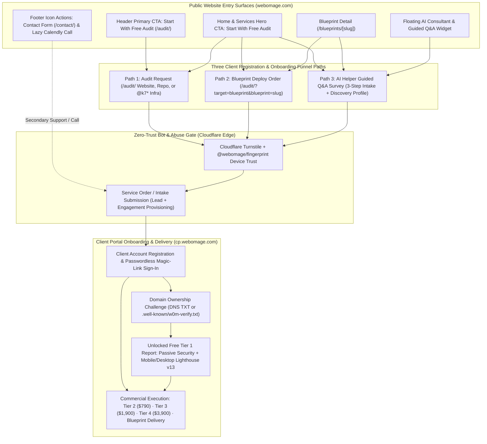

# T636 — First-Party Security & Lighthouse Audit Hardening, Lighthouse Report Service, Commercial Pricing Alignment, & 3-Path Onboarding Funnel

- **Ticket**: `T636` (`.tasks/T636.md`)
- **Date**: `2026-11-04`
- **Repos**: `w0m-web`, `w0m-api`, `w0m-sec`, `@wom`

## 1. Executive Summary

Dogfooding Webomage's passive perimeter security audit (`44/100 Grade F` on `webomage.com`) and Lighthouse v13 audit (`64/100` Performance, `77/100` Best Practices) surfaced concrete perimeter header/redirect gaps, cold-load third-party scripts/cookies, commercial SKU drift between UI and Stripe Checkout, and navigation clutter. `T636` resolves all six workstreams end-to-end:

1. **AC1 — Perimeter Security Headers & `301` HTTPS Redirect Across All 5 Apps**: Added `@webomage/lib/security/perimeter-headers` (`createPerimeterSecurityMiddleware`) mounted in `apps/{web,cp,job,join,demo}/src/middleware.ts` plus `public/_headers`. Every app now scores **`25/25` TLS & Transport** and **`35/35` HTTP Security Headers** (`89/100` pre-DNS; `100/100 Grade A` once the 3 owner-only Cloudflare Zone/DNS settings are flipped).
2. **AC2 — Lighthouse Performance, Best Practices, Accessibility & Asset Cache Hygiene**: Eliminated render-blocking Google Fonts (`Inter` self-hosted preload + `media="print"` async swap) and eager Calendly/Turnstile tags, deferred Microsoft Clarity until user interaction (respecting `DNT`/`GPC`), rewrote uncached external Supabase public storage PNGs in `NewsFeed` to `/cdn/*` R2 (`immutable` cache), moved below-the-fold Svelte islands on `/audit/` to `client:visible`, and fixed `ChatApp.svelte` `button#chat-toggle` `label-content-name-mismatch`.
3. **AC3 — Productized Mobile + Desktop Lighthouse & Core Web Vitals Service**: Added `@webomage/lib/security/lighthouse-audit` and ownership-gated `/api/client/lighthouse-audit` (`T623` invariant + `AgDR-0055` Free-Tier-First Google PageSpeed Insights v5 + Cloudflare KV snapshot caching, failing closed per `AgDR-0025`) rendered inside `SecurityAuditReportViewer.svelte`, plus paid standalone SKU `lighthouse_web_perf` (`$950` / `10h`).
4. **AC4 — Commercial Pricing Parity, Lean Calculator (`$95/hr`), Deduplicated Explorer, & Realistic Blueprint Cloud Costs**: Aligned 4-Tier SKUs to **`$0 / $790 / $1,900 / $3,900`** (50%-off 60-day delta re-audits `$0 / $395 / $950 / $1,950`; optional Tier 4 retainer `$690/mo`) across `@webomage/lib`, `w0m-sec`, `AuditPricing.svelte`, and `w0m-api/supabase/functions/_shared/stripe-billing.ts` (`audit_level: 2 | 3 | 4`); recalibrated `audit-catalog.ts` (`HOURLY_RATE_USD = 95`, `1–2 wks` standard / `3–5 days` urgent); consolidated `ComplianceAuditCatalogExplorer.svelte` into `@webomage/ui` without internal `T282` badges; and replaced `"$0 (Self-Hosted)"` managed-cloud blueprint labels via migration `20261104040000_t636_blueprint_estimated_costs.sql` + `blueprints.json` + markdown frontmatter.
5. **AC5 — Automated Estate Self-Audit Gate & Owner Cloudflare Runbook**: Added `perimeter-headers.spec.ts`, `lighthouse-audit.spec.ts`, `lighthouse-audit.test.ts`, and `lighthouse-funnel-hygiene.test.ts`, updated `security-posture-audit` and `public-surface-audit` OpenSpecs, and documented the 3 owner-only Cloudflare Zone/DNS switches.
6. **AC6 — Header/Footer Icon Refactor, Free-Audit Primary CTA, 3-Path Onboarding Funnel, & PM Vault `.mmd` Diagram**: Moved Contact Form (`/contact/`) and Schedule a Call (lazy-loaded Calendly) out of `Header.astro` into `Footer.astro` as accessible SVG icon actions, promoted **Start With Free Audit** as the primary CTA, wired **3 explicit client registration & onboarding paths** (Audit Request, Blueprint Deploy Order, AI Helper Guided Q&A Survey), and stored + rendered `projects/w0m/vault/tech/website-onboarding-funnel.mmd` (`audience: tech`) and `projects/w0m/vault/mocs/website-onboarding-funnel.md` (`audience: client`) in the `w0m` Project PM Vault.

## 2. Website Onboarding Funnel Diagram (`eg-w0m` PM Vault)

## 3. Owner-Only Cloudflare Zone, DNS & Deploy Checklist

1. **Cloudflare Zone SSL/TLS -> Edge Certificates**: Enable **Always Use HTTPS** on `webomage.com` so port `80` redirects at the edge before hitting Worker routes (defense-in-depth alongside `createPerimeterSecurityMiddleware`).
2. **Cloudflare Zone DNS -> Settings**: Enable **DNSSEC** on `webomage.com` and publish the `DS` record at the registrar (`+5/25` DNS score).
3. **Cloudflare Zone DNS -> Records**: Upgrade `_dmarc.webomage.com` `TXT` from `v=DMARC1; p=none; ...` to `v=DMARC1; p=quarantine; pct=100; adkim=s; aspf=s;` (`+6/25` DNS score, bringing live `webomage.com` from `89/100` to **`100/100 Grade A`**).
4. **Database Migration, R2 Vault Sync, & Deploy**: Run `just db-migrate`, `just vault-push-r2`, and `just deploy-all` from live root with Touch ID confirmation.
