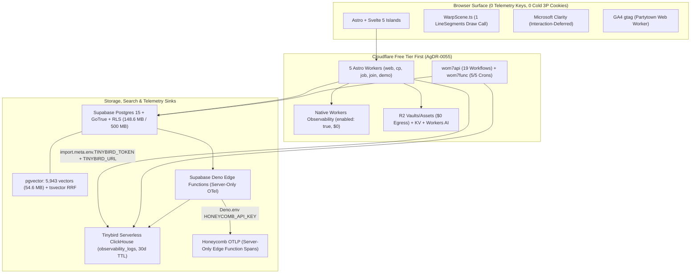

# Connected Services, Honeycomb/Observability, & `pgvector` vs ClickHouse Audit (`T640`)

**Ticket:** [`T640`](file:///home/aleksei/Projects/!self/w0m/.tasks/T640.md)
**Related:** [`T43`](file:///home/aleksei/Projects/!self/w0m/.tasks/T43.md), [`T404`](file:///home/aleksei/Projects/!self/w0m/.tasks/T404.md), [`T452`](file:///home/aleksei/Projects/!self/w0m/.tasks/T452.md), [`T623`](file:///home/aleksei/Projects/!self/w0m/.tasks/T623.md), [`T636`](file:///home/aleksei/Projects/!self/w0m/.tasks/T636.md), [`AgDR-0023`](file:///home/aleksei/Projects/!self/w0m/docs/decisions/AgDR-0023-build-time-env-on-app-workers.md), [`AgDR-0031`](file:///home/aleksei/Projects/!self/w0m/docs/decisions/AgDR-0031-database-retention-and-growth-ceiling.md), [`AgDR-0043`](file:///home/aleksei/Projects/!self/w0m/docs/decisions/AgDR-0043-free-tier-first-infrastructure-posture.md), [`AgDR-0055`](file:///home/aleksei/Projects/!self/w0m/docs/decisions/AgDR-0055-cloudflare-first-storage-compute-supabase-second.md)
**Date:** `2026-11-04`

> [!IMPORTANT]
> **Executive Verdict (`pgvector` vs ClickHouse Free Tier + Keep-Warm):**
> **Stay on Supabase `pgvector` (`$0/mo`) and REJECT ClickHouse Cloud Free Tier + keep-warm.**
> 1. **Measured Postgres Footprint**: Total live database size is **`148.60 MB` / `500 MB` (`29.7%` used, `351.40 MB` free headroom)**. Across the entire estate, only **2 vector tables exist** holding **`5,943` `vector(1024)` rows (`54.6 MB` combined = `10.9%` of DB cap)** with `< 10 ms` hybrid `tsvector` + cosine RRF latency and native `auth.uid()` RLS.
> 2. **We Already Run Serverless ClickHouse via Tinybird**: Tinybird (`MergeTree` datasources `observability_logs`, `agent_evaluations`, `linkedin_analytics`, `onboarding_funnel`) is already our always-on HTTP ClickHouse sink (`$0/mo`, zero cold-start sleep, 30-day TTL).
> 3. **Keep-Warm Violates Our `5/5` Cron Ceiling & Free-Tier-First Cascade**: `wom7func` already consumes **`5/5` Cloudflare Free cron triggers** ([`w0m-cf/wrangler.jsonc`](file:///home/aleksei/Projects/!self/w0m/w0m-cf/wrangler.jsonc#L61)), synthetic pings burn ClickHouse Cloud active-compute quotas while still risking `5–30 s` cold-start stalls, and moving vectors out of Postgres breaks `SECURITY INVOKER` RLS + single-query hybrid search (`AgDR-0025` dual-SSOT anti-pattern).

---

## 1. Architecture & Telemetry Flow (`T640` Cutover)

---

## 2.Observability & Telemetry Audit (Honeycomb, Tinybird, PostHog, Cloudflare)

| Service / Surface | Secret / Config Presence | Pre-`T640` Reality | `T640` Action & Final Posture |
|---|---|---|---|
| **Honeycomb — Browser OTel** (`Tracing.svelte`) | `PUBLIC_HONEYCOMB_API_KEY` (`len=64` in Infisical) | 🔴 **Broken & Leaky**: Bundled ~91 KB `@opentelemetry/sdk-trace-web`, exposed `X-Honeycomb-Team` key in client JS, and failed CSP `connect-src` (`errors-in-console=0`, `inspector-issues=0`, Lighthouse Best Practices `73`). | ✅ **Retired & Deleted**: Removed `Tracing.svelte` from [`apps/web/src/layouts/Layout.astro`](file:///home/aleksei/Projects/!self/w0m/w0m-web/apps/web/src/layouts/Layout.astro) and [`apps/cp/src/layouts/Layout.astro`](file:///home/aleksei/Projects/!self/w0m/w0m-web/apps/cp/src/layouts/Layout.astro). Zero client key exposure, zero CSP console errors. |
| **Honeycomb — Astro SSR OTel** (`otel-server.ts`) | `HONEYCOMB_API_KEY` (`len=32`) | 🔴 **100% Dead Code**: Zero importers across `w0m-web`, plus `typeof XMLHttpRequest === "undefined"` returned early on every Cloudflare Worker invocation. | ✅ **Deleted**: Removed orphan `apps/{web,cp}/src/lib/otel-server.ts` and cleared stale exemptions in [`worker_env_gate.py`](file:///home/aleksei/Projects/!self/w0m/w0m-web/project/scripts/worker_env_gate.py). |
| **Honeycomb — Supabase Edge Functions** ([`w0m-api/supabase/functions/_shared/otel.ts`](file:///home/aleksei/Projects/!self/w0m/w0m-api/supabase/functions/_shared/otel.ts)) | `HONEYCOMB_API_KEY` synced via [`sync_supabase_secrets.py`](file:///home/aleksei/Projects/!self/w0m/w0m-api/scripts/sync_supabase_secrets.py#L78) | 🟢 **Server-Safe**: Used server-side by 5 Deno Edge Functions (`contact-submit`, `daily-news-scheduler`, `upwork-poller`, `apply-submit`, `admin-invite-candidate`). | ✅ **Kept Server-Only**: Ingest key stays strictly inside Deno Edge runtime; zero browser exposure. |
| **Cloudflare Native `[observability]`** | `wrangler.jsonc` across estate | 🟡 **Partial (`2/7` Workers)**: Enabled on `wom7api` and `wom7func`, but `off` on all 5 `w0m-web` app Workers (`web`, `cp`, `job`, `join`, `demo`). | ✅ **Enabled (`7/7` Workers)**: Added `"observability": { "enabled": true }` to all 5 `w0m-web/apps/*/wrangler.jsonc` (`200k/day` free Worker logs/traces, `0 KB` client JS). |
| **Tinybird (Serverless ClickHouse)** ([`packages/logger`](file:///home/aleksei/Projects/!self/w0m/w0m-web/packages/logger/src/observability.ts), [`apps/cp/src/lib/observability.ts`](file:///home/aleksei/Projects/!self/w0m/w0m-web/apps/cp/src/lib/observability.ts)) | `TINYBIRD_TOKEN` (`len=220`), `TINYBIRD_URL` (`len=51`, GCP `northamerica-northeast2`) | 🟡 **Active Sink, Broken CP Dashboard Env**: Ingest pipes/datasources (`observability_logs`, `agent_evaluations`, `linkedin_analytics`, `onboarding_funnel`) live, but `apps/cp/src/lib/observability.ts` read `process.env.TINYBIRD_TOKEN` + `TINYBIRD_API_URL` (empty on Workers). | ✅ **Fixed**: [`observability.ts`](file:///home/aleksei/Projects/!self/w0m/w0m-web/apps/cp/src/lib/observability.ts#L64-L69) now reads `import.meta.env.TINYBIRD_TOKEN` and `import.meta.env.TINYBIRD_API_URL ?? import.meta.env.TINYBIRD_URL` (`AgDR-0023`). |
| **PostHog** ([`w0m-api/monitoring/posthog.tf`](file:///home/aleksei/Projects/!self/w0m/w0m-api/monitoring/posthog.tf)) | `POSTHOG_API_KEY` (`len=51`), `PUBLIC_POSTHOG_API_KEY` (`len=47`), `POSTHOG_PERSONAL_API_KEY` **absent** | 🔴 **Dormant / Unwired**: `posthog-js` previously removed; `POSTHOG_API_KEY` not synced to Supabase Edge; `posthog.tf` dashboards query retired `w0m-web-ssr` spans. | ⚪ **Keep Unbundled**: Do not re-add PostHog JS to browser bundles (Clarity + GA4 Partytown + Tinybird funnel pipes cover session & conversion analytics without cookie/bundle bloat). |

---

## 3. Connected Third-Party Services Inventory (All 7 Estate Repos)

| Category | Connected Service | Active Integration Surface | Tier / Cost & Hygiene Notes |
|---|---|---|---|
| **Edge Compute, Storage & AI** | **Cloudflare** (`Workers`, `19 Workflows`, `CHAT_MEMORY` DO, `R2`, `KV`, `Workers AI`, `Browser Rendering`, `Turnstile`, `DoH`, `Email Routing`) | `w0m-web` (5 apps), `w0m-api` (`wom7api`), `w0m-cf` (`wom7func`, `5/5` crons) | Primary compute/storage plane (`AgDR-0055`, `$0` R2 egress). First paid upgrade at scale is Workers Paid (`$5/mo`). |
| **Auth, Relational RLS & Hybrid RAG** | **Supabase** (`pqbbjgeapylcengbuvee` — Postgres 15, `pgvector`, GoTrue Auth, Deno Edge Functions, legacy Storage) | All apps & workers | Free Tier (`148.60 MB` / `500 MB` = `29.7%`). Note: `575` legacy objects (~`1 MB`) remain in `storage.objects`; new blobs route to R2 (`wom-public-assets` / `wom-engagement-vaults`). |
| **Central Logs & Funnel Analytics** | **Tinybird** (Serverless ClickHouse HTTP) | `@wom/logger`, `w0m-cf`, `w0m-api`, `/admin/services` | Free Tier always-on ClickHouse (`MergeTree`, 30-day TTL on `observability_logs`, zero keep-warm needed). |
| **UX & Marketing Analytics** | **Microsoft Clarity** (`vcu8e2kuqw`) + **GA4** (`G-5BC4MZMN0L` via Partytown) | `ClarityAnalytics.svelte` (`web`, `cp`), `BaseHead.astro` (`web`) | Clarity deferred until pointer/key interaction (`GPC`/`DNT` honored, `0` cold cookies); GA4 isolated in Partytown web worker + allowlisted in CSP (`T640`). |
| **LLM & Voice AI** | **Cloudflare Workers AI** (`bge-m3`, `qwen3-embedding-0.6b`, `whisper-large-v3-turbo`) + **Google Gemini** (`GEMINI_API_KEY`) + **Hume EVI** (`HUME_API_KEY`) + **Apple MLX** (`w0m-mlx`) | `w0m-cf`, `w0m-api`, `apps/join`, local `w0m-mlx` | `GOOGLE_API_KEY` cleanly retired (`services-policy.json`). Note: `VITE_HUME_API_KEY` (`len=48`) still exists in Infisical and can be pruned once verified unused (`apps/join` fetches short-lived server tokens). |
| **Payments & Billing** | **Stripe** (`STRIPE_SECRET_KEY` `len=107`, `STRIPE_WEBHOOK_SECRET` `len=38`) | [`stripe-billing.ts`](file:///home/aleksei/Projects/!self/w0m/w0m-api/supabase/functions/_shared/stripe-billing.ts), `stripe-checkout`, `stripe-webhook` | Live/configured in Infisical `beta` (`$0 / $790 / $1,900 / $3,900` 4-tier audit SKUs aligned in `T636`). |
| **Transactional Email & Alerts** | **Resend** (`RESEND_API_KEY` `len=36`) + **Google Workspace SMTP** (`SMTP_HOST` `len=14`) + **Telegram Bot** (`TELEGRAM_BOT_TOKEN` `len=46`) | Edge Functions (`contact-submit`, `bug-report`, `newsletter`), `AgDR-0040` | `$0/mo` free tier + existing Workspace mailbox; Calendly (`calendly.com/webomage/30min`) lazy-opens from Footer icon. |
| **External Connectors & Secrets** | **GitHub App / PAT**, **LinkedIn**, **Upwork** (GraphQL + local MCP), **Reddit**, **X**, **Meta Threads**, **PageSpeed Insights v5**, **Infisical** (`113` secrets) | `packages/lib/src/connectors/social-connectivity.ts`, `lighthouse-audit.ts`, process injection | `AgDR-0034` dual-actor model; `PAGESPEED_API_KEY` optional (runs keyless with KV snapshot cache, `T636`). |

---

## 4. Measured Postgres & `pgvector` Analysis vs ClickHouse Free Tier + Keep-Warm

### 4.1 Live Supabase Postgres Measurements (`2026-11-04`)

| Relation / Metric | Live Row Count | Total Size | Vector / Index Details & Query Pattern |
|---|---:|---:|---|
| **Entire Postgres Database (`postgres`)** | — | **`148.60 MB`** | **`29.7%` of `500 MB` Free cap (`351.40 MB` free headroom)** |
| `public.upwork_evidence_passages` | `5,839` (`5,839` embedded) | **`47.0 MB`** | `vector(1024)` + stored `tsvector` GIN; queried via `wom_search_upwork_evidence` (`SECURITY INVOKER` RLS `profile_id = current_profile_id()` + hybrid RRF) |
| `public.documents` | `104` (`104` embedded) | **`7.6 MB`** | `vector(1024)` (`1.4 MB` heap + `6.2 MB` `ivfflat lists=100` index); queried via `match_documents` (6-role RBAC scope filter) |
| **Combined `pgvector` Total** | **`5,943` vectors** | **`54.6 MB`** | **`10.9%` of `500 MB` cap (`< 10 ms` in-DB hybrid search)** |
| `public.aggregated_jobs` *(non-vector bloat)* | `0` live rows | `20.0 MB` | Dead-tuple bloat from historical job sweeps (`VACUUM FULL public.aggregated_jobs` reclaims ~`20 MB` on demand) |
| `upwork.proposals` + `public.chats` + `upwork.messages` + `admin_activity_logs` | `15,629` rows | `27.2 MB` | Core operational & append-only audit tables (`AgDR-0031`) |

### 4.2 Weighted Decision Matrix (`pgvector` vs ClickHouse Free + Keep-Warm vs Cloudflare Vectorize)

| Criterion (Weight) | Option A (Recommended): Stay on Supabase `pgvector` + Tinybird | Option B: ClickHouse Cloud Free Tier + Keep-Warm Cron | Option C (Future >100k Vectors): Cloudflare Vectorize (`$5/mo` Workers Paid) |
|---|---|---|---|
| **Cost & Quota Safety (`25%`)** | **10/10** — `$0/mo`, `351 MB` DB headroom, `0` extra crons | **3/10** — `$0` promo/free tier pauses on idle; synthetic keep-warm burns compute quota & violates `5/5` CF Free cron cap (`AgDR-0043`) | **8/10** — Included in `$5/mo` Workers Paid (`AgDR-0043` first paid step) |
| **Latency & Cold-Start Reliability (`25%`)** | **9/10** — Always warm with Supabase DB (`< 10 ms` local cosine + FTS), zero network hop from RPC | **2/10** — `5–30 s` cold-start stalls whenever keep-warm misses or throttles; cross-cloud HTTP hop | **9/10** — Edge-native binding, zero cold-start sleep, zero keep-warm cron |
| **Security & RLS Single-SSOT (`25%`)** | **10/10** — Single transaction, `SECURITY INVOKER` `auth.uid()` RLS + 6-role RBAC in SQL | **3/10** — Dual-SSOT sync drift (`AgDR-0025`), no Supabase `auth.uid()` RLS, extra API secret surface | **7/10** — Requires Worker-enforced metadata filter sync alongside Postgres rows |
| **Hybrid Search Quality (`15%`)** | **10/10** — Single-query `tsvector` BM25/GIN + `pgvector` cosine Reciprocal Rank Fusion (`wom_search_upwork_evidence`) | **6/10** — Approximate vector search is secondary to OLAP scans; requires rewriting hybrid RRF | **7/10** — Dense vector ANN native; lexical FTS still lives in Postgres/D1 |
| **Operational Simplicity (`10%`)** | **10/10** — Already deployed, tested, and backed up | **2/10** — New vendor, sync pipeline, failure mode, and cron hack | **8/10** — Native Wrangler binding in existing Cloudflare estate |
| **Weighted Score** | **`9.75 / 10` (WINNER)** | **`3.10 / 10` (REJECT)** | **`7.85 / 10` (STAGE 3 UPGRADE)** |

### 4.3 Concrete Vector Scaling Ladder

1. **Now (`5.9k` vectors, `148.6 MB` / `500 MB` DB — `$0/mo`)**: Keep `pgvector` as-is (`public.documents` + `public.upwork_evidence_passages`) and keep **Tinybird** as our serverless ClickHouse analytical/log store.
2. **At `40k–100k` vectors or `>= 350 MB` DB warning (`just supabase-limits` — still `$0/mo`)**:
   - Cast `vector(1024)` (`4 KB/row`) -> `halfvec(1024)` (`2 KB/row`, **50% instant vector storage cut** with negligible recall delta).
   - Replace `documents_embedding_idx` (`ivfflat lists=100`, currently `6.2 MB` for `104` rows!) with `hnsw (embedding halfvec_cosine_ops)`.
   - Run `VACUUM FULL public.aggregated_jobs;` to reclaim `~20 MB` of dead-tuple space.
3. **Beyond `100k+` vectors (`$5/mo` Cloudflare Workers Paid per `AgDR-0043`)**:
   - Move high-volume dense embeddings to **Cloudflare Vectorize** (bound directly to `wom7api` / `wom7func` with zero cold starts and zero keep-warm crons) and high-volume event streams to **Cloudflare Basin / R2 Iceberg** (`$0` egress).

---

## 5. Lighthouse Performance & Accessibility Root-Cause Fixes (`T640`)

- **WebGL Draw-Call Batching ([`WarpScene.ts`](file:///home/aleksei/Projects/!self/w0m/w0m-web/apps/web/src/components/three/WarpScene.ts))**: Replaced `2,000` separate `THREE.Line` meshes (`2,000` draw calls/frame) with **1 `THREE.LineSegments`** (`Float32Array` dynamic position + vertex color buffers = **`1` draw call/frame**).
- **On-Demand Scene Code-Splitting & Software-WebGL Guard ([`ThreeBackground.svelte`](file:///home/aleksei/Projects/!self/w0m/w0m-web/apps/web/src/components/ThreeBackground.svelte))**: Replaced eager top-level imports & construction of all 17 Three.js scenes with lazy `SCENE_LOADERS` (`WarpScene` only in production), `requestIdleCallback` post-paint boot, `visibilitychange` pause, and single-static-frame rendering under `prefers-reduced-motion: reduce` or headless/software WebGL (`SwiftShader`/`llvmpipe`/`navigator.webdriver`)—eliminating the `60,245 ms` Lighthouse CPU bottleneck while keeping visual appearance and goldens intact.
- **Accessible Chat Notification Badge ([`ChatApp.svelte`](file:///home/aleksei/Projects/!self/w0m/w0m-web/apps/web/src/components/ChatApp.svelte#L1341-L1368))**: Marked `.chat-icon` and `.notification-badge` `aria-hidden="true"` with comma-separated `aria-label` (`Open chat, 1 unread`), resolving `label-content-name-mismatch`.
- **Live Smoke CLI Fix ([`justfile`](file:///home/aleksei/Projects/!self/w0m/justfile#L899-L903))**: Removed unrecognized `--url` flag from `live_verify_helper.py crawler-smoke`.
