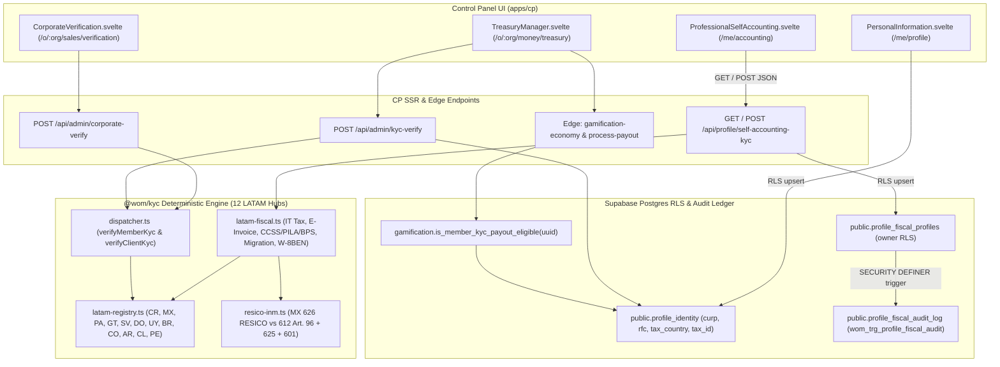

# T644 — Costa Rica, Mexico (626 RESICO & 612 Profesional) & 12-Country LATAM IT KYC & Fiscal Engine

- **Ticket:** `T644` (`.tasks/T644.md`)
- **OpenSpec:** `w0m-web/openspec/specs/w0m-kyc/spec.md`
- **Migration:** `w0m-api/supabase/migrations/20261105000000_t644_latam_kyc_and_fiscal_profiles.sql`
- **Date:** `2026-11-04`

---

## 1. Executive Summary

`T644` expands Webomage's `@wom/kyc` package, Supabase identity/fiscal schema, Edge payout gates, and Control Panel (`/me/accounting`, `/me/profile`, `/api/admin/kyc-verify`, `/api/admin/corporate-verify`, and `TreasuryManager`) from an 8-country ID validator with Mexico-only RESICO self-accounting into a **12-country LATAM IT-Hub KYC, Fiscal/Tax, E-Invoicing, Social Security, Work-Authorization & Cross-Border `W-8BEN`/`W-8BEN-E` Engine** with **Costa Rica (`CR`)** first-class and a full **Mexico (`MX`) `626 RESICO` vs `612 Actividad Empresarial y Profesional (Honorarios TI)`** progressive engine.

Key outcomes:
1. **12 Supported LATAM IT Jurisdictions:** `CR` (Costa Rica), `MX` (Mexico), `PA` (Panama), `GT` (Guatemala), `SV` (El Salvador), `DO` (Dominican Republic), `UY` (Uruguay), `BR` (Brazil), `CO` (Colombia), `AR` (Argentina), `CL` (Chile), and `PE` (Peru).
2. **Costa Rica First-Class Statutory Coverage (`CR`):**
   - **Tax & Civil Identity:** Cédula Física TSE (`9` digits), Cédula Jurídica (`3-101-XXXXXX` / `3-102-XXXXXX`), DGME `DIMEX` (`11`/`12` digits), Hacienda `NITE` (`3-120-XXXXXX`), and **22-character BCCR `SINPE IBAN`** (`ISO 13616 MOD 97-10` check digits + Costa Rican bank code resolution).
   - **IT Tax Regimes:** `Ley 7092` Persona Física progressive annual `Utilidades` (`0%`–`25%` with optional `25%` presumed deduction), `Ley 7092` PYME Jurídica (`5%`–`20%`), `PROCOMER Zona Franca Servicios TI` (`Ley 7210` `0%` ISR), and `DGME Estancia Nómada Digital` (`Ley 10008` `0%` ISR / `0%` CCSS on foreign-paid remote work, with hard statutory blocker on domestic Costa Rican invoicing).
   - **E-Invoicing & Social Security:** Hacienda XML `v4.3`/`v4.4` (`09_FacturaElectronicaExportacion` at `0%` IVA under `Ley 9635 Art. 8` vs `13%` domestic, `CABYS 8314100000000`, `CIIU 6201`) and `CCSS Trabajador Independiente` (`SEM + IVM`).
3. **Mexico (`MX`) Full Professional Tax Regime (`612`) Alongside `626` RESICO, `625` & `601`:**
   - **Official 11-Tier SAT `Art. 96 LISR` (`Anexo 8 RMF`) Monthly Tariff (`SAT_612_ART96_MONTHLY_BRACKETS`):** Exact `Cuota Fija + ((Utilidad Neta − Límite Inferior) × % Excedente)` calculation (`1.92%` up to `35.00%`) after `Art. 103 LISR` operating deductions (cloud, hardware, subcontractors), `10%` ISR + `10.67%` IVA Persona Moral retentions (`Art. 106 LISR` / `Art. 1-A LIVA`), and `0%` IVA on foreign IT exports (`Art. 29 Fracc. IV LIVA`).
   - **Live `626` vs `612` Comparison & Statutory Disqualifiers (`compareMexicoResicoVsProfesional612`):** Side-by-side comparison card and quick regime switcher in `ProfessionalSelfAccounting.svelte`, plus enforcement of `Art. 113-E Octavo Párrafo LISR` (shareholders / S.A.S. partners / startup RSU & equity holders or `>$3.5M MXN/yr` must use `612` rather than `626`).
4. **Mexico-Only Contractor Block Removed:** `public.profile_identity`, `gamification.is_member_kyc_payout_eligible()`, `gamification.compliance_profiles_identity_guard()`, `gamification-economy`, `process-payout`, `/api/admin/kyc-verify`, and `TreasuryManager.svelte` now accept verified non-Mexican LATAM contractors via `tax_country` + `tax_id` alongside Mexican `curp` / `rfc`.
5. **Audited Durable Fiscal Storage (`T613` / `T614`):** `public.profile_fiscal_profiles` (owner-only RLS) is paired with append-only `public.profile_fiscal_audit_log` and `SECURITY DEFINER` trigger `public.wom_trg_profile_fiscal_audit()` (redacting bank account numbers to last-4).

---

## 2. End-to-End Architecture Diagram



---

## 3. Mexico (`MX`) Régimen `626` RESICO vs Régimen `612` Actividad Profesional (Honorarios TI)

| Statutory Dimension | `626` — RESICO (`Art. 113-E LISR`) | `612` — Actividad Empresarial y Profesional (`Art. 100–110 & Art. 96 LISR`) |
|---|---|---|
| **Annual Revenue Cap** | Hard cap **`$3,500,000 MXN/yr`** (`~$291,666.67 MXN/mo`) | **Unlimited** (`Sin tope de ingresos`) |
| **Taxable Base (`ISR`)** | Gross collected revenue (`Ingreso bruto cobrado`) | Net profit (`Ingresos cobrados − Deducciones autorizadas Art. 103`) |
| **Monthly `ISR` Calculation** | Flat `1.00%`–`2.50%` bracket rate on gross | **11-Bracket Progressive Tariff (`Art. 96 LISR`)**: `Cuota Fija + % Excedente` (`1.92%`–`35.00%`) |
| **Operating Expense Deductions** | **$0 for `ISR`** (creditable only for `IVA`) | **100% deductible (`Art. 103 LISR`)**: cloud/GPU infra, laptops, software, subcontractors, office |
| **Annual Personal Deductions (`Art. 151`)** | **Not allowed** | **Allowed**: Gastos Médicos Mayores (`GMM`), Plan Personal de Retiro (`PPR`), hipoteca, colegiaturas |
| **Startup Equity / RSUs / Corporate Shares** | **Prohibited** (`Art. 113-E párr. 8 LISR` disqualifies shareholders) | **Fully compatible** with holding S.A.S./S.A. shares, US C-Corp stock, or RSUs |
| **Domestic Persona Moral Withholding** | `1.25%` `ISR` (`Art. 113-J`) + `10.67%` `IVA` (`2/3`) | `10.00%` `ISR` (`Art. 106`) + `10.67%` `IVA` (`Art. 1-A LIVA`) |
| **Foreign IT Export `IVA` (`Art. 29 Fracc. IV`)** | **`0%` Tasa Cero** (`Exportación 02`, `UsoCFDI S01`) | **`0%` Tasa Cero** (`Exportación 02`, `UsoCFDI S01`) |

Also modeled in `@wom/kyc`: **`625`** (*Plataformas Tecnológicas* — `2.1%` `Art. 113-A`), **`601`** (*Persona Moral S.A.S. / S.A. de C.V.* — `30%` `Art. 9 LISR` + `W-8BEN-E`), and **`605`** (*Asimilados a Salarios* — `Art. 94/96`).

---

## 4. 12-Country LATAM IT Statutory Matrix

| ISO | Country | Tax Authority & E-Invoice | Corporate & Personal IDs (Check Digit) | Key IT Export Tax Regime & Export VAT | US Treaty / `W-8BEN` Rule |
|---|---|---|---|---|---|
| `CR` | **Costa Rica** | Hacienda (`ATV` / `TRIBU-CR`) · XML `v4.3`/`v4.4` (`CABYS 8314100000000`) | Cédula Jurídica `3-101-XXXXXX`, Física `9d`, `DIMEX` `11-12d`, `NITE` `3-120-XXXXXX`, `SINPE IBAN` `22c` (`MOD 97`) | `Ley 7092` Utilidades (`0%–25%`), PYME (`5%–20%`), `PROCOMER Zona Franca` (`0%`), `Ley 10008` Nomad (`0%` foreign) · `0%` IVA (`Ley 9635 Art. 8`) | `IRC §862(a)(3)` `0%` US WHT w/ Foreign TIN |
| `MX` | **Mexico** | `SAT` · `CFDI 4.0` (`G03` / `S01`, Export `02`) | `RFC` (`12`/`13c`), `CURP` (`18c` Mod 10), `SPEI CLABE` (`18d`) | `626` RESICO (`1.0%–2.5%` s/ Bruto), **`612` Profesional (`Art. 96` 11-tramo s/ Utilidad)**, `625` (`2.1%`), `601` (`30%`) · `0%` IVA (`Art. 29 Fracc. IV LIVA`) | **US–Mexico Tax Treaty** (`Art. 7` / `Art. 14`) |
| `PA` | **Panama** | `DGI` (`e-Tax 2.0`) · `SFEP` | `RUC + DV` (`2d`), Cédula / `E-` | Territorial Principle (`Art. 694` Fiscal Code — `0%` foreign-source ISR), `SEM` / `Ciudad del Saber` · `0%` ITBMS | `IRC §862(a)(3)` `0%` US WHT |
| `GT` | **Guatemala** | `SAT` · `FEL` | `NIT` (`Mod 11 0-9/K`), `RENAP CUI` (`13d` Mod 11) | `Pequeño Contribuyente FEL` (`5%`), `Opcional Simplificado` (`5%`/`7%`), `Decreto 29-89` (`0%` ISR) · `0%` IVA | `IRC §862(a)(3)` `0%` US WHT |
| `SV` | **El Salvador** | `Ministerio de Hacienda` · `DTE` | `NIT` (`14d` Mod 11/10), `RNPN DUI` (`9d` Mod 10) | `Ley de Fomento a la Innovación y Manufactura Tecnológica` (`Decreto 699` — `0%` ISR 15 yrs) · `0%` IVA | `IRC §862(a)(3)` `0%` US WHT |
| `DO` | **Dominican Republic** | `DGII` · `e-CF` (`B16` Export) | `RNC` (`9d` Mod 11), `JCE Cédula` (`11d` Luhn Mod 10) | `RST Ingresos` (`~7%`), `CNZFE Zona Franca Ley 8-90` (`0%` ISR) · `0%` ITBIS | `IRC §862(a)(3)` `0%` US WHT |
| `UY` | **Uruguay** | `DGI` · `CFE` (`e-Factura Exportación`) | `RUT` (`12d` Mod 11), `DNIC CI` (`7-8d` Mod 10) | **100% IRPF / IRAE Exemption on Software Dev & IT Exports** (`Art. 27 lit. K TO/96`, `Ley 19.637` S.A.S.) · `0%` IVA | `IRC §862(a)(3)` `0%` US WHT |
| `BR` | **Brazil** | `Receita Federal` · `NFS-e Nacional` | `CNPJ` (`14d` Mod 11), `CPF` (`11d` Mod 11) | `Simples Nacional Anexo III` via `Fator R >= 28%` (`~3.05%` export eff., `LC 116/2003` ISS/PIS/COFINS exempt) | `IRC §862(a)(3)` `0%` US WHT |
| `CO` | **Colombia** | `DIAN` · `Factura Electrónica` | `NIT + DV` (Prime Mod 11), `CC` / `CE` / `PPT` | `Régimen Simple RST` (`7.3%`–`14.5%`) + `PILA` (`40%` IBC) · `0%` IVA (`Art. 481 lit. c ET`) | `IRC §862(a)(3)` `0%` US WHT |
| `AR` | **Argentina** | `ARCA` (ex-`AFIP`) · `Factura E` | `CUIT` / `CUIL` (`11d` Mod 11), `CBU` (`22d`) | `Monotributo Tech` + `BCRA Com. A 7518` (`$36,000 USD/yr` direct USD retention without FX pesification) · `0%` IVA | `IRC §862(a)(3)` `0%` US WHT |
| `CL` | **Chile** | `SII` · `BHE` / `Factura Exportación DTE 110` | `RUT` / `RUN` (`Mod 11 0-9/K`) | `Boleta de Honorarios 2da Categoría` (`14.5%` retention) or `SpA Pro-Pyme 14 D N°3` (`12.5%`) · `0%` IVA | **US–Chile Tax Treaty in Force** (`Art. 7` / `Art. 14`) |
| `PE` | **Peru** | `SUNAT` · `RHE` / `SEE` | `RUC` (`11d` Mod 11), `DNI` (`8d`), `CE` (`9d`), `CCI` (`20d`) | `Renta de 4ta Categoría RHE` (`8%` w/ `20%` deduction + `7 UIT` floor) or `MYPE Tributario` (`10%`) · `0%` IGV (`Ley 30641`) | `IRC §862(a)(3)` `0%` US WHT |

---

## 5. Operator Deployment Commands (Touch ID Required)

After pulling `origin/beta`, apply the database migration and deploy from the live workspace:

```bash
cd ~/Projects/'!self'/w0m
just db-migrate
just deploy-all
```
