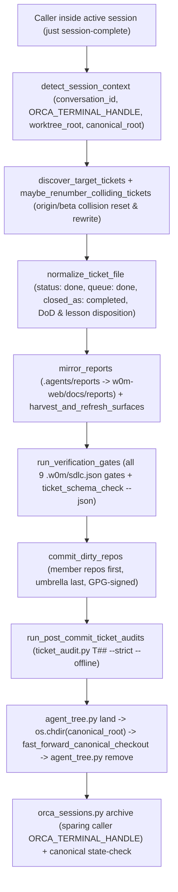

# T645 — In-Session `just session-complete` SDLC Wrap-Up CLI (`scripts/session_complete.py`)

- **Ticket:** `T645` (also normalizes post-deploy wrap-up surfaces for `T627`, `T635`, `T638`, `T639`)
- **Date:** `2026-11-04`
- **Author:** `agy:t645-session-complete`
- **Repositories:** `@wom` (`scripts/session_complete.py`, `scripts/tests/test_session_complete.py`, `justfile`, `.w0m/sdlc.json`, `AGENTS.md`, `.agents/rules/sdlc.md`, `LESSONS.md`), `w0m-web` (`project/test-suites.json`, `docs/reports/`)

## 1. Context & Problem

`.w0m/sdlc.json -> session_wrapup` (`T613`) and `AGENTS.md` mandate a 6-step wrap-up and 9 verification gates before ending any agent session or handing off human-gated deploys (`just deploy-all`), yet `justfile` previously exposed no single `session-complete` entrypoint. Running ~12 manual commands across nested repos from inside an active Orca session repeatedly caused four failure modes:

1. **Tracking & report mirror drift:** Tickets closed with `status: done` retained `queue: now` or `queue: backlog-platform` (`T635`, `T638`, `T639`), and `.agents/reports/*.md` deliverables were left unmirrored in `w0m-web/docs/reports/`.
2. **Parallel session `T##` ID collisions:** Concurrent agent worktrees branching from the same `origin/beta` (`T639`) allocated identical next ticket numbers (`T645`), failing at `agent-tree-land` with `ticket_collision` and `add/add` rebase conflicts.
3. **Self-inflicted terminal/cwd hazards when called in-session:** Removing `~/.w0m/work/<set>` while `cwd` remained inside the deleted directory broke post-land subprocesses (`getcwd`), and naive tab cleanup risked sending `SIGHUP` to the caller's own active `ORCA_TERMINAL_HANDLE`.
4. **Pre-commit vs post-commit audit ordering:** Single-ticket `ticket_audit.py <T##> --strict --offline` checks `check_git_working_tree` and fails if invoked before committing `.tasks/T##.md`.

## 2. Architecture & Execution Pipeline

## 3. Key Implementation Details

1. **Safe In-Session Caller Detection (`detect_session_context`)**:
   - Walks `ps -o pid=,ppid=,args=` ancestry to detect `--conversation <uuid>` and reads `ORCA_TERMINAL_HANDLE` / `ORCA_TAB_ID` / `ORCA_AGENT_PANE`.
   - Resolves `canonical_root` from any worktree via `git rev-parse --path-format=absolute --git-common-dir` (`Path(common_dir).parent`), supporting execution either directly inside `~/.w0m/work/<set>/w0m` or from `@wom` root with `--set <set>`.
2. **Automatic Branch Ticket Collision Renumbering (`maybe_renumber_colliding_tickets`)**:
   - Fetches `origin/beta` and compares branch-added `.tasks/T*.md` IDs against `origin/beta`. When a sibling session has landed the same `T##` first, soft-resets unpushed branch commits to `merge-base`, allocates `max(origin_ids) + 1`, and rewrites the ticket file, branch reports, and branch `LESSONS.md` suffix so `git rebase origin/beta` lands with zero `add/add` conflict.
3. **Fail-Closed Normalization & Gate Enforcement**:
   - Refuses tickets missing `## Definition of Done`, unchecked `- [ ] ACn` items (unless `--complete-acs` is explicitly supplied), or missing lesson disposition in `## Status notes` (unless `--lesson-note` or `--no-lessons` is passed).
   - Dynamically reads and executes all 9 `.w0m/sdlc.json -> session_wrapup.verification_gates` (`shell=False`) plus `ticket_schema_check.py --enforce` pre-commit and `ticket_audit.py <T##> --strict --offline` post-commit.
4. **Live Checkout Sync & Terminal-Safe Archive**:
   - Commits member repos (`w0m-web`) first and umbrella (`.`) last, lands via `agent_tree.py land --set <set>`, calls `os.chdir(canonical_root)` *before* `agent_tree.py remove <set>`, fast-forwards non-overlapping `beta` checkouts in `canonical_root`, archives the active conversation transcript (`close_terminals=False`), and supports `--close-completed-others` (`--exclude-handle <caller>`) plus optional `--close-self-when-settled` (`systemd-run --user --collect`).

## 4. Verification Evidence

- `just session-complete-test` (`scripts/tests/test_session_complete.py`): `8/8` unit & throwaway-git integration tests passing (`3.7s`).
- `ruff check scripts/session_complete.py scripts/tests/test_session_complete.py`: `0` errors.
- `just suites-drift`: `361` declared suites, `0` undeclared, `0` unresolved.
- `python3 scripts/stale_path_check.py` & `python3 scripts/justfile_calls_check.py`: `1,383` references verified, `0` stale/unresolved.
- Live dogfood execution of `just session-complete T645 T639 T638 T635 T627` from inside active session `c2262ec5-a16b-40d2-8638-3f0995a1902b`.

## 5. Companion `webomage/orca` Overlay Fixes & Live RPC Normalization

1. **Live RPC Normalization (`repo.update -> issueSourcePreference: "auto"`)**:
   - Switched `w0m`, `bridgeroad`, `simroute`, and `pandatransfer` on the live `HP` Orca Desktop daemon from `issueSourcePreference: "origin"` to `"auto"` and verified via `github.listWorkItems` that `w0m` resolves `sources.issues = webomage/wom7board` + `sources.prs = webomage/w0m` immediately on the connected iPhone.
2. **Local `webomage/orca` Overlay Commits (`0` GitHub Actions workflow runs triggered)**:
   - `feat/nested-subfolder-git-and-sdlc-repo`: Auto-discovers `.w0m/sdlc.json -> vcs.repo` and `-w0m` nested git remotes even under `issueSourcePreference === "origin"`, projects `issueRepository` into `repo.list` and `github.repoSlug` / `findRepoForGitHubProjectRepository` for GitHub Project v2 boards, and adds manual `owner/repo` mapping (`repo.update` + `.orca/project.json` + Mobile `Repositories` drawer, promoting mapped `folder` workspaces).
   - `fix/mobile-terminal-theme-enforcement`: Enforces `useMobileColorScheme()` (`light` / `dark`) on `TerminalWebView` and `terminal-webview-frame-styles.ts` even when the desktop host sends an opposite-polarity palette (`20/20` Vitest passing).
   - `feat/mobile-four-side-edge-arrows`: Sets 4-side edge arrow keys (`pills`, `strips`, `orbs`, `gamepad` D-pad/action/hub, and quick-switcher dock) to `opacity: 0.5` at rest and `0.92`/`0.95` on press (`9/9` Vitest passing).
