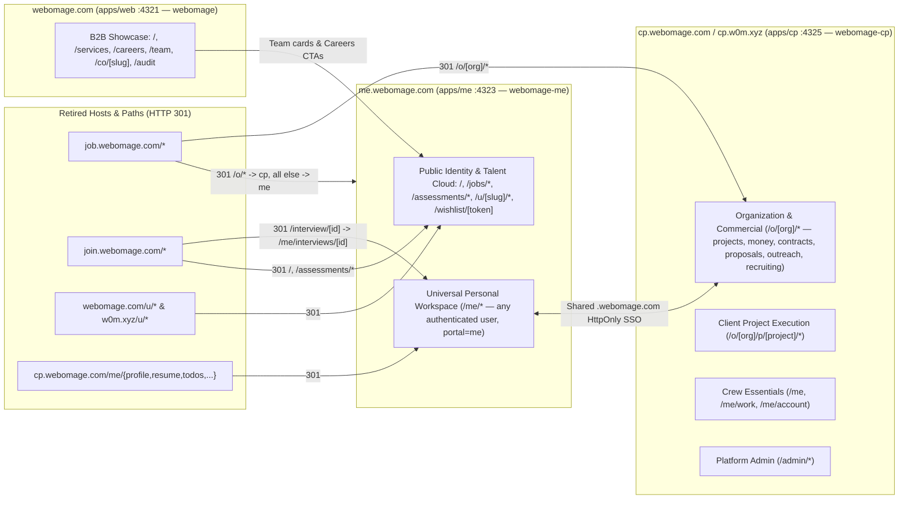

# T646 — `me.webomage.com` Personal & Talent Cloud Unification and `cp.webomage.com` Org/Crew Realignment (`AgDR-0056`)

> [!IMPORTANT]
> **Single-Responsibility Portal Cutover (`AgDR-0056`, superseding clauses 1–2 of `AgDR-0033` with zero backward-compatibility shims per `AgDR-0025`):**
> - **`me.webomage.com` (`w0m-web/apps/me`, Cloudflare Worker `webomage-me`, port `:4323`)**: Universal Personal & Talent Cloud portal for **any registered user** (`/me/*`), public personal profiles (`/u/[slug]`, `/u/[slug]/cv`, `/u/[slug]/wishlist`, `/wishlist/[token]`), public job board (`/`, `/jobs`, `/jobs/[id]`), skill assessments (`/assessments`, `/assessments/[id]`), and candidate AI interviews (`/me/interviews/[id]`).
> - **`cp.webomage.com` / `cp.w0m.xyz` (`w0m-web/apps/cp`, Worker `webomage-cp`, port `:4325`)**: Organization (`/o/[org]/*` including repatriated contracts, proposals, outreach, and recruiting), Client Projects (`/o/[org]/p/[project]/*`), Crew Delivery (`/me`, `/me/work`, `/me/account`), and Platform Admin (`/admin/*`).
> - **`webomage.com` (`w0m-web/apps/web`, Worker `webomage`, port `:4321`)**: Corporate B2B showcase, `/audit`, `/co/[slug]`, `/careers` (`200 OK`), and `/team` (cards linking directly to `https://me.webomage.com/u/<slug>`), serving HTTP `301` redirects on `/u/*` and `/wishlist/*`.

## 1. Portal Boundary Topology (`AgDR-0056`)

## 2. Estate Cutover Summary (6 Repositories + Root `@wom`)

| Surface | Changes Delivered |
|---|---|
| **`w0m-web`** | Created `apps/me` (`:4323`, `webomage-me`) with 31 pages and 51 `/api/*` endpoints; deleted `apps/job` and `apps/join`; repatriated 11 `/o/[org]/*` commercial/recruiting pages to `apps/cp`; trimmed `apps/cp` `/me` to `/me`, `/me/work`, `/me/account` with `301` redirects for moved `/me/*` paths; replaced `apps/web` `/u/[slug]*` and `/wishlist/[token]` with `301` redirects to `https://me.webomage.com`; updated `@webomage/authz`, `@webomage/lib`, 20 OpenSpec specs, E2E specs, manuals, and 4 `en-desktop-me_*.png` golden PNGs. |
| **`w0m-api`** | Added migration `20261105010000_t646_candidate_interview_session_rpc.sql` (`public.wom_my_interview_session(uuid)`, `public.wom_my_job_applications()`, `site_settings.external_links`, and seeded `vault_notes` URL cutover); updated Cloudflare Terraform (`webomage-me` domain/KV/redirects + proxied `AAAA 100::` redirect records for `job.`/`join.`), `supabase-settings` redirect allowlist, CORS (`me.webomage.com`, `:4323`), `admin-invite-candidate`, `outreach-clip-ingest`, `seed-demo`, and `dagger/pipeline.ts` (`5` deployable apps). |
| **`w0m-cf`** | Replaced `join` + `job` health probes with `me` (`https://me.webomage.com/api/health`) in `src/lib/health-watchdog.ts` and `test/health-watchdog.spec.ts`. |
| **`w0m-ext`** | Cut over browser clipper and profile sync defaults (`DEFAULT_JOB_PORTAL_ORIGIN` -> `DEFAULT_ME_PORTAL_ORIGIN = "https://me.webomage.com"`) in `background.ts`, `indeedProfileSpecs.ts`, and `popup.html`. |
| **`w0m-sec`** | Updated RFC 9116 `security.txt` targets and bug-bounty disclosure scope (`me.webomage.com` replacing `job.`/`join.`) across `SECURITY.md`, `check_security_txt.py`, and pytest suites. |
| **`w0m-skills`** | Updated `skills/webomage-design/SKILL.md` (`[data-app="me"]`), stamped version, and synced lockfiles across `@wom`, `w0m-web`, and `w0m-api`. |
| **`@wom` root** | Updated `justfile`, `just/estate.just`, `Caddyfile.local`, `.w0m/sdlc.json`, `confirm-policy.json`, `deps-policy.json`, `release-apps.json`, `health_check.py`, `host_service_probe.py`, `hosts_check.py`, `secret_flow_check.py`, `sync_manifest_versions.py`, `w0m_audit.py`, and root pytest suites. |

## 3. Security & Single-Responsibility Hardening

1. **Eliminated `adminClient()` / `systemprompt` Exposure in Candidate Interviews (`T646` AC3):** Retired `apps/join/src/pages/interview/[id].astro` and replaced direct service-role queries with `SECURITY DEFINER` RPCs `public.wom_my_interview_session(uuid)` and `public.wom_my_job_applications()` bound strictly to `auth.uid()` (never returning `job_postings.systemprompt` or `interview_evaluations`).
2. **Portal Capability Boundary (`@webomage/authz`):** Added `portal: "me"` (`me_personal_portal_policy`) admitting any authenticated user to `me.webomage.com/me/*` while keeping `cp.webomage.com` gated by `platform_member`, client org membership, or platform admin role.
3. **Zero Silent Fallbacks (`AgDR-0025`):** Deleted `apps/job` and `apps/join` outright, replaced retired routes with explicit `301` redirects preserving query strings, and updated seeded Obsidian `vault_notes` links in SQL migration `20261105010000_t646_candidate_interview_session_rpc.sql`.
