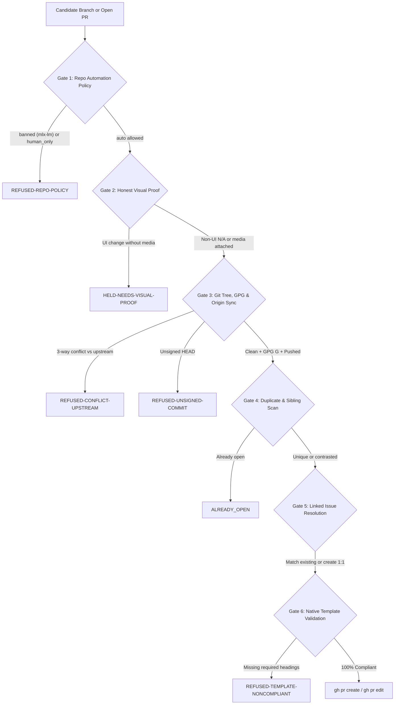

# External Upstream PRs — Target Contribution Rules Audit, Remediation & Full Auto-Mode Submission (`T655` / `T657` / `AgDR-0058`)

**Date:** 2026-11-06  
**Tickets:** `T655`, `T657`  
**Decision Record:** [`AgDR-0058`](../../docs/decisions/AgDR-0058-gate-enforced-auto-mode-upstream-pr-governance.md) (amends `T435` blanket external-PR block while preserving Touch ID gates on `just deploy*`, `just db-migrate`, secret sync, and `AgDR-0047` security disclosures)  
**Engine:** [`scripts/w0m_prs.py`](../../scripts/w0m_prs.py) (`compliance` & `auto` subcommands; `just pr-compliance` & `just pr-auto`)

---

## 1. Executive Summary

- **Governance Cutover (`AgDR-0058`):** Replaced `T435`'s blanket human Touch ID gate on upstream PR creation/closure with a deterministic **6-gate target-compliance engine** in `scripts/w0m_prs.py` (`95/95` `test_w0m_prs.py` + `91/91` `test_confirm_step.py` passing).
- **Open External PR Remediation & Rebase Sweep (`23` pre-existing PRs):**
  - Remediated **`15` non-compliant PR descriptions** (`14` `stablyai/orca` PRs upgraded to the mandatory 11-section `.github/pull_request_template.md` with `Fixes #<issue>` linkage across `7` reused upstream issues + `7` newly created 1:1 issues `#38849`–`#38855`; plus `jundot/omlx#3743` upgraded to `omlx`'s 3-section template).
  - Rebased and remediated **`headroomlabs-ai/headroom#4597`** (`5c45c8f9`, `MERGEABLE`) onto `upstream/main` (`c01cf07d`), resolving maintainer `JerrettDavis`'s `P1` credential-isolation finding so `ProxyConfig.anthropic_extra_headers` (`x-api-key`, `Authorization`) never leak into or override `HEADROOM_OMLX_API_KEY` on local `oMLX` routes (`115/115` `pytest` + GitHub Actions CI green).
  - Rebased and adapted **`oxiglade/mlx-rs#442`** (`a2951b08`, `MERGEABLE`) onto `upstream/main` (`adf439bf` / `#443`–`#451`), migrating Gemma 4 to `mlx-lm/src/arch/{activation,attention}.rs` (`GeGlu`, `AttentionMasks`), `Result`-returning `cache.info(index)?`, and two-phase `step.evaluate(&[&logits])?.commit()` (`xtask verify-oracle-boundary` `12/12` `pass`).
  - Rebased **`stablyai/orca#37034`** (`471b47030c`), **`stablyai/orca#37510`** (`b7e67d00834`, extracting `local-issue-repository-override.ts` for `max-lines: 300`), and **`stablyai/orca#38612`** (`8c7d1b9ac9a`) onto latest `upstream/main` (`MERGEABLE`).
  - Hard-blocked **`ml-explore/mlx-lm#2026`** (`SKIPPED-POLICY (banned)`) per `ml-explore/mlx-lm`'s strict zero-AI-automation rule (`CONTRIBUTING.md:14-15` / `AGENTS.md:10-28`).
- **Full Auto-Mode Upstream Submission (`16/16` prepared branches submitted, `0` held, `0` conflicts):**
  - **`T655` wave (`12` PRs):** `JeffHoogland/moksha` (`#310`, `#311`, `#312`), `BodhiDev/bodhi-profile-iso` (`#2`), `BodhiDev/bodhi7packages` (`#10`), `BodhiDev/bodhi8packages` (`#8`), `bulwarkid/virtual-fido` (`#56`), and `stablyai/orca` (`#38857`, `#38858`, `#38859`, `#38861`, `#38863`).
  - **`T657` wave (`4` remaining `stablyai/orca` PRs):** Rebased `fix/linux-cli-stale-appimage-and-dispatcher` (`355962fe32` → `#38991`, `Fixes #38990`) and captured `5` genuine `@2x` dark-mode visual proof PNGs hosted on `webomage/orca` `pr-assets/t657-visual-proof` to submit `feat/system-and-docker-monitors` (`#38987`, `Fixes #38986`), `feat/mobile-terminal-4-tap-alt-m` (`#38993`, `Fixes #38992`), and `feat/subagent-display-and-floating-category` (`#38995`, `Fixes #38994`).
- **Final Live Totals:** **`39` open `webomage/*` external PRs** (**`39/39` `MERGEABLE`**; `38/39` template-compliant, with only human-gated `ml-explore/mlx-lm#2026` awaiting manual browser paste).

---

## 2. 6-Gate Auto-Mode Pipeline (`AgDR-0058`)



---

## 3. Target Repository Contribution Rules Matrix (`18` `w0m-pr/*` Forks)

| Fork (`w0m-pr/*`) | Upstream Repository | Base Branch | Automation Mode | Template Profile | Linked Issue Rule | GPG / CLA / Special Policy |
| :--- | :--- | :--- | :--- | :--- | :--- | :--- |
| `orca` | `stablyai/orca` | `main` | `auto` | `orca_11_section` | **Mandatory** (`Fixes #<id>`) | 11 sections (`ELI5`, `What Changed`, `Why`, `Linked Issue`, `Visual Proof`, `Testing`, `Risk`, `AI Disclosure`, `Review`, `Agent skill upstream boundary`, `Notes`, `Checklist`); real media for UI changes or `` `N/A` `` + reason. |
| `mlx-lm` | `ml-explore/mlx-lm` | `main` | **`banned`** | `mlx_lm_manual` | Optional | **Strict AI ban (`CONTRIBUTING.md:14-15`, `AGENTS.md:10-28`):** AI-written PR descriptions, review replies, `git push`, and PR creation prohibited (penalty: closure + contributor ban). Human browser-only. |
| `graphify` | `Graphify-Labs/graphify` | `v8` | `human_description_required` | `graphify_5_section` | Optional | Conventional Commit title (`pr-standards` CI), `<= 500` LOC, max `3` open PRs; PR description must be human-authored (`CONTRIBUTING.md:27`). |
| `headroom` | `headroomlabs-ai/headroom` | `main` | `strict_governance` | `headroom_7_section` | Recommended | `headroom-pr-governance` CI enforces 7 headings + `### Test Output`, real behavior proof, and runtime rollout safety. |
| `omlx` | `jundot/omlx` | `main` | `auto` | `omlx_3_section` | Optional | `.github/pull_request_template.md` (`## Summary`, `## Validation` with Apple Silicon hardware details, `## Checklist`). |
| `mlx-vlm` | `Neywa-Labs/mlx-vlm` (`Blaizzy/mlx-vlm`) | `main` | `auto` | `standard` | Optional | GitHub workflow `Check commit signatures` requires verified GPG commit signatures (`G`). |
| `laya-mlx` | `mizorewww/laya-mlx` | `main` | `auto` | `standard` | Optional | Pure-MLX unit test parity (`pytest`), GPG-signed commits. |
| `mlx-rs` | `oxiglade/mlx-rs` | `main` | `auto` | `standard` | Optional | `cargo test` + shared `arch/{attention,activation}.rs` helpers (`Result`-returning cache API). |
| `tart-guest-agent` | `openai/tart-guest-agent` | `main` | `auto` | `standard` | Optional | Swift/Go cross-platform build + unit tests. |
| `tart` | `cirruslabs/tart` | `main` | `auto` | `standard` | Optional | Swift macOS virtualization conventions (currently `0` pending branches). |
| `virtual-fido` | `bulwarkid/virtual-fido` | `master` | `auto` | `standard` | Optional | Targets `master`; Go/Python tests clean. |
| `moksha` | `JeffHoogland/moksha` | `master` | `auto` | `standard` | Optional | Targets `master` (not stale `main`); zero-warning C99/EFL compilation (`gcc -Wall`). |
| `bodhi-profile-iso` | `BodhiDev/bodhi-profile-iso` | `main` | `auto` | `standard` | Optional | Round-trip `eet` compilation verified. |
| `bodhi7packages` | `BodhiDev/bodhi7packages` | `main` | `auto` | `standard` | Optional | Clean `patch -p1 --fuzz=0` Debian quilt series (`jammy`). |
| `bodhi8packages` | `BodhiDev/bodhi8packages` | `main` | `auto` | `standard` | Optional | Clean `patch -p1 --fuzz=0` Debian quilt series (`noble` & `trixie`). |
| `ai-design-skills` | `elayadesign/ai-design-skills` | `main` | `auto` | `standard` | Optional | Synced upstream mirror (`0` pending branches). |
| `cloudflare-skills` | `cloudflare/skills` | `main` | `cla_required` | `standard` | Optional | Cloudflare CLA check required before opening PRs (`0` pending branches). |
| `security-audit-skill` | `cloudflare/security-audit-skill` | `main` | `cla_required` | `standard` | Optional | Cloudflare CLA check required before opening PRs (`0` pending branches). |

---

## 4. Complete Inventory of All `39` Open External PRs

### 4A. Pre-Existing Open External PRs (`23` Audited, Rebased & Remediated)

| # | Repository & PR | Head Branch → Base | Linked Issue | Mergeable | Action Taken | Compliance Status |
| :--- | :--- | :--- | :--- | :--- | :--- | :--- |
| 1 | [`Graphify-Labs/graphify#4727`](https://github.com/Graphify-Labs/graphify/pull/4727) | `feat/global-graph-sync-and-status` → `v8` | — | `MERGEABLE` | Untouched (`pr-standards: SUCCESS`) | `COMPLIANT` |
| 2 | [`Neywa-Labs/mlx-vlm#2288`](https://github.com/Neywa-Labs/mlx-vlm/pull/2288) | `fix/turboquant-dim512-threadgroup-fallback` → `main` | — | `MERGEABLE` | Untouched (`Check commit signatures: SUCCESS`) | `COMPLIANT` |
| 3 | [`bulwarkid/virtual-fido#48`](https://github.com/bulwarkid/virtual-fido/pull/48) | `macos_release` → `master` | — | `MERGEABLE` | Untouched | `COMPLIANT` |
| 4 | [`headroomlabs-ai/headroom#4597`](https://github.com/headroomlabs-ai/headroom/pull/4597) | `feat/omlx-proxy-routing` → `main` | — | **`MERGEABLE`** | **Rebased (`5c45c8f9`) + Fixed `P1` credential isolation** (`115/115` `pytest`) | `COMPLIANT` |
| 5 | [`jundot/omlx#3743`](https://github.com/jundot/omlx/pull/3743) | `fix/menubar-adopt-external-omlx` → `main` | — | `MERGEABLE` | **Remediated** (`Summary` / `Validation` / `Checklist`) | `COMPLIANT` |
| 6 | [`mizorewww/laya-mlx#27`](https://github.com/mizorewww/laya-mlx/pull/27) | `fix/native-serve-tests-and-torchless-calibration` → `main` | — | `MERGEABLE` | Untouched | `COMPLIANT` |
| 7 | [`ml-explore/mlx-lm#2026`](https://github.com/ml-explore/mlx-lm/pull/2026) | `perf/gemma4-kv-shared-prefill-and-moe-sanitize` → `main` | — | `MERGEABLE` | **Skipped (`AUTOMATION_BANNED`)** — human UI paste in §6 | `NON_COMPLIANT` (Human-Only) |
| 8 | [`openai/tart-guest-agent#62`](https://github.com/openai/tart-guest-agent/pull/62) | `feat/media-clipboard-and-file-transfer` → `main` | — | `MERGEABLE` | Untouched (`APPROVED` by `sylvesterkaczmarek`) | `COMPLIANT` |
| 9 | [`oxiglade/mlx-rs#442`](https://github.com/oxiglade/mlx-rs/pull/442) | `feat/mlx-lm-gemma4-arch` → `main` | — | **`MERGEABLE`** | **Rebased (`a2951b08`) + Adopted `arch/{activation,attention}.rs` & `Result` cache** | `COMPLIANT` |
| 10 | [`stablyai/orca#16597`](https://github.com/stablyai/orca/pull/16597) | `feat/zeroclaw-agent-connector` → `main` | `Fixes #38849` | `MERGEABLE` | **Remediated** (11-section template + created `#38849`) | `COMPLIANT_WITH_WARNINGS` (UI screenshot optional) |
| 11 | [`stablyai/orca#21148`](https://github.com/stablyai/orca/pull/21148) | `feat/macos-deep-link-shortcuts` → `main` | `Fixes #21158` | `MERGEABLE` | **Remediated** (11-section template + linked `#21158`) | `COMPLIANT` |
| 12 | [`stablyai/orca#21157`](https://github.com/stablyai/orca/pull/21157) | `feat/macos-deep-link-worktree` → `main` | `Fixes #21159` | `MERGEABLE` | **Remediated** (11-section template + linked `#21159`) | `COMPLIANT` |
| 13 | [`stablyai/orca#37029`](https://github.com/stablyai/orca/pull/37029) | `feat/cross-worktree-tab-move` → `main` | `Fixes #24022` | `MERGEABLE` | **Remediated** (11-section + contrasted `#28115`) | `COMPLIANT_WITH_WARNINGS` (UI screenshot optional) |
| 14 | [`stablyai/orca#37030`](https://github.com/stablyai/orca/pull/37030) | `feat/agent-collaboration-board` → `main` | `Fixes #38850` | `MERGEABLE` | **Remediated** (11-section template + created `#38850`) | `COMPLIANT` |
| 15 | [`stablyai/orca#37031`](https://github.com/stablyai/orca/pull/37031) | `feat/mobile-camera-capture-chat` → `main` | `Fixes #38851` | `MERGEABLE` | **Remediated** (11-section template + created `#38851`) | `COMPLIANT_WITH_WARNINGS` (UI screenshot optional) |
| 16 | [`stablyai/orca#37032`](https://github.com/stablyai/orca/pull/37032) | `feat/mobile-live-input-password-mask` → `main` | `Fixes #38852` | `MERGEABLE` | **Remediated** (11-section template + created `#38852`) | `COMPLIANT_WITH_WARNINGS` (UI screenshot optional) |
| 17 | [`stablyai/orca#37033`](https://github.com/stablyai/orca/pull/37033) | `feat/obsidian-ofm-engine` → `main` | `Fixes #3040` | `MERGEABLE` | **Remediated** (11-section template + linked `#3040`) | `COMPLIANT_WITH_WARNINGS` (UI screenshot optional) |
| 18 | [`stablyai/orca#37034`](https://github.com/stablyai/orca/pull/37034) | `fix/mobile-landscape-safe-area-insets` → `main` | `Fixes #24490` | **`MERGEABLE`** | **Rebased (`471b47030c`) + Remediated** (`#24490`) | `COMPLIANT_WITH_WARNINGS` (UI screenshot optional) |
| 19 | [`stablyai/orca#37035`](https://github.com/stablyai/orca/pull/37035) | `fix/mobile-markdown-external-tab-read` → `main` | `Fixes #32115` | `MERGEABLE` | **Remediated** (11-section template + linked `#32115`) | `COMPLIANT` |
| 20 | [`stablyai/orca#37510`](https://github.com/stablyai/orca/pull/37510) | `feat/nested-subfolder-git-and-sdlc-repo` → `main` | `Fixes #23385` | **`MERGEABLE`** | **Rebased (`b7e67d00834`) + Remediated** (`#23385`) | `COMPLIANT` |
| 21 | [`stablyai/orca#37511`](https://github.com/stablyai/orca/pull/37511) | `feat/mobile-session-tab-reorder` → `main` | `Fixes #38853` | `MERGEABLE` | **Remediated** (11-section template + created `#38853`) | `COMPLIANT_WITH_WARNINGS` (UI screenshot optional) |
| 22 | [`stablyai/orca#37995`](https://github.com/stablyai/orca/pull/37995) | `feat/mobile-terminal-triple-tap-enter` → `main` | `Fixes #38854` | `MERGEABLE` | **Remediated** (11-section template + created `#38854`) | `COMPLIANT_WITH_WARNINGS` (UI screenshot optional) |
| 23 | [`stablyai/orca#38612`](https://github.com/stablyai/orca/pull/38612) | `feat/mobile-four-side-edge-arrows` → `main` | `Fixes #38855` | **`MERGEABLE`** | **Rebased (`8c7d1b9ac9a`) + Remediated** (`#38855`) | `COMPLIANT_WITH_WARNINGS` (UI screenshot optional) |

### 4B. Newly Auto-Submitted Upstream PRs (`16` Opened via `just pr-auto`)

| # | Repository & New PR | Head Branch → Base | SHA (GPG) | Linked Issue | Template Profile | Status |
| :--- | :--- | :--- | :--- | :--- | :--- | :--- |
| 24 | [`JeffHoogland/moksha#310`](https://github.com/JeffHoogland/moksha/pull/310) | `feat/eight-zone-window-snapping` → `master` | `ab2ccde251` (`G`) | — | `standard` | `SUBMITTED` (`COMPLIANT`) |
| 25 | [`JeffHoogland/moksha#311`](https://github.com/JeffHoogland/moksha/pull/311) | `fix/desktop-editor-icon-path-and-size` → `master` | `8fa2b5ff76` (`G`) | — | `standard` | `SUBMITTED` (`COMPLIANT`) |
| 26 | [`JeffHoogland/moksha#312`](https://github.com/JeffHoogland/moksha/pull/312) | `feat/appimage-diricon-and-rdns-wmclass` → `master` | `ab44d40c0b` (`G`) | — | `standard` | `SUBMITTED` (`COMPLIANT`) |
| 27 | [`BodhiDev/bodhi-profile-iso#2`](https://github.com/BodhiDev/bodhi-profile-iso/pull/2) | `feat/eight-zone-window-snap-bindings` → `main` | `c67f582c31` (`G`) | — | `standard` | `SUBMITTED` (`COMPLIANT`) |
| 28 | [`BodhiDev/bodhi7packages#10`](https://github.com/BodhiDev/bodhi7packages/pull/10) | `feat/moksha-snap-and-icon-backports` → `main` | `04cf2574ae` (`G`) | — | `standard` | `SUBMITTED` (`COMPLIANT`) |
| 29 | [`BodhiDev/bodhi8packages#8`](https://github.com/BodhiDev/bodhi8packages/pull/8) | `feat/moksha-snap-and-icon-backports` → `main` | `78adb66686` (`G`) | — | `standard` | `SUBMITTED` (`COMPLIANT`) |
| 30 | [`bulwarkid/virtual-fido#56`](https://github.com/bulwarkid/virtual-fido/pull/56) | `feat/linux-desktop-hotkey-helper` → `master` | `20e460bf57` (`G`) | — | `standard` | `SUBMITTED` (`COMPLIANT`) |
| 31 | [`stablyai/orca#38857`](https://github.com/stablyai/orca/pull/38857) | `fix/webgl-atlas-version-desync-recovery` → `main` | `5e42400a90` (`G`) | `Fixes #38856` | `orca_11_section` | `SUBMITTED` (`COMPLIANT`) |
| 32 | [`stablyai/orca#38858`](https://github.com/stablyai/orca/pull/38858) | `fix/terminal-smooth-resize-and-replay` → `main` | `67b51345e9` (`G`) | `Fixes #21204` | `orca_11_section` | `SUBMITTED` (`COMPLIANT`) |
| 33 | [`stablyai/orca#38859`](https://github.com/stablyai/orca/pull/38859) | `fix/mobile-terminal-theme-enforcement` → `main` | `fca701fafc` (`G`) | `Fixes #32242` | `orca_11_section` | `SUBMITTED` (`COMPLIANT`) |
| 34 | [`stablyai/orca#38861`](https://github.com/stablyai/orca/pull/38861) | `perf/terminal-chat-redraw-and-tab-caching` → `main` | `77f8d1a3b0` (`G`) | `Fixes #38860` | `orca_11_section` | `SUBMITTED` (`COMPLIANT`) |
| 35 | [`stablyai/orca#38863`](https://github.com/stablyai/orca/pull/38863) | `fix/mobile-live-input-prompt-backload` → `main` | `9f8a46b1aa` (`G`) | `Fixes #38862` | `orca_11_section` | `SUBMITTED` (`COMPLIANT`) |
| 36 | [`stablyai/orca#38987`](https://github.com/stablyai/orca/pull/38987) | `feat/system-and-docker-monitors` → `main` | `de4ddf07e9` (`G`) | `Fixes #38986` | `orca_11_section` + `@2x` PNGs | `SUBMITTED` (`COMPLIANT`) |
| 37 | [`stablyai/orca#38991`](https://github.com/stablyai/orca/pull/38991) | `fix/linux-cli-stale-appimage-and-dispatcher` → `main` | `355962fe32` (`G`) | `Fixes #38990` | `orca_11_section` | `SUBMITTED` (`COMPLIANT`) |
| 38 | [`stablyai/orca#38993`](https://github.com/stablyai/orca/pull/38993) | `feat/mobile-terminal-4-tap-alt-m` → `main` | `6f154f8e05` (`G`) | `Fixes #38992` | `orca_11_section` + `@2x` PNG | `SUBMITTED` (`COMPLIANT`) |
| 39 | [`stablyai/orca#38995`](https://github.com/stablyai/orca/pull/38995) | `feat/subagent-display-and-floating-category` → `main` | `01a571be9d` (`G`) | `Fixes #38994` | `orca_11_section` + `@2x` PNGs | `SUBMITTED` (`COMPLIANT`) |

---

## 5. Held & Refused Prepared Branches (`0` Remaining)

All `4` previously held/refused `stablyai/orca` branches from `T655` (`fix/linux-cli-stale-appimage-and-dispatcher`, `feat/mobile-terminal-4-tap-alt-m`, `feat/subagent-display-and-floating-category`, and `feat/system-and-docker-monitors`) were rebased and supplied with `@2x` dark-mode visual proof screenshots on `webomage/orca` `pr-assets/t657-visual-proof` (`b1b9ca3`), passing all `6` gates and submitting cleanly as `#38987`, `#38991`, `#38993`, and `#38995` under `T657`.

---

## 6. Human-Only Follow-Up (`1` PR)

### 6A. `ml-explore/mlx-lm#2026` — Manual Browser Edit Required (`AUTOMATION_BANNED`)

> [!CAUTION]
> `ml-explore/mlx-lm` (`CONTRIBUTING.md:14-15` and `AGENTS.md:10-28`) strictly prohibits AI-written PR descriptions, automated `gh pr edit` calls, and agent `git push` operations (penalty: immediate PR closure and contributor ban). `w0m_prs.py` hard-blocks all mutations on `ml-explore/mlx-lm`.

To bring [`ml-explore/mlx-lm#2026`](https://github.com/ml-explore/mlx-lm/pull/2026) into compliance with `.github/pull_request_template.md`, open the PR in your browser, click **Edit** on the top description **in your own words**, and prepend/include their required template lines:

```markdown
- ☑️ I understand it is strictly prohibited to use AI to write PR description
- Description of change: <1-3 short sentences written in your own words>
- Issue fixed (if any): N/A
- AI usage disclosure: <brief note in your own words on how AI assisted coding/testing>
```

---

## 7. Appendix — Legacy Pre-`w0m` Personal `casualuser` PRs (`2016–2021`, Out of Scope)

Six historical personal PRs opened between `2016` and `2021` on non-`w0m-pr` repositories remain open under `casualuser` and were intentionally left untouched:

- `EGreg/Platform-history#58` (2017)
- `Qbix/Platform-History-v1#16` (2016)
- `casualuser/go-diagrams#1` (2021, personal fork)
- `j3k0/stormpath-export#2` (2017)
- `mr-ping/apns-python#1` (2017)
- `serverless/examples#245` (2018)
