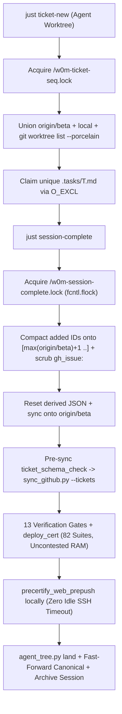

# T656–T661 Session Walkthrough: Identity & Sidebar Unification, 48-Hour Session Audit, Side-by-Side Orca AppImages, and Parallel Wrap-Up Hardening

**Date:** 2026-11-06  
**Conversation:** `a74304e5-07e2-4424-aa34-de8e18412f4c`  
**Tickets Covered:** [T656.md](file:///home/aleksei/Projects/!self/w0m/.tasks/T656.md) · [T657.md](file:///home/aleksei/Projects/!self/w0m/.tasks/T657.md) · [T658.md](file:///home/aleksei/Projects/!self/w0m/.tasks/T658.md) · [T659.md](file:///home/aleksei/Projects/!self/w0m/.tasks/T659.md) · [T660.md](file:///home/aleksei/Projects/!self/w0m/.tasks/T660.md) · [T661.md](file:///home/aleksei/Projects/!self/w0m/.tasks/T661.md)  
**Canonical Report Path:** [2026-11-06-t656-t661-session-audit-orca-appimage-and-wrapup-hardening.md](file:///home/aleksei/Projects/!self/w0m/.agents/reports/2026-11-06-t656-t661-session-audit-orca-appimage-and-wrapup-hardening.md)

> [!IMPORTANT]
> All six tickets (`T656`–`T661`) are landed on `origin/beta`, mirrored 1-to-1 to closed GitHub Issues `#656`–`#661` on `webomage/wom7board`, recorded in [LESSONS.md](file:///home/aleksei/Projects/!self/w0m/LESSONS.md#L2035-L2069), and verified via `just state-check` on `/home/aleksei/Projects/!self/w0m`.

---

## 1. Unified Identity Widget, Sidebar Context/Hat Switcher & CTA Contrast (`T656`)

Landed in `w0m-web@c1c590bee` and `@wom@d4ae520`:

1. **Web CTA Contrast Fix**: Wrapped bare `a { color: var(--brand-color); }` inside `@layer base` in [global.css](file:///home/aleksei/Projects/!self/w0m/w0m-web/apps/web/src/styles/global.css) so Tailwind v4 `@layer utilities` (`text-slate-950`, `no-underline`) render high-contrast text on `#nav-free-audit-cta` and `HomeServices.astro`.
2. **Single `AuthWidget` Without Duplicate Hat Radios**: Removed the redundant `SWITCH HAT` block from [AuthWidget.svelte](file:///home/aleksei/Projects/!self/w0m/w0m-web/packages/ui/src/components/AuthWidget.svelte) across both `placement="header"` (`webomage.com`) and `placement="sidebar"` (`cp.webomage.com`, `me.webomage.com`), while passing `availableRoles` into `getAppsForRole()` so wearing a project hat (`tl`, `pm`, `qa`) never hides `"Control Panel (CP)"`.
3. **Consolidated Sidebar `ContextSwitcher`**: Merged `SidebarHatSwitcher` directly into [ContextSwitcher.svelte](file:///home/aleksei/Projects/!self/w0m/w0m-web/apps/cp/src/components/ContextSwitcher.svelte) (`PERSONAL` -> `ORGANIZATIONS` -> `ACTIVE ORG HATS`) and gated [HatToolsAvailabilityBar.svelte](file:///home/aleksei/Projects/!self/w0m/w0m-web/apps/cp/src/components/HatToolsAvailabilityBar.svelte) strictly to narrowing hats.
4. **Full `Me` Sidebar Tools on `cp`**: Expanded `PERSONAL_NAV_SECTIONS` in [nav.ts](file:///home/aleksei/Projects/!self/w0m/w0m-web/apps/cp/src/lib/nav.ts) to expose all 5 `Me` sections (`Home`, `My Work`, `Career & Profile`, `Personal Space`, `Account & Security`).

---

## 2. 48-Hour Multi-Session Ownership Sweep (`84` Sessions, `2026-11-04`–`2026-11-06`)

| Category / Session | Count | Ticket / Commit | Verified Disposition |
|---|---|---|---|
| `prs-reconcile` cron runs | `70` | Automated | `70/70` `DONE`, zero stranded edits |
| Subagent runs | `4` | Parent-owned | `4/4` `DONE` |
| Earlier interactive sessions | `6` | Prior tickets | `6/6` `DONE` |
| `ef70285c` (MCP `sudo` PTY fix) | `1` | `T657` (`ed820f6`) | Landed; `0` orphaned `sudo` processes |
| `11f01337` (Tinybird ClickHouse) | `1` | `T658` (`0fe30a1`) | Landed & `#658` restored on GitHub |
| `e5a76290` (`catalog-drift-gate`) | `1` | `T659` (`dcdfbbe`) | Rescued dormant tree & landed cleanly |
| `d8988ee0` (Orca PR rebase audit) | `1` | `T660` (`f59fec0`) | Landed & `#660` verified `CLOSED` |

---

## 3. Side-by-Side Orca AppImage Deployment (`T661` AC1–AC3)

- Updated `_default_appimage_path()` in [orca_overlay_update.py](file:///home/aleksei/Projects/!self/w0m/scripts/orca_overlay_update.py) (synced to `~/.local/bin/orca-overlay-update`) and [tools-policy.json](file:///home/aleksei/Projects/!self/w0m/project/policies/tools-policy.json) to target `/home/aleksei/Apps/orca-linux-w0m.AppImage`.
- Installed SHA-512-verified `/home/aleksei/Apps/orca-linux-w0m.AppImage` (`webomage/orca@v1.4.251-w0m.2`, `229M`) alongside untouched `/home/aleksei/Apps/orca-linux-main.AppImage` (`stablyai/orca@v1.4.251`, `240M`).
- Generated desktop launchers `~/.local/share/applications/orca.desktop` (`Orca (w0m)`) and `~/.local/share/applications/orca-main.desktop` (`Orca (Main)`), covered by `8/8` tests in [test_orca_overlay_update.py](file:///home/aleksei/Projects/!self/w0m/scripts/tests/test_orca_overlay_update.py).

---

## 4. Parallel Ticket Allocation & `session-complete` Hardening (`T661` AC4–AC5)



### Five Root Causes Eliminated
1. **Cross-worktree duplicate `T##` allocation**: [`allocate_ticket`](file:///home/aleksei/Projects/!self/w0m/scripts/ticket_new.py#L175-L248) in [ticket_new.py](file:///home/aleksei/Projects/!self/w0m/scripts/ticket_new.py) now locks `<git-common-dir>/w0m-ticket-seq.lock` and scans `git worktree list --porcelain` while keeping standalone `/tmp` test repos hermetic.
2. **Concurrent `vitest` worker starvation (`5 GiB` host)**: [`session_complete_lock`](file:///home/aleksei/Projects/!self/w0m/scripts/session_complete.py#L549-L611) serializes the full live `run_session_complete()` lifecycle via kernel `fcntl.flock` (auto-released on crash/SIGKILL).
3. **Collision/gap renumbering & GitHub `#N` clobbers**: [`maybe_renumber_colliding_tickets`](file:///home/aleksei/Projects/!self/w0m/scripts/session_complete.py#L430-L535) compacts branch-added tickets onto contiguous `[max(origin/beta)+1, ...]` via two-phase `.renumber-tmp-*` renames, scrubs inherited `gh_issue:` frontmatter, and resolves pre-renumber paths on `--dry-run`.
4. **Pre-GitHub-sync schema guard**: [`_verify_target_ticket_schema`](file:///home/aleksei/Projects/!self/w0m/scripts/session_complete.py#L998-L1040) validates ticket frontmatter before `sync_tickets_to_github()` makes any network mutation.
5. **Idle SSH push drop**: [`precertify_web_prepush`](file:///home/aleksei/Projects/!self/w0m/scripts/session_complete.py#L1319-L1369) runs `w0m-web/.husky/pre-push` locally before `agent_tree.py land` opens an SSH socket to GitHub.

---

## 5. Earned Lessons Recorded in `@wom/LESSONS.md`

- **`T656`** ([LESSONS.md:2035](file:///home/aleksei/Projects/!self/w0m/LESSONS.md#L2035-L2039)): *WRAP BARE ELEMENT DEFAULTS IN `@layer base` UNDER TAILWIND V4, PASS `availableRoles` WHEN WEARING PROJECT HATS, AND RUN `build:search` BEFORE `goldens-built`*.
- **`T659`** ([LESSONS.md:2053](file:///home/aleksei/Projects/!self/w0m/LESSONS.md#L2053-L2057)): *COUPLE CROSS-REPO CATALOG GENERATORS TO EVERY INPUT MUTATOR, RESOLVE WORKTREE ROOTS IN GLOBAL CLIS, AND EXCLUDE GENERATED TABLES FROM `oxfmt`*.
- **`T661`** ([LESSONS.md:2065](file:///home/aleksei/Projects/!self/w0m/LESSONS.md#L2065-L2069)): *SERIALIZE `ticket_new` AND `session-complete` VIA `<git-common-dir>` `flock`, COMPACT RENUMBERED IDS BIDIRECTIONALLY WITH `gh_issue:` SCRUB, AND PRE-CERTIFY `w0m-web` LOCALLY BEFORE SSH PUSH*.

---

## 6. Verification & Operator Commands

```bash
cd ~/Projects/'!self'/w0m
just orca-status
just session-complete-test
just orca-overlay-test
just state-check
```
