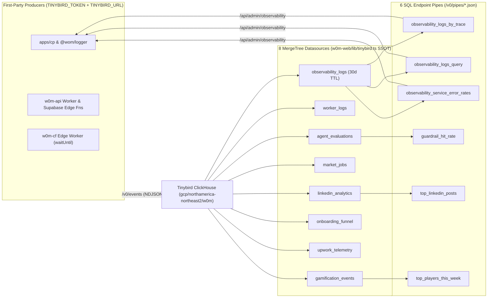

# T658 — Tinybird ClickHouse Free-Tier Unification & Mac Multi-Agent Import Report

- **Date:** 2026-11-06
- **Ticket:** [[T658]]
- **Scope:** `w0m-web`, `w0m-api`, `w0m-cf`, `@wom` estate root, and workstation agent/Orca configuration (`aleksei@HP`)

## 1. Mac Archive Unpack & Multi-Agent / Orca Import Summary

All macOS workstation archives (`/home/aleksei/Projects/mac-migration-bundle` and `/home/aleksei/Downloads/mac-home-configs-20260417.tgz`) were audited against Linux (`HP`) after creating a pre-import backup at `/home/aleksei/.w0m/backups/linux-agent-configs-pre-mac-import-2026-11-06` (`chmod 700`):

- **Coding & AI Agents Imported:** `~/.codex` (config, `AGENTS.md`, rules, skills, memories), `~/.gemini` (`GEMINI.md`, rules, skills, extensions), `~/.claude` + `~/.config/orca/claude-accounts/`, `~/.openclaw`, `~/.grok`, `~/.cursor`, `~/.local/share/{goose,opencode,kilo,muse,fonts}`, `~/.omlx`, `~/.ollama`, `~/.lmstudio`, and `~/.config/{Antigravity,Cursor,Windsurf,Code}/User/` (`settings.json` + `keybindings.json` with macOS `cmd+` translated to Linux `ctrl+`).
- **Orca Live State Verified (`v1.4.251-w0m.2`):** `20` registered repos with Linux paths (`w0m*`, `_proj/*`, `evercred`), Codex account `casualuser@gmail.com` active (`authMode=chatgpt`), `~/.config/orca/keybindings.json` translated to Linux modifiers, all `5` scheduled automations enabled on `antigravity`, and offline UI preference helper installed at `/home/aleksei/.w0m/bin/orca-sync-mac-ui-settings.py`.

## 2. Tinybird Serverless ClickHouse Audit & Unification (`T658`)

### Root Causes Identified
1. **Forward SSOT Split:** `w0m-web/tinybird.config.mjs` included only `w0m-web/lib/tinybird.ts` (`3` datasources + `1` pipe), leaving `5` datasources (`observability_logs`, `agent_evaluations`, `onboarding_funnel`, `upwork_telemetry`, `gamification_events`) and `5` SQL endpoint pipes undeployed on `gcp/northamerica-northeast2/w0m` (`observability_logs_query` was absent from every schema file).
2. **Regional Endpoint & Ingestion Bugs:** Runtime callers defaulted to EU `https://api.tinybird.co` instead of Toronto GCP `https://api.northamerica-northeast2.gcp.tinybird.co` (`403 Invalid token`), `job-aggregator.ts` posted to camelCase `marketJobs` without checking HTTP status, `linkedin-ingest` called single-row `.ingest()` on an array instead of `.ingestBatch()`, and ISO-8601 `T`/`Z` timestamps risked ClickHouse `DateTime` quarantine.
3. **Missing Worker Bindings & Telemetry:** `w0m-api` and `w0m-cf` lacked `TINYBIRD_URL` in `wrangler.jsonc` and `TINYBIRD_TOKEN` in `sync-*-secrets`, and `w0m-cf` emitted HTTP `>= 400` / exception / degraded `/health` traces only to ephemeral console logs.

### Topology After `T658`



## 3. Owner Live Rollout Commands

Run from the live estate checkout with Touch ID confirmation:

```bash
cd ~/Projects/'!self'/w0m
just tinybird-apply
just sync-cfworkers-secrets
just sync-api-secrets
just sync-cp-secrets
just deploy-all
```
