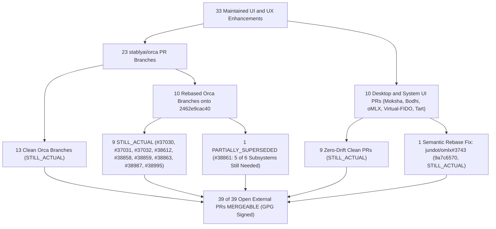
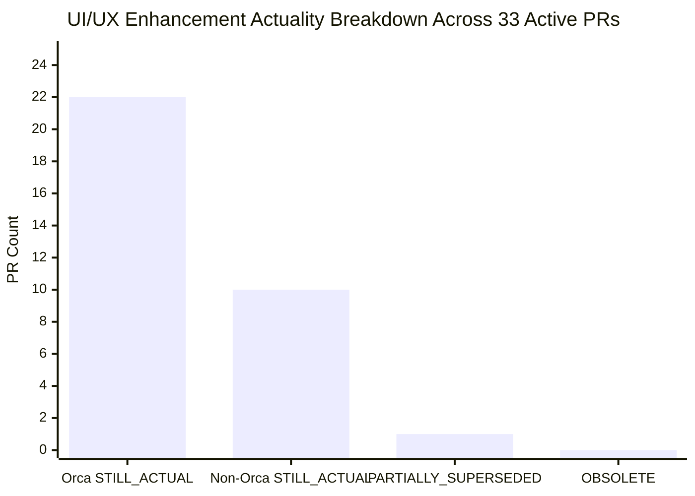

# External UI/UX Enhancements — Upstream Actuality Audit & Full Rebase Sweep (`T658`)

**Date:** 2026-11-06  
**Ticket:** `T658`  
**Related:** `T654`, `T655`, `T657`, [`AgDR-0058`](../../docs/decisions/AgDR-0058-gate-enforced-auto-mode-upstream-pr-governance.md)  
**Upstream Baselines Audited:** `stablyai/orca@2462e9cac40` (`main`), `jundot/omlx@2165e7572` (`main`), `JeffHoogland/moksha@a796b1f9` (`master`), `BodhiDev/*` (`main`), `bulwarkid/virtual-fido@8ff796e` (`master`), `openai/tart-guest-agent@b935262` (`main`)

---

## 1. Executive Summary

- **Complete UI/UX Actuality Audit (`33` Maintained Enhancements across `9` External Repos):**
  - **`0 / 33` (`0%`) `OBSOLETE`:** Not a single maintained UI/UX enhancement has been 100% superseded upstream; zero PRs should be closed.
  - **`1 / 33` (`3%`) `PARTIALLY_SUPERSEDED`:** [`stablyai/orca#38861`](https://github.com/stablyai/orca/pull/38861) (`perf/terminal-chat-redraw-and-tab-caching`) had **1 of its 6 subsystems** covered by `stablyai/orca`'s 2026-11-06 mobile chat performance wave (`#38920`, `#38956`, `#39003`, `#39031`, `#39051`), while **5 of its 6 subsystems** (mobile warm `TerminalWebView` LRU cap of `3` + `memo(TerminalPaneView)`, desktop structured-chat hot LRU cap of `2`, desktop/mobile `document.hidden` & `AppState` backgrounded reveal snap, desktop unattended `4 KiB` xterm redraw coalescing + non-ConPTY WebGL `terminal.refresh()` skip + cross-platform DEC `?2026` hold, and desktop `coveredByNativeChat` single-pane renderer suspension) remain **100% missing upstream**.
  - **`32 / 33` (`97%`) `STILL_ACTUAL`:** Every remaining Orca desktop/mobile UI enhancement (`22` PRs) and every Moksha, Bodhi, oMLX, Virtual-FIDO, and Tart Guest Agent UI/UX PR (`10` PRs) remains unimplemented upstream.
- **Full GPG-Signed Rebase & Semantic Adaptation Sweep (`11` Branches Rebased, `39/39` Open PRs `MERGEABLE`):**
  - Rebased **10 conflicting/overlapping `stablyai/orca` PR branches** (`#37030`, `#37031`, `#37032`, `#38612`, `#38858`, `#38859`, `#38861`, `#38863`, `#38987`, `#38995`) onto `upstream/main@2462e9cac40` across today's upstream refactors (`#38813` RPC subdirectory split, `#38845` & `#39134` renderer/PTY transport reorganization, `#38917` diff note sheet API, `#38919` `MobileNativeChatLowerRegion`, `#38953` `{ coalesce }` transport flag, `#38988` `<OrcaQueryProvider>`, `#39003` `<Activity>` chat retention, `#39032` `LiveInputCapture` external store + `<LiveInputField>`, and `#39076` memoized `<HostSectionHeader>`).
  - Rebased **`jundot/omlx#3743`** (`fix/menubar-adopt-external-omlx` → `9a7c6570`) onto `upstream/main@2165e7572`, fixing a **silent semantic regression** introduced by upstream `#5070` (`963f1b24`) where `recordAuxiliaryHealthSuccess()` and `tickHealth()` added `guard let process, process.isRunning` checks that broke menubar adoption when `process == nil` (`adoptedPID != nil`).
  - Verified **`24/24` `webomage/orca` branches** (`23` open PRs + `feat/w0m-overlay-updater-feed`) exit `0` under `git merge-tree --write-tree upstream/main` and **`39/39` open external PRs** report live GitHub `MERGEABLE`.
- **PR Monitor Synchronization (`scripts/w0m_prs.py`):**
  - Added the 4 `T657` Orca PR head branches (`#38987`, `#38991`, `#38993`, `#38995`) to `ACTIVE_OPEN_PR_HEAD_BRANCHES` (`95/95` `test_w0m_prs.py` passing) and added `+refs/heads/perf/*:refs/remotes/origin/perf/*` to `w0m-pr/orca`'s fetch refspec so Orca's scheduled PR sync automation no longer misclassifies open PR branches as unsubmitted.

---

## 2. Actuality & Rebase Architecture

---

## 3. Deep-Dive Findings on Upstream Overlap & Semantic Rebases

### 3.1 `stablyai/orca#38861` (`perf/terminal-chat-redraw-and-tab-caching`) — `PARTIALLY_SUPERSEDED` (Keep Open)

Upstream `stablyai/orca` landed a major mobile/chat performance wave on 2026-11-06 (`#38887`, `#38920`, `#38953`, `#38956`, `#39003`, `#39031`, `#39051`). Commit-level comparison against `upstream/main@2462e9cac40` shows:

| Subsystem in `#38861` | Upstream Status (`2462e9cac40`) | Verdict |
| :--- | :--- | :--- |
| **1. Mobile chat streaming render cadence & hidden-behind-terminal retention** | Covered differently by `#39031` (`9519bf6fe32`, 30 Hz `REVEAL_STEP_MS` + incremental tail markdown cache), `#38956` (`4cccf7b04ac`, row element reuse), `#39051` (`6239efb34a6`, append deltas), and `#39003` (`e28bcfea650`, `<Activity mode={shown ? 'visible' : 'hidden'}>`). | **Covered Upstream** |
| **2. Mobile warm `TerminalWebView` LRU cap (`use-warm-terminal-handles.ts`, cap = `3`) + `memo(TerminalPaneView)`** | Upstream `MobileSessionActiveContent.tsx` still mounts **every visited terminal tab's `WebView` forever** with an un-memoized `TerminalPaneView`, causing multi-WebView RAM exhaustion on iOS/Android. | **STILL NEEDED** |
| **3. Desktop structured-chat overlay LRU cap (`StructuredAgentSessionPaneOverlayLayer.tsx`, cap = `2`)** | Upstream still retains **100% of visited `mountedStructuredTabs`** in the live React DOM without eviction. | **STILL NEEDED** |
| **4. Backgrounded window/app reveal snap (`document.hidden` & `AppState !== 'active'`)** | `#39003` only hides chat when switching to the terminal view; when Native Chat remains selected while Orca is minimized or backgrounded, upstream still runs `requestAnimationFrame` reveal timers. | **STILL NEEDED** |
| **5. Desktop foreground xterm redraw coalescing (`4 KiB` unattended budget, WebGL `terminal.refresh()` skip, cross-platform DEC `?2026` hold)** | Upstream `pane-host-capability-flags.ts` still restricts DEC `?2026` synchronized-output hold to Windows ConPTY (`isWindowsBackend`), runs redundant DOM `terminal.refresh()` even when WebGL is active, and uses `64 KiB` unattended budgets. | **STILL NEEDED** |
| **6. Desktop `coveredByNativeChat` single-pane terminal suspension + tighter cold-park caps (`4->2` worktrees, `6->3` tabs)** | Upstream `use-terminal-pane-global-effects.ts` still leaves single-pane xterm/WebGL renderers active underneath full-pane Native Chat overlays. | **STILL NEEDED** |

### 3.2 `stablyai/orca#38863` & `#37032` vs Upstream `#39032` (`LiveInputCapture` External Store)

- Upstream `#39032` (`f76e6eebda6`, *"Keep terminal typing out of session re-renders"*) extracted `<LiveInputField>` in `MobileSessionCommandDock.tsx` backed by `createLiveInputCapture()` (`useSyncExternalStore`), while still keeping a **single global `let text = ''` string** shared across all tabs with zero terminal prompt backloading.
- Both `#37032` (`440a8a0ddb6`, asterisk password masking + `secureTextEntry` + auto-expiring `Show` override wired directly inside `<LiveInputField>` so keystrokes only re-render the field) and `#38863` (`c62f10c4141`, xterm buffer prompt-line backloading on focus/click + per-tab `useTerminalLiveSessionRetention`) remain **100% `STILL_ACTUAL`** and were adapted cleanly to `<LiveInputField>` + `{ coalesce }` (`49/49` unit tests passing across both branches).

### 3.3 `stablyai/orca#37033` (`feat/obsidian-ofm-engine`) vs Upstream `#38809`

- Upstream `#38809` (`0e20885cf4c`) added basic 5-type GitHub alert (`[!NOTE]`..`[!CAUTION]`) blockquote parsing **only** in the mobile React Native markdown parser (`mobile/src/components/markdown-blocks.ts`).
- Desktop `RichMarkdown.tsx` / `MarkdownEditor.tsx` still have **zero** Obsidian Flavored Markdown support (`[[wikilinks]]`, `![[embeds]]`, YAML frontmatter `aliases`, 13+ OFM callout types, or `> [!type]+/-` foldable `
` callouts). `#37033` (`dafc52c4617`) merges cleanly and remains **100% `STILL_ACTUAL`**.

### 3.4 `jundot/omlx#3743` (`fix/menubar-adopt-external-omlx`) vs Upstream `#5050` & `#5070`

- Upstream `#5050` (`0a16bb48`) only allowed the Ask AI settings test button to query remote HTTP endpoints; `ServerProcess.swift` still fails with port-in-use errors when a CLI/LaunchAgent `omlx serve` instance already owns the configured port.
- Critically, upstream `#5070` (`963f1b24`) added `guard let process, process.isRunning else { return }` inside `recordAuxiliaryHealthSuccess()` and `tickHealth()`. Because an adopted external server has `process == nil` and `adoptedPID != nil`, a naive git rebase would have broken health polling on adopted servers. Rebased commit `9a7c6570` updates both guards to verify `process.isRunning` **or** `adoptedPID` liveness (`kill(pid, 0) == 0`).

---

## 4. Complete Actuality & Rebase Inventory (`33` UI/UX Enhancements)

### 4A. `stablyai/orca` Desktop & Mobile UI/UX PRs (`23` Open PRs — `23/23` `MERGEABLE`)

| PR | Branch | HEAD SHA (`G`) | Actuality Verdict | Rebase / Audit Evidence vs `upstream/main@2462e9cac40` |
| :--- | :--- | :--- | :--- | :--- |
| [`#16597`](https://github.com/stablyai/orca/pull/16597) | `feat/zeroclaw-agent-connector` | `eb718b8182b` | `STILL_ACTUAL` | Clean merge; upstream `agent-kind.ts` has no `zeroclaw` connector or AI Vault scanner. |
| [`#21148`](https://github.com/stablyai/orca/pull/21148) | `feat/macos-deep-link-shortcuts` | `2d734780a10` | `STILL_ACTUAL` | Clean merge; upstream `orca-deep-link-url.ts` only routes skill/plugin installs. |
| [`#21157`](https://github.com/stablyai/orca/pull/21157) | `feat/macos-deep-link-worktree` | `85b55c87ee4` | `STILL_ACTUAL` | Clean merge; macOS `orca://worktree` creation protocol absent upstream. |
| [`#37029`](https://github.com/stablyai/orca/pull/37029) | `feat/cross-worktree-tab-move` | `6015e6edb40` | `STILL_ACTUAL` | Clean merge; `#38840` only detaches same-worktree mobile split panes, zero cross-worktree tab drag/move. |
| [`#37030`](https://github.com/stablyai/orca/pull/37030) | `feat/agent-collaboration-board` | **`3adfc6ddb67`** | `STILL_ACTUAL` | **Rebased** onto `#38813` (`rpc/methods/orchestration/orchestration.ts`); `7/7` lock tests pass. |
| [`#37031`](https://github.com/stablyai/orca/pull/37031) | `feat/mobile-camera-capture-chat` | **`6ce090fe443`** | `STILL_ACTUAL` | **Rebased** onto `#38919` (`MobileNativeChatLowerRegion` `lowerContent`); upstream `MobileImageSource` is still `'library' \| 'files'`. |
| [`#37032`](https://github.com/stablyai/orca/pull/37032) | `feat/mobile-live-input-password-mask` | **`440a8a0ddb6`** | `STILL_ACTUAL` | **Rebased** onto `#39032` (`<LiveInputField>` + `useLiveInputCaptureText`); `8/8` tests pass. |
| [`#37033`](https://github.com/stablyai/orca/pull/37033) | `feat/obsidian-ofm-engine` | `dafc52c4617` | `STILL_ACTUAL` | Clean merge; desktop OFM wikilinks, aliases, and foldable callouts absent upstream (`#38809` is mobile-only alerts). |
| [`#37034`](https://github.com/stablyai/orca/pull/37034) | `fix/mobile-landscape-safe-area-insets` | `471b47030c0` | `STILL_ACTUAL` | Clean merge; `MobileHomeScreen.tsx` still omits `insets.left`/`insets.right` horizontal padding. |
| [`#37035`](https://github.com/stablyai/orca/pull/37035) | `fix/mobile-markdown-external-tab-read` | `d07c01a91b1` | `STILL_ACTUAL` | Clean merge; `markdown-tab-disk-host.ts` still rejects open desktop markdown tabs outside workspace root. |
| [`#37510`](https://github.com/stablyai/orca/pull/37510) | `feat/nested-subfolder-git-and-sdlc-repo` | `b7e67d00834` | `STILL_ACTUAL` | Clean merge; nested subfolder git & `.w0m/sdlc.json` discovery absent upstream. |
| [`#37511`](https://github.com/stablyai/orca/pull/37511) | `feat/mobile-session-tab-reorder` | `c9990761094` | `STILL_ACTUAL` | Clean merge; mobile tab drag/sheet reorder & `session.tabs.move` relay write absent upstream. |
| [`#37995`](https://github.com/stablyai/orca/pull/37995) | `feat/mobile-terminal-triple-tap-enter` | `337782af421` | `STILL_ACTUAL` | Clean merge (preserving `#38953` `{ coalesce }`); mobile terminal stops at double-tap upstream. |
| [`#38612`](https://github.com/stablyai/orca/pull/38612) | `feat/mobile-four-side-edge-arrows` | **`18435d9fd7a`** | `STILL_ACTUAL` | **Rebased** (4 commits) onto `#38988` `<OrcaQueryProvider>`, `#38917`, `#38919`, and `#39003` `<Activity>`; `10/10` tests pass. |
| [`#38857`](https://github.com/stablyai/orca/pull/38857) | `fix/webgl-atlas-version-desync-recovery` | `5e42400a904` | `STILL_ACTUAL` | Clean merge; shared WebGL glyph-atlas version desync recovery absent upstream. |
| [`#38858`](https://github.com/stablyai/orca/pull/38858) | `fix/terminal-smooth-resize-and-replay` | **`fb9a588ab9b`** | `STILL_ACTUAL` | **Rebased** onto `#38953` (`!coalesce` fast-path preserved alongside `inResizeBurst` + DEC `?2026` hold + floating `SessionRestoredBanner`). |
| [`#38859`](https://github.com/stablyai/orca/pull/38859) | `fix/mobile-terminal-theme-enforcement` | **`7a74c0dda4d`** | `STILL_ACTUAL` | **Rebased** onto `#38813`, `#38953`, and `#39134` (`input/keyboard/terminal-keyboard-protocol-pane-agent`); light/dark + `OSC 10/11`/`CSI ?996n` parity absent upstream. |
| [`#38861`](https://github.com/stablyai/orca/pull/38861) | `perf/terminal-chat-redraw-and-tab-caching` | **`68dfe5a64a8`** | **`PARTIALLY_SUPERSEDED`** | **Rebased** onto `#39003`/`#39031`; **5 of 6 subsystems** (warm WebView/structured-chat LRU caps, backgrounded reveal snap, foreground WebGL/`?2026` coalescing, `coveredByNativeChat` suspension) still missing upstream (`45/45` tests pass). |
| [`#38863`](https://github.com/stablyai/orca/pull/38863) | `fix/mobile-live-input-prompt-backload` | **`c62f10c4141`** | `STILL_ACTUAL` | **Rebased** onto `#39032` (`<LiveInputField>` + `LiveInputCapture.set`) and `#38953`; `41/41` tests pass. |
| [`#38987`](https://github.com/stablyai/orca/pull/38987) | `feat/system-and-docker-monitors` | **`411143623eb`** | `STILL_ACTUAL` | **Rebased** onto `#38813` (`rpc/methods/preflight/preflight.ts`); `0` `tsrs` errors across all 31 files. |
| [`#38991`](https://github.com/stablyai/orca/pull/38991) | `fix/linux-cli-stale-appimage-and-dispatcher` | `355962fe324` | `STILL_ACTUAL` | Clean merge; Linux startup stale AppImage wrapper self-heal absent upstream. |
| [`#38993`](https://github.com/stablyai/orca/pull/38993) | `feat/mobile-terminal-4-tap-alt-m` | `6f154f8e059` | `STILL_ACTUAL` | Clean merge; 4-tap `Alt+M` gesture & 3-tap/4-tap settle disambiguation absent upstream. |
| [`#38995`](https://github.com/stablyai/orca/pull/38995) | `feat/subagent-display-and-floating-category` | **`254e8d84bb1`** | `STILL_ACTUAL` | **Rebased** onto `#39076` (memoized `<HostSectionHeader>`); sidebar/mobile flat/tree subagent modes + Antigravity roster + Floating category absent upstream. |

### 4B. Non-Orca Desktop & System UI/UX PRs (`10` Open PRs — `10/10` `MERGEABLE`)

| Repository & PR | Branch | HEAD SHA (`G`) | Actuality Verdict | Upstream Audit & Rebase Status |
| :--- | :--- | :--- | :--- | :--- |
| [`jundot/omlx#3743`](https://github.com/jundot/omlx/pull/3743) | `fix/menubar-adopt-external-omlx` | **`9a7c6570`** | `STILL_ACTUAL` | **Rebased** onto `2165e7572` + fixed `#5070` `adoptedPID` health-polling guard in `ServerProcess.swift`. |
| [`JeffHoogland/moksha#310`](https://github.com/JeffHoogland/moksha/pull/310) | `feat/eight-zone-window-snapping` | `a2ab7e83` | `STILL_ACTUAL` | Clean (`0` upstream commits since `a796b1f9` on `master`); 8-zone edge/corner window snapping absent upstream. |
| [`JeffHoogland/moksha#311`](https://github.com/JeffHoogland/moksha/pull/311) | `fix/desktop-editor-icon-path-and-size` | `6472cc45` | `STILL_ACTUAL` | Clean (`0` upstream commits on `master`); `.desktop` absolute icon file picker & preview clamp absent upstream. |
| [`JeffHoogland/moksha#312`](https://github.com/JeffHoogland/moksha/pull/312) | `feat/appimage-diricon-and-rdns-wmclass` | `da4b4d2b` | `STILL_ACTUAL` | Clean (`0` upstream commits on `master`); AppImage `.DirIcon` & reverse-DNS `StartupWMClass` matching absent upstream. |
| [`BodhiDev/bodhi-profile-iso#2`](https://github.com/BodhiDev/bodhi-profile-iso/pull/2) | `feat/eight-zone-window-snap-bindings` | `2040a66` | `STILL_ACTUAL` | Clean (`0` upstream commits); default keybindings for 8-zone snapping absent upstream. |
| [`BodhiDev/bodhi7packages#10`](https://github.com/BodhiDev/bodhi7packages/pull/10) | `feat/moksha-snap-and-icon-backports` | `8489c37` | `STILL_ACTUAL` | Clean (`0` upstream commits); Bodhi 7 (`jammy`) Moksha quilt backports absent upstream. |
| [`BodhiDev/bodhi8packages#8`](https://github.com/BodhiDev/bodhi8packages/pull/8) | `feat/moksha-snap-and-icon-backports` | `30a79bc` | `STILL_ACTUAL` | Clean (`0` upstream commits); Bodhi 8 (`noble`/`trixie`) Moksha quilt backports absent upstream. |
| [`bulwarkid/virtual-fido#48`](https://github.com/bulwarkid/virtual-fido/pull/48) | `macos_release` | `781f94d` | `STILL_ACTUAL` | Clean (`0` upstream commits on `master`); macOS Touch ID / release packaging absent upstream. |
| [`bulwarkid/virtual-fido#56`](https://github.com/bulwarkid/virtual-fido/pull/56) | `feat/linux-desktop-hotkey-helper` | `5d54c89` | `STILL_ACTUAL` | Clean (`0` upstream commits on `master`); Linux desktop approval popup & hotkey helper absent upstream. |
| [`openai/tart-guest-agent#62`](https://github.com/openai/tart-guest-agent/pull/62) | `feat/media-clipboard-and-file-transfer` | `bd27756` | `STILL_ACTUAL` | Clean (`0` upstream commits since `b935262`, `APPROVED`); guest/host image clipboard & drag-and-drop transfer absent upstream. |

---

## 5. Verification Summary

- **Git Mergeability & Signatures:** `24/24` `webomage/orca` branches (`23` PRs + `feat/w0m-overlay-updater-feed`) exit `0` under `git merge-tree --write-tree upstream/main`; `39/39` open external PRs report live GitHub `MERGEABLE` with GPG-signed (`G`) commits.
- **Orca Test Suites on Rebased Branches:** `111/111` targeted Vitest unit tests passed across `#37030` (`7/7`), `#37032` (`8/8`), `#38612` (`10/10`), `#38861` (`45/45`), and `#38863` (`41/41`), plus `0` `tsrs` errors on `#38987`.
- **w0m Governance & Tooling Gates:** `python3 scripts/tests/test_w0m_prs.py` (`95/95` passed), `mmd-validate` (`2/2` Mermaid diagrams valid), `reports-ticket-check`, and `lessons-check` all green.
