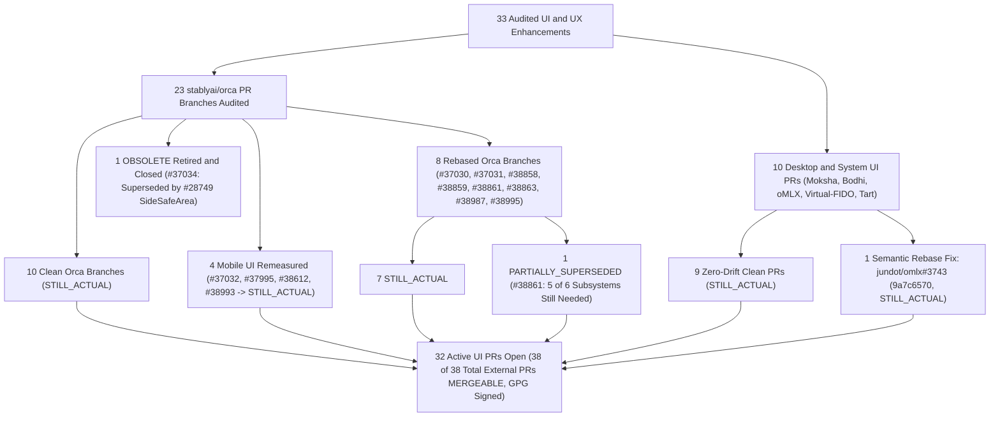
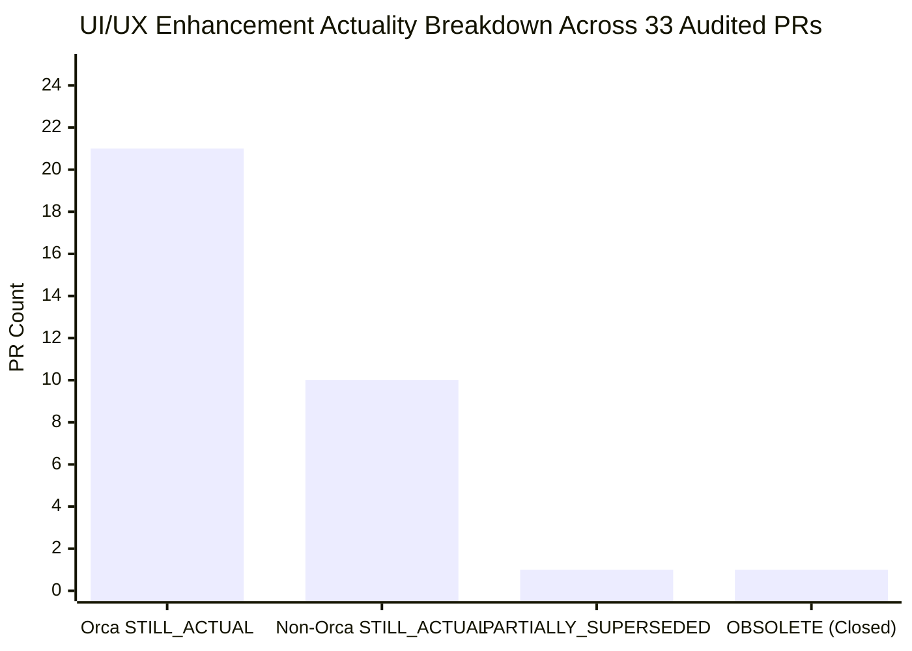

# External UI/UX Enhancements — Upstream Actuality Audit, Mobile UI Remeasurement & Full Rebase Sweep (`T660` / `T662`)

**Date:** 2026-11-06  
**Tickets:** `T660`, `T662`  
**Related:** `T654`, `T655`, `T657`, [`AgDR-0058`](../../docs/decisions/AgDR-0058-gate-enforced-auto-mode-upstream-pr-governance.md)  
**Upstream Baselines Audited:** `stablyai/orca@be3b87f3ac6` (`main`), `jundot/omlx@2165e7572` (`main`), `JeffHoogland/moksha@a796b1f9` (`master`), `BodhiDev/*` (`main`), `bulwarkid/virtual-fido@8ff796e` (`master`), `openai/tart-guest-agent@b935262` (`main`)

---

## 1. Executive Summary

- **Complete UI/UX Actuality & Mobile Remeasurement Audit (`33` Audited Enhancements -> `32` Active Open UI PRs + `1` Retired `OBSOLETE`):**
  - **`1 / 33` (`3%`) `OBSOLETE` (Closed & Retired in `T662`):** [`stablyai/orca#37034`](https://github.com/stablyai/orca/pull/37034) (`fix/mobile-landscape-safe-area-insets`) was 100% superseded upstream by `#28749`/`#35177` (root `<SideSafeArea>` wrapping `<Stack>` in `MobileProviders.tsx`) and imported `mobile/src/layout/screen-edge-padding.ts`, which upstream deleted (`TS2307` under `tsrs` despite a clean `git merge-tree`). Closed cleanly on GitHub and moved to `INTERNAL_OR_SUPERSEDED_BRANCHES` in `scripts/w0m_prs.py`.
  - **`1 / 33` (`3%`) `PARTIALLY_SUPERSEDED` (Keep Open):** [`stablyai/orca#38861`](https://github.com/stablyai/orca/pull/38861) (`perf/terminal-chat-redraw-and-tab-caching` -> `70ea9e76710`) had **1 of its 6 subsystems** covered by `stablyai/orca`'s 2026-11-06 mobile chat performance wave (`#38920`, `#38956`, `#39003`, `#39031`, `#39051`), while **5 of its 6 subsystems** (mobile warm `TerminalWebView` LRU cap of `3` + `memo(TerminalPaneView)`, desktop structured-chat hot LRU cap of `2`, desktop/mobile `document.hidden` & `AppState` backgrounded reveal snap, desktop unattended `4 KiB` xterm redraw coalescing + non-ConPTY WebGL `terminal.refresh()` skip + cross-platform DEC `?2026` hold, and desktop `coveredByNativeChat` single-pane renderer suspension) remain **100% missing upstream**.
  - **`31 / 33` (`94%`) `STILL_ACTUAL`:** Every remaining Orca desktop/mobile UI enhancement (`21` PRs) and every Moksha, Bodhi, oMLX, Virtual-FIDO, and Tart Guest Agent UI/UX PR (`10` PRs) remains unimplemented upstream.
- **Orca Mobile New Keys Bar, Tabbed Home & Safe-Area Remeasurement (`T662`):**
  - Remeasured all remaining `12` mobile `stablyai/orca` PRs against `#37900` (`46pt` scrolling `MobileSessionAccessoryKeys` bar + labelled `<LiveInputField>`), `#38206` (4-tab `MobileHomeScreen` + `MobileHomeFab`), `#38286` (native chat Plan mode `leadingControls`), `#28749`/`#35177` (`<SideSafeArea>` + iPhone Duo `SideRail`), and `#39146` (terminal rendering owner split):
    - **`#37032` (`e2caebb8bda`):** Moved `MobileTerminalPasswordMaskToggle` into `<TextField trailing={...}>` and aligned `MobileTerminalPasswordMaskOverlay` to `COMPOSER_TEXT_SIZE` (`16`) so it never clips `#37900`'s `"Live input"` caption.
    - **`#38612` (`610718570e2`):** Raised Gamepad's right diamond cluster to `bottom: 60` (`10pt` clear of Native Chat's `Scroll to latest` FAB at `bottom: 12..50`) even when `switcherChipHidden` is `true`, and defaulted unset `edgeNavigationMode` to `'off'` on iPhone Duo `SideRail` postures (`useDirectionPadAvailable()`).
    - **`#37995` (`d6fbd0f80e4`) & `#38993` (`0e30568f519`):** Added `hiddenKeyboardTapFocusDelayMs: 420` when 3-tap `Enter` or 4-tap `Alt+M` is enabled so `#37900`'s `50ms` tap-to-focus timer resets across taps 1–3 without opening the software keyboard mid-gesture (`50ms` preserved when keyboard is already visible or gesture is disabled).
- **Full GPG-Signed Rebase & Global Mergeability (`38/38` Open External PRs `MERGEABLE`):**
  - Rebased `#37031` (`744ed070077`), `#38858` (`4ee49315a60`), `#38859` (`3c9b9861558`), and `#38861` (`70ea9e76710`) onto `stablyai/orca` `main` (fixing `#39146` moved imports in `terminal-pane-manager-options.ts` and `reattach-grid-fit.ts`), alongside `#37030`, `#38863`, `#38987`, `#38995`, and `jundot/omlx#3743` (`9a7c6570`).
  - Verified **`23/23` active `webomage/orca` branches** (`22` open PRs + `feat/w0m-overlay-updater-feed`) exit `0` under `git merge-tree --write-tree upstream/main@be3b87f3ac6` and **`38/38` open external PRs** report live GitHub `MERGEABLE`.

---

## 2. Actuality & Rebase Architecture

---

## 3. Deep-Dive Findings on Upstream Overlap, Mobile Remeasurement & Semantic Rebases

### 3.1 `stablyai/orca#38861` (`perf/terminal-chat-redraw-and-tab-caching`) — `PARTIALLY_SUPERSEDED` (Keep Open)

Upstream `stablyai/orca` landed a major mobile/chat performance wave on 2026-11-06 (`#38887`, `#38920`, `#38953`, `#38956`, `#39003`, `#39031`, `#39051`). Commit-level comparison against `upstream/main@be3b87f3ac6` shows:

| Subsystem in `#38861`                                                                                                                           | Upstream Status (`be3b87f3ac6`)                                                                                                                                                                                                                                                  | Verdict              |
| :---------------------------------------------------------------------------------------------------------------------------------------------- | :------------------------------------------------------------------------------------------------------------------------------------------------------------------------------------------------------------------------------------------------------------------------------- | :------------------- |
| **1. Mobile chat streaming render cadence & hidden-behind-terminal retention**                                                                  | Covered differently by `#39031` (`9519bf6fe32`, 30 Hz `REVEAL_STEP_MS` + incremental tail markdown cache), `#38956` (`4cccf7b04ac`, row element reuse), `#39051` (`6239efb34a6`, append deltas), and `#39003` (`e28bcfea650`, `<Activity mode={shown ? 'visible' : 'hidden'}>`). | **Covered Upstream** |
| **2. Mobile warm `TerminalWebView` LRU cap (`use-warm-terminal-handles.ts`, cap = `3`) + `memo(TerminalPaneView)`**                             | Upstream `MobileSessionActiveContent.tsx` still mounts **every visited terminal tab's `WebView` forever** with an un-memoized `TerminalPaneView`, causing multi-WebView RAM exhaustion on iOS/Android.                                                                           | **STILL NEEDED**     |
| **3. Desktop structured-chat overlay LRU cap (`StructuredAgentSessionPaneOverlayLayer.tsx`, cap = `2`)**                                        | Upstream still retains **100% of visited `mountedStructuredTabs`** in the live React DOM without eviction.                                                                                                                                                                       | **STILL NEEDED**     |
| **4. Backgrounded window/app reveal snap (`document.hidden` & `AppState !== 'active'`)**                                                        | `#39003` only hides chat when switching to the terminal view; when Native Chat remains selected while Orca is minimized or backgrounded, upstream still runs `requestAnimationFrame` reveal timers.                                                                              | **STILL NEEDED**     |
| **5. Desktop foreground xterm redraw coalescing (`4 KiB` unattended budget, WebGL `terminal.refresh()` skip, cross-platform DEC `?2026` hold)** | Upstream `pane-host-capability-flags.ts` still restricts DEC `?2026` synchronized-output hold to Windows ConPTY (`isWindowsBackend`), runs redundant DOM `terminal.refresh()` even when WebGL is active, and uses `64 KiB` unattended budgets.                                   | **STILL NEEDED**     |
| **6. Desktop `coveredByNativeChat` single-pane terminal suspension + tighter cold-park caps (`4->2` worktrees, `6->3` tabs)**                   | Upstream `use-terminal-pane-global-effects.ts` still leaves single-pane xterm/WebGL renderers active underneath full-pane Native Chat overlays.                                                                                                                                  | **STILL NEEDED**     |

### 3.2 `stablyai/orca#38863` & `#37032` vs Upstream `#37900` & `#39032` (`LiveInputCapture` External Store)

- Upstream `#37900` (`490488a5d8e`, _"Restore the terminal keys bar and simplify live input"_) and `#39032` (`f76e6eebda6`, _"Keep terminal typing out of session re-renders"_) restored a `46pt` scrolling `MobileSessionAccessoryKeys` bar (`Esc`, `Tab`, `Ctrl`, `Alt`, `Paste`, `←`, `↓`, `↑`, `→`, `Enter`) above a labelled `<LiveInputField>` backed by `createLiveInputCapture()` (`useSyncExternalStore`), while keeping a **single global `let text = ''` string** shared across all tabs with zero terminal prompt backloading and zero password masking.
- Both `#37032` (`e2caebb8bda`) and `#38863` (`c62f10c4141`, xterm buffer prompt-line backloading on focus/click + per-tab `useTerminalLiveSessionRetention`) remain **100% `STILL_ACTUAL`**.

### 3.3 `stablyai/orca#37033` (`feat/obsidian-ofm-engine`) vs Upstream `#38809`

- Upstream `#38809` (`0e20885cf4c`) added basic 5-type GitHub alert (`[!NOTE]`..`[!CAUTION]`) blockquote parsing **only** in the mobile React Native markdown parser (`mobile/src/components/markdown-blocks.ts`).
- Desktop `RichMarkdown.tsx` / `MarkdownEditor.tsx` still have **zero** Obsidian Flavored Markdown support (`[[wikilinks]]`, `![[embeds]]`, YAML frontmatter `aliases`, 13+ OFM callout types, or `> [!type]+/-` foldable `
` callouts). `#37033` (`dafc52c4617`) merges cleanly and remains **100% `STILL_ACTUAL`**.

### 3.4 `jundot/omlx#3743` (`fix/menubar-adopt-external-omlx`) vs Upstream `#5050` & `#5070`

- Upstream `#5050` (`0a16bb48`) only allowed the Ask AI settings test button to query remote HTTP endpoints; `ServerProcess.swift` still fails with port-in-use errors when a CLI/LaunchAgent `omlx serve` instance already owns the configured port.
- Critically, upstream `#5070` (`963f1b24`) added `guard let process, process.isRunning else { return }` inside `recordAuxiliaryHealthSuccess()` and `tickHealth()`. Because an adopted external server has `process == nil` and `adoptedPID != nil`, a naive git rebase would have broken health polling on adopted servers. Rebased commit `9a7c6570` updates both guards to verify `process.isRunning` **or** `adoptedPID` liveness (`kill(pid, 0) == 0`).

### 3.5 Orca Mobile New Keys Bar, Tabbed Home & Safe-Area Remeasurement (`T662`)

Evaluating all `13` mobile `stablyai/orca` PR branches with `tsrs` (`mobile/tsconfig.json`) plus pixel/timer layout inspection against `#28749`, `#35177`, `#37900`, `#38206`, `#38286`, and `#39146` surfaced 1 superseded PR and 4 layout/timing collisions that pure git conflict checks missed:

1. **Retired Superseded Safe-Area PR (`#37034` `fix/mobile-landscape-safe-area-insets` -> `OBSOLETE`):**
   - Upstream `#28749` (`eb2decf1e28`) and `#35177` (`57af4099b8d`) wrapped the root `<Stack>` inside `<SideSafeArea>` in `MobileProviders.tsx` and deleted `mobile/src/layout/screen-edge-padding.ts`. Although `#37034` exited `0` under `git merge-tree`, `tsrs` caught `TS2307: Cannot find module '../layout/screen-edge-padding'` and keeping `paddingLeft`/`paddingRight` on `MobileHomeScreen` would double-pad landscape safe areas. Closed `#37034` on GitHub and moved the branch to `INTERNAL_OR_SUPERSEDED_BRANCHES` in `scripts/w0m_prs.py` (`34` active proposals).
2. **`#37032` (`feat/mobile-live-input-password-mask` -> `e2caebb8bda`):**
   - `#37900`'s `<TextField fieldLabel="Live input">` stacks a caption above the `<TextInput>` inside the same container, causing `#37032`'s absolute `top: -3, right: 0` `Show`/`Hide` button inside `children` to overlap the `"Live input"` label. Split `MobileTerminalPasswordMaskToggle` into `<TextField trailing={...}>` (before `<MobileTerminalLiveInputStatus>`), gave `inputOverlayHost` `flex: 1, minWidth: 0, alignSelf: 'stretch'`, and matched `MobileTerminalPasswordMaskOverlay` font size to `COMPOSER_TEXT_SIZE` (`16`) with `right: 0` (`8/8` Vitest tests + `0` mobile `tsrs` errors).
3. **`#38612` (`feat/mobile-four-side-edge-arrows` -> `610718570e2`):**
   - In Native Chat, `MobileNativeChatConversationPane` renders a `38x38` `Scroll to latest` FAB at `right: 12, bottom: 12` (`12..50pt`), while `switcherChipHidden` is `true` whenever the session dock renders. Previously, `gamepadRightClusterBottom` collapsed to `PANE_EDGE_INSET` (`10pt`) when `switcherChipHidden` was `true`, overlapping `Scroll to latest`. Updated `gamepadRightClusterBottom` to `switcherChipHidden ? PANE_EDGE_INSET + 4 + safeBottomRightOffset : settingsDockBottom + 36` (`bottom: 60`, `10pt` clear of `Scroll to latest`), and wired `useDirectionPadAvailable()` into `resolveEdgeNavigationMode(layout, directionPadAvailable)` so iPhone Duo `SideRail` postures default unset `edgeNavigationMode` to `'off'` instead of duplicating the rail D-pad (`12/12` Vitest tests + `0` mobile `tsrs` errors).
4. **`#37995` (`feat/mobile-terminal-triple-tap-enter` -> `d6fbd0f80e4`) & `#38993` (`feat/mobile-terminal-4-tap-alt-m` -> `0e30568f519`):**
   - `#37900` routes single WebView taps (`tapCount === 1`) when the software keyboard is hidden to `scheduleTerminalLiveInputFocus()` on a `50ms` timer. Because multi-tap terminal streaks allow up to `400ms` between taps, Tap 1 fired `liveInputRef.focus()` at `t = 50ms` before Tap 2 arrived, popping open the keyboard mid-streak. Parameterized `useTerminalLiveInputFocus({ hiddenKeyboardTapFocusDelayMs })` to use `420ms` when `tripleTapEnterEnabled` or `quadTapAltMEnabled` is active (resetting `timerRef` across taps 1–3 while keeping `50ms` when the keyboard is already open or the gesture is off) and rebuilt `terminal-webview-document-script.generated.ts` (`28/28` Vitest tests + `0` mobile `tsrs` errors on each branch).

---

## 4. Complete Actuality & Rebase Inventory (`33` Audited UI/UX Enhancements)

### 4A. `stablyai/orca` Desktop & Mobile UI/UX PRs (`22` Active Open PRs `MERGEABLE` + `1` Retired `OBSOLETE`)

| PR                                                      | Branch                                        | HEAD SHA (`G`)    | Actuality Verdict          | Rebase / Remeasurement Evidence vs `upstream/main@be3b87f3ac6`                                                                                                |
| :------------------------------------------------------ | :-------------------------------------------- | :---------------- | :------------------------- | :------------------------------------------------------------------------------------------------------------------------------------------------------------ |
| [`#16597`](https://github.com/stablyai/orca/pull/16597) | `feat/zeroclaw-agent-connector`               | `eb718b8182b`     | `STILL_ACTUAL`             | Clean merge; upstream `agent-kind.ts` has no `zeroclaw` connector or AI Vault scanner.                                                                        |
| [`#21148`](https://github.com/stablyai/orca/pull/21148) | `feat/macos-deep-link-shortcuts`              | `2d734780a10`     | `STILL_ACTUAL`             | Clean merge; upstream `orca-deep-link-url.ts` only routes skill/plugin installs.                                                                              |
| [`#21157`](https://github.com/stablyai/orca/pull/21157) | `feat/macos-deep-link-worktree`               | `85b55c87ee4`     | `STILL_ACTUAL`             | Clean merge; macOS `orca://worktree` creation protocol absent upstream.                                                                                       |
| [`#37029`](https://github.com/stablyai/orca/pull/37029) | `feat/cross-worktree-tab-move`                | `6015e6edb40`     | `STILL_ACTUAL`             | Clean merge; `#38840` only detaches same-worktree mobile split panes, zero cross-worktree tab drag/move.                                                      |
| [`#37030`](https://github.com/stablyai/orca/pull/37030) | `feat/agent-collaboration-board`              | **`3adfc6ddb67`** | `STILL_ACTUAL`             | **Rebased** onto `#38813` (`rpc/methods/orchestration/orchestration.ts`); `7/7` lock tests pass.                                                              |
| [`#37031`](https://github.com/stablyai/orca/pull/37031) | `feat/mobile-camera-capture-chat`             | **`744ed070077`** | `STILL_ACTUAL`             | **Rebased** onto `#38286` (`leadingControls` Plan chip) & `#38919`; `29/29` tests + mobile `tsrs` pass.                                                       |
| [`#37032`](https://github.com/stablyai/orca/pull/37032) | `feat/mobile-live-input-password-mask`        | **`e2caebb8bda`** | `STILL_ACTUAL`             | **Remeasured** (`T662`) onto `#37900`/`#39032`: `<TextField trailing={...}>` toggle + `COMPOSER_TEXT_SIZE` mask; `8/8` tests pass.                            |
| [`#37033`](https://github.com/stablyai/orca/pull/37033) | `feat/obsidian-ofm-engine`                    | `dafc52c4617`     | `STILL_ACTUAL`             | Clean merge; desktop OFM wikilinks, aliases, and foldable callouts absent upstream (`#38809` is mobile-only alerts).                                          |
| [`#37034`](https://github.com/stablyai/orca/pull/37034) | `fix/mobile-landscape-safe-area-insets`       | Closed (`T662`)   | **`OBSOLETE` (Closed)**    | **Retired & Closed (`T662`):** Superseded by `#28749`/`#35177` root `<SideSafeArea>` & deleted `screen-edge-padding.ts`.                                      |
| [`#37035`](https://github.com/stablyai/orca/pull/37035) | `fix/mobile-markdown-external-tab-read`       | `d07c01a91b1`     | `STILL_ACTUAL`             | Clean merge; `markdown-tab-disk-host.ts` still rejects open desktop markdown tabs outside workspace root.                                                     |
| [`#37510`](https://github.com/stablyai/orca/pull/37510) | `feat/nested-subfolder-git-and-sdlc-repo`     | `b7e67d00834`     | `STILL_ACTUAL`             | Clean merge; nested subfolder git & `.w0m/sdlc.json` discovery absent upstream.                                                                               |
| [`#37511`](https://github.com/stablyai/orca/pull/37511) | `feat/mobile-session-tab-reorder`             | `c9990761094`     | `STILL_ACTUAL`             | Clean merge; mobile tab drag/sheet reorder & `session.tabs.move` relay write absent upstream.                                                                 |
| [`#37995`](https://github.com/stablyai/orca/pull/37995) | `feat/mobile-terminal-triple-tap-enter`       | **`d6fbd0f80e4`** | `STILL_ACTUAL`             | **Remeasured** (`T662`) for `#37900`: `420ms` hidden-keyboard tap-focus settle window; `28/28` tests + mobile `tsrs` pass.                                    |
| [`#38612`](https://github.com/stablyai/orca/pull/38612) | `feat/mobile-four-side-edge-arrows`           | **`610718570e2`** | `STILL_ACTUAL`             | **Remeasured** (`T662`): Gamepad `bottom: 60` (`Scroll to latest` FAB clearance) + Duo `SideRail` `'off'` default; `12/12` tests pass.                        |
| [`#38857`](https://github.com/stablyai/orca/pull/38857) | `fix/webgl-atlas-version-desync-recovery`     | `5e42400a904`     | `STILL_ACTUAL`             | Clean merge; shared WebGL glyph-atlas version desync recovery absent upstream.                                                                                |
| [`#38858`](https://github.com/stablyai/orca/pull/38858) | `fix/terminal-smooth-resize-and-replay`       | **`4ee49315a60`** | `STILL_ACTUAL`             | **Rebased** (`T662`) onto `#39146` (`viewport/` & `snapshots/` moves); `32/32` desktop/mobile tests + `tsrs` pass.                                            |
| [`#38859`](https://github.com/stablyai/orca/pull/38859) | `fix/mobile-terminal-theme-enforcement`       | **`3c9b9861558`** | `STILL_ACTUAL`             | **Rebased** (`T662`) onto `#39146` (`appearance/terminal-appearance`); `36/36` tests + `tsrs` pass.                                                           |
| [`#38861`](https://github.com/stablyai/orca/pull/38861) | `perf/terminal-chat-redraw-and-tab-caching`   | **`70ea9e76710`** | **`PARTIALLY_SUPERSEDED`** | **Rebased** (`T662`) onto `#39146`; **5 of 6 subsystems** still missing upstream (`19/19` tests across all 6 suites + `tsrs` pass).                           |
| [`#38863`](https://github.com/stablyai/orca/pull/38863) | `fix/mobile-live-input-prompt-backload`       | **`c62f10c4141`** | `STILL_ACTUAL`             | **Rebased** onto `#37900`/`#39032` (`<LiveInputField>` + `LiveInputCapture.set`) and `#38953`; `41/41` tests pass.                                            |
| [`#38987`](https://github.com/stablyai/orca/pull/38987) | `feat/system-and-docker-monitors`             | **`411143623eb`** | `STILL_ACTUAL`             | **Rebased** onto `#38813` (`rpc/methods/preflight/preflight.ts`); `0` `tsrs` errors across all 31 files.                                                      |
| [`#38991`](https://github.com/stablyai/orca/pull/38991) | `fix/linux-cli-stale-appimage-and-dispatcher` | `355962fe324`     | `STILL_ACTUAL`             | Clean merge; Linux startup stale AppImage wrapper self-heal absent upstream.                                                                                  |
| [`#38993`](https://github.com/stablyai/orca/pull/38993) | `feat/mobile-terminal-4-tap-alt-m`            | **`0e30568f519`** | `STILL_ACTUAL`             | **Remeasured** (`T662`) for `#37900`: `420ms` hidden-keyboard tap-focus settle window across 4-tap `Alt+M`; `28/28` tests pass.                               |
| [`#38995`](https://github.com/stablyai/orca/pull/38995) | `feat/subagent-display-and-floating-category` | **`254e8d84bb1`** | `STILL_ACTUAL`             | **Rebased** onto `#39076` (memoized `<HostSectionHeader>`); sidebar/mobile flat/tree subagent modes + Antigravity roster + Floating category absent upstream. |

### 4B. Non-Orca Desktop & System UI/UX PRs (`10` Open PRs — `10/10` `MERGEABLE`)

| Repository & PR                                                                        | Branch                                   | HEAD SHA (`G`) | Actuality Verdict | Upstream Audit & Rebase Status                                                                                                        |
| :------------------------------------------------------------------------------------- | :--------------------------------------- | :------------- | :---------------- | :------------------------------------------------------------------------------------------------------------------------------------ |
| [`jundot/omlx#3743`](https://github.com/jundot/omlx/pull/3743)                         | `fix/menubar-adopt-external-omlx`        | **`9a7c6570`** | `STILL_ACTUAL`    | **Rebased** onto `2165e7572` + fixed `#5070` `adoptedPID` health-polling guard in `ServerProcess.swift`.                              |
| [`JeffHoogland/moksha#310`](https://github.com/JeffHoogland/moksha/pull/310)           | `feat/eight-zone-window-snapping`        | `a2ab7e83`     | `STILL_ACTUAL`    | Clean (`0` upstream commits since `a796b1f9` on `master`); 8-zone edge/corner window snapping absent upstream.                        |
| [`JeffHoogland/moksha#311`](https://github.com/JeffHoogland/moksha/pull/311)           | `fix/desktop-editor-icon-path-and-size`  | `6472cc45`     | `STILL_ACTUAL`    | Clean (`0` upstream commits on `master`); `.desktop` absolute icon file picker & preview clamp absent upstream.                       |
| [`JeffHoogland/moksha#312`](https://github.com/JeffHoogland/moksha/pull/312)           | `feat/appimage-diricon-and-rdns-wmclass` | `da4b4d2b`     | `STILL_ACTUAL`    | Clean (`0` upstream commits on `master`); AppImage `.DirIcon` & reverse-DNS `StartupWMClass` matching absent upstream.                |
| [`BodhiDev/bodhi-profile-iso#2`](https://github.com/BodhiDev/bodhi-profile-iso/pull/2) | `feat/eight-zone-window-snap-bindings`   | `2040a66`      | `STILL_ACTUAL`    | Clean (`0` upstream commits); default keybindings for 8-zone snapping absent upstream.                                                |
| [`BodhiDev/bodhi7packages#10`](https://github.com/BodhiDev/bodhi7packages/pull/10)     | `feat/moksha-snap-and-icon-backports`    | `8489c37`      | `STILL_ACTUAL`    | Clean (`0` upstream commits); Bodhi 7 (`jammy`) Moksha quilt backports absent upstream.                                               |
| [`BodhiDev/bodhi8packages#8`](https://github.com/BodhiDev/bodhi8packages/pull/8)       | `feat/moksha-snap-and-icon-backports`    | `30a79bc`      | `STILL_ACTUAL`    | Clean (`0` upstream commits); Bodhi 8 (`noble`/`trixie`) Moksha quilt backports absent upstream.                                      |
| [`bulwarkid/virtual-fido#48`](https://github.com/bulwarkid/virtual-fido/pull/48)       | `macos_release`                          | `781f94d`      | `STILL_ACTUAL`    | Clean (`0` upstream commits on `master`); macOS Touch ID / release packaging absent upstream.                                         |
| [`bulwarkid/virtual-fido#56`](https://github.com/bulwarkid/virtual-fido/pull/56)       | `feat/linux-desktop-hotkey-helper`       | `5d54c89`      | `STILL_ACTUAL`    | Clean (`0` upstream commits on `master`); Linux desktop approval popup & hotkey helper absent upstream.                               |
| [`openai/tart-guest-agent#62`](https://github.com/openai/tart-guest-agent/pull/62)     | `feat/media-clipboard-and-file-transfer` | `bd27756`      | `STILL_ACTUAL`    | Clean (`0` upstream commits since `b935262`, `REVIEW_REQUIRED`); guest/host image clipboard & drag-and-drop transfer absent upstream. |

---

## 5. Verification Summary

- **Git Mergeability & Signatures:** `23/23` active `webomage/orca` branches (`22` open PRs + `feat/w0m-overlay-updater-feed`) exit `0` under `git merge-tree --write-tree upstream/main@be3b87f3ac6`; `38/38` remaining open external PRs (`22` `stablyai/orca` + `16` non-Orca across `w0m-pr`) report live GitHub `MERGEABLE` with GPG-signed (`G`) commits (`stablyai/orca#37034` cleanly closed as superseded).
- **Orca Test & Typecheck Suites (`T660` + `T662`):** `240/240` targeted Vitest unit tests passed across `#37030` (`7/7`), `#37031` (`29/29`), `#37032` (`8/8`), `#37995` (`28/28`), `#38612` (`12/12`), `#38858` (`32/32`), `#38859` (`36/36`), `#38861` (`19/19`), `#38863` (`41/41`), and `#38993` (`28/28`), plus `0` `tsrs` errors (`config/tsconfig.tc.web.json` & `mobile/tsconfig.json`).
- **w0m Governance & Tooling Gates:** `python3 scripts/tests/test_w0m_prs.py` (`95/95` passed), `mmd-validate` (`2/2` Mermaid diagrams valid), `reports-ticket-check`, and `lessons-check` all green.
