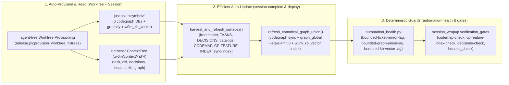

# AI-DLC & SDLC Multi-Layer Data Architecture Audit & `casey/just` Issue Triage

- **Date:** 2026-11-08
- **Ticket:** [[T683]]
- **Related:** [[T640]], [[T652]], [[T655]], [[T681]], [[T682]], `AgDR-0032`, `AgDR-0058`

---

## 1. Executive Summary

We audited every AI-DLC and SDLC data layer across `@wom` across all three operational phases (**Provision/Read**, **Auto-Update**, and **Guarded Verification**) and closed 6 concrete gaps:

---

## 2. AI-DLC & SDLC Data Layers Matrix (Before vs. After)

| Data Layer | Storage Location | Before Audit | After (`T683` / `T682`) |
|---|---|---|---|
| **Member Repo AST Graphs (`codegraph`)** | `<repo>/.codegraph/graph.db` (`6` repos) | Gitignored; missing in `agent-tree` worktrees; `just ask` only queried `3` repos (`w0m-web`, `w0m-api`, `w0m-cf`); canonical repos `Oct 26` stale after `git merge --ff-only`. | Provisioned into every `agent-tree` worktree (`release.py`); `just ask` + `.w0m/sdlc.json` cover all `6` repos; synced automatically on canonical fast-forward & `just codegraph-sync`. |
| **Semantic & Call Graphs (`graphify`)** | `<repo>/graphify-out/graph.json` + `~/.graphify/global-graph.json` | Gitignored; missing in `agent-tree` worktrees; `session_complete.py` used default `--stale-limit 10` leaving `6/7` repos `1..9` commits stale. | Provisioned into every `agent-tree` worktree; `refresh_canonical_graph_union()` and `_post-deploy-knowledge` pass `--stale-limit 0` so all `7` repos rebuild incrementally to `0` lag. |
| **Hybrid Vector + BM25 KB (`w0m_kb_vector.py`)** | `~/.w0m/knowledge-index/corpus.sqlite` (`128`-dim SVD + SQLite FTS5 RRF) | Lagged by `14` tickets (`667` vs `681`); not queried by `just ask` or `context_tree.py`; not refreshed on wrap-up; unguarded. | Queried automatically by `just ask` and `context_tree.py` (`kb/related.md`); re-indexed on `session-complete` and `_post-deploy-knowledge`; guarded by `bounded-kb-vector-lag` in `automation_health.py`. |
| **Harness² Evidence Bundle (`context_tree.py`)** | `.w0m/context/<ticket>/` | Rejected `DRAFT-<slug>` worktree tickets; only wrote `task.md`, `diff.patch`, and `decisions/related.md`; manual-only. | Supports both `T<N>` and `DRAFT-<slug>`; materializes `lessons/related.md`, `kb/related.md`, and `graph/symbols.md` with `EVIDENCE_BOUNDARY` headers; auto-triggered by `ticket_new.py`. |
| **Codemap & CP Feature Index** | `w0m-web/docs/CODEMAP.md`, `w0m-web/docs/CP-FEATURE-INDEX.md` | Omitted from `harvest_and_refresh_surfaces()` and `session_wrapup.verification_gates`. | Refreshed automatically in `harvest_and_refresh_surfaces()` and verified by `just codemap-check` + `just cp-feature-index-check` + `just decisions-check`. |
| **Ticket Frontmatter, `TASKS.md` & GitHub Sync Index** | `.tasks/T*.md`, `TASKS.md`, `w0m-web/project/tickets-sync-index.json` | `harvest_and_refresh_surfaces()` did not reconcile `tickets-sync-index.json` hashes after `sync_tickets_to_github()` wrote `gh_issue:` and `tasks_render.py` updated `TASKS.md` (`3/681` drift). | Re-runs `harvest_and_refresh_surfaces()` after `sync_tickets_to_github()` and reconciles `tickets-sync-index.json` hashes for synced tickets (`0/682` lag). |

---

## 3. Upstream `casey/just` Hot Issues Without Open PRs & Repository Policy (`casey/just#3227`)

### 3.1 Critical Upstream Repository Policy (`casey/just#3227`)
- **Upstream PRs are disabled repository-wide on `casey/just`:** In [`casey/just#3227`](https://github.com/casey/just/issues/3227) (*"Pull requests are disabled"*, 👍44), maintainer Casey Rodarmor disabled external pull requests at the GitHub repository level (citing agent-generated PR volume and preference for authoring/iterating changes directly from issues).
- **Governance Action Taken:** Registered `"casey/just"` in `scripts/w0m_prs.py` (`UPSTREAM_CONTRIBUTION_RULES` with `automation_mode: "banned"`, `max_open_prs: 0`) so `just pr-auto` / `just pr-compliance` enforces this boundary automatically (`AgDR-0058`).

### 3.2 Hottest & Newest Open Issues on `casey/just` (Zero Open PRs)

| Issue | Reactions / Comments | Updated | Category | Summary & Technical Root Cause |
|---|---:|---|---|---|
| **`#3773`** | 👍0 · 💬0 | **2026-11-08 (Today)** | Bug (`--fmt` / `--dump`) | **`--fmt` drops trailing comment on a recipe line:** When a recipe has a body (`b: a # comment`), `just --fmt` and `just --dump` silently delete `# comment` because `Parser::parse_recipe` consumes the comment token inside `expect_eol()` without emitting an AST field, whereas assignments/aliases/body-less recipes preserve trailing comments. |
| **`#2684`** | 👍28 · 💬10 | 2026-10-07 | Feature (`--usage` / `--list`) | **`just --usage` should support multi-line documentation comments:** Multi-line `#` doc blocks above a recipe are truncated or require `[doc(...)]` workarounds when rendering `--usage` help. |
| **`#2442`** | 👍25 · 💬15 | 2026-05-28 | `coveted` Feature | **Inline modules (`mod foo { ... }`):** Declare module namespaces inline inside a single `justfile` without requiring separate `foo.just` files. |
| **`#1500`** | 👍21 · 💬5 | 2026-06-28 | `coveted` Feature | **`just --list` should list fallback recipes:** When `set fallback` is enabled, `just --list` only shows current-directory recipes and hides parent fallback recipes. |
| **`#3271`** | 👍14 · 💬3 | 2026-04-11 | Feature (`attribute`) | **Attribute to require interactive terminal (`[interactive]` / `[not-interactive]`):** Guard recipes that require a TTY (`[ -t 1 ]`) declaratively via recipe attributes. |
| **`#3439`** | 👍13 · 💬14 | 2026-11-02 | `coveted` Tracking | **Cached recipe tracking issue (`[cache]`):** Follow-up enhancements for `[cache]` (added in `1.54.0`), including input file hashing and cache invalidation flags. |
| **`#1582`** | 👍11 · 💬22 | 2026-09-18 | `coveted` Feature | **Run subsequents on success or failure (post-recipe cleanup/teardown hooks):** Guarantee a teardown recipe runs even when the primary recipe exits non-zero. |
| **`#1885`** | 👍9 · 💬16 | 2026-11-06 | Feature (`import`) | **Support wildcard imports in justfiles (`import '.just/*.just'`):** Glob imports for modular `.just/` directories. |
| **`#1760`** | 👍5 · 💬4 | 2026-11-07 | Feature (`--fmt`) | **`just --fmt`: allow passing files to format:** Accept positional file paths in `just --fmt <file>...` for `treefmt` / `pre-commit` integration without `-f` per call. |
| **`#3699`** | 👍0 · 💬5 | 2026-11-07 | Feature (`groups`) | **Support hierarchical recipe groups (`[group: 'svc/db']`):** Nested group rendering in `just --list` for monorepos. |
| **`#3769`** | 👍0 · 💬0 | 2026-11-03 | Feature (`timeout`) | **Add per-recipe execution timeouts (`[timeout('30s')]`) and `--timeout` flag.** |
| **`#3770`** | 👍0 · 💬0 | 2026-11-03 | Feature (`parallel`) | **Add `[exclusive]` recipe attribute for interactive parallel execution.** |
| **`#3771`** | 👍0 · 💬0 | 2026-11-04 | Feature (`groups`) | **Support aliases for recipe groups.** |
